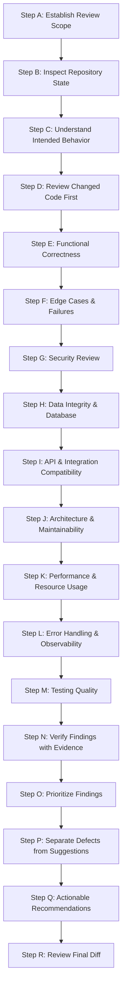

---
name: code-review
description: Reviews code changes, pull requests, and existing implementations for correctness defects, regressions, security weaknesses, data-integrity problems, API incompatibilities, performance issues, and maintainability risks. Use when inspecting staged or unstaged diffs, reviewing completed features, evaluating refactors, or assessing code quality before merging or releasing changes.
---

# Code Review Skill

This skill guides the AI coding agent to systematically inspect, evaluate, and review software changes, pull requests, and existing implementations. It identifies substantive correctness defects, regressions, security risks, data-integrity hazards, API incompatibilities, and maintainability concerns through evidence-based analysis and produces actionable, prioritized review feedback.

## 1. Purpose and Scope

Code review is a critical engineering quality gate that ensures changes are functionally correct, secure, maintainable, and backward-compatible. This skill ensures the agent systematically answers core code review questions:

- **What changed, and why was it changed?** Understand the intent, business value, user story, or defect being resolved.
- **Does the implementation satisfy the intended requirements?** Confirm the change fulfills acceptance criteria without missing cases.
- **Could the change introduce a functional defect or regression?** Trace logic, state transitions, and edge cases to detect bugs.
- **Are inputs, outputs, permissions, and errors handled correctly?** Ensure complete validation, authorization, and error handling.
- **Are there security or data-integrity concerns?** Audit for injection, broken object-level authorization (IDOR), or race conditions.
- **Could the change break existing APIs, schemas, or integrations?** Preserve public contracts, database models, and consumer stability.
- **Are there meaningful performance or resource-usage problems?** Identify N+1 queries, unbounded loading, memory leaks, or heavy locks.
- **Are architectural boundaries and conventions respected?** Ensure adherence to project layer separation and coding standards.
- **Which observations are actual defects vs. preferences?** Differentiate substantive bugs from optional stylistic suggestions.
- **How severe and actionable is each finding?** Assign calibrated severities (Critical, High, Medium, Low, Informational) with evidence.
- **What evidence supports each finding?** Reference specific file paths, line ranges, and reproducible execution paths.
- **What must be fixed before the change is accepted?** Provide clear, constructive, and architecture-aligned recommendations.

*Scope Boundary*: Focuses on inspecting, reviewing, and evaluating code. It does not replace feature implementation (handled by [backend-development](../backend-development/SKILL.md) and [frontend-development](../frontend-development/SKILL.md)), defect debugging (handled by [debugging](../debugging/SKILL.md)), or automated test execution (handled by [testing-qa](../testing-qa/SKILL.md)).

## 2. When to Use This Skill

### Trigger Scenarios

Activate this skill when:
- **Reviewing Completed Feature Implementations**: Evaluating newly authored code against acceptance criteria before task completion.
- **Reviewing Pull Requests & Proposed Merges**: Inspecting staged or unstaged Git diffs prior to merging or deployment.
- **Auditing Refactoring Changes**: Checking refactors to confirm behavior preservation, contract stability, and zero regressions.
- **Reviewing Shared Code Modifications**: Evaluating changes to base utilities, shared services, middleware, or core entities.
- **Checking API & Database Migrations**: Reviewing schema changes, endpoint additions, or response format updates for compatibility.
- **Reviewing Security-Sensitive Changes**: Inspecting authentication flows, permission guards, token handling, or sanitizers.
- **Pre-Release Quality Gates**: Performing final code verification before tagging releases or advancing milestones.
- **Peer Reviewing Agent-Generated Code**: Auditing code produced by subagents or parallel workflows for quality and convention alignment.

### When NOT to Use This Skill

Do not invoke this skill for:
- Writing feature business logic or implementing application routes without a review objective.
- Reproducing active bugs and developing patches (use [debugging](../debugging/SKILL.md)).
- Running deep vulnerability assessments and penetration testing (use [security-review](../security-review/SKILL.md)).
- Trivial one-line edits (e.g., fixing a typo in documentation) that do not alter application behavior.

## 3. Code Review Workflow

Follow this eighteen-step workflow (Steps A through R) when conducting a code review:

### Step A: Establish the Review Scope
- Identify the target diff, branch, pull request, or files to be reviewed.
- Clarify whether the review is an evaluation of new changes or a broader assessment of pre-existing code.
- Prioritize newly modified files and the surrounding modules necessary to understand their ripple effects.

### Step B: Inspect the Current Repository State
- Check Git status (`git status`, `git diff --staged`, `git diff`) to identify added, modified, renamed, or deleted files.
- Preserve uncommitted user changes. Never run destructive Git commands (`git reset --hard`, `git checkout .`) during review.
- If the repository has untracked changes, distinguish user work from agent-generated modifications. Follow [change-safety.md](../../rules/change-safety.md).

### Step C: Understand the Intended Behavior
- Review upstream specifications, user stories, PRD/SRS requirements, and architectural decisions.
- Understand what the code was doing before the change and what it is expected to do now.
- Avoid guessing intent; if requirements are ambiguous, state the assumption clearly in the review findings.

### Step D: Review the Changed Code First
- Focus on the actual diff before reading unrelated files across the repository.
- Examine surrounding context to understand variable lifecycles, imports, and downstream consumers.
- Check whether the implementation fulfills the stated requirement without superfluous code or scope creep.

### Step E: Review Functional Correctness
- Verify business logic, calculations, and state transitions against requirements.
- Check control flows: ensure conditions (`if/else`, `switch`) evaluate correctly and loop bounds terminate cleanly.
- Check data types, nullability, and empty states: ensure `null`, `undefined`, or empty arrays do not cause runtime errors.

### Step F: Review Edge Cases and Failure Behavior
- Audit boundary conditions: minimum/maximum values, zero inputs, off-by-one indices, and leap dates.
- Check missing or invalid inputs: verify rejection of malformed payloads before processing.
- Verify recovery: ensure partial failures or canceled operations leave application state consistent.

### Step G: Review Security
- Check server-side authorization: verify that every modified endpoint or service validates user permissions and ownership (IDOR).
- Audit injection risks: ensure SQL queries use parameterization and dynamic HTML is escaped/sanitized.
- Check secret safety: ensure no API keys, tokens, or private credentials are committed in code or tests. Follow [security.md](../../rules/security.md).

### Step H: Review Data Integrity and Database Behavior
- Check database mutations: ensure multi-table updates execute within atomic transactions.
- Review constraints and indexes: ensure foreign keys, unique indices, and check constraints match data models.
- Avoid N+1 queries: verify that queries batch-load or join related records rather than querying in loops. Follow [database.md](../../rules/database.md).

### Step I: Review API and Integration Compatibility
- Verify API contract preservation: ensure endpoint paths, parameters, response fields, and status codes remain backward-compatible.
- Check serialization: verify that Data Transfer Objects (DTOs) exclude internal columns and match OpenAPI specifications.
- Check external integrations: verify connect/read timeouts, circuit breakers, and bounded retry policies. Follow [api-design.md](../../rules/api-design.md).

### Step J: Review Architecture and Maintainability
- Verify single responsibility and layer separation: keep controllers thin, logic in services, and persistence in repositories.
- Check for unnecessary coupling, circular dependencies, or premature abstractions (YAGNI).
- Adhere to project naming conventions and directory organization. Follow [coding-standards.md](../../rules/coding-standards.md).

### Step K: Review Performance and Resource Usage
- Check algorithmic efficiency: avoid nested loops over large datasets or unindexed database lookups.
- Audit resource lifecycles: ensure database connections, file handles, and streams are closed reliably in `finally` blocks.
- Check bundle size impact: avoid importing massive libraries when small standard utilities suffice. Follow [performance-optimization.md](../../rules/performance-optimization.md).

### Step L: Review Error Handling and Observability
- Ensure errors are never silently swallowed with empty `catch` blocks or synthetic success returns (`200 OK` on error).
- Check that client error messages are sanitized while internal logs capture full diagnostic context with correlation IDs.
- Confirm that sensitive data (passwords, tokens, PII) is redacted from all log statements.

### Step M: Review Testing Quality
- Confirm that new business logic, endpoints, or bug fixes are accompanied by automated tests.
- Inspect test assertions: ensure tests assert observable outcomes and cannot pass if the underlying feature fails.
- Verify that existing tests were not deleted or relaxed merely to make a pipeline pass. Follow [testing.md](../../rules/testing.md).

### Step N: Verify Findings with Available Evidence
- Trace the code execution path to confirm that every reported defect is reachable under realistic conditions.
- Verify whether existing upstream middleware, schema validators, or database constraints already prevent the issue.
- Avoid duplicate findings: consolidate multiple symptoms originating from the same root cause into a single finding.

### Step O: Prioritize Findings
- Calibrate findings using standard severity levels:
  - **Critical**: Severe data loss, security compromise, or complete system crash requiring immediate blocking of merge.
  - **High**: Major functional defect, broken API contract, or significant security gap on core workflows.
  - **Medium**: Edge-case failure, missing validation, or moderate maintainability risk under specific conditions.
  - **Low**: Minor code quality gap, missing comment on complex logic, or non-critical hygiene issue.
  - **Informational**: Optional architectural suggestion or enhancement idea (not a blocking defect).

### Step P: Distinguish Findings from Suggestions
- Clearly separate blocking defects from optional refactoring suggestions and personal stylistic preferences.
- Never present subjective opinions as objective bugs. Accept alternative implementations if they are clean and functional.

### Step Q: Provide Actionable Recommendations
- For each finding, explain the problem concisely, reference the exact file/line, and provide a concrete, idiomatic code fix.
- Suggest specific verification tests to confirm the resolution.
- Prefer minimal, targeted adjustments over sweeping architectural redesigns.

### Step R: Review the Final Diff
- Perform a final pass over the diff to confirm that all feedback is grounded, accurate, and actionable.
- Ensure no accidental edits, leftover debug logs, or scratch files were introduced during review.

## 4. Code Review Output Format

Structure code reviews using this standardized, actionable format:

### 1. Review Summary
Executive overview summarizing the reviewed diff, overall assessment (Approved, Changes Requested, or Informational), and key highlights.

### 2. Substantive Findings

Present findings ordered by severity:

#### [High] Missing Tenant Isolation in Order Lookup
- **Location**: `src/services/order.service.ts:48-52`
- **Confidence**: Confirmed
- **Condition**: When a user queries an order by ID (`GET /api/v1/orders/:id`).
- **Evidence**: `const order = await orderRepo.findById(orderId); return order;` (Lacks `userId` filter).
- **Impact**: Any authenticated user can view other users' order details by guessing or enumerating order IDs (IDOR).
- **Recommendation**: Pass `userId` from the authenticated session and query `orderRepo.findByIdAndUser(orderId, userId)`.
- **Verification**: Add an integration test asserting `403 Forbidden` or `404 Not Found` when User A requests User B's order.

### 3. Additional Observations & Suggestions
Optional architectural suggestions or non-blocking improvements:
- *Observation*: Consider using `Promise.all` in `batchNotificationService.ts:12` to parallelize independent dispatch calls.

### 4. Verification Summary
Summary of automated checks executed or inspected:
- **Linter**: Passed cleanly (`npm run lint`)
- **Type Check**: Passed cleanly (`tsc --noEmit`)
- **Unit Tests**: 14 passed (`npm test -- order.test.ts`)
- **Manual Verification**: Inspected SQL query generation in `orderRepo.ts`.

### 5. Overall Assessment
Final recommendation on whether the change is ready for merge, requires fixes, or needs further discussion.

## 5. Review Finding Quality Standards

Every substantive finding must meet these engineering criteria:

- **Evidence-Based**: Point to concrete code lines, control flows, and inputs; never speculate without code evidence.
- **Actionable**: Include a clear, practical recommendation that a developer can implement immediately.
- **Defensible Severity**: Calibrate severity based on real impact and likelihood; avoid severity inflation for minor nits.
- **Root-Cause Focused**: Group related failure points under the single underlying defect rather than spamming duplicate findings.
- **Respectful & Constructive**: Focus on code mechanics, data flows, and architectural contracts rather than personal critique.

## 6. Review-Only and Remediation Boundaries

- **Read-Only by Default**: Code review is strictly an evaluative, analytical process. Do not modify application code during a review.
- **No Unsolicited Fixes**: Provide code recommendations in review comments; let the author implement them unless explicitly requested.
- **Preserve Git History**: Do not create commits, push branches, or alter Git status unless authorized.
- **Explicit Remediation Hand-off**: If the user requests both review and remediation, complete the review report first, then proceed with targeted edits under [change-safety.md](../../rules/change-safety.md).

## 7. New Code vs. Existing Code

### Reviewing New Code
- Verify that new components adhere strictly to project conventions, types, and testing standards.
- Check for complete error handling, edge cases, and backward compatibility with consuming modules.
- Ensure new dependencies are justified and existing shared utilities are reused.

### Reviewing Existing Code
- Distinguish pre-existing legacy issues from regressions introduced by the current diff.
- Do not block a feature pull request for pre-existing defects in adjacent code unless the change worsens them.
- File separate technical debt notes for pre-existing issues rather than conflating them with the current PR review.

## 8. Avoid Duplication with Other Skills and Rules

This skill operates in direct alignment with project rules and complementary skills:

- [coding-standards.md](../../rules/coding-standards.md): Defines naming conventions, readability, single responsibility, and error handling.
- [change-safety.md](../../rules/change-safety.md): Mandates minimal blast radius, surgical diffs, and protection of user work.
- [debugging](../debugging/SKILL.md): Investigates, reproduces, and fixes confirmed bugs.
- [testing-qa](../testing-qa/SKILL.md): Designs and executes automated test suites across all testing levels.
- [security-review](../security-review/SKILL.md): Conducts in-depth vulnerability assessments and threat modeling.
- [backend-development](../backend-development/SKILL.md) & [frontend-development](../frontend-development/SKILL.md): Implement features according to review standards.
- [api-design.md](../../rules/api-design.md): Governs API contract compatibility and response serialization.
- [database.md](../../rules/database.md): Governs query safety, schema integrity, and transaction boundaries.
- [performance-optimization.md](../../rules/performance-optimization.md): Governs performance profiling and bottleneck elimination.
- [documentation.md](../../rules/documentation.md): Directs documentation standards for public interfaces and change logs.

## 9. Final Validation Checklist

Before concluding any code review, verify each item:

- [ ] **Scope Respected**: Are findings focused on the requested diff and directly affected modules?
- [ ] **Evidence Grounded**: Is every finding supported by specific code lines and demonstrable conditions?
- [ ] **Defect vs. Preference**: Are objective bugs clearly distinguished from optional style suggestions?
- [ ] **Defensible Severity**: Are severity ratings calibrated to actual impact without inflation?
- [ ] **Actionable Guidance**: Does each finding provide a concrete, framework-aligned remediation path?
- [ ] **Read-Only Discipline**: Was application code left unmodified during the review?
- [ ] **User Work Protected**: Are uncommitted user modifications completely preserved?
- [ ] **Honest Assessment**: Does the review summary reflect genuine inspection without fabricated claims?
