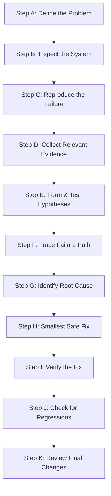
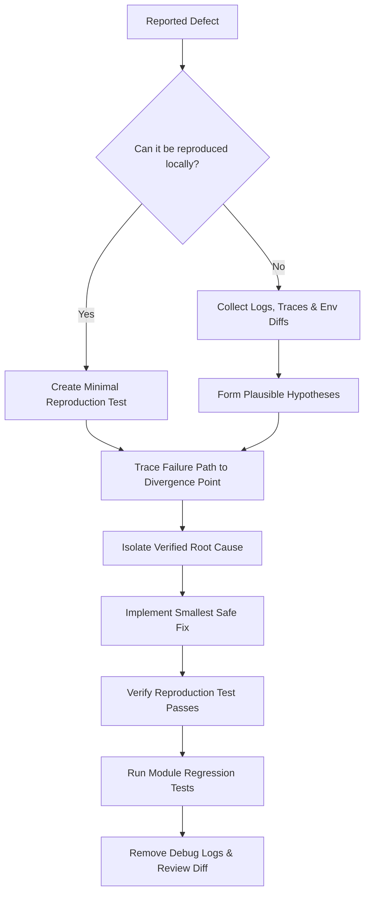

---
name: debugging
description: Investigates software bugs, runtime errors, failing tests, unexpected behavior, configuration problems, API failures, database issues, and intermittent defects. Use when reproducing a problem, analyzing logs or stack traces, finding root causes, implementing targeted fixes, or verifying that a defect has been resolved.
---

# Debugging Skill

This skill guides the AI coding agent to systematically troubleshoot, diagnose, isolate, fix, and verify software failures. It transforms raw error symptoms into confirmed root causes, develops minimal targeted fixes, prevents regressions, and maintains change safety across all layers of the stack.

## 1. Purpose and Scope

Debugging is the empirical discipline of identifying why software deviates from expected behavior and resolving the defect with minimal disruption. This skill ensures the agent systematically addresses core troubleshooting questions:

- **What exactly is failing?** Differentiate between the observed symptom, error manifestation, and underlying failure path.
- **What behavior was expected vs. observed?** Compare actual outputs, state transitions, or status codes against requirements.
- **Can the problem be reproduced?** Isolate the minimal, deterministic reproduction scenario before modifying application code.
- **Which evidence supports the investigation?** Examine stack traces, application logs, network traces, query outputs, and test failures.
- **Which code paths or configurations cause the failure?** Trace execution from entry point through state mutations to the failing sink.
- **What is the confirmed root cause?** Distinguish the true underlying flaw from secondary symptoms or upstream triggers.
- **How can competing hypotheses be tested?** Design targeted diagnostic checks that disprove competing explanations one by one.
- **What is the smallest safe fix?** Implement a surgical, architecture-aligned repair without broad rewrites or unrelated refactoring.
- **How can the fix be verified?** Execute reproduction tests confirming the defect is resolved without merely suppressing errors.
- **What related functionality could regress?** Audit dependent routes, shared utilities, data contracts, and adjacent test suites.
- **Which uncertainties remain unresolved?** Disclose unverified edge cases, environmental dependencies, or external blockers honestly.

*Scope Boundary*: Focuses on defect investigation, diagnosis, root-cause isolation, and targeted verification. It does not replace feature implementation (handled by [backend-development](../backend-development/SKILL.md) and [frontend-development](../frontend-development/SKILL.md)), broad testing strategy (handled by [testing-qa](../testing-qa/SKILL.md)), or performance profiling (handled by [performance-optimization.md](../../rules/performance-optimization.md)).

## 2. When to Use This Skill

### Trigger Scenarios

Activate this skill when:
- **Investigating Runtime Exceptions & Crashes**: Diagnosing unhandled errors, panic aborts, null pointer exceptions, or memory faults.
- **Diagnosing Broken Automated Tests**: Identifying why existing or newly added tests fail in local or CI environments.
- **Troubleshooting Backend & API Failures**: Investigating unexpected 4xx/5xx HTTP codes, failed serialization, or timeout errors.
- **Resolving Frontend UI & Interaction Glitches**: Diagnosing broken component state, missing re-renders, layout breaks, or event failures.
- **Fixing Database Query & Migration Errors**: Investigating constraint violations, deadlock conflicts, or transaction rollbacks.
- **Troubleshooting Build & Dependency Defects**: Resolving compiler errors, missing modules, broken imports, or package mismatches.
- **Diagnosing Intermittent & Concurrency Bugs**: Investigating race conditions, promise timing bugs, or environment-dependent issues.
- **Isolating Regressions**: Pinpointing root causes of defects introduced by recent commits or refactoring tasks.

### When NOT to Use This Skill

Do not invoke this skill for:
- Greenfield feature implementation without existing errors or broken behavior.
- Proactive security auditing without a defect report (use [security-review](../security-review/SKILL.md)).
- General refactoring or code cleanup that does not target an active defect.
- Performance optimization of working, correct code without a defect report.

## 3. Debugging Workflow

Follow this eleven-step diagnostic workflow (Steps A through K) when investigating and fixing software failures:



### Step A: Define the Problem
- Identify the exact symptom, error message, failing endpoint, or broken workflow.
- Contrast expected behavior with observed behavior. Note triggering actions, inputs, and environmental constraints.
- Avoid assuming the user's initial hypothesis is accurate; treat it as an unverified clue until verified by evidence.

### Step B: Inspect the Existing System
- Review relevant source code, configuration files, package manifests, and recent Git changes in the affected area.
- Trace established architecture, shared utilities, and error-handling conventions.
- Check whether similar functionality works correctly elsewhere in the codebase to identify working reference patterns.

### Step C: Reproduce the Failure
- Construct the minimal reproduction scenario: a failing unit test, a localized script, or a concise CLI command.
- Confirm whether the failure is deterministic, intermittent, or environment-specific.
- Never claim an issue is reproduced or unreproducible without actual execution; avoid modifying production data during reproduction.

### Step D: Collect Relevant Evidence
- Gather concrete diagnostics: stack traces, server logs, browser console output, HTTP payloads, and database query logs.
- Inspect exact file names and line numbers where exceptions trigger.
- Redact sensitive data: never include real credentials, API keys, or private user data in logs or debugging notes.

### Step E: Form and Test Hypotheses
- Formulate testable explanations explaining how the observed inputs lead to the failure through the code path.
- Test one hypothesis at a time using targeted diagnostic logs or focused test assertions.
- Eliminate disproven explanations immediately; do not apply random code mutations in the hope that something works.

### Step F: Trace the Failure Path
- Trace data flow from ingress boundary (request/event) through middleware, domain services, and persistence sinks.
- Identify the exact point where state or execution diverges from expected invariants.
- Verify whether the issue originates in the reported module or stems from invalid upstream data or unhandled edge cases.

### Step G: Identify the Root Cause
- Articulate the root cause clearly: what code assumption, missing validation, concurrency flaw, or configuration error created the bug.
- Distinguish the root cause from secondary symptoms (e.g., a `NullPointerException` is a symptom; missing record validation is the cause).
- Confirm that resolving the root cause will eliminate the symptom permanently across all callers.

### Step H: Develop the Smallest Safe Fix
- Design a surgical fix targeted directly at the root cause, adhering strictly to existing architecture and coding conventions.
- Never suppress errors with empty `catch` blocks, fake success responses, or loosened validation to make errors disappear.
- Avoid broad refactoring, formatting changes, or unrelated cleanups within the debugging diff. Follow [change-safety.md](../../rules/change-safety.md).

### Step I: Verify the Fix
- Re-run the reproduction test or command created in Step C to confirm that the failure is completely resolved.
- Verify that the fix handles boundary cases, empty states, and invalid inputs gracefully.
- Confirm that the fix does not mask or relocate the failure to a downstream component.

### Step J: Check for Regressions
- Execute existing automated test suites across the affected module and dependent services (`npm test`, `pytest`).
- Check public contracts: ensure method signatures, API response structures, and status codes remain backward-compatible.
- Run type checks and linters (`tsc --noEmit`, `npm run lint`) to confirm code hygiene.

### Step K: Review the Final Changes
- Review the complete Git diff: remove all temporary `console.log` statements, debugging flags, and test scratch files.
- Verify that user changes were preserved and no unrelated files were touched.
- Document the confirmed root cause, applied remediation, and verification evidence concisely.

## 4. Specialized Debugging Scenarios

Apply targeted diagnostic techniques for specific defect categories:

### A. Frontend and UI Bugs
- **State & Props Drift**: Inspect React/Vue dev tools, component re-render triggers, and state mutation immutability.
- **Event & Form Handling**: Verify event listener bindings, form submission interceptors (`preventDefault`), and validation state.
- **Asynchronous UI Updates**: Check for race conditions in fast successive requests, unmounted component updates, and missing loading states.
- **Layout & CSS**: Inspect viewport overflow, flex/grid alignment, and specificity conflicts using computed styles.

### B. Backend and Runtime Errors
- **Unhandled Exceptions**: Trace the full stack trace to the primary failure frame; inspect variable values at the point of failure.
- **Middleware Ordering**: Check whether auth, body-parsing, or CORS middleware execute in the required logical sequence.
- **Resource Exhaustion**: Check for unclosed file handles, database connection leaks, or runaway memory allocation in loops.

### C. API Integration Failures
- **Payload & Header Mismatches**: Log and verify outgoing HTTP headers, `Content-Type`, auth tokens, and serialized JSON payloads.
- **Status Code Semantics**: Check whether upstream API errors (401, 403, 404, 429, 502) are parsed and handled gracefully.
- **Timeouts & Retries**: Verify connect/read timeouts and ensure non-idempotent mutations (payments) are not blindly retried.

### D. Database and Data-Integrity Bugs
- **Query & Parameter Errors**: Inspect raw generated SQL, parameter bindings, and query execution plans.
- **Transaction Rollbacks**: Confirm that multi-statement mutations roll back cleanly on errors without leaving orphan records.
- **Constraint Violations**: Verify foreign key integrity, unique index conflicts, and nullability mismatches before persistence.

### E. Build and Dependency Problems
- **Module Resolution**: Check `package.json`, lockfile consistency, `node_modules`, and TypeScript path aliases (`tsconfig.json`).
- **Target & Runtime Mismatch**: Confirm runtime version compatibility (Node.js, Python, JVM) and transpilation targets.
- **Clean Cache Discipline**: Test targeted cache clearing only when concrete evidence indicates corrupted build artifacts.

### F. Configuration and Environment Problems
- **Missing Environment Variables**: Verify presence and type of required variables without printing secret values to logs.
- **Path & OS Discrepancies**: Guard against hardcoded POSIX `/` vs Windows `\` path separators; use path resolution utilities.
- **Environment Isolation**: Compare development, staging, and production configurations to identify divergence.

### G. Asynchronous and Concurrency Bugs
- **Missing Awaits**: Check for unawaited Promises, unhandled Promise rejections, or fire-and-forget background operations.
- **Race Conditions**: Identify shared mutable state across concurrent requests; introduce row locks or optimistic locking.
- **Deadlocks**: Ensure lock acquisition order is consistent across all transactions.

### H. Performance-Related Bugs
- **Query Bottlenecks (N+1)**: Identify repetitive queries inside loops; apply eager loading or batching.
- **Event Loop Blocking**: Check for synchronous file I/O, heavy JSON parsing, or CPU-intensive algorithms on request threads.
- **Memory Growth**: Trace long-lived caches, uncleared intervals, or event listener leaks. Follow [performance-optimization.md](../../rules/performance-optimization.md).

### I. Intermittent and Hard-to-Reproduce Bugs
- **Timing & Network Jitter**: Introduce controlled stress tests or network throttling to expose timing vulnerabilities.
- **Shared State Contamination**: Check whether test order dependence or singleton state leakage causes random failures.
- **Instrumentation**: Add structured diagnostic logging around critical state transitions to capture evidence on occurrence.

### J. Security-Sensitive Bugs
- **Access Control Gaps**: Check if missing ownership checks allow unauthorized resource manipulation (IDOR).
- **Injection Flaws**: Trace unsanitized user inputs reaching SQL queries, shell commands, or HTML sinks.
- **Safe Containment**: Follow [security.md](../../rules/security.md); avoid testing live exploits against production.

## 5. Debugging Decision Tree

Use this decision logic to guide your diagnostic strategy:



- **Failing Automated Test**: Inspect assertion diff and expected vs. actual values before touching code.
- **Runtime Stack Trace**: Locate top application frame, inspect variables at failure point, and verify preconditions.
- **API/Endpoint Failure**: Inspect request parameters, auth context, service delegation, and response status code.
- **Database Query Error**: Inspect parameterized SQL, schema constraints, transaction boundaries, and lock contention.
- **Intermittent Bug**: Examine concurrency locks, promise resolution timing, and shared mutable state.

## 6. Standard Debugging Investigation Blueprint

Every professional bug investigation follows a reproducible cycle: authoring a failing test, identifying the exact root cause, applying the surgical fix, and verifying resolution:

```typescript
// 1. Minimal Reproduction Test (Fails on unpatched code)
describe('Bug Repro: LoanService due date calculation on leap years', () => {
  it('should correctly calculate 14-day loan across Feb 28 on leap year', () => {
    const loanService = new LoanService();
    const startDate = new Date('2024-02-20T00:00:00Z'); // 2024 is a leap year

    const dueDate = loanService.calculateDueDate(startDate, 14);

    // Expected: March 5, 2024 (20 + 14 = 34 - 29 days in Feb = Mar 5)
    // Observed Bug: Returns March 6 because it hardcoded 28 days for February
    expect(dueDate.toISOString().split('T')[0]).toBe('2024-03-05');
  });
});

// 2. Surgical Root-Cause Fix (Inside LoanService.ts)
// BEFORE (Buggy):
// const daysInMonth = month === 1 ? 28 : standardDays[month];

// AFTER (Surgical Fix using native Date math):
export class LoanService {
  calculateDueDate(startDate: Date, durationDays: number): Date {
    const dueDate = new Date(startDate.getTime());
    dueDate.setUTCDate(dueDate.getUTCDate() + durationDays);
    return dueDate;
  }
}
```

## 7. Debugging Output Format

For substantial debugging investigations, document findings using this structured format:

### 1. Problem Summary
Clear description of the observed defect, triggering conditions, and expected vs. actual behavior.

### 2. Reproduction Status
- **Status**: Deterministic / Intermittent / Environment-Specific / Unreproducible
- **Reproduction Command**: `npm test -- -t "LoanService due date"`

### 3. Evidence & Stack Trace
Key log lines, error codes, and stack trace frames isolating the failure point.

### 4. Root Cause Analysis
Technical explanation of why the failure occurred, what code path was affected, and which invariant was violated.

### 5. Fix Applied
Summary of the surgical fix implemented, referencing touched files and lines.

### 6. Verification Results
Summary of tests executed, confirming the reproduction test passes and all regression suites succeed.

### 7. Regression Risks & Unresolved Items
Assessment of adjacent components verified and any external dependencies or assumptions remaining.

## 8. Safety and Change-Control Requirements

- **Preserve User Modifications**: Never run `git reset --hard` or overwrite untracked user files as a debugging shortcut.
- **Read-Only First**: Use read-only commands and non-destructive inspection before applying code edits.
- **No Test-Bypassing Hacks**: Never delete tests, comment out assertions, or return mock data to make tests pass.
- **Zero Production Risk**: Never run destructive drop/truncate commands or execute untested scripts against real databases.
- **Clean Diff Discipline**: Remove all temporary `console.log` statements and scratch files before concluding.

## 9. Avoid Duplication with Other Skills and Rules

This skill operates in direct alignment with project rules and complementary skills:

- [change-safety.md](../../rules/change-safety.md): Mandates minimal blast radius, surgical diffs, and protection of user work.
- [core-workflow.md](../../rules/core-workflow.md): Establishes the inspect-first, plan, execute, and verify workflow.
- [testing.md](../../rules/testing.md) & [testing-qa](../testing-qa/SKILL.md): Provide test harness conventions, regression testing protocols, and assertion strategies.
- [backend-development](../backend-development/SKILL.md): Implements server-side fixes for controllers, services, and repositories.
- [frontend-development](../frontend-development/SKILL.md): Implements UI fixes for components, state, and client-side interactions.
- [api-development](../api-development/SKILL.md): Resolves endpoint, serialization, and integration contract errors.
- [security-review](../security-review/SKILL.md): Audits security defects, access control failures, and vulnerability remediations.
- [performance-optimization.md](../../rules/performance-optimization.md): Governs profiling, query optimization, and memory leak analysis.
- [documentation.md](../../rules/documentation.md): Directs accurate documentation of defect resolutions and changelogs.

## 10. Final Validation Checklist

Before concluding any debugging task, verify each item:

- [ ] **Problem Clear**: Are the symptom, expected behavior, and observed failure explicitly defined?
- [ ] **Root Cause Confirmed**: Is the underlying defect understood rather than merely treating symptoms?
- [ ] **Minimal Safe Fix**: Is the change surgical and confined strictly to the files necessary to fix the root cause?
- [ ] **No Error Suppression**: Are errors resolved properly without empty catch blocks or fake success responses?
- [ ] **Reproduction Verified**: Does the reproduction test or command confirm that the bug is completely resolved?
- [ ] **Regression Clean**: Do all existing unit, integration, and linting checks pass with zero regressions?
- [ ] **Diff Cleaned**: Are all temporary debugging statements, logs, and scratch files removed?
- [ ] **User Work Preserved**: Are all existing user modifications and unrelated files completely intact?
