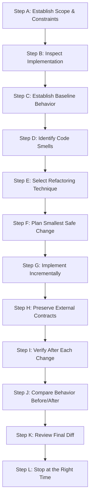

---
name: refactoring
description: Improves the internal structure, readability, maintainability, modularity, and organization of existing code while preserving intended external behavior. Use when simplifying complex functions, reducing duplication, extracting responsibilities, improving naming, restructuring modules, or safely cleaning up technical debt without changing requirements or adding unrelated features.
---

# Refactoring Skill

This skill guides the AI coding agent to safely, incrementally, and systematically improve the internal structure, readability, testability, and maintainability of existing code while strictly preserving its observable external behavior.

## 1. Purpose and Core Principles

Refactoring cleans and reorganizes software without altering its functional contracts. This skill ensures the agent adheres to three core engineering principles:

### Behavior Preservation
- The primary goal is structural improvement with **zero intentional alteration** to established behavior, public APIs, database integrity, error states, or user experience.
- Understand what the code does, why it exists, which callers depend on it, and what tests validate it before changing a single line.
- If a pre-existing defect is uncovered during refactoring, distinguish it clearly from the refactoring task. Do not silently change behavior; report the issue separately.

### Small, Controlled Changes
- Refactor incrementally in small, focused steps rather than executing broad, sweeping rewrites.
- Keep each intermediate change coherent, compileable, testable, and independently reversible.
- Stop when the targeted structural improvement is achieved; avoid unrequested refactoring of adjacent modules.

### Evidence-Based Improvement
- Refactor only to solve demonstrated code smells and concrete maintainability bottlenecks—never for subjective aesthetic preference.
- Target clear issues: duplicated domain logic, deeply nested control flows, oversized functions, unclear naming, or tight coupling.

*Scope Boundary*: Focuses strictly on behavior-preserving code restructuring. It does not replace feature development, defect debugging (handled by [debugging](../debugging/SKILL.md)), broad architecture redesign (handled by [architecture-design](../architecture-design/SKILL.md)), or performance profiling (handled by [performance-optimization.md](../../rules/performance-optimization.md)).

## 2. When to Use This Skill

### Trigger Scenarios

Activate this skill when:
- **Simplifying Complex Functions**: Decomposing monolithic, multi-branching functions into focused, readable routines.
- **Eliminating Duplicated Code**: Consolidating duplicate calculations, validations, or transformations into reusable helpers.
- **Clarifying Naming & Intent**: Renaming ambiguous variables, functions, or types to express domain business concepts clearly.
- **Separating Tangled Responsibilities**: De-coupling business rules from transport controllers, UI rendering, or database queries.
- **Reducing Excessive Nesting**: Replacing deeply nested `if/else` ladders with early returns and guard clauses.
- **Improving Testability**: Extracting dependencies and parameters so business logic can be unit-tested without complex mocks.
- **Removing Verified Dead Code**: Safely deleting unreachable methods, obsolete flags, and unused imports after verifying zero consumers.
- **Post-Feature Code Cleanup**: Cleaning up temporary scaffolding, duplicate logic, or prototype shortcuts after feature completion.

### When NOT to Use This Skill

Do not invoke this skill for:
- Implementing new business features or changing functional requirements.
- Fixing functional bugs or altering incorrect business calculations (use [debugging](../debugging/SKILL.md)).
- Rewriting entire application subsystems or migrating frameworks from scratch.
- Purely cosmetic reformatting (use existing configured linters/formatters like Prettier/ESLint).

## 3. Refactoring Workflow

Follow this twelve-step workflow (Steps A through L) when executing any refactoring task:



### Step A: Establish Scope and Constraints
- Identify the explicit refactoring target: specific files, functions, modules, or components.
- Establish architectural constraints: framework versions, public API contracts, and database schema compatibility.
- Bound the blast radius strictly to the requested area; refuse unrequested creep into adjacent modules.

### Step B: Inspect the Existing Implementation
- Read the target code and trace its callers, dependencies, imports, and existing tests.
- Understand the existing architecture: layer separation, dependency flow, and framework idioms.
- Distinguish between true duplication (shared domain rules) and coincidental structural similarity.

### Step C: Establish Existing Behavior
- Identify normal execution paths, boundary conditions, edge cases, error states, and side effects.
- Run existing test suites to establish an empirical baseline before editing.
- If coverage is missing, write a focused **characterization test** capturing current behavior before refactoring.

### Step D: Identify the Specific Refactoring Opportunity
- Target concrete code smells: long functions (>50 lines), excessive cyclomatic complexity, parameter bloat (>4 params), or low cohesion.
- Evaluate whether the problem is genuine and whether a small refactor provides most of the maintainability benefit.

### Step E: Select an Appropriate Refactoring Technique
- Select the simplest proven technique: Extract Function, Inline Function, Rename Symbol, Replace Nested Conditional with Guard Clauses, Extract Variable, or Consolidate Duplication.
- Avoid introducing complex design patterns, factories, or indirection layers without demonstrated architectural necessity.

### Step F: Plan the Smallest Safe Change
- Break the refactoring into small, logically coherent steps that can be reviewed in a clean diff.
- Identify the exact functions to move, rename, or extract and anticipate downstream impact.

### Step G: Implement Incrementally
- Apply changes in small, discrete steps. Keep code compiling and tests passing after every step.
- Preserve all logging, error-handling semantics, security checks, and transaction boundaries.
- Respect project coding conventions and avoid reformatting unrelated files. Follow [coding-standards.md](../../rules/coding-standards.md).

### Step H: Preserve External Contracts
- Keep public API endpoints, exported function signatures, and component props backward-compatible.
- Preserve database schemas, active record conventions, and serialization shapes consumed by frontends.
- Ensure error formats, status codes, and exception types remain identical for calling consumers.

### Step I: Verify After Each Meaningful Change
- Run targeted unit and integration tests after each incremental step.
- Run type checkers (`tsc --noEmit`) and linters to verify zero compiler or linting regressions.
- If a test fails, investigate immediately; never modify the test to match a broken refactor.

### Step J: Compare Behavior Before and After
- Compare inputs, outputs, return types, exceptions, and side effects against the Step C baseline.
- Ensure that observable behavior is identical across happy paths, boundary inputs, and error states.

### Step K: Review the Final Diff
- Review the complete Git diff (`git diff`): verify that every modified line serves the refactoring goal.
- Remove temporary debugging instrumentation, test logs, and unused scratch files.
- Verify that uncommitted user work was preserved completely. Follow [change-safety.md](../../rules/change-safety.md).

### Step L: Stop at the Right Time
- Conclude the task as soon as the structural objective is achieved and tests pass.
- Resist the temptation to perform endless rounds of speculative cleanup.

## 4. Distinguish Refactoring from Other Work

| Activity | Primary Goal | Preserves Behavior? | Governed By |
|---|---|---|---|
| **Refactoring** | Improve internal code structure and maintainability | **Yes, strictly** | This Skill & [change-safety.md](../../rules/change-safety.md) |
| **Feature Development** | Add new business functionality or capabilities | No (adds behavior) | [backend-development](../backend-development/SKILL.md) / [frontend-development](../frontend-development/SKILL.md) |
| **Bug Fixing** | Correct defective behavior to match requirements | No (fixes behavior) | [debugging](../debugging/SKILL.md) |
| **Code Review** | Evaluate changes and produce actionable findings | Read-only | [code-review](../code-review/SKILL.md) |
| **Performance Tuning** | Optimize throughput, latency, or memory usage | Yes | [performance-optimization.md](../../rules/performance-optimization.md) |
| **Architecture Redesign** | Alter core module boundaries or storage tiers | Broad changes | [architecture-design](../architecture-design/SKILL.md) |

## 5. Risk Management and Change Safety

- **Inspect Git State**: Run `git status` before touching files; preserve all uncommitted user work.
- **Never Run Destructive Commands**: Prohibit `git reset --hard`, `git checkout .`, or dropping databases as refactoring shortcuts.
- **Zero Inadvertent Deletions**: Before deleting unused code, verify that it is not invoked dynamically via reflection, routes, or configuration.
- **Never Weaken Safeguards**: Refactoring must never relax validation, bypass authentication, suppress error handling, or drop database constraints.
- **No Unsolicited Dependencies**: Use existing language standard libraries and project utilities; do not install new packages without approval.

## 6. Testing Strategy

Ensure high empirical confidence across the refactoring lifecycle:

1. **Characterization Tests**: When refactoring legacy code lacking tests, author a baseline test asserting existing behavior before modifying code.
2. **Unit Tests**: Execute fast unit tests covering extracted functions, boundary values, and domain logic.
3. **Integration Tests**: Verify database queries, transactions, and service orchestration remain functional.
4. **Static Verification**: Execute type checks (`tsc --noEmit`) and linters (`npm run lint`) to confirm contract preservation.
5. **No Blind Snapshot Updates**: If a UI or test snapshot changes, investigate why; never blindly update snapshots without proving equivalence. Follow [testing-qa](../testing-qa/SKILL.md).

## 7. Refactoring Examples and Decision Guidance

### Example A: Replace Deeply Nested Conditionals with Guard Clauses

**Problem**: Deeply nested logic obscures primary flow and increases cognitive complexity.
```typescript
// BEFORE: Deeply nested control flow
export function calculateLateFee(loan: Loan, returnDate: Date): number {
  let fee = 0;
  if (loan.status === 'ACTIVE') {
    if (returnDate > loan.dueDate) {
      const diffDays = Math.ceil((returnDate.getTime() - loan.dueDate.getTime()) / (1000 * 3600 * 24));
      if (loan.memberType === 'VIP') {
        fee = diffDays * 0.5;
      } else {
        fee = diffDays * 1.0;
      }
    }
  }
  return fee;
}

// AFTER: Flat guard clauses and extracted rate calculation (Preserves exact behavior)
export function calculateLateFee(loan: Loan, returnDate: Date): number {
  if (loan.status !== 'ACTIVE' || returnDate <= loan.dueDate) {
    return 0;
  }
  const diffDays = Math.ceil((returnDate.getTime() - loan.dueDate.getTime()) / 86_400_000);
  const dailyRate = loan.memberType === 'VIP' ? 0.5 : 1.0;
  return diffDays * dailyRate;
}
```
*Why this is a refactor*: Observable return values are identical for all inputs; control flow is flattened from 4 levels to 1.

### Example B: Extract Duplicate Transformation Logic

**Problem**: Identical ISBN formatting and validation logic is duplicated across three route handlers.
```typescript
// Solution: Extract shared helper into dedicated domain utility
export function normalizeIsbn(rawIsbn: string): string {
  const cleaned = rawIsbn.replace(/[-\s]/g, '').toUpperCase();
  if (!isValidIsbnFormat(cleaned)) {
    throw new ValidationError(`Invalid ISBN format: ${rawIsbn}`);
  }
  return cleaned;
}
```
*Verification*: All 3 consuming routes call `normalizeIsbn`; unit tests confirm identical normalization and exception behavior.

## 8. Expected Completion Report Format

When completing an authorized refactoring task, provide a concise summary:

### 1. Refactoring Summary
Describe the structural improvements achieved (e.g., flattened control flow, extracted shared utilities, reduced coupling).

### 2. Files Changed
- `src/services/loan.service.ts`: Flattened nested conditionals; extracted `calculateLateFee`.
- `src/utils/isbn.ts`: Consolidated duplicate ISBN formatting logic.

### 3. Behavior Preservation
Confirm that all public contracts, return types, validation checks, and error envelopes were preserved without change.

### 4. Verification Results
- **Unit Tests**: 18 passed (`npm test -- loan.test.ts`)
- **Type Check**: Passed cleanly (`tsc --noEmit`)
- **Linter**: Zero warnings (`npm run lint`)

### 5. Remaining Risks & Recommendations
Note any unverified edge cases or separate technical debt opportunities outside the current scope.

## 9. Avoid Duplication with Existing Skills and Rules

This skill operates in direct alignment with project rules and complementary skills:

- [change-safety.md](../../rules/change-safety.md): Mandates minimal blast radius, surgical diffs, and protection of user work.
- [coding-standards.md](../../rules/coding-standards.md): Establishes naming, readability, single responsibility, and error handling standards.
- [code-review](../code-review/SKILL.md): Evaluates code changes and audits refactors for quality.
- [debugging](../debugging/SKILL.md): Investigates and fixes functional defects (keeps bug fixes separate from refactoring).
- [testing-qa](../testing-qa/SKILL.md): Plans and executes automated tests and characterization test suites.
- [security-review](../security-review/SKILL.md): Audits security controls to ensure refactoring does not weaken defenses.
- [architecture-design](../architecture-design/SKILL.md): Governs major subsystem boundaries and structural redesigns.
- [performance-optimization.md](../../rules/performance-optimization.md): Governs profiling and performance improvements.
- [documentation.md](../../rules/documentation.md): Directs accurate documentation updates when structure evolves.

## 10. Final Validation Checklist

Before concluding any refactoring task, verify each item:

- [ ] **Behavior Preserved**: Is observable behavior identical across happy paths, edge cases, and error states?
- [ ] **Small & Focused**: Are changes surgical and confined strictly to the requested refactoring scope?
- [ ] **No Hidden Bug Fixes**: Are functional fixes kept separate from structural improvements?
- [ ] **Public Contracts Intact**: Are API endpoints, exported functions, and database schemas preserved?
- [ ] **Automated Tests Pass**: Do all unit, integration, and characterization tests pass without modifications?
- [ ] **Static Checks Clean**: Are type checks (`tsc --noEmit`) and linters completely error-free?
- [ ] **Diff Cleaned**: Are temporary debugging statements, test logs, and scratch files removed?
- [ ] **User Work Preserved**: Are all uncommitted user modifications completely intact?
