---
name: security-review
description: Reviews application code, architecture, APIs, authentication, authorization, database access, dependencies, configuration, file handling, and data flows for potential security vulnerabilities. Use when conducting security reviews, investigating suspected vulnerabilities, assessing security-sensitive changes, evaluating dependency risks, prioritizing findings, or preparing remediation recommendations. Reviews implemented code and configuration for vulnerabilities; for design-time threat analysis of a new feature or architecture, use threat-modeling.
---

# Security Review Skill

This skill guides the AI coding agent to systematically evaluate application source code, architecture, APIs, authentication, access controls, database queries, dependencies, configuration, and data flows. It identifies security vulnerabilities through evidence-based analysis and produces actionable, prioritized remediation guidance.

## 1. Purpose and Scope

Defensive security reviews identify design weaknesses, implementation flaws, and configuration exposures before systems are compromised. This skill ensures the agent systematically addresses core security questions:

- **What assets and trust boundaries require protection?** Identify sensitive data (PII, credentials, financial records), privileged operations, and tenant borders.
- **Which application components process untrusted input?** Map ingress points from user requests, third-party webhooks, and external APIs.
- **Are authentication and authorization enforced correctly?** Verify identity controls, role permissions, and ownership checks on every protected action.
- **Could sensitive data be exposed, modified, or accessed without permission?** Trace data persistence, serialization, logging, and error envelopes.
- **Are database queries and data-processing operations safe?** Ensure parameterized SQL, safe ORMs, and secure data sanitization.
- **Are APIs vulnerable to abuse or information leakage?** Audit rate limiting, mass assignment, object-level authorization (BOLA/IDOR), and CORS.
- **Are secrets or sensitive configurations exposed?** Check for hardcoded API keys, exposed credentials, and permissive deployment flags.
- **Do dependencies introduce supply-chain risks?** Audit direct and transitive dependencies against known vulnerability databases (CVEs).
- **Which findings are confirmed vs. suspected vs. false positives?** Validate code paths and reachability rather than echoing scanner noise.
- **How severe and exploitable is each finding?** Assess impact, attacker prerequisites, and existing mitigations.
- **What evidence supports each finding?** Ground every finding in actual code references, data flows, and demonstrable execution paths.
- **What remediation is appropriate?** Recommend framework-aligned, architectural fixes at the correct trust boundary.
- **What testing validates the proposed fix?** Define automated regression and negative verification tests for each remediation.

*Scope Boundary*: Focuses on defensive code analysis, vulnerability discovery, and remediation design. It does not replace feature development (handled by [backend-development](../backend-development/SKILL.md) and [frontend-development](../frontend-development/SKILL.md)), intrusive penetration testing, or exploit development.

## 2. When to Use This Skill

### Trigger Scenarios

Activate this skill when:
- **Conducting Code Security Reviews**: Auditing PRs, features, or modules prior to production deployment.
- **Investigating Suspected Vulnerabilities**: Analyzing reported security defects, scanner alerts, or suspicious behaviors.
- **Reviewing Auth & Permission Changes**: Evaluating authentication workflows, token lifecycles, and RBAC/ABAC updates.
- **Auditing API & Data Access Boundaries**: Checking endpoints for broken object-level authorization (IDOR), mass assignment, or SQL injection.
- **Reviewing File Upload & Processing**: Auditing file upload validators, storage paths, path traversal guards, and archive extractors.
- **Evaluating Secrets & Configuration**: Auditing environment variables, secret management, and TLS/cookie settings.
- **Assessing Dependencies & Supply Chains**: Reviewing `package.json`, lockfiles, and dependency vulnerability scan outputs.
- **Reviewing Security-Sensitive Architecture**: Evaluating trust boundaries, network ingress, and external integration points.
- **Verifying Vulnerability Remediation**: Reassessing patched code to ensure vulnerabilities are eliminated without regressions.

### When NOT to Use This Skill

Do not invoke this skill for:
- Writing feature business logic or building application routes without a security review goal.
- Executing intrusive penetration tests, denial-of-service simulations, or live exploits against production.
- Purely cosmetic styling or layout adjustments that have no security impact.
- Standard functional bug fixing unrelated to security or trust boundaries.

## 3. Security Review Workflow

Follow this twenty-three-step workflow (Steps A through W) when conducting a comprehensive security review:

```mermaid
flowchart TD
    A["Step A: Establish Scope"] --> B["Step B: Architecture Review"]
    B --> C["Step C: Threat Identification"]
    C --> D["Step D: Trace Untrusted Input"]
    D --> E["Step E: Review Authentication"]
    E --> F["Step F: Review Authorization"]
    F --> G["Step G: Input Validation & Injection"]
    G --> H["Step H: Database Security"]
    H --> I["Step I: API Security"]
    I --> J["Step J: Browser & Frontend Security"]
    J --> K["Step K: File Handling & Resources"]
    K --> L["Step L: Secrets & Sensitive Data"]
    L --> M["Step M: Cryptography & Config"]
    M --> N["Step N: Dependencies & Supply Chain"]
    N --> O["Step O: External Integrations & SSRF"]
    O --> P["Step P: Business Logic Risks"]
    P --> Q["Step Q: Error Handling & Logging"]
    Q --> R["Step R: Deployment & Runtime"]
    R --> S["Step S: Responsible Tool Use"]
    S --> T["Step T: Validate Findings"]
    T --> U["Step U: Assess Severity"]
    U --> V["Step V: Remediation Advice"]
    V --> W["Step W: Post-Fix Reassessment"]
```

### Step A: Establish the Review Scope
- Define the target files, modules, endpoints, and deployment environments included in the review.
- Identify sensitive assets: user credentials, customer PII, financial transactions, and administrative capabilities.
- Distinguish between a targeted diff review and a comprehensive application assessment.

### Step B: Understand the Application Architecture
- Map request lifecycles: ingress gateways -> middleware pipeline -> controllers -> domain services -> persistence.
- Identify existing security mechanisms: session stores, auth middleware, role guards, and ORM abstractions.
- Trace trust boundaries separating clients, internal services, databases, and third-party APIs.

### Step C: Identify Threats and Attack Surfaces
- Identify realistic threat actors, entry points, and attack vectors matching the application's exposure.
- Prioritize high-consequence risks: unauthorized data access, privilege escalation, remote code execution, and data corruption.
- Avoid listing generic theoretical attacks; focus on threats reachable through actual application interfaces.

### Step D: Trace Untrusted Input and Sensitive Operations
- Identify all input sources: HTTP request bodies, query strings, headers, route params, uploaded files, and webhooks.
- Trace inputs into sensitive operations: SQL queries, system commands, HTML rendering, and file storage.
- Confirm whether inputs are sanitized, validated, or parameterized before reaching execution sinks.

### Step E: Review Authentication
- Verify that protected endpoints require valid authentication; inspect credential verification logic.
- Audit password storage: ensure slow, memory-hard algorithms (Argon2id, bcrypt, scrypt) are used with adequate salt.
- Review token lifecycles: check token generation randomness, expiration, secure cookie flags (`HttpOnly`, `Secure`, `SameSite`), and revocation.

### Step F: Review Authorization and Access Control
- Verify server-side authorization: check roles, scopes, and tenant boundaries on every protected operation.
- Inspect object-level access controls: prevent Insecure Direct Object References (IDOR/BOLA) by validating resource ownership.
- Prevent mass assignment: ensure requests bind strictly to typed DTOs with allowlisted fields. Follow [security.md](../../rules/security.md).

### Step G: Review Input Validation and Injection Risks
- Check for SQL and NoSQL injection: confirm all queries use parameterized statements or safe ORM mappings.
- Inspect command execution and dynamic evaluation: eliminate `exec()`, `eval()`, and unsanitized template interpolation.
- Check for Cross-Site Scripting (XSS), Path Traversal (`../`), and Server-Side Request Forgery (SSRF).

### Step H: Review Database Security
- Verify queries avoid string concatenation with untrusted input.
- Check least-privilege database connections and ensure transactions protect multi-step mutations against race conditions.
- Prevent database error disclosures from leaking table schemas or connection strings to clients. Follow [database.md](../../rules/database.md).

### Step I: Review API Security
- Verify authentication, authorization, and rate limiting across all API endpoints.
- Ensure response serialization excludes internal IDs, password hashes, and private audit columns.
- Inspect CORS configuration: ensure `Access-Control-Allow-Origin: *` is never combined with credentials. Follow [api-design.md](../../rules/api-design.md).

### Step J: Review Browser and Frontend Security
- Audit dynamic HTML rendering: avoid `dangerouslySetInnerHTML` or `v-html` without strict sanitization (DOMPurify).
- Verify sensitive tokens are not stored in browser `localStorage` or `sessionStorage`.
- Audit security headers: `Content-Security-Policy`, `X-Content-Type-Options: nosniff`, `X-Frame-Options: DENY`, `Strict-Transport-Security`.

### Step K: Review File Handling and Resource Access
- Validate uploaded files against strict allowlists of extensions and verified MIME types.
- Sanitize uploaded filenames and store files outside web-accessible roots or in object storage to prevent direct execution.
- Enforce strict file size limits and protect file downloads with resource ownership checks.

### Step L: Review Secrets and Sensitive Data
- Scan source code and configuration files for hardcoded API keys, private tokens, passwords, and connection strings.
- Verify that credentials reside in environment variables or dedicated secret vaults.
- Redact credentials in reports: never print or commit exposed secrets into documentation or transcripts.

### Step M: Review Cryptography and Security Configuration
- Verify use of standard, vetted cryptographic libraries; eliminate obsolete algorithms (MD5, SHA1 for signatures, DES).
- Ensure random values (tokens, salts, IVs) use cryptographically secure pseudorandom number generators (CSPRNG).
- Verify that debug mode, verbose stack traces, and unauthenticated test endpoints are disabled in production builds.

### Step N: Review Dependencies and Supply-Chain Risks
- Audit direct and transitive dependencies via package manager security tools (`npm audit`, `pip-audit`).
- Verify whether vulnerable code paths in flagged dependencies are actually imported and reachable.
- Recommend conservative dependency upgrades or safe workarounds without introducing breaking changes.

### Step O: Review External Integrations and SSRF Risks
- Identify outbound network requests driven by user-supplied URLs or hostnames.
- Enforce strict allowlists of permitted destination domains; block requests to internal networks (RFC 1918) and cloud metadata services (`169.254.169.254`).
- Set explicit connect and read timeouts on all external requests.

### Step P: Review Business-Logic Vulnerabilities
- Check for logic bypasses: skipping checkout steps, negative quantity inputs, or unauthorized status transitions.
- Verify concurrency protections: prevent duplicate payments, double bookings, or race conditions on constrained resources.
- Ensure all business invariant calculations (pricing, discounts, quotas) occur strictly on the server.

### Step Q: Review Error Handling, Logging, and Observability
- Verify error-handling middleware returns sanitized, generic client messages without leaking stack traces or SQL details.
- Ensure sensitive data (passwords, tokens, PII, payment details) is redacted before writing to server logs.
- Propagate correlation IDs for traceability without exposing internal infrastructure details.

### Step R: Review Deployment and Runtime Configuration
- Review container files, file permissions, and environment configurations for overly permissive execution rights.
- Ensure administrative interfaces, metrics endpoints, and debugging tools are protected or inaccessible externally.
- Verify TLS enforcement and certificate validation settings.

### Step S: Use Security Tools Responsibly
- Use available static analysis tools (linters, secret scanners) in non-destructive, read-only modes.
- Interpret tool outputs critically; discard false positives and confirm real code reachability.
- Never run unauthorized intrusive scanning or disruptive payloads against shared or production environments.

### Step T: Validate Potential Findings
- Confirm that the suspected code path is executable and that input reaches the vulnerable sink without prior sanitization.
- Check for existing mitigating controls (upstream middleware, WAF, schema validation, ORM escaping).
- Clearly label findings as Confirmed, High Confidence, or Suspected.

### Step U: Assess Severity and Priority
- Evaluate potential impact, exploitability, required privileges, and asset sensitivity using standard severity ratings:
  - **Critical**: Remote code execution, unauthenticated data breach, or complete privilege takeover.
  - **High**: Significant vulnerability (IDOR, SQLi, stored XSS) allowing unauthorized data mutation or access.
  - **Medium**: Vulnerability requiring specific prerequisites, reflected XSS, or defense-in-depth gaps.
  - **Low**: Minor security hygiene issues, missing non-critical security headers, or localized leaks.
  - **Informational**: Hardening suggestions or best-practice observations without active exploitability.

### Step V: Develop Remediation Recommendations
- Provide clear, architecture-aligned code fixes operating at the correct trust boundary.
- Suggest specific verification tests (unit, integration, or negative test cases) to confirm the fix.
- Highlight any regression risks or breaking changes associated with the proposed remediation.

### Step W: Reassess After Remediation
- Reinspect modified code to verify that the vulnerability is completely resolved.
- Check adjacent code paths to ensure the remediation did not introduce secondary defects or bypasses.
- Run automated test suites to confirm zero functional regressions.

## 4. Security Review Output Format

For security assessments, structure reports using this standardized format:

### 1. Executive Summary
High-level overview of review scope, overall posture, key findings summary, and explicit limitations.

### 2. Scope & Methodology
Files, modules, endpoints, and architectural boundaries reviewed, including tools executed (e.g., `npm audit`, static inspection).

### 3. Findings Summary Table

| ID | Finding | Severity | Confidence | Affected Area | Status |
|---|---|---|---|---|---|
| SEC-01 | Missing Ownership Check on Book Loan (IDOR) | **High** | Confirmed | `src/controllers/loan.controller.ts` | Open |
| SEC-02 | Unsanitized Redirect in Auth Callback | **Medium** | High Confidence | `src/routes/auth.routes.ts` | Open |

### 4. Detailed Findings

#### SEC-01: Missing Ownership Check on Book Loan (IDOR)
- **Severity**: High | **Confidence**: Confirmed
- **Location**: `src/controllers/loan.controller.ts:42`
- **Evidence**: `const loan = await loanRepo.findById(req.params.id); return res.json(loan);`
- **Description**: The endpoint retrieves a loan record directly by client-supplied ID without verifying that the requesting user owns the loan or has librarian privileges.
- **Security Impact**: Authenticated users can view private loan records and borrower identities across the entire system.
- **Conditions**: Requires a valid authenticated session; any user role can exploit.
- **Recommendation**: Enforce ownership verification against `req.user.id` or require the `LIBRARIAN` role before returning the record.
- **Verification**: Add an integration test asserting that User A receives `403 Forbidden` when attempting to access User B's loan.

### 5. Positive Security Controls
Highlight verified defensive implementations (e.g., parameterized queries, bcrypt password hashing, secure JWT cookies).

### 6. Risks, Unknowns & Exclusions
Identify unverified components, external services, or infrastructure elements outside the review scope.

### 7. Remediation Priorities
Prioritized remediation roadmap grouping critical/high items for immediate action and medium/low items for planned maintenance.

## 5. Finding Quality Requirements

Every reported security finding must satisfy these engineering standards:

- **Evidence-Based**: Grounded in specific file paths, code snippets, and verified execution paths; never report speculation.
- **Reachable & Exploitable**: Confirm the input flow reaches the vulnerable operation under realistic runtime conditions.
- **Context-Aware Severity**: Rate severity based on real project impact, existing mitigations, and required privileges; avoid severity inflation.
- **No Raw Secrets**: Redact any discovered credentials, API keys, or private tokens with placeholders (`***REDACTED***`).
- **Actionable Remediation**: Provide concrete, framework-idiomatic code corrections rather than vague generic advice.

## 6. Authorization and Safety Boundaries

- **Defensive Focus**: Conduct reviews strictly to identify and remediate weaknesses; never attempt destructive exploitation.
- **Scope Discipline**: Review only code and environments explicitly authorized by the user.
- **No Production Disruption**: Never run intrusive scanning, load tests, or destructive operations against live production systems.
- **Separation of Assessment and Remediation**: Do not modify application code during a review unless the user explicitly requests implementation of fixes.

## 7. New Projects vs. Existing Projects

### Greenfield Projects (Design Review)
- Evaluate architectural specifications, trust boundaries, authentication models, and data flows before code is written.
- Identify insecure design patterns, missing encryption, or weak default configurations early.
- Define secure baseline templates (DTO schemas, auth middleware, parameterized queries, security headers).

### Brownfield Projects (Code Audit)
- Inspect existing source code, routing tables, and database persistence layers directly.
- Trace actual user inputs through the codebase to verify existing defensive controls.
- Focus remediation on targeted, backward-compatible fixes that avoid breaking existing consumers.

## 8. Avoid Duplication with Other Skills and Rules

This skill operates in direct alignment with project rules and complementary skills:

- [security.md](../../rules/security.md): Establishes mandatory secure coding standards and vulnerability prevention rules.
- [backend-development](../backend-development/SKILL.md): Implements server-side business logic and applies security remediations.
- [frontend-development](../frontend-development/SKILL.md): Implements client-side UI and resolves browser security issues (XSS, token storage).
- [api-development](../api-development/SKILL.md) & [api-design.md](../../rules/api-design.md): Define secure endpoint contracts, authorization, and error envelopes.
- [database-design](../database-design/SKILL.md) & [database.md](../../rules/database.md): Govern SQL parameterization, transaction isolation, and data access security.
- [testing-qa](../testing-qa/SKILL.md): Implements automated security regression tests and validates remediation efficacy.
- [project-planning](../project-planning/SKILL.md): Organizes prioritized security remediation tasks into delivery milestones.
- [documentation.md](../../rules/documentation.md): Directs documentation accuracy for security findings and audit reports.

## 9. Final Validation Checklist

Before concluding any security review, verify each item:

- [ ] **Authorized Scope**: Were all reviewed components within the user-authorized scope?
- [ ] **Evidence Grounding**: Is every finding supported by verified code paths without speculation?
- [ ] **Contextual Severity**: Are severity ratings calibrated to actual impact, required prerequisites, and existing mitigations?
- [ ] **Zero Credential Exposure**: Are all credentials, tokens, and PII completely redacted from the report?
- [ ] **Actionable Remediation**: Does each finding include a practical, framework-aligned fix and verification test?
- [ ] **Positive Controls Recorded**: Are verified defensive controls recognized alongside vulnerabilities?
- [ ] **No Application Changes**: Was application code left unmodified unless remediation was explicitly requested?
- [ ] **No Secrets in Skill**: Is the reusable skill document completely free of real project secrets?
