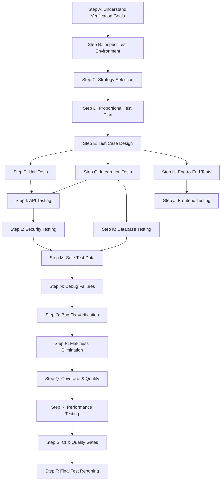
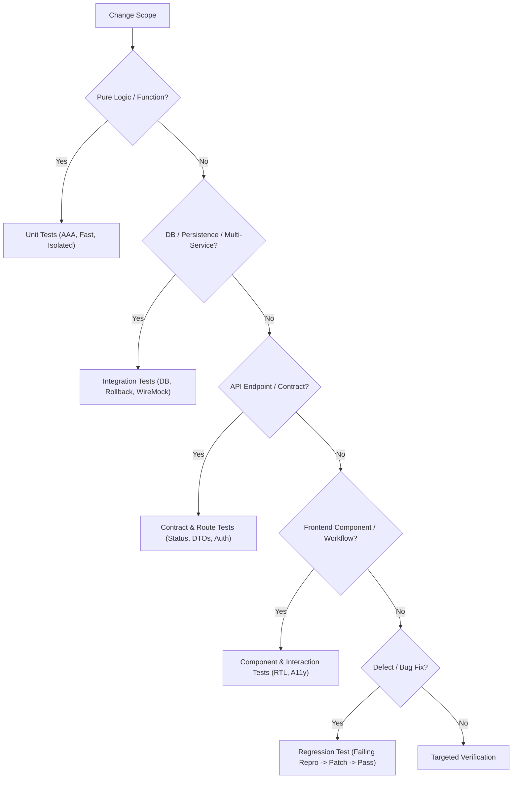

---
name: testing-qa
description: Plans, implements, executes, and evaluates software tests, including unit, integration, end-to-end, regression, API, accessibility, and relevant security tests. Use when validating new features, investigating defects, testing bug fixes, improving test coverage, verifying refactors, diagnosing failing tests, or assessing software quality.
---

# Testing & QA Skill

This skill guides the AI coding agent to plan, author, execute, debug, and evaluate automated software tests and quality assurance procedures. It ensures changes are validated against approved requirements, defects are reproduced and resolved at root causes, regressions are prevented, and verification outcomes are reported honestly.

## 1. Purpose and Scope

Quality assurance establishes empirical confidence that software behaves correctly, securely, and performantly under expected and exceptional conditions. This skill ensures the agent systematically addresses core testing questions:

- **What requirements and behaviors need to be tested?** Extract testable scenarios from user stories, PRDs, SRS specs, and acceptance criteria.
- **Which testing levels are appropriate?** Select the optimal balance of unit, integration, E2E, contract, regression, and security tests.
- **How should useful test cases be designed?** Cover happy paths, negative inputs, boundary conditions, and invariant state transitions.
- **Which existing test tools and fixtures should be reused?** Leverage established runners, assertion libraries, factories, and mocks.
- **How should test environments and data be isolated?** Use dedicated test databases, synthetic records, and transaction rollbacks.
- **How can a bug be reproduced reliably?** Construct minimal, deterministic reproduction cases before modifying application code.
- **How can a fix be verified without hiding problems?** Confirm tests fail on unpatched code and pass with the genuine architectural fix.
- **How can regressions be detected?** Run existing regression suites across dependent services, modules, and API contracts.
- **How should flaky tests be investigated?** Eliminate race conditions, unhandled asynchronous timing, and shared mutable state.
- **What evidence is sufficient to report a test as passed?** Genuine command output showing passing assertions from real test executions.
- **Which risks remain unverified?** Clearly disclose untested edge cases, mocked external boundaries, or environmental limitations.

*Scope Boundary*: Focuses on test planning, implementation, execution, debugging, and verification reporting. It does not replace feature coding (handled by [frontend-development](../frontend-development/SKILL.md) and [backend-development](../backend-development/SKILL.md)), API contract design (handled by [api-design.md](../../rules/api-design.md)), or deployment pipelines (handled by [deployment.md](../../rules/deployment.md)).

## 2. When to Use This Skill

### Trigger Scenarios

Activate this skill when:
- **Validating New Features**: Designing and authoring unit, integration, or E2E tests for newly implemented functionality.
- **Reproducing & Fixing Defects**: Writing failing regression tests to isolate reported bugs, followed by post-fix verification.
- **Diagnosing Broken Test Suites**: Investigating failing test runs, assertion errors, timeouts, or environment setup issues.
- **Stabilizing Flaky Tests**: Identifying and resolving nondeterministic behavior, race conditions, or order-dependent test failures.
- **Testing API Contracts**: Verifying endpoint request validation, response serialization, status codes, and error envelopes.
- **Validating Frontend Workflows**: Testing UI component rendering, state changes, user interactions, and accessibility attributes.
- **Testing Database Persistence**: Verifying migrations, constraints, relationships, rollbacks, and concurrent transactions.
- **Auditing Quality & Coverage**: Assessing branch/line coverage, identifying untested risk paths, and verifying CI quality gates.

### When NOT to Use This Skill

Do not invoke this skill for:
- Writing raw application business logic without a testing or verification objective.
- Pure UI wireframing or design system definition without test execution (use [ui-ux-design](../ui-ux-design/SKILL.md)).
- Conceptual schema modeling without persistence testing (use [database-design](../database-design/SKILL.md)).
- Modifying production infrastructure or running destructive load tests against production targets.

## 3. Testing & QA Workflow

Follow this twenty-step workflow (Steps A through T) when planning, implementing, and executing tests:



### Step A: Understand What Must Be Verified
- Review approved requirements, acceptance criteria, user stories, and architecture specs.
- Identify required happy paths, negative validation paths, boundary conditions, and domain state invariants.
- Determine which modules, APIs, database operations, and external services are affected.
- Distinguish confirmed requirements from speculative assumptions. Ask concise questions only when ambiguities affect correctness.

### Step B: Inspect the Existing Test Environment
- Inspect test runners (e.g., Jest, Vitest, Pytest), configurations, fixtures, mock factories, and CI scripts (`package.json`).
- Identify established test conventions: naming patterns (`*.test.ts`, `test_*.py`), directory structures, and setup helpers.
- Verify environment safety: ensure test commands execute against isolated test databases and never touch production targets.

### Step C: Choose the Appropriate Testing Strategy
- Select the minimal effective combination of testing levels based on risk and architecture:
  - **Unit**: Fast, isolated tests for pure functions, calculations, domain invariants, and components.
  - **Integration**: Real interactions between services, repositories, databases, and middleware.
  - **E2E**: Critical user journeys across the running application.
  - **Contract / API**: Request schemas, response DTOs, status codes, and error envelopes.
  - **Regression**: Dedicated tests reproducing past bugs to prevent recurrence.

### Step D: Create a Proportional Test Plan
- For complex changes, outline the test objective, scenarios, levels, mock boundaries, and environment requirements.
- For simple or localized changes, use a concise test checklist rather than generating heavy documentation.
- Prioritize high-risk business logic and security boundaries over repetitive superficial tests.

### Step E: Design Meaningful Test Cases
- Structure tests using the **Arrange-Act-Assert (AAA)** or Given-When-Then pattern.
- Cover normal valid input, invalid/malformed payloads, boundary values, missing fields, and unauthorized attempts.
- Use explicit, descriptive scenario names communicating context, condition, and expected outcome.

### Step F: Implement Unit Tests
- Test business rules, transformations, and validation logic in small, deterministic units.
- Avoid external network calls, system clock dependencies, or shared mutable state.
- Keep mocking focused: mock external I/O boundaries, but do not mock internal logic under test.

### Step G: Implement Integration Tests
- Test realistic interactions between application services, repositories, database engines, and middleware.
- Run tests against isolated test resources (containerized or in-memory databases).
- Ensure safe teardown: clean up created database records and close connections in `afterEach` or `finally` blocks.

### Step H: Implement End-to-End Tests
- Focus E2E tests on core user workflows (e.g., user signup -> login -> book search -> checkout).
- Use stable, accessible selectors (`role`, `aria-label`, `data-testid`); avoid brittle DOM class paths.
- Avoid arbitrary `sleep()` timeouts; use deterministic assertions that await DOM state changes or network responses.

### Step I: Test API Behavior
- Verify request validation, response status codes, header parsing, and serialized DTOs.
- Test negative flows: `400 Bad Request` (invalid schema), `401 Unauthorized`, `403 Forbidden`, `404 Not Found`, `409 Conflict`.
- Verify pagination metadata, filtering parameters, and idempotency key replays. Follow [api-design.md](../../rules/api-design.md).

### Step J: Test Frontend Behavior
- Mount components using standard harnesses (e.g., React Testing Library) asserting on accessible roles and user events.
- Test form validation feedback, loading skeletons, empty views, and error recovery states.
- Verify keyboard navigability and focus management. Follow [accessibility.md](../../rules/accessibility.md).

### Step K: Test Database Behavior
- Test queries, unique constraints, foreign key cascades, and transaction rollbacks on failure.
- Verify migration scripts bidirectionally (up and down) against a dedicated test database.
- Test concurrent mutations when operations depend on row locks or atomic increments. Follow [database.md](../../rules/database.md).

### Step L: Test Security-Relevant Behavior
- Verify unauthorized requests are rejected at the route and service boundaries.
- Test tenant isolation: verify users cannot view or mutate records belonging to other tenants or users.
- Verify input sanitization to prevent SQL injection and XSS. Follow [security.md](../../rules/security.md).

### Step M: Create Safe and Reproducible Test Data
- Use deterministic factories and synthetic test fixtures rather than production data dumps.
- Ensure test executions are independent and order-agnostic; reset test database state between runs.
- Never hardcode real credentials, API tokens, or personal identity information in fixtures.

### Step N: Debug Failing Tests
- Read complete failure traces, identifying the exact assertion, file, and line that failed.
- Reproduce the failure using the smallest targeted command (e.g., `npm test -- -t "specific test"`).
- Distinguish between a genuine application defect, an outdated test assertion, and an environment problem.
- Fix root causes in application code rather than weakening meaningful test assertions.

### Step O: Verify Bug Fixes and Prevent Regressions
- Follow the regression protocol: author a failing test reproducing the defect, apply the minimal architectural fix, and verify the test passes.
- Keep the regression test in the permanent test suite.
- Run adjacent module test suites to confirm no secondary regressions were introduced.

### Step P: Handle Flaky and Nondeterministic Tests
- Investigate intermittent test failures: identify race conditions, unhandled asynchronous promises, or shared mutable variables.
- Replace arbitrary timeouts with explicit synchronization primitives (awaiting event completion).
- Avoid masking flaky tests with infinite retries; resolve root timing or concurrency defects.

### Step Q: Evaluate Coverage and Quality
- Use coverage tools (`jest --coverage`, `pytest --cov`) to identify untested risk areas.
- Prioritize meaningful branch and scenario coverage over vanity line-count percentages.
- Ensure critical domain services, authorization guards, and error handlers have complete branch coverage.

### Step R: Test Performance When Justified
- For performance-critical features, execute automated benchmarks measuring latency, memory, or query counts.
- Compare measurements against established baselines. Follow [performance-optimization.md](../../rules/performance-optimization.md).
- Avoid executing heavy load tests against production environments without explicit authorization.

### Step S: Respect CI and Quality Gates
- Execute standard project verification scripts: `npm test`, `npm run lint`, `tsc --noEmit`.
- Ensure all quality gates pass without warnings or skipped mandatory suites.
- Disclose any environment-blocked checks honestly; never claim CI passed without actual execution.

### Step T: Review the Final Test Results
- Verify test counts: distinguish passed, failed, skipped, and blocked checks.
- Confirm report matches actual CLI terminal outputs without fabricated data.
- Document any remaining unverified edge cases or external dependency limitations.

## 4. Testing Strategy Decision Tree

Use this decision logic to select the appropriate test types for any given change:



- **Isolated domain rule or utility**: Author focused unit tests.
- **Database queries, transactions, or multi-service flow**: Author integration tests with test database isolation.
- **API endpoint or schema update**: Author route integration tests verifying status codes, schemas, and auth.
- **Critical multi-step user journey**: Author targeted E2E workflow tests.
- **Bug fix**: Author a dedicated regression test reproducing the defect prior to patching.
- **Trivial cosmetic edit**: Execute focused linter and targeted unit checks without heavy suites.

## 5. Standard Test Implementation Blueprint

Every robust automated test follows the Arrange-Act-Assert structure with explicit preconditions, clean isolation, and descriptive scenario names:

```typescript
import { BookReservationService } from '../src/services/BookReservationService';
import { BookRepository } from '../src/repositories/BookRepository';
import { ReservationRepository } from '../src/repositories/ReservationRepository';
import { ConflictError, NotFoundError } from '../src/errors';

describe('BookReservationService', () => {
  let service: BookReservationService;
  let mockBookRepo: jest.Mocked<BookRepository>;
  let mockReservationRepo: jest.Mocked<ReservationRepository>;
  let mockTxManager: any;

  beforeEach(() => {
    // 1. Arrange: Clean, Isolated Mocks & Fixtures
    mockBookRepo = {
      findByIdWithLock: jest.fn(),
      decrementCopies: jest.fn(),
    } as any;
    mockReservationRepo = {
      countActiveByUser: jest.fn(),
      create: jest.fn(),
    } as any;
    mockTxManager = {
      runInTransaction: jest.fn((callback) => callback({})),
    };

    service = new BookReservationService(mockBookRepo, mockReservationRepo, mockTxManager);
  });

  describe('reserveBook', () => {
    it('should successfully reserve book when copies are available', async () => {
      // Arrange
      const bookId = 'book-123';
      const userId = 'user-456';
      mockBookRepo.findByIdWithLock.mockResolvedValue({ id: bookId, availableCopies: 3 } as any);
      mockReservationRepo.countActiveByUser.mockResolvedValue(1);
      mockReservationRepo.create.mockResolvedValue({ id: 'res-789', expiresAt: new Date() } as any);

      // Act
      const result = await service.reserveBook(userId, { bookId, reservationDays: 14 });

      // Assert
      expect(result.reservationId).toBe('res-789');
      expect(mockBookRepo.decrementCopies).toHaveBeenCalledWith(bookId, 1, expect.anything());
    });

    it('should throw ConflictError when no copies remain', async () => {
      // Arrange
      mockBookRepo.findByIdWithLock.mockResolvedValue({ id: 'b1', availableCopies: 0 } as any);

      // Act & Assert (Negative Scenario)
      await expect(service.reserveBook('u1', { bookId: 'b1', reservationDays: 7 }))
        .rejects.toThrow(ConflictError);
      expect(mockReservationRepo.create).not.toHaveBeenCalled();
    });
  });
});
```

## 6. Test Reporting Format

For substantial verification tasks, present findings in this structured format:

### 1. Test Objective
Concise description of the feature, bug fix, or refactor being validated.

### 2. Scope & Environment
Modules, endpoints, and target environments tested (e.g., local Node.js v20, isolated SQLite test DB).

### 3. Tests Executed
| Test Suite / Command | Total | Passed | Failed | Status |
|---|---|---|---|---|
| `npm test -- services/BookReservationService.test.ts` | 6 | 6 | 0 | **Passed** |
| `npm test -- api/books.test.ts` | 8 | 8 | 0 | **Passed** |
| `npm run lint` | - | - | 0 | **Passed** |
| `tsc --noEmit` | - | - | 0 | **Passed** |

### 4. Defects Found & Remediated
Detail any defects caught during testing and how they were resolved.

### 5. Regression Verification
Confirm that existing related test suites were executed with zero regressions.

### 6. Coverage & Limitations
Report code coverage metrics if available and note any mocked external dependencies.

### 7. Final Assessment
Clear statement of whether the change meets all quality gates and is safe to integrate.

## 7. Safety and Quality Principles

| Principle | Description | Implementation Rule |
|---|---|---|
| **Data Safety First** | Never run destructive tests against production databases. | Use ephemeral or dedicated test databases with automatic transaction rollbacks. |
| **Reproducibility** | Tests must produce identical results on every execution. | Eliminate reliance on system clocks, random seeds, and uncontrolled network calls. |
| **Assert Observable Outcomes** | Assert public contracts and state, not private internals. | Verify return values, emitted events, and database mutations; avoid testing implementation details. |
| **Never Weaken Tests** | Never delete or relax assertions to force a failing test to pass. | Fix the root cause in the application code; preserve test integrity. |
| **Honest Reporting** | Report real execution results with complete transparency. | Never fabricate test output, screenshot evidence, or coverage metrics. |

## 8. Test Documentation and Test Artifacts

- **Code Location**: Store automated test files in established project directories (e.g., `tests/`, `__tests__/`, or colocated `*.test.ts`); never store test scripts inside `.agents/skills/`.
- **Reusable Utilities**: Colocate test factories, seed fixtures, and custom mocks in `tests/fixtures/` or `tests/helpers/`.
- **Maintainability**: Treat test code with the same engineering rigor as production code: clean naming, zero duplication, and clear structure.

## 9. Avoid Duplication with Other Skills and Rules

This skill operates in direct alignment with project rules and complementary skills:

- [testing.md](../../rules/testing.md): Core testing and quality assurance rule defining ongoing testing constraints.
- [change-safety.md](../../rules/change-safety.md): Mandates minimal blast radius, regression testing, and safe refactoring.
- [security.md](../../rules/security.md): Dictates authorization barrier testing and credential protection.
- [database.md](../../rules/database.md): Governs transaction rollback safety and database test environment isolation.
- [accessibility.md](../../rules/accessibility.md): Defines WCAG 2.2 AA testing requirements and keyboard accessibility criteria.
- [performance-optimization.md](../../rules/performance-optimization.md): Governs profiling, benchmarking, and Core Web Vitals checks.
- [api-development](../api-development/SKILL.md) & [backend-development](../backend-development/SKILL.md): Provide endpoints and business logic to be tested.
- [frontend-development](../frontend-development/SKILL.md): Implements UI components and client-side interactions to be tested.
- [documentation.md](../../rules/documentation.md): Directs test reporting and documentation accuracy.

## 10. Final Validation Checklist

Before concluding any testing task, verify each item:

- [ ] **Requirements Traceability**: Do test cases cover all acceptance criteria and business rules?
- [ ] **Full Behavioral Spectrum**: Are happy paths, boundary values, invalid inputs, and error states tested?
- [ ] **Test Independence**: Can tests run in any order without dependencies on residual state?
- [ ] **Environment Safety**: Are tests isolated from production databases and live external services?
- [ ] **Real Assertions**: Do tests contain meaningful assertions that fail when code behavior is incorrect?
- [ ] **Regression Verification**: If fixing a defect, was a failing reproduction test written and verified?
- [ ] **Clean Resource Teardown**: Are all test database records, files, and sockets properly closed and cleaned up?
- [ ] **Quality Gates & CI**: Do test runner, linter, and typecheck commands pass with zero errors?
- [ ] **No Code in Skills Directory**: Are all test files located in the project's application test folders?
- [ ] **Honest Reporting**: Does the final test summary reflect actual command outputs without fabricated data?

## 11. Test-First Evidence and Pre-PR Verification Loop

### TDD Evidence Report
When work follows the test-first workflow (`testing.md` Section 22), keep a short evidence report in the project's documentation (for example `docs/testing/<task>.tdd.md`) so the proof survives session restarts and squash merges:
1. **Source**: the plan or PRD used, or the journeys derived during the run.
2. **Per behavior**: a one-sentence summary, the exact command run, the RED and GREEN output excerpts, and what the passing test guarantees.
3. **Guarantee table**: `| # | What is guaranteed | Test file or command | Type | Result | Evidence |`.
4. **Coverage and gaps**: the coverage command and result, plus skipped or deferred tests.
Quote real commands and outputs only; never record PASS for a test that was not run. Checkpoint commits per stage (RED, GREEN, refactor) are optional and need the user's commit authorization.

### Pre-PR Verification Loop
Before declaring work ready for review, run these phases in order and stop at the first failure:

| Phase | Typical command | Pass condition |
| :--- | :--- | :--- |
| 1. Build | `npm run build`, `cargo build`, `go build ./...` | Exit code 0 |
| 2. Types | `tsc --noEmit`, `pyright`, `mypy` | No errors |
| 3. Lint | `npm run lint`, `ruff check .` | No errors; warnings reported |
| 4. Tests | Project suite with coverage | All pass; coverage per `testing.md` |
| 5. Security | Search the diff for secrets and debug output | Nothing found |
| 6. Diff review | `git diff --stat` and file-by-file review | Only intended changes |

Run the test phase through `verify-runner.mjs` with a project profile (`node-test`, `npm-test`, `pytest`) so the Stop gate receives matching evidence, then report:

```
VERIFICATION REPORT
Build: PASS/FAIL | Types: PASS/FAIL (n) | Lint: PASS/FAIL (n) | Tests: x/y, z% | Security: PASS/FAIL | Diff: n files
Overall: READY / NOT READY
```

*Evidence report and verification loop adapted from ECC `tdd-workflow` and `verification-loop` (MIT); see THIRD_PARTY_NOTICES.md.*
