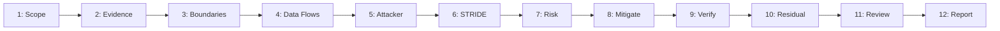

---
name: threat-modeling
description: Identifies and assesses software security threats by examining assets, trust boundaries, data flows, entry points, attacker capabilities, attack paths, and potential business impacts. Uses structured threat modeling methods to prioritize risks, recommend mitigations, define security requirements, and establish verification criteria. Use when designing new features or architectures, integrating external services, changing authentication or data access, or evaluating application security risks. Design-time analysis; to review implemented code for vulnerabilities, use security-review.
---

# Threat Modeling Skill

This skill teaches the AI coding agent to systematically identify assets, trust boundaries, entry points, potential threats, attack paths, business risks, and proportionate mitigations across software architectures, APIs, data pipelines, and integrations.

## 1. Purpose, Core Principles, and Security Mindset

The central mandate of threat modeling is:
**Understand what must be protected, how an attacker could reach or misuse it, what the consequences would be, and which proportionate controls reduce the risk. Ground threat assessments in the actual system instead of inventing vulnerabilities or treating every theoretical concern as a confirmed defect.**

Adhere to seven foundational principles:
- **Evidence-Based Analysis**: Derive threat models from verified code, architecture, and configuration.
- **Proportionality**: Calibrate analysis depth and mitigations to actual asset sensitivity and risk.
- **Asset-Centricity**: Anchor security evaluations in the critical assets requiring protection.
- **Explicit Trust Boundaries**: Identify where control, permissions, or security assumptions transition.
- **Structured Frameworks**: Use established methods (STRIDE, attack trees) to systematically spot threats.
- **Actionable Mitigations**: Propose concrete, testable controls that directly break attack paths.
- **Honest Uncertainty**: Distinguish confirmed exposures from plausible risks and unverified assumptions.

*Scope Boundary*: Focuses on design-time threat analysis, trust boundaries, and risk prioritization. For code audits, see [security-review](../security-review/SKILL.md); for auth, see [authentication-authorization](../authentication-authorization/SKILL.md); for input rules, see [input-validation](../input-validation/SKILL.md); for system design, see [architecture-design](../architecture-design/SKILL.md); for repo rules, follow [security.md](../../rules/security.md).

## 2. Scope and Trigger Scenarios

### Trigger Scenarios
Activate this skill when:
- **Architecture & Feature Design**: Designing new modules, major workflows, or distributed services.
- **Authentication & Access Changes**: Modifying login flows, session handling, RBAC, or tenant routing.
- **Sensitive Data Processing**: Handling PII, payment processing, encryption keys, or file uploads.
- **External Integrations**: Connecting third-party APIs, webhooks, identity providers, or cloud services.
- **AI & Agentic Systems**: Integrating LLMs, RAG pipelines, or autonomous agent tools.

### When NOT to Use This Skill
Do not use this skill for:
- Routine cosmetic UI styling changes that introduce zero security or data exposure.
- Post-incident forensic investigations (use [incident-response](../incident-response/SKILL.md)).
- Pure database query tuning without permission changes (use [database-query-optimization](../database-query-optimization/SKILL.md)).
- Network-level packet filtering or volumetric DDoS mitigation (defer to edge WAFs).

| Activity | Primary Skill | Supporting Skills |
| :--- | :--- | :--- |
| **Model feature threats & attack paths** | `threat-modeling` | `architecture-design`, `security-review` |
| **Model auth & multi-tenant risks** | `threat-modeling` | `authentication-authorization` |
| **Model API & webhook ingress threats** | `threat-modeling` | `api-development`, `input-validation` |
| **Model AI & tool execution risks** | `threat-modeling` | `ai-llm-integration`, `rag-systems` |
| **Verify mitigations via test cases** | `testing-qa` | `threat-modeling` |

## 3. Defining the Purpose and Value of Threat Modeling

Threat modeling is a structured shift-left methodology for discovering design flaws early:
- **Core Security Questions**: What are we building? What can go wrong? What will we do? Did we succeed?
- **Proactive Defense**: Resolves structural security weaknesses before writing code or deploying systems.
- **Distinction from Audits**: Code reviews inspect syntax; threat models evaluate architecture and design.
- **Complementary Synergy**: Informs penetration testing, test scenarios, and security test automation.

## 4. Determining When Threat Modeling is Appropriate

Scale the threat modeling process proportionately to system impact and risk:
- **Lightweight Assessment**: Perform a focused threat scan for minor route additions or small data changes.
- **Comprehensive Threat Model**: Conduct full models for multi-tenant features, auth flows, and payment routes.
- **Avoid Overburdening**: Do not block low-risk UI bug fixes with exhaustive security reviews.

## 5. Understanding the Actual System Before Assessing Threats

Reconstruct system reality from verified project evidence rather than theoretical assumptions:
- **Codebase Inspection**: Examine controllers, middleware, data models, routes, and existing configs.
- **Component Classification**: Distinguish confirmed components from inferred or unverified architecture.
- **No Speculative Systems**: Never assume cloud services, WAFs, or controls exist without direct evidence.

## 6. Identifying and Classifying Important Assets

Catalog and classify the valuable elements that require defensive protection:
- **Authentication Secrets**: Passwords, session cookies, JWT signing keys, and recovery tokens.
- **Customer & Entity Data**: PII, student records, payment details, documents, and business records.
- **System Capabilities**: Admin privileges, billing workflows, database integrity, and system uptime.
- **Asset Sensitivity**: Categorize assets by confidentiality, integrity, and availability impact.

## 7. Identifying Security and Trust Boundaries

Map every boundary where control, privileges, or security assumptions transition:
- **User & Client Boundaries**: Anonymous internet $\to$ authenticated user $\to$ privileged administrator.
- **Application Boundaries**: Frontend client $\to$ API gateway $\to$ backend services $\to$ database storage.
- **Tenant & Partner Boundaries**: Tenant A $\to$ Tenant B; internal backend $\to$ third-party webhook/API.
- **Execution Boundaries**: Web server $\to$ background worker; AI model output $\to$ privileged tool execution.

## 8. Mapping Data Flows and Entry Points

Trace the end-to-end journey of requests and data through application layers:
- **Ingress Vectors**: Web forms, API endpoints, query params, headers, webhooks, and file uploads.
- **Traversed Layers**: Trace requests from gateway through middleware, validation, DB, and queues.
- **Side Effects**: Identify downstream mutations, external notifications, and background processing.

## 9. Attacker Capabilities, Profiles, and Realistic Assumptions

Define credible threat actors and their plausible technical capabilities:
- **External Anonymous**: Internet attackers probing public APIs, login endpoints, and assets.
- **Authenticated Regular User**: Legitimate users attempting horizontal (IDOR) or vertical escalation.
- **Malicious Tenant / Insider**: Multi-tenant members attempting cross-organization data leakage.
- **Realistic Assumptions**: Model what attackers can actually observe, manipulate, or replay in transit.

## 10. Structured Threat Identification Methods

Apply proven frameworks to uncover threats systematically across components:
- **STRIDE Framework**: Assess Spoofing, Tampering, Repudiation, Information Disclosure, DoS, Elevation.
- **Abuse Cases**: Model misuse scenarios where attackers exploit legitimate features for harm.
- **Attack Trees**: Map multi-step attack paths from initial entry point to asset compromise.

## 11. Formulating Concrete Threat Scenarios

Structure each threat scenario into actionable, evidence-based descriptions:
- **Threat Structure**: Asset $\to$ Actor $\to$ Entry Point $\to$ Precondition $\to$ Attack Path $\to$ Business Impact.
- **Concrete Scenarios**: Describe specific mechanisms (e.g., "Attacker passes forged tenant ID in payload").
- **Avoid Vague Categories**: Replace generic labels with concrete architectural vulnerability descriptions.

```markdown
**Scenario**: User alters `tenant_id` in PUT /api/v1/courses/{id} to overwrite another tenant's data.
- **Impact**: Unauthorized cross-tenant modification (Integrity breach).
- **Existing Control**: Route checks authentication but omits tenant ownership check.
- **Mitigation**: Derive tenant ID from server session; enforce tenant filter in update query.
```

## 12. Analyzing Threats Across Security Properties

Evaluate how potential threats impact core security and privacy invariants:
- **Confidentiality & Privacy**: Exposure of PII, business records, or secrets to unauthorized parties.
- **Integrity & Authenticity**: Unauthorized data modification, state manipulation, or impersonation.
- **Availability & Accountability**: Resource exhaustion, unhandled exceptions, and un-audited actions.

## 13. Assessing Existing Controls Before Recommending New Ones

Identify defenses already in place before prescribing additional security measures:
- **Inspect Implemented Guards**: Check auth middleware, input validators, ORM scoping, and rate limiters.
- **Evaluate Effectiveness**: Verify whether existing controls truly mitigate the identified attack path.
- **Avoid Redundant Controls**: Do not add unnecessary layers when an existing control suffices.

## 14. Systematically Prioritizing Risks

Rank threats using a qualitative matrix grounded in exploitability and business harm:
- **Critical**: Trivial exploitability, remote unauthenticated access, high-impact data compromise.
- **High**: Authenticated IDOR, privilege escalation, or direct cross-tenant data access.
- **Medium**: Complex preconditions, limited information disclosure, or authenticated DoS.
- **Low**: Theoretical concerns with minimal business impact or high exploitation barrier.

## 15. Recommending Concrete, Proportionate Mitigations

Propose precise, architectural mitigations that break attack paths cleanly:
- **Root-Cause Controls**: Fix root vulnerabilities (e.g., server authorization) rather than symptoms (hiding UI).
- **Proportionate Design**: Select solutions that maintain system usability, performance, and simplicity.
- **Implementation Guidance**: Define the exact architectural boundary responsible for enforcement.

## 16. Authentication and Authorization Threats

Analyze threat vectors targeting identity and access controls:
- **Credential & Session Abuse**: Brute-force guessing, credential stuffing, and session fixation.
- **Authorization Bypass**: Missing server route guards, client-supplied role trusting, and IDOR exploits.
- **Tenant Hopping**: Leaking data across organizations due to missing tenant query scopes.

## 17. Input, Injection, and Data-Processing Threats

Identify vulnerabilities arising from untrusted input and payload processing:
- **Injection Vectors**: Parameter interpolation in SQL queries, shell commands, or HTML templates.
- **Malicious Uploads**: Executable files uploaded to web roots, zip bombs, and path traversal names.
- **Mass Assignment**: Binding unvalidated request payloads directly to internal database entities.

## 18. API, Webhook, and External Integration Threats

Protect external boundaries and asynchronous integration endpoints:
- **Broken Object Authorization**: Accessing API resources by guessing sequential or un-scoped IDs.
- **Webhook Forgery**: Accepting external webhook payloads without verifying HMAC cryptographic signatures.
- **Cascading Failures**: Unhandled third-party API latency causing backend thread pool starvation.

## 19. Database and Multi-Tenant Threats

Guard persistent data stores against leakage, corruption, and cross-tenant crossover:
- **Unscoped Queries**: Executing updates or deletes lacking mandatory tenant or user ownership clauses.
- **Privilege Overreach**: Database connections operating with administrative database privileges.
- **Concurrency Races**: Time-of-check to time-of-use (TOCTOU) race conditions in state changes.

## 20. AI and LLM-Specific Threat Modeling

Model unique trust boundaries when integrating generative AI and agentic tools:
- **Prompt Injection**: Malicious instructions embedded in user inputs or retrieved documents.
- **Unauthorized Tool Execution**: Models tricked into invoking destructive tools without user consent.
- **Data Leakage in Prompts**: Exposing sensitive system prompts, secrets, or other tenants' data.
- **Defensive Guardrails**: Enforce server-side authorization on all tools; validate structured outputs.

## 21. Infrastructure, Deployment, and Secrets Threats

Evaluate deployment configurations, network exposure, and secret storage:
- **Secret Exposure**: Hardcoded keys in git, unredacted secrets in logs, or exposed client bundles.
- **Public Storage Buckets**: S3 or cloud buckets unintentionally exposed without authentication.
- **Overprivileged Service Accounts**: Background workers running with full administrative cloud roles.

## 22. Availability, Resource Exhaustion, and DoS Threats

Prevent malicious actors from exhausting computational and storage resources:
- **Unbounded Operations**: Deep pagination queries, giant file uploads, or complex regex (ReDoS).
- **Cascading Exhaustion**: Retry storms and cache stampedes collapsing downstream databases.
- **Mitigation Controls**: Apply request timeouts, pagination limits, payload size caps, and rate limits.

## 23. Auditability, Privacy, and Data Retention

Ensure security actions are verifiable while preserving user privacy:
- **Audit Logging**: Record logins, privilege changes, and critical business mutations.
- **Privacy Redaction**: Never log passwords, tokens, credit cards, or raw sensitive payloads.
- **Retention Hygiene**: Define safe log retention windows to minimize data exposure liabilities.

## 24. Supply-Chain and Third-Party Dependency Risks

Manage risks introduced by external packages and third-party libraries:
- **Vulnerable Packages**: Outdated dependencies containing known CVEs in critical execution paths.
- **Scope Discipline**: Avoid importing heavy, unmaintained libraries for simple localized tasks.
- **Lockfile Integrity**: Use pinned versions and integrity hashes to prevent tampering.

## 25. Defining Security Requirements and Verification Criteria

Translate identified threats into testable security acceptance criteria:
- **Actionable Requirements**: Express requirements as clear, verifiable rules (e.g., "Tenant A cannot read Tenant B").
- **Verification Plan**: Define specific unit, integration, or API tests required to validate mitigations.
- **Testable Boundaries**: Focus tests on the exact boundary where enforcement must occur.

## 26. Handling Residual Risk and Accepted Limitations

Acknowledge and document risks that cannot be fully mitigated:
- **Documented Trade-Offs**: Explain why specific residual risks remain (e.g., legacy integration limits).
- **Compensating Controls**: Note secondary protections that reduce remaining exposure (e.g., audit alerts).
- **Formal Risk Acceptance**: Direct unmitigated architectural risks to designated project stakeholders.

## 27. Avoiding False Positives and Unsupported Findings

Maintain credibility by strictly adhering to evidence-based risk reporting:
- **Classification Categories**: Label findings clearly as Confirmed, Likely, Potential, or Unknown.
- **Evidence Requirement**: Tie every confirmed finding to concrete code lines or verified configurations.
- **No Speculative Drama**: Avoid declaring critical vulnerabilities based purely on missing documentation.

## 28. Integrating Threat Modeling into Feature Development

Embed threat modeling into the standard feature development lifecycle:
- **Pre-Implementation**: Model entry points, identify threats, and define security rules in plans.
- **During Implementation**: Verify that code changes respect planned trust boundaries and mitigations.
- **Post-Implementation**: Run verification tests and document residual risks in completion reports.

## 29. Verification and Security Testing Methods

Verify that implemented mitigations successfully defeat the modeled attack paths:
- **Negative Security Tests**: Assert invalid credentials, unauthorized roles, and IDOR attacks return 401/403/404.
- **Boundary Tests**: Verify size limits, pagination maximums, and malformed payload rejections.
- **Isolation Tests**: Programmatically confirm that cross-tenant access attempts are completely blocked.

## 30. Recommended 12-Phase Threat Modeling Workflow



- **Phases 1-4 (Scope, Evidence & Architecture)**: Define boundary, inspect code, map assets, and trace data flows.
- **Phases 5-8 (Threats, Risk & Mitigations)**: Model attackers, run STRIDE, rank risks, and specify mitigations.
- **Phases 9-12 (Testing, Review & Reporting)**: Define verification criteria, document residual risk, and publish report.

## 31. Definition of Done

A threat modeling task is complete only when all criteria are satisfied:
- [ ] 1. **System Scope Defined**: Documented target components, assets, entry points, and trust boundaries.
- [ ] 2. **Evidence-Based Model**: Grounded analysis in actual codebase, schemas, and configurations.
- [ ] 3. **Structured Threat Analysis**: Evaluated concrete attack paths across STRIDE and abuse cases.
- [ ] 4. **Risk Prioritization Clear**: Categorized risks (Critical, High, Medium, Low) with explicit reasoning.
- [ ] 5. **Concrete Mitigations**: Recommended specific architectural controls that break attack paths.
- [ ] 6. **Verification Defined**: Outlined testable acceptance criteria to validate implemented controls.
- [ ] 7. **Residual Risks Documented**: Honestly disclosed unverified assumptions and remaining risks.

## 32. Standardized Completion Report Template

```markdown
# Threat Model Report: [Target Component]
### 1. Scope & Trust Boundaries
- **Boundary & Entry Points**: [e.g., POST /api/v1/enroll, Stripe Webhook]
- **Boundaries**: [Client -> API Gateway -> DB; External Webhook -> Worker]
### 2. Assets & Actors
- **Assets**: [User data, payment status, signing keys]
- **Threat Actors**: [External anonymous, authenticated user, malicious tenant]
### 3. Prioritized Threats
| ID | Threat Scenario (STRIDE) | Impact | Risk | Mitigation |
| :--- | :--- | :--- | :--- | :--- |
| **TM-01** | Tampering: Client alters fee in request | Financial loss | HIGH | Derive price from DB on server |
| **TM-02** | Elevation: Manipulate ID to view records | PII exposure | HIGH | Enforce user ownership filter |
| **TM-03** | Spoofing: Forged webhook payload | Unauthorized access | CRITICAL | Verify HMAC signature |
### 4. Verification & Residual Risk
- **Verification**: [Unit & API tests for ownership, HMAC, and boundary validation]
- **Residual Risks**: [Upstream outage handled via retry queue; no raw card storage]
```

## 33. Avoiding Overengineering and Threat Modeling Anti-Patterns

Avoid these common threat modeling anti-patterns:
- Generating theoretical risk lists disconnected from verified system architecture.
- Treating unverified assumptions as confirmed critical vulnerabilities.
- Inventing complex mathematical risk scores that disguise subjective opinions.
- Demanding exhaustive threat models for low-risk, cosmetic UI modifications.
- Recommending expensive third-party tools when an existing control suffices.
- Implementing code modifications when the task requested threat analysis only.

## 34. Cross-Skill Coordination and Alignment

Coordinate threat modeling seamlessly with other engineering competencies:
- **Security Audits & Review**: Feed threat scenarios directly into [security-review](../security-review/SKILL.md).
- **Identity & Access**: Mitigate AuthN/AuthZ threats using [authentication-authorization](../authentication-authorization/SKILL.md).
- **Data Validation**: Counter injection and payload attacks via [input-validation](../input-validation/SKILL.md).
- **Abuse Throttling**: Address resource exhaustion and DoS using [rate-limiting](../rate-limiting/SKILL.md).
- **Architecture Design**: Align system boundaries with [architecture-design](../architecture-design/SKILL.md) and [architecture-review](../architecture-review/SKILL.md).
- **Testing & Verification**: Translate threat criteria into test suites with [testing-qa](../testing-qa/SKILL.md).

## 35. Repository Rules Alignment and 10-Point Validation Checklist

Ensure all threat modeling activities conform to repository standards:
- **Rules**: [security.md](../../rules/security.md), [architecture.md](../../rules/architecture.md), [api-design.md](../../rules/api-design.md), [backend.md](../../rules/backend.md), [database.md](../../rules/database.md), [change-safety.md](../../rules/change-safety.md), [core-workflow.md](../../rules/core-workflow.md).
- **Supporting Skills**: [security-review](../security-review/SKILL.md), [authentication-authorization](../authentication-authorization/SKILL.md), [architecture-design](../architecture-design/SKILL.md).

### 10-Point Threat Modeling Checklist

- [ ] 1. **System Reality Grounded**: Base model on verified codebase, APIs, and configurations.
- [ ] 2. **Assets Clearly Cataloged**: Identify critical assets, credentials, data, and workflows.
- [ ] 3. **Trust Boundaries Mapped**: Identify every point where user or network trust assumptions shift.
- [ ] 4. **Entry Points Traced**: Follow data flows from client inputs through processing to persistence.
- [ ] 5. **Realistic Attacker Modeled**: Consider credible threat actors, capabilities, and motivations.
- [ ] 6. **Structured STRIDE Analysis**: Evaluate Spoofing, Tampering, Repudiation, Info Leak, DoS, Elevation.
- [ ] 7. **Existing Controls Assessed**: Check implemented defenses before proposing new mechanisms.
- [ ] 8. **Proportionate Mitigations**: Recommend targeted, break-the-attack-path architectural controls.
- [ ] 9. **Testable Verification Plan**: Specify test cases to validate that mitigations block attacks.
- [ ] 10. **Residual Risks Disclosed**: Honestly document unmitigated threats and unverified assumptions.
