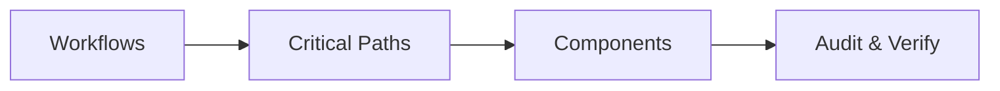

---
name: accessibility-audit
description: Audits web applications and user interfaces for accessibility barriers involving semantic HTML, keyboard navigation, screen readers, focus management, forms, color contrast, images, responsive layouts, and WCAG requirements. Use when evaluating accessibility, investigating barriers for users with disabilities, reviewing interactive components, assessing accessibility test results, or verifying accessibility improvements. To build or fix accessible components, use accessibility instead.
---

# Accessibility Audit Skill

This skill teaches the agent to evaluate web applications, user interfaces, forms, navigation, dynamic components, and user workflows for accessibility barriers. It guides the agent to systematically identify, verify, prioritize, document, and recommend fixes for accessibility defects while preserving application behavior and design.

## 1. Purpose and Core Principles

Accessibility is an essential quality requirement, not a cosmetic enhancement. A feature is incomplete if it fails for users relying on keyboards, screen readers, magnification, or voice inputs. Follow four principles:

- **Accessibility is Functional Quality**: Evaluate whether users can perceive, understand, navigate, and operate interfaces across visual, auditory, motor, and cognitive needs. Never assume mouse-only use.
- **Follow Authoritative Standards (WCAG 2.2)**: Use WCAG 2.2 Level AA baseline. Distinguish Level A, AA, and AAA criteria. Partial criteria do not prove full conformance.
- **Prefer Inclusive Semantic Solutions**: Use semantic HTML before custom ARIA (`<button>` over `<div role="button">`). Preserve native keyboard/focus behaviors. Never convey essential information by color, sound, shape, or motion alone.
- **Evidence Before Conclusions**: Distinguish directly observed manual defects, automated rule violations, code-level risks, and unverified conditions. State environment limitations honestly.

*Scope Boundary*: Focuses on accessibility evaluation, barrier detection, WCAG auditing, and remediation verification. For design, use [ui-ux-design](../ui-ux-design/SKILL.md); for coding, use [frontend-development](../frontend-development/SKILL.md); for code quality, use [code-review](../code-review/SKILL.md); for tests, use [testing-qa](../testing-qa/SKILL.md); for rules, follow [accessibility.md](../../rules/accessibility.md).

## 2. Defining the Audit Scope

Before auditing, establish evaluation boundaries and target components:



- **Target Workflows**: Public pages, auth/login, checkout, account settings, search, and data tables.
- **Target Components**: Navigation menus, modals, dropdowns/comboboxes, tabs, accordions, forms, and alerts.
- **Interaction Modes**: Keyboard-only, screen reader output, high-zoom (200%-400%), and reduced-motion modes.
- **Audit Depth**: Differentiate targeted component audits, critical journey reviews, and broad view assessments.
- **Document Exclusions**: Explicitly record untested pages, mock services, or unreached states.

## 3. Accessibility Audit Workflow

Execute audits systematically through four sequential steps:

- **Step A (Understand User Journey)**: Map user goals, critical path controls, decision points, loading/error states, and failure barriers.
- **Step B (Inspect Implementation)**: Review templates, DOM structure, computed accessibility tree, CSS focus rules, and event handlers.
- **Step C (Run Automated Checks)**: Run available tools (axe-core, Lighthouse, `jsx-a11y`). Filter false positives; investigate genuine violations (~30-40% WCAG coverage).
- **Step D (Conduct Manual Review)**: Perform keyboard walkthroughs (`Tab`, `Escape`, `Arrows`), check focus rings/trapping, inspect tree semantics, and test 200%-400% zoom reflow.

## 4. Semantic HTML and Document Structure

Semantic markup provides an inherent accessibility tree for assistive technology:

- **Landmarks**: Use HTML5 landmarks (`<header>`, `<nav>`, `<main>`, `<aside>`, `<footer>`) to delineate page regions. Disambiguate duplicates using `aria-label`.
- **Heading Hierarchy (WCAG 1.3.1)**: Maintain heading order (`h1`-`h6`) representing content structure. Never skip levels for styling; use CSS.
- **Buttons vs. Links**: Use `<button>` for actions and dialogs; use `<a href="...">` for URL navigation. Never use `<div onClick>`.
- **Lists and Content Groups**: Wrap related items in `<ul>`, `<ol>`, or `<dl>`. Assistive technology announces item counts and boundaries.
- **Language & Title**: Ensure `<html>` has a valid `lang` attribute (e.g., `lang="en"`) and `<title>` uniquely describes current page and state (WCAG 2.4.2, 3.1.1).

## 5. Accessible Names, Roles, States, and Relationships

Interactive elements must programmatically expose their purpose, type, and status (WCAG 4.1.2):

- **Accessible Name Computation**: Names derive from: (1) `aria-labelledby`, (2) `aria-label`, (3) native text, or (4) `title`/`placeholder`. Names must express purpose clearly.
- **Label in Name (WCAG 2.5.3)**: If a control has visible text, its programmatic accessible name must contain the visible text to support speech-input users.
- **Roles & States**: Use native HTML roles. When custom ARIA roles are required (`role="tab"`, `role="dialog"`), implement required child roles and dynamic states: `aria-expanded`, `aria-selected`, `aria-checked`, and `aria-disabled`.
- **Relationships**: Link auxiliary text using `aria-describedby` (help text, error messages) and `aria-controls`. Ensure referenced IDs exist in the DOM.

## 6. Keyboard Navigation and Interaction

Every interactive feature must be operable through keyboard alone without precise timing (WCAG 2.1.1, 2.1.2):

- **Logical Tab Order (WCAG 2.4.3)**: Focus must follow visual reading sequence. Never use positive `tabindex`. Use `tabindex="0"` or `tabindex="-1"`.
- **No Keyboard Traps (WCAG 2.1.2)**: Focus must never be trapped inside widgets or overlays. Standard keys (`Tab`, `Shift+Tab`, `Escape`) must allow exit.
- **Composite Widgets (WAI-ARIA APG)**: Support standard keys: `Arrows` for tabs/menus/comboboxes; `Enter/Space` to activate; `Escape` to dismiss.
- **Hover Parity**: Any action triggered on mouse hover must be reachable via keyboard and dismissible with `Escape` (WCAG 1.4.13).

## 7. Focus Management and Visibility

Users navigating via keyboard must always see where focus is located (WCAG 2.4.7):

- **Visible Focus Indicators**: Ensure all focusable elements display an obvious focus indicator ($\ge 3:1$ contrast against adjacent background).
- **Never Suppress Outlines**: Never apply `outline: none` without providing an equal or higher-contrast custom focus style.
- **Unobscured Focus (WCAG 2.4.11)**: Ensure focused controls are not hidden beneath sticky headers, banners, or overlays.
- **Modal Dialog Lifecycle**: Move focus into modal on open; trap focus within modal boundaries while open; restore focus to trigger button on close.
- **SPA Route Transitions**: Move focus to primary `<h1>`, main landmark, or route announcer on client-side route changes.

## 8. Screen Readers and Assistive Technology

Ensure screen readers convey meaningful information without requiring visual context:

- **Landmark Navigation**: Screen reader users navigate via landmarks (`main`, `nav`, `banner`). Label duplicate landmarks with `aria-label`.
- **Live Regions (WCAG 4.1.3)**: Announce dynamic updates without stealing focus: use `role="status"` (`aria-live="polite"`) for search results/confirmations; use `role="alert"` (`aria-live="assertive"`) sparingly for critical errors.
- **Decorative Content Suppression**: Hide purely visual icons and graphics using `aria-hidden="true"`.
- **Honest Reporting**: If testing was performed via accessibility tree inspection rather than live screen readers (NVDA, VoiceOver), state that limitation explicitly.

## 9. Images, Icons, and Non-Text Content

All non-text content must have a text alternative serving an equivalent purpose (WCAG 1.1.1):

- **Informative Images**: Provide concise, context-aware `alt` text explaining essential information (e.g., `alt="Quarterly revenue rose 15% in Q3"`).
- **Decorative Images**: Use `alt=""` or `aria-hidden="true"` so assistive technologies ignore decorative illustrations.
- **Icon-Only Buttons**: Any button containing only an icon must have a programmatic accessible name via `aria-label`, `<span class="sr-only">`, or SVG `<title>`.
- **SVG Graphics**: Apply `aria-hidden="true"` and `focusable="false"` to decorative SVGs. For interactive SVGs, provide `role="img"` and an accessible name.
- **Complex Charts**: Supplement charts with an accessible data table, textual summary, or CSV download link.

## 10. Color Contrast and Visual Presentation

Content must be visually distinguishable for users with low vision or color blindness (WCAG 1.4.3, 1.4.11):

- **Text Contrast (WCAG 1.4.3 AA)**: Minimum **4.5:1** for normal text (<18pt); minimum **3:1** for large text ($\ge 18\text{pt}$ or $\ge 14\text{pt}$ bold).
- **Non-Text Contrast (WCAG 1.4.11 AA)**: Minimum **3:1** for UI component boundaries, input borders, icons, and focus indicators against adjacent backgrounds.
- **Beyond Color Alone (WCAG 1.4.1)**: Never use color as the sole visual cue to convey state, value, error, or action. Pair color with icons, text labels, or patterns.
- **Placeholder Text & Themes**: Never rely on placeholder text for labels or instructions. Verify contrast in both light and dark modes across all interaction states.

## 11. Forms, Labels, and Error Validation

Forms represent critical transaction pathways requiring rigorous accessibility engineering:

- **Visible & Programmatic Labels (WCAG 3.3.2)**: Every input, textarea, and select must have an associated visible `<label for="id">` matching the control's `id`.
- **Group Labels & Required Fields**: Group related controls with `<fieldset>` and `<legend>`. Indicate required inputs visually and programmatically (`required` or `aria-required="true"`).
- **Autocomplete Attributes (WCAG 1.3.5)**: Apply standard `autocomplete` tokens (`name`, `email`, `current-password`, `street-address`).
- **Error Identification & Association (WCAG 3.3.1, 3.3.2)**: Mark invalid fields with `aria-invalid="true"`. Link errors via `aria-describedby`. On submission failure, focus error summary or first invalid input. Preserve valid user inputs.

## 12. Links, Buttons, and Navigation

Ensure navigation and actionable controls communicate clear intent:

- **Descriptive Link Text (WCAG 2.4.4)**: Link text must convey destination purpose in context. Avoid ambiguous phrases ("click here", "read more") unless disambiguated by context or `aria-label`.
- **Link vs. Button Semantics**: Links navigate to a new URL; buttons perform an in-page action, open a dialog, or submit data.
- **Active Navigation States**: Use `aria-current="page"` to indicate active pages in navigation menus, breadcrumbs, and pagination.
- **External Links**: Indicate when links open in a new tab via visual icon and accessible label (`<span class="sr-only">(opens in new window)</span>`).

## 13. Tables, Data Grids, and Complex Interfaces

Data presentation must preserve structural relationships across rows and columns (WCAG 1.3.1):

- **Data Tables**: Provide a `<caption>` or preceding heading. Use `<th>` with `scope="col"` or `scope="row"`. Never use tables purely for layout.
- **Sortable Columns**: Indicate sort status programmatically on headers using `aria-sort="ascending|descending|none"`.
- **Row-Level Actions**: In repeated row actions (e.g., "Edit", "Delete"), provide contextual accessible names (`aria-label="Edit Book: 1984"`).
- **Interactive Grids vs. Tables**: Use standard semantic `<table>` unless implementing full spreadsheet-like 2D keyboard navigation (`role="grid"`).

## 14. Modals, Menus, Tabs, and Dynamic Widgets

Custom widgets must adhere strictly to WAI-ARIA Authoring Practices (APG):

| Widget | Roles & State | Keyboard | Focus Behavior |
| :--- | :--- | :--- | :--- |
| **Modal Dialog** | `role="dialog"`, `aria-modal="true"` | `Tab` cycles; `Escape` closes | Focus into modal on open; restore on close |
| **Tabs** | `role="tablist"`, `tab`, `tabpanel` | `Arrows` switch; `Tab` enters | Focus active tab; `Tab` navigates to panel |
| **Accordion** | Trigger `<button aria-expanded="...">` | `Enter/Space` toggles; `Tab` next | Focus remains on header button |
| **Dropdown Menu** | Trigger `aria-haspopup="menu"` | `Down/Enter` opens; `Up/Down` moves | Focus moves to first item; returns on close |

## 15. Responsive Design, Zoom, and Reflow

Interfaces must adapt gracefully to magnification and diverse screen geometries:

- **Reflow (WCAG 1.4.10 AA)**: Content must reflow without 2D scrolling at **320 CSS pixels** width (400% zoom at 1280px). Exceptions: data tables, maps.
- **Resize Text (WCAG 1.4.4 AA)**: Text must be resizable up to **200%** using browser zoom without clipping, truncating, or obscuring controls.
- **Touch Targets (WCAG 2.5.8 AA)**: Target size for pointer inputs must be at least **$24 \times 24\text{px}$**, or provide sufficient surrounding spacing.

## 16. Motion, Animation, and Time-Dependent Behavior

Protect users from vestibular dysfunction, distraction, and cognitive barriers:

- **Reduced Motion (WCAG 2.3.3)**: Respect user preferences via `@media (prefers-reduced-motion: reduce)`. Disable non-essential parallax, transitions, and auto-scrolling.
- **Pause, Stop, Hide (WCAG 2.2.2)**: Auto-playing or scrolling content lasting $>5$ seconds must provide a visible pause/stop mechanism.
- **Flashing Content (WCAG 2.3.1)**: Ensure no content flashes more than 3 times in any 1-second period to prevent triggering seizures.
- **Adjustable Time Limits (WCAG 2.2.1)**: For session timeouts, provide warnings and allow users to extend duration by $\ge 10\times$ default.

## 17. Authentication and Sensitive Workflows

Security-sensitive workflows require inclusive verification without compromising security:

- **Accessible Authentication (WCAG 3.3.8 AA)**: Do not require cognitive function tests (passwords, CAPTCHA) without alternatives (password managers, paste, WebAuthn).
- **Password Managers**: Ensure fields permit paste events and use standard autocomplete attributes (`username`, `current-password`, `new-password`).
- **Data Privacy in Audits**: Never capture real credentials, credit card numbers, tokens, or PII in audit reports or screenshots.

## 18. Automated Testing vs. Manual Testing

Effective auditing combines automated efficiency with manual human verification:

- **Automated Scanning (~30-40% WCAG)**: High speed, broad coverage for syntax errors, missing attributes, and measurable contrast ratios (axe-core, Lighthouse).
- **Manual Verification (~60-70% WCAG)**: Critical for contextual quality, alt text meaning, screen reader phrasing, keyboard fluidity, error recovery, and cognitive clarity.
- **Rule of Thumb**: Zero automated violations $\neq$ accessible application.

## 19. Severity and Prioritization Model

Prioritize accessibility barriers according to user impact and task completion barriers:

| Severity | User Impact | Representative Examples |
| :--- | :--- | :--- |
| **Critical** | Completely blocks essential task; no accessible workaround exists. | Keyboard trap in modal; un-submittable checkout form; missing submit name. |
| **High** | Severe difficulty for major workflow; workaround is arduous or obscure. | Focus indicator absent; form errors unlinked to inputs; missing field labels. |
| **Medium** | Significant confusion or friction; accessible workaround exists. | Broken heading sequence; text contrast 3.8:1; missing `aria-expanded`. |
| **Low** | Minor inconsistency with negligible direct user impact. | Landmark missing secondary label; decorative icon missing `aria-hidden`. |
| **Informational** | Architectural observation or enhancement opportunity. | Recommending native `<dialog>`; advisory note on upcoming WCAG 2.2 criteria. |

## 20. Accessibility Findings and Evidence

Every substantive audit finding must document:
- **Title & Severity**: Concise summary with rating (Critical, High, Medium, Low, Informational).
- **Confidence & Location**: Level (Confirmed, High, Medium) with exact file path, component, and line (e.g., `src/components/CheckoutModal.tsx:48`).
- **Affected Users & Behavior**: Specific modality impacted (keyboard, screen reader, low-vision) and observed defect.
- **Evidence & WCAG Reference**: Code snippet/trace and exact WCAG 2.2 criterion (e.g., WCAG 2.1.1 Keyboard, Level A).
- **Impact, Fix & Verification**: User barrier description, concrete semantic code fix, and re-test steps.

## 21. Remediation and Fix Verification

When authorized to remediate accessibility barriers:

1. **Isolate Root Cause**: Determine if defect originates in a shared UI component, layout template, or styling token.
2. **Prefer Semantic HTML**: Replace custom `div`/`span` structures with native semantic elements (`<button>`, `<dialog>`, `<nav>`).
3. **Minimize ARIA**: Remove redundant or incorrect ARIA attributes; use ARIA only when native HTML cannot express role or state.
4. **Implement Smallest Fix**: Make targeted changes resolving the barrier while preserving existing design and business logic.
5. **Re-Test Verification**: Re-run automated scanner, perform keyboard walkthrough, verify focus restoration, and check computed accessibility tree.

## 22. Accessibility Regression Prevention

Establish automated safeguards to prevent accessibility regressions:

- **Automated CI Scans**: Integrate axe-core via Playwright (`@axe-core/playwright`), Cypress, or Jest (`jest-axe`) to catch regressions in build pipelines.
- **Linter Rules**: Enforce `eslint-plugin-jsx-a11y` or framework equivalents for compile-time feedback.
- **Component Tests**: Write unit/integration tests asserting keyboard activation (`Enter`, `Space`), focus movement, and `aria-expanded` state toggles.
- **Definition of Done**: Include accessibility acceptance criteria (keyboard operable, visible focus, valid labels, contrast verified) in feature specifications.

## 23. Risk Management and Change Safety

Follow strict safety boundaries during accessibility audits:

- **Audit-Only Principle**: Never modify application code, styles, or dependencies during an audit task unless explicitly authorized.
- **No Ineffective ARIA Silencing**: Never add bogus ARIA attributes solely to silence linter warnings without verifying real AT behavior.
- **Preserve Focus Outlines**: Never remove native outlines without verifying an equally high-contrast custom replacement.
- **Security Invariance**: Never weaken authentication, session timeouts, or validation safeguards under the guise of accessibility.
- **Data Protection**: Never include sensitive user data, auth tokens, or passwords in audit reports or screenshots.

## 24. Expected Accessibility Audit Report Format

Every substantive audit must produce a structured diagnostic report following this format:

```markdown
# Accessibility Audit Report: [Workflow Name]

## 1. Audit Summary
- **Target Scope**: [e.g., Checkout: Cart, Shipping, Payment Modal] | **Standard**: WCAG 2.2 AA
- **Methods**: Automated axe-core scan, keyboard walkthrough, accessibility tree inspection
- **Key Risks**: 1 Critical keyboard trap in Payment Modal; 1 High form labeling defect
- **Limitations**: Physical screen reader unverified; verified via browser accessibility tree

## 2. Prioritized Findings

### [CRIT-01] Keyboard Focus Trapped Inside Payment Modal Close Button
- **Severity**: Critical | **Confidence**: Confirmed | **Location**: `src/components/PaymentModal.tsx:64`
- **Standard**: WCAG 2.1.2 No Keyboard Trap (Level A) | **Affected Users**: Keyboard-only users
- **Observed**: Tabbing past close button cycles focus back to address bar; modal inputs unreachable.
- **Evidence**: `keydown` handler traps focus exclusively on close button due to incorrect boundaries.
- **User Impact**: Users navigating via keyboard cannot complete checkout.
- **Recommendation**: Implement standard focus trap cycling through modal inputs using native `<dialog>`.
- **Verification**: Tab repeatedly in modal; verify focus cycles through fields and `Escape` closes.

## 3. Existing Strengths & Automated Results
- Semantic landmarks (`header`, `main`, `footer`) properly structured; text contrast exceeds 7:1.
- Tool: `@axe-core/playwright`; 3 violations detected (1 real label-missing, 2 false-positive contrast).

## 4. Manual Verification Summary & Action Plan
- **Manual Summary**: Keyboard trapped in modal; 200%/400% zoom reflow verified; focus rings visible.
- **Action Plan**: 1. Fix modal keyboard trap (`PaymentModal.tsx`); 2. Connect form labels (`CreditCardForm.tsx`).
- **Overall Assessment**: Strong semantics, but checkout modal keyboard barrier blocks purchase completion.
```

## 25. Alignment with Existing Rules and Skills

This skill integrates with repository rules and agent skills:
- **Core Rules**:
  - Follows [accessibility.md](../../rules/accessibility.md) for engineering standards, ARIA rules, and contrast ratios.
  - Conforms to [change-safety.md](../../rules/change-safety.md) and [core-workflow.md](../../rules/core-workflow.md) by auditing non-destructively before proposing fixes.
  - Aligns with [frontend.md](../../rules/frontend.md) for UI component architecture and state management.
- **Related Skills**:
  - [ui-ux-design](../ui-ux-design/SKILL.md): Consult for inclusive user journeys, wireframes, and design token contrast.
  - [frontend-development](../frontend-development/SKILL.md): Implement approved accessibility remediation.
  - [code-review](../code-review/SKILL.md): Check pull requests for accessibility regressions.
  - [testing-qa](../testing-qa/SKILL.md): Integrate automated accessibility scans into test suites.

## 26. Final Validation Checklist

Before finalizing any accessibility audit, verify all 10 criteria:

- [ ] **1. Defined Scope & Journeys**: Clear audit scope identifying specific user workflows, components, and tested states.
- [ ] **2. Semantic HTML Evaluated**: Landmarks, headings, lists, and button/link semantics were inspected.
- [ ] **3. Keyboard Operability Tested**: Tab navigation, activation, focus order, and absence of keyboard traps were verified.
- [ ] **4. Focus Visibility Confirmed**: Focus rings were checked for visibility, contrast, and absence of outline suppression.
- [ ] **5. Form Accessibility Audited**: Labels, error associations, `aria-invalid`, and input preservation were verified.
- [ ] **6. Non-Text Content & Contrast Checked**: Alt text quality, icon accessible names, and $\ge 4.5:1$ / $\ge 3:1$ contrast were measured.
- [ ] **7. Dynamic Widgets Inspected**: Modal dialogs, tabs, accordions, and live regions adhere to WAI-ARIA APG patterns.
- [ ] **8. Automated & Manual Synergy**: Automated scan results were corroborated with manual keyboard and tree inspections.
- [ ] **9. Honest Reporting of Limits**: Untested screen reader outputs or device constraints were explicitly documented.
- [ ] **10. Actionable & Prioritized Findings**: Every finding provides severity, exact file location, WCAG reference, user impact, and verification steps.
