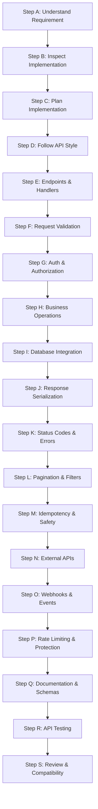

---
name: api-development
description: Implements, modifies, debugs, tests, and maintains API endpoints, request and response handling, validation, authentication integration, pagination, error handling, webhooks, and external API integrations according to established API contracts and backend conventions. Use when building or maintaining working API functionality.
---

# API Development Skill

This skill guides the AI coding agent to implement, extend, debug, test, and maintain API endpoints, controllers, request pipelines, response serializers, webhooks, and third-party integrations. It translates approved API designs, schemas, and contract specifications into robust, production-ready server interfaces.

## 1. Purpose and Scope

API development connects client applications, external partners, and distributed services to backend capabilities. This skill ensures the agent systematically addresses core API implementation questions:

- **How should an endpoint or integration be implemented?** Understand protocol, route structure, method, and contracts before coding.
- **Which existing components should be reused?** Leverage established routes, controllers, domain services, middleware, and API clients.
- **How should requests be parsed and validated?** Validate ingress parameters, headers, and payloads against typed schemas.
- **How should responses follow documented contracts?** Serialize clean Data Transfer Objects (DTOs) with consistent casing and types.
- **How should auth and authorization be enforced?** Verify caller identity and enforce fine-grained, server-side resource permissions.
- **How should databases and external services be integrated?** Use parameterized queries, atomic transactions, timeouts, and retries.
- **How should errors and duplicate requests be handled?** Standardize error envelopes, status codes, and idempotency mechanisms.
- **How can existing API contracts remain compatible?** Preserve field names, response formats, and status codes for existing clients.
- **How should API implementations be tested?** Execute automated contract tests, route integration tests, and edge-case assertions.
- **How should documentation remain consistent with code?** Update OpenAPI/Swagger specs and schema definitions alongside code changes.

*Scope Boundary*: Focuses on implementing and maintaining API code. It does not replace API design (handled by [api-design.md](../../rules/api-design.md)), domain business logic (handled by [backend-development](../backend-development/SKILL.md)), database modeling (handled by [database-design](../database-design/SKILL.md)), or deployment pipelines (handled by [deployment.md](../../rules/deployment.md)).

## 2. When to Use This Skill

### Trigger Scenarios

Activate this skill when:
- **Implementing New API Endpoints**: Authoring routes, handlers, and controllers for REST, GraphQL, or RPC interfaces.
- **Modifying Existing Endpoints**: Adding optional query filters, extending response payloads, or updating endpoint logic.
- **Building Ingress Validation & DTOs**: Creating request schemas, body parsers, parameter validators, and serializers.
- **Integrating Authentication & Authorization**: Applying auth middleware, checking user roles, scopes, or tenant boundaries.
- **Implementing Pagination, Filtering & Sorting**: Authoring cursor-based or offset pagination, query filters, and sort clauses.
- **Integrating Third-Party APIs**: Creating outbound HTTP client wrappers, handling external tokens, and managing timeouts.
- **Authoring Webhook Handlers**: Building incoming webhook receivers with signature verification, replay protection, and async dispatch.
- **Debugging API Defects**: Diagnosing 4xx/5xx status errors, serialization bugs, broken contracts, or webhook delivery failures.
- **Writing API Contract & Integration Tests**: Authoring automated endpoint tests verifying HTTP status codes, payloads, and error formats.

### When NOT to Use This Skill

Do not invoke this skill for:
- Pure UI wireframing or visual layout design (use [ui-ux-design](../ui-ux-design/SKILL.md)).
- Client-side React/Vue component development (use [frontend-development](../frontend-development/SKILL.md)).
- Conceptual data modeling or SQL migration authoring without API endpoints (use [database-design](../database-design/SKILL.md)).
- Abstract API design specifications without implementation requirements (use [api-design.md](../../rules/api-design.md)).

## 3. API Development Workflow

Follow this nineteen-step workflow (Steps A through S) when developing or modifying API functionality:



### Step A: Understand the API Requirement
- Review the approved API specification, user story, and acceptance criteria.
- Identify calling consumers and required HTTP method, URI path, parameters, headers, payload, and response schema.
- Distinguish confirmed requirements from speculative assumptions. Ask concise questions only when ambiguities affect correctness or compatibility.

### Step B: Inspect Existing API Implementation
- Inspect existing route registries, controllers, middleware, services, serializers, and test suites.
- Review established URL structures (`/api/v1/...`), casing, pagination patterns, and error envelopes.
- Check for existing endpoints serving similar needs to avoid creating redundant routes.

### Step C: Plan the Implementation
- Identify files to create or modify: route definitions, controllers, validation schemas, DTOs, and tests.
- Map data flow: route entry -> authentication -> validation -> domain service -> persistence -> response serialization.
- Assess backward compatibility risks for existing consumers before altering existing schemas or status codes.

### Step D: Follow the Existing API Style
- Adhere strictly to the project's actual API paradigm (REST, GraphQL, gRPC, tRPC). Never impose REST conventions on non-REST systems.
- Follow existing naming conventions, URL hierarchies, and serialization rules.
- Reuse existing middleware (auth, logging, error handling). Follow [api-design.md](../../rules/api-design.md).

### Step E: Implement Endpoints and Handlers
- Register routes using framework idioms (Express router, FastAPI router, NestJS controller).
- Use standard HTTP methods: `GET` (safe reads), `POST` (creation), `PUT` (replacement), `PATCH` (partial update), `DELETE` (removal).
- Keep handlers thin: extract parameters, delegate logic to domain services, and return standard responses.
- Prevent routing ambiguities and ensure unsupported HTTP methods return `405 Method Not Allowed`.

### Step F: Implement Request Validation
- Treat all ingress data (body, path params, query string, headers) as untrusted.
- Validate inputs against explicit typed schemas (e.g., Zod, Pydantic) covering types, lengths, ranges, and allowed enum values.
- Reject invalid payloads immediately with `400 Bad Request` or `422 Unprocessable Entity` containing field-level messages.
- Use allowlists to prevent mass assignment of sensitive model properties (`role`, `balance`).

### Step G: Implement Authentication and Authorization
- Enforce authentication on all protected endpoints using established auth middleware (session cookies, Bearer JWT, API keys).
- Enforce server-side authorization: verify user roles, granular permissions, tenant isolation, and resource ownership.
- Never trust client-supplied user IDs or ownership flags without verifying against session tokens.
- Return consistent `401 Unauthorized` and `403 Forbidden` responses. Follow [security.md](../../rules/security.md).

### Step H: Implement Business Operations
- Delegate business logic to dedicated application services; never embed domain logic directly inside route handlers.
- Validate domain preconditions and state transitions before updating state.
- Ensure authoritative calculations (pricing, balances, stock counts) occur strictly on the server.
- Prevent duplicate execution of consequential operations by ensuring idempotency. Follow [backend-development](../backend-development/SKILL.md).

### Step I: Implement Database Integration
- Execute database operations through established repositories or ORM models using parameterized queries.
- Wrap multi-table mutations that must succeed or fail together in atomic database transactions.
- Prevent N+1 query patterns using eager joins or batching. Enforce tenant and ownership filters at the query level. Follow [database.md](../../rules/database.md).

### Step J: Implement Response Serialization
- Serialize responses using dedicated Data Transfer Objects (DTOs) with allowlisted fields.
- Never return raw database models containing internal IDs, password hashes, or private audit columns.
- Ensure consistent data types, ISO 8601 timestamps, and predictable empty states (`[]` for collections, `null` for missing objects).

### Step K: Handle Status Codes and Errors
- Return standard, semantic HTTP status codes (`200`, `201`, `204`, `400`, `401`, `403`, `404`, `409`, `422`, `429`, `500`).
- Never return `200 OK` for failed operations or partial errors.
- Format error responses using a consistent structure (e.g., RFC 9457 Problem Details or project error envelope).
- Sanitize error messages: never disclose stack traces, database queries, or server file paths to clients.

### Step L: Implement Pagination, Filtering, and Sorting
- Apply bounded pagination on all collection endpoints (default limit 20, max limit 100) using cursor or offset/limit patterns.
- Return pagination metadata (`total`, `page`, `limit`, `hasMore`, or `nextCursor`) when required by the contract.
- Allowlist supported filter and sort fields; push filtering, sorting, and pagination down to database queries.

### Step M: Implement Idempotency and Concurrency Safety
- Support idempotency keys (`Idempotency-Key` header) for critical, duplicate-prone operations (e.g., payments, reservations).
- Store idempotency records with request hashes and cached responses to return identical results upon duplicate submissions.
- Guard against race conditions using database unique constraints, transactions, or optimistic concurrency locks.

### Step N: Integrate External APIs
- Isolate external API interactions inside dedicated client adapter modules.
- Configure explicit connection and request timeouts (e.g., 5-10s) on all outbound HTTP calls.
- Implement bounded retries with exponential backoff only for transient network errors on idempotent operations.
- Validate and sanitize external responses before passing data to domain services; never leak external API keys.

### Step O: Implement Webhooks and Event-Based APIs
- Verify cryptographic signatures (e.g., HMAC-SHA256 in `X-Signature-256`) and timestamps on incoming webhook payloads.
- Acknowledge webhooks immediately (`200 OK` or `202 Accepted`) and offload heavy processing to background workers.
- Ensure webhook handlers are idempotent to safely handle duplicate event deliveries.

### Step P: Apply Rate Limiting and Resource Protection
- Apply rate limiting to endpoints vulnerable to brute force or abuse (auth endpoints, search queries, resource exports).
- Enforce request body size limits at the gateway or middleware level to protect against memory exhaustion.
- Return `429 Too Many Requests` with a `Retry-After` header when rate limits are exceeded.

### Step Q: Support API Documentation and Schemas
- Update OpenAPI/Swagger specifications or markdown documentation in `docs/api/`.
- Ensure documented paths, parameters, schemas, and status codes exactly match the implemented code.
- Provide realistic, sanitized example values in schemas without exposing sensitive test data. Follow [documentation.md](../../rules/documentation.md).

### Step R: Test the API Implementation
- Follow [testing.md](../../rules/testing.md) to author comprehensive automated tests:
  - **Happy Path Tests**: Verify successful status codes, payload structures, and response serialization.
  - **Validation Tests**: Verify `400`/`422` responses for missing, malformed, or out-of-range fields.
  - **Auth & Permission Tests**: Verify `401 Unauthorized` for missing tokens and `403 Forbidden` for insufficient roles.
  - **Edge Case Tests**: Verify `404 Not Found`, `409 Conflict`, pagination limits, and idempotency replays.
- Run automated tests, linters, and type checkers (`npm test`, `npm run lint`, `tsc --noEmit`).

### Step S: Review the Final Changes
- Inspect Git diffs to verify changes are strictly scoped to the requested API feature.
- Ensure no debug logging (`console.log`), test tokens, or commented-out code remain.
- Confirm that existing API consumers will not experience breaking contract changes.

## 4. API Protocol-Specific Guidance

Apply only the guidance that matches the project's actual API technology:

### REST and HTTP APIs
- Follow resource-oriented URI naming using plural nouns (`/api/v1/books`, `/api/v1/books/{id}/reviews`).
- Restrict URI nesting to two levels; use query parameters for deeper filtering.
- Use standard HTTP status codes and adhere strictly to method semantics (`GET`, `POST`, `PUT`, `PATCH`, `DELETE`).

### GraphQL
- Follow established schema definitions: query fields for reads, mutation fields for state modifications.
- Implement fine-grained authorization checks inside resolver functions.
- Guard against recursive query denial-of-service using query depth and complexity limits.
- Solve N+1 database queries in field resolvers using DataLoader or batch loading techniques.

### RPC and Typed Frameworks (gRPC, tRPC)
- Adhere strictly to procedure signatures, protocol buffers, or type-inferred routers.
- Preserve backward compatibility when extending message definitions (use new field tags, never alter existing IDs).
- Map RPC status codes (OK, NOT_FOUND, PERMISSION_DENIED) cleanly to client envelopes.

### Webhooks & Event Consumers
- Verify payload signatures, validate JSON structure, and ensure idempotent event handling.
- Acknowledge incoming events quickly; defer heavy tasks to asynchronous queue workers.

## 5. API Development Principles

| Principle | Description | Implementation Rule |
|---|---|---|
| **Contract Stability** | Never break active API consumers without versioning. | Adding optional fields is safe; renaming or removing fields requires deprecation. |
| **Zero Client Trust** | Validate all ingress parameters, bodies, and headers. | Enforce typed schema validation at the route boundary; allowlist accepted fields. |
| **Explicit Status Codes** | Return semantic status codes reflecting real outcomes. | Never return 200 OK for errors; distinguish 400, 401, 403, 404, 409, and 422. |
| **Data Minimization** | Return only authorized, necessary fields in responses. | Serialize custom DTOs; never expose internal database models or password hashes. |
| **Defensive Timeouts** | Bound all outbound and inbound resource consumption. | Set connection/read timeouts on external calls; enforce body size and rate limits. |
| **Strict Blast Radius** | Localized modifications with zero side effects. | Extend endpoints safely without altering unrelated routes or global middleware. |

## 6. New API vs. Existing API

### Greenfield Development (New Endpoints or Services)
- Establish the baseline routing architecture, URL prefixing (`/api/v1/`), and route registration pattern.
- Implement the standard middleware pipeline: CORS, request body parsing, correlation IDs, auth, validation, and error handling.
- Establish the standardized response envelope, pagination metadata, and RFC 9457 error format early.
- Configure OpenAPI/Swagger generators and automated API integration test harnesses from the start.

### Brownfield Development (Existing Endpoints)
- **Inspect Before Modifying**: Audit existing routes, parameter conventions, casing styles, and response formats.
- **Maintain Contract Compatibility**: Preserve existing field names, nullability rules, and HTTP status codes.
- **Reuse Existing Middleware**: Use established authentication, validation, and serialization helpers.
- **Coordinate with Consumers**: Identify frontend pages or services consuming the endpoint before modifying response structures.

## 7. Standard Endpoint Implementation Blueprint

Every production-grade API endpoint demonstrates clean separation between routes, validation schemas, auth guards, domain delegation, response DTO serialization, and standardized error translation:

```typescript
import { Router, Request, Response, NextFunction } from 'express';
import { z } from 'zod';

// 1. Explicit Request Schema
export const CreateBookSchema = z.object({
  title: z.string().trim().min(1).max(200),
  isbn: z.string().regex(/^(97(8|9))?\d{9}(\d|X)$/, 'Invalid ISBN format'),
  authorId: z.string().uuid(),
  publishedYear: z.number().int().min(1000).max(new Date().getFullYear()),
});
export type CreateBookInput = z.infer<typeof CreateBookSchema>;

// 2. Response DTO Serializer (Data Minimization)
export function serializeBookResponse(book: BookEntity) {
  return {
    id: book.id,
    title: book.title,
    isbn: book.isbn,
    authorId: book.authorId,
    publishedYear: book.publishedYear,
    createdAt: book.createdAt.toISOString(),
  };
}

// 3. Route Registration with Middleware & Handler
export function registerBookRoutes(router: Router, bookService: BookService, auth: any) {
  router.post(
    '/api/v1/books',
    auth.requireRole(['ADMIN', 'LIBRARIAN']),
    async (req: Request, res: Response, next: NextFunction) => {
      try {
        const validatedInput = CreateBookSchema.parse(req.body);
        const newBook = await bookService.createBook(validatedInput, req.user.id);
        return res.status(201).json({
          status: 'success',
          data: serializeBookResponse(newBook),
        });
      } catch (error) {
        next(error); // Forwarded to centralized error middleware
      }
    }
  );
}
```

## 8. Output and Documentation Requirements

Maintain clear records and documentation for all API changes:

1. **Source Code Placement**: Place API routes, controllers, and schemas in established application directories (`src/api/`, `src/routes/`); never place application code inside `.agents/skills/`.
2. **API Documentation**: Update OpenAPI/Swagger definitions or markdown documents in `docs/api/` matching the implementation.
3. **Automated Test Results**: Report results of automated API integration tests (`npm test`, `pytest`) verifying status codes and schemas.
4. **Endpoint Inventory Summary**: Detail the HTTP method, route path, authentication requirements, request payload schema, and response format.
5. **Change Summary**: Provide a clear record of touched files, highlighting additions, bug fixes, or compatibility assurances.

## 9. Avoid Duplication with Other Skills and Rules

This skill operates in direct alignment with project rules and complementary skills:

- [api-design.md](../../rules/api-design.md): API interface guidelines, REST/GraphQL standards, error formats, and versioning policies.
- [backend-development](../backend-development/SKILL.md): Domain business logic, state machines, and service-layer orchestration.
- [security.md](../../rules/security.md): Authentication mechanisms, token verification, injection defense, and secret handling.
- [database.md](../../rules/database.md): SQL parameterization, transactions, indexing, and data persistence safety.
- [frontend-development](../frontend-development/SKILL.md): Frontend implementation consuming API endpoints.
- [testing.md](../../rules/testing.md): Testing standards, mocking conventions, and test coverage requirements.
- [coding-standards.md](../../rules/coding-standards.md): Code formatting, naming, and TypeScript typing rigor.
- [change-safety.md](../../rules/change-safety.md): Minimal blast radius and contract backward compatibility.
- [documentation.md](../../rules/documentation.md): API documentation upkeep in `docs/api/`.

## 10. Final Validation Checklist

Before concluding any API development task, verify each item:

- [ ] **Contract Compliance**: Does the endpoint match the approved API specification in route, method, parameters, and response format?
- [ ] **Ingress Validation**: Are all request bodies, path parameters, and query strings validated via strict typed schemas?
- [ ] **Authentication & Authorization**: Is authentication enforced? Are permissions and ownership verified on the server?
- [ ] **Standard HTTP Status Codes**: Does the endpoint return semantic status codes (`200`, `201`, `204`, `400`, `401`, `403`, `404`, `409`, `422`)?
- [ ] **Response Serialization & DTOs**: Are responses serialized via explicit DTOs with sensitive database columns excluded?
- [ ] **Sanitized Error Handling**: Do error responses follow the standard error envelope without leaking stack traces or internal paths?
- [ ] **Pagination & Resource Limits**: Are collection endpoints bounded with sensible default and maximum limits?
- [ ] **Idempotency & Safety**: Are duplicate requests handled safely for mutation endpoints where idempotency is required?
- [ ] **Contract Compatibility**: Are changes backward-compatible for existing frontend and external consumers?
- [ ] **Automated Tests**: Do automated tests cover positive flows, validation rejections, auth failures, and edge cases?
- [ ] **API Documentation**: Are OpenAPI/Swagger definitions or markdown documents in `docs/api/` updated to match?
