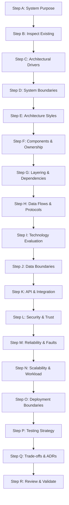
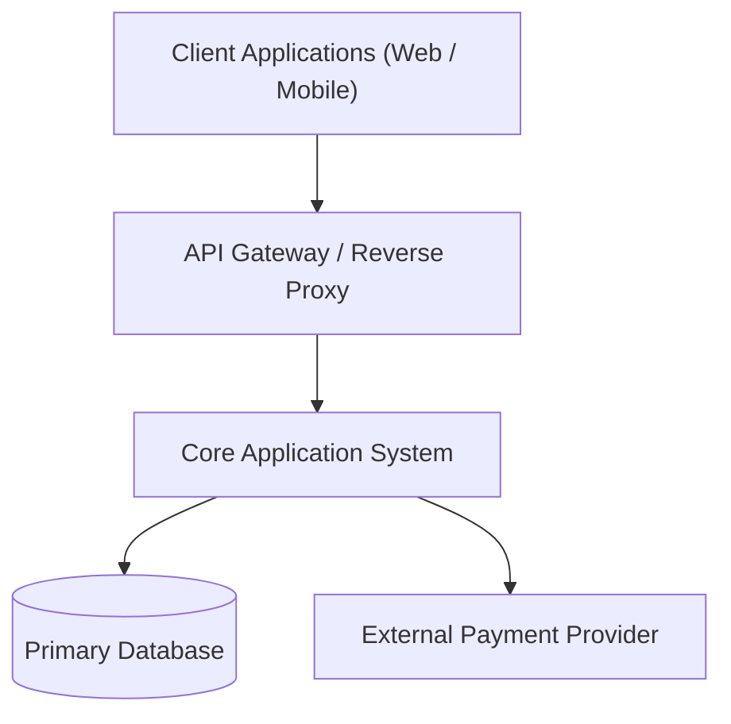

---
name: architecture-design
description: Designs, evaluates, documents, and reviews software architectures, module boundaries, system components, dependency relationships, data flows, integration patterns, technology choices, and architectural decisions. Use when starting a new software system, planning major features, evaluating architectural alternatives, or changing the structure of an existing application. For new systems or structural changes; to assess an existing architecture without redesigning it, use architecture-review.
---

# Architecture Design Skill

This skill guides the AI coding agent to analyze requirements, architect scalable software systems, delineate cohesive module boundaries, evaluate technical trade-offs, map data flows, design resilient integrations, and author authoritative Architecture Decision Records (ADRs).

## 1. Purpose and Scope

Architecture design establishes the structural foundations, component boundaries, and communication patterns of a software system. This skill ensures the agent answers essential architectural questions:

- **What are the architectural drivers and constraints?** The functional obligations, quality attributes (NFRs), and system limitations.
- **Which architecture style best fits the workload?** Monolith, modular monolith, hexagonal/ports-and-adapters, event-driven, or distributed services.
- **What are the primary components and their responsibilities?** Discrete modules, domains, and infrastructural adapters with clear ownership.
- **How do components communicate?** Synchronous APIs, message brokers, streaming channels, and direct function invocations.
- **How are dependencies organized?** Direction of dependency flow, inversion of control, and circular dependency prevention.
- **Where do specific responsibilities reside?** Placement of business logic, persistence logic, transport interfaces, and presentation.
- **Which technology choices and patterns are justified?** Evidence-backed selection of runtimes, frameworks, and storage engines.
- **What are the primary cross-cutting concerns?** Security boundaries, reliability protocols, latency targets, and observability.
- **Which decisions require formal records?** Identifying impactful trade-offs warranting Architecture Decision Records (ADRs).
- **How does the architecture evolve without accidental complexity?** Incremental refactoring paths that protect business continuity.

*Scope Boundary*: Focuses on system-level structural design, module decomposition, integration patterns, and architectural trade-offs. It does not replace low-level physical database modeling, detailed API endpoint authoring, line-by-line coding, or product requirements drafting.

## 2. When to Use This Skill

### Trigger Scenarios

Activate this skill when:
- **Architecting Greenfield Systems**: Designing the high-level structural blueprint for a new application or platform.
- **Evaluating Architectural Alternatives**: Comparing architectural styles (e.g., modular monolith vs. microservices) against concrete requirements.
- **Designing Multi-Module Features**: Structuring cross-cutting capabilities that span databases, services, APIs, and client views.
- **Refactoring System Structure**: Untangling tight coupling, circular dependencies, leaky abstractions, or god-objects in existing codebases.
- **Evaluating Technology Stack Changes**: Assessing runtime upgrades, framework replacements, or external service migrations.
- **Formalizing Architecture Decisions**: Writing and maintaining Architecture Decision Records (ADRs) in `docs/architecture/`.
- **Reviewing System Cohesion**: Auditing proposed code changes for architectural boundary violations before implementation.

### When NOT to Use This Skill

Do not invoke this skill for:
- Localized bug fixes or single-function improvements.
- Trivial UI layout or styling updates.
- Routine API route additions that fit seamlessly into existing controllers.
- Low-level database index additions or schema adjustments (use [database.md](../../rules/database.md)).
- Product requirements gathering (use [requirements-analysis](../requirements-analysis/SKILL.md) or [prd-writing](../prd-writing/SKILL.md)).

## 3. Architecture Design Workflow

Follow this eighteen-step procedure to analyze, structure, and document system architecture:



### Step A: Understand the System's Purpose

1. **Review Upstream Specs**: Inspect approved [PRDs](../../../docs/product/), [SRS documents](../../../docs/requirements/), and business workflows.
2. **Identify Primary Responsibilities**: Clarify what the software achieves, its target audience, and primary system transactions.
3. **Analyze Quality Attributes**: Catalog critical NFRs (security, latency, throughput, availability, maintainability, compliance).
4. **Resist Premature Selection**: Never lock in microservices, distributed queues, or complex frameworks before understanding functional and scale realities.

### Step B: Inspect Existing Architecture

- **For Existing Codebases**:
  - Map runtime entry points, directory structures, core services, data repositories, and third-party integrations.
  - Trace request lifecycles from network ingress through domain logic down to data stores.
  - Audit architectural integrity: look for circular imports, leaky abstractions (e.g., ORM models in UI templates), and unmanaged side-effects.
  - Preserve established conventions unless a demonstrated architectural defect requires remediation.
- **For Greenfield Projects**:
  - Establish the minimal cohesive architectural baseline necessary to satisfy initial requirements.

### Step C: Identify Architectural Drivers

Isolate the key drivers that directly dictate architectural decisions:
- **Workload Profile**: Concurrency, read-to-write ratios, burstiness, and storage volume.
- **Data Integrity & Consistency**: ACID transaction requirements versus eventual consistency tolerances.
- **Security & Regulatory Boundaries**: Multi-tenancy, PCI-DSS, HIPAA, or strict PII segregation.
- **Operational Feasibility**: Deployment platform capabilities, team expertise, maintenance complexity, and hosting costs.

### Step D: Define System Boundaries

- Explicitly delineate what runs inside the application boundary versus external systems (gateways, third-party APIs, CDNs, databases).
- Establish trust boundaries: where untrusted inputs are validated and sanitized before entering core domain layers.
- Determine data ownership: identify the single system of record for each business entity.

### Step E: Evaluate Architecture Styles

Evaluate candidate architectural styles against the project's drivers:
- **Modular Monolith**: High cohesion, in-process communication, shared or separated schemas; optimal for most applications.
- **Layered / Onion / Clean Architecture**: Strict dependency inversion, isolating domain logic from infrastructure and UI.
- **Hexagonal (Ports & Adapters)**: Primary/secondary ports decoupling core workflows from databases, messaging, and HTTP.
- **Event-Driven Architecture**: Asynchronous event publishing, decoupling producers from consumers for high-burst or multi-subscriber workloads.
- **Distributed Microservices**: Independent deployment and polyglot scaling; justified only when operational complexity is offset by organizational scale.
- *Selection Principle*: Default to the simplest architecture that satisfies established requirements. Reject speculative distributed complexity.

### Step F: Define Components and Responsibilities

- Decompose the system into cohesive, loosely coupled modules or bounded contexts.
- For each component, define: Primary Responsibility, Owned Data Entities, Exposed Interfaces, Inbound Dependencies, and Explicit Anti-Responsibilities.
- Ensure high functional cohesion: components must group tightly related domain capabilities.

### Step G: Define Layering and Dependency Direction

- **Dependency Inversion Principle**: High-level domain logic must never depend on low-level infrastructure or transport details. Both must depend on abstractions.
- **Acyclic Dependencies**: Enforce unidirectional dependencies; eliminate circular references between modules.
- **Clean Transport Separation**: Ensure HTTP controllers, GraphQL resolvers, or CLI handlers act merely as adapters translating requests into domain commands.

### Step H: Define Component Interactions and Data Flows

- Map critical data flows: Request Ingress -> Authentication -> Input Validation -> Domain Execution -> Persistence -> Response Serialization.
- Specify interaction paradigms: synchronous request-response (REST, gRPC) versus asynchronous messaging (message brokers, background queues).
- Define transactional scopes: identify where atomic database transactions begin and commit.

### Step I: Evaluate Technology Choices

When selecting runtimes, frameworks, or storage engines:
- Evaluate against requirements: language ecosystem, performance benchmarks, community maturity, LTS support, and license terms.
- Weigh operational maintenance: operational overhead, monitoring tooling, debugging difficulty, and hosting costs.
- Preserve existing stack choices unless measurable limitations require migration.

### Step J: Design Data and Persistence Boundaries

- Define persistence boundaries: determine whether modules share a physical database, utilize separate schemas, or maintain private data stores.
- Designate the authoritative system of record for each data domain to prevent dual-write synchronization conflicts.
- Keep business logic decoupled from ORM-specific details; expose repository interfaces matching domain language.

### Step K: Define API and Integration Boundaries

- Establish interface contracts for internal module communication and external client endpoints.
- Isolate external third-party integrations behind dedicated Gateway or Adapter modules.
- Plan API versioning strategies, backward compatibility, and response pagination (reference [api-design.md](../../rules/api-design.md)).

### Step L: Address Security and Trust Boundaries

- Establish perimeter defenses: TLS termination, rate limiting, and request sanitization.
- Implement zero-trust internal architecture: verify authentication and authorization at service boundaries; never rely solely on UI guards.
- Secure credential management: inject secrets via environment variables or secret vaults; eliminate hardcoded secrets (reference [security.md](../../rules/security.md)).

### Step M: Address Reliability and Failure Handling

- Eliminate single points of failure across critical workflows.
- Implement defensive integration patterns: timeouts, jittered exponential backoffs, circuit breakers, and dead-letter queues.
- Ensure idempotency on all mutating operations that may be retried across network boundaries.

### Step N: Address Performance and Scalability

- Analyze performance bottlenecks: database queries, network round-trips, serialization costs, and concurrency locks.
- Design for stateless application tiers to enable effortless horizontal scaling behind load balancers.
- Apply caching judiciously: define cache invalidation strategies and tenant-scoped keys before introducing Redis or memory caches (reference [performance-optimization.md](../../rules/performance-optimization.md)).

### Step O: Plan Configuration and Deployment Boundaries

- Separate code from configuration following 12-factor application principles.
- Define containerization (Docker) and runtime boundaries matching hosting environments.
- Coordinate database migration execution with application deployment lifecycles (reference [deployment.md](../../rules/deployment.md)).

### Step P: Define Architectural Quality and Testing Strategy

- Structure architecture to support fast, deterministic automated testing.
- Design domain layers to be testable without booting databases or spinning up HTTP servers.
- Define testing pyramids: unit tests for domain rules, integration tests for repository/adapter boundaries, E2E tests for critical user journeys (reference [testing.md](../../rules/testing.md)).

### Step Q: Compare Alternatives and Record Decisions

- Compare viable architectural approaches using explicit trade-off matrices.
- Document consequential decisions as formal Architecture Decision Records (ADRs) capturing Context, Decision, Alternatives, and Consequences.
- Present major technical trade-offs to stakeholders for approval before finalizing designs.

### Step R: Review and Validate the Proposed Architecture

Conduct a holistic architectural review:
- Does the design fulfill all functional use cases and quality attributes?
- Are component boundaries clean and free from circular dependencies?
- Are failure modes, recovery paths, and security boundaries documented?
- Is the architecture proportionate to the project's real-world scale and complexity?
- Mark unapproved designs clearly as `[Proposed Architecture]`.

## 4. Standard Architecture Document Structure

When compiling a comprehensive architecture document, structure the output using the following standard template:

---

# Architecture Design Document: [System or Project Name]

## 1. Architecture Overview
Executive summary of the system, primary architectural style, core runtime choices, and key technical drivers.

## 2. Requirements & Architectural Drivers
- **Key Functional Drivers**: Primary use cases governing structural design.
- **Quality Attributes (NFRs)**: Latency, availability, security, and scalability targets.
- **Technical & Business Constraints**: Mandated platforms, regulatory boundaries, and budgets.

## 3. Architecture Style & Rationale
- **Selected Style**: `[e.g., Modular Monolith / Clean Architecture / Event-Driven]`
- **Rationale**: Detailed explanation of why this style fits the identified drivers.
- **Alternatives Considered**: Why competing patterns (e.g., microservices) were rejected.

## 4. System Context & External Boundaries


## 5. Component & Module Decomposition

| Module Name | Primary Responsibility | Owned Entities | Dependencies |
|---|---|---|---|
| `AuthModule` | Authentication, JWT issuance, RBAC enforcement | `User`, `Role`, `Session` | Database |
| `CatalogModule` | Book catalog search, filtering, and metadata | `Book`, `Author`, `Genre` | Database, Cache |
| `OrderModule` | Checkout, payments, and order fulfillment | `Order`, `OrderItem` | `AuthModule`, `CatalogModule`, Payment Gateway |

## 6. Data Flows & Execution Lifecycles
Narrative walkthrough and sequence diagrams illustrating critical user journeys from request ingress to data mutation and response.

## 7. Technology Stack Selection & Evidence

| Layer | Selected Technology | Version | Rationale & Trade-offs |
|---|---|---|---|
| Runtime | Node.js | LTS (20+) | High I/O throughput, unified TypeScript stack |
| Web Framework | Fastify | 4.x | Low overhead, native JSON schema validation |
| Persistence | PostgreSQL | 16+ | Robust ACID compliance, native JSONB support |

## 8. Data & Persistence Architecture
- Data ownership models and schema segregation.
- Relational integrity, transaction boundaries, and migration strategies (expand-and-contract).

## 9. Security & Trust Architecture
- Ingress authentication, JWT verification, and RBAC authorization matrices.
- Data protection at rest and in transit; secret management protocols.

## 10. Reliability & Performance Engineering
- Circuit breakers, timeout configurations, and graceful degradation paths.
- Stateless autoscaling strategies and connection pooling configurations.

## 11. Deployment & Infrastructure View
- Containerization strategy, environment configuration (`.env` injection), and CI/CD deployment pipelines.

## 12. Architectural Decision Summary
- Links to individual Architecture Decision Records (e.g., `ADR-001`, `ADR-002`).

## 13. Risks, Trade-offs & Open Decisions
- Documented technical risks, mitigation plans, and unresolved stakeholder questions.

---

## 5. Architecture Decision Records (ADRs)

Author formal ADRs in `docs/architecture/architecture-decisions/` using the standard format:

```markdown
# ADR-[NUMBER]: [Title of Decision]

## Status
`[Proposed | Accepted | Deprecated | Superseded by ADR-XXX]`

## Context
The technical, architectural, or business problem requiring a decision, along with identified constraints.

## Decision
The specific technical choice, pattern, or framework selected, articulated in active voice.

## Alternatives Considered
1. **Alternative A**: Description, pros, and cons.
2. **Alternative B**: Description, pros, and cons.

## Consequences
- **Positive**: Direct benefits and unlocked capabilities.
- **Negative / Trade-offs**: Added complexity, operational costs, or architectural limitations.

## Compliance & Verification
How the team will verify adherence to this architectural decision in code reviews or automated tests.
```

## 6. Architecture Diagramming Guidelines

- **Simplicity First**: Focus diagrams on structural clarity; avoid overwhelming viewers with every micro-component in a single view.
- **Standard Syntax**: Use Mermaid syntax for system context, component diagrams, state charts, and sequence diagrams.
- **Accurate Boundaries**: Clearly delineate trust boundaries, external API networks, and internal data tiers.
- **Diagram Alignment**: Ensure text narratives and accompanying diagrams depict identical component names and relationships.

## 7. Storage, Versioning, and Template Usage

- **Inspect Templates**: Review `.agents/templates/architecture/` before creating new architecture specifications.
- **Persistent Location**: Store system-wide architecture documents in `docs/architecture/` (e.g., `docs/architecture/ARCHITECTURE.md`) and ADRs in `docs/architecture/architecture-decisions/`.
- **Never Store in Skills Folder**: Never place project-specific architecture documents or ADRs into `.agents/skills/architecture-design/`.
- **Maintain Living Architecture**: When revising architectures, execute targeted updates, increment document versions, and preserve historical ADRs.

## 8. Interaction and Decision Principles

1. **Inspect Codebase First**: Determine current architectural reality from source code and configurations before asking questions.
2. **Targeted Strategic Inquiries**: Inquire only when missing requirements block core structural patterns or security boundaries.
3. **Evidence-Based Choices**: Base technology and pattern recommendations on measurable drivers, never on fashion or novelty.
4. **No Premature Implementation**: Producing an architecture document does not authorize immediate code changes or infrastructure provisioning.
5. **Stakeholder Alignment**: Mark new designs as `[Proposed Architecture]` until explicitly authorized by project stakeholders.

## 9. Rule Harmony and Skill Collaboration

This architecture design skill operates in synergy with existing project rules and skills:

- [architecture.md](../../rules/architecture.md): Establishes baseline architectural constraints, module decoupling, and layer separation rules.
- [srs-writing](../srs-writing/SKILL.md) & [prd-writing](../prd-writing/SKILL.md): Provide upstream functional requirements and business context.
- [project-planning](../project-planning/SKILL.md): Converts component designs into phased implementation milestones.
- [database.md](../../rules/database.md): Governs persistence implementation, relational integrity, and migration safety.
- [security.md](../../rules/security.md): Dictates trust boundaries, secret management, and defense-in-depth controls.
- [api-design.md](../../rules/api-design.md): Informs interface contracts, payload formats, and endpoint versioning.
- [performance-optimization.md](../../rules/performance-optimization.md): Sets latency percentiles and resource consumption limits.
- [deployment.md](../../rules/deployment.md): Guides runtime containerization, environment configuration, and release engineering.
