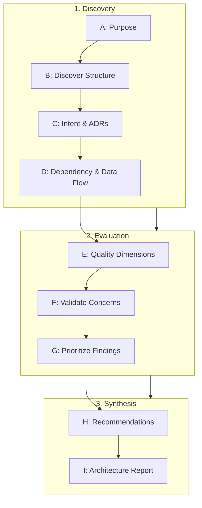

---
name: architecture-review
description: Reviews existing software architecture for module boundaries, dependency direction, coupling, cohesion, scalability, reliability, security boundaries, data flow, integration contracts, maintainability, and technical debt. Use when assessing an existing system, investigating architectural risks, reviewing major structural changes, evaluating architectural consistency, or identifying justified opportunities for improvement before redesign or refactoring. Assesses what already exists; to design a new system or a structural change, use architecture-design.
---

# Architecture Review Skill

This skill guides the AI coding agent to systematically inspect, evaluate, and document an existing software architecture, identify structural weaknesses and risks, assess cohesion and coupling, and recommend proportionate, evidence-backed improvements without imposing speculative redesigns or unprompted rewrites.

## 1. Purpose, Core Principles, and Architectural Mindset

Architecture review evaluates how well an existing system's structural design satisfies its functional requirements and quality attributes. Adhere to five foundational principles:

- **Understand Before Judging**: Inspect actual code, entry points, module imports, and runtime configurations before forming opinions. Distinguish documented design intent from observed implementation. Never declare an architecture defective merely because it diverges from textbook patterns.
- **Architecture Must Fit Actual Requirements**: Evaluate structural choices against the project's real scale, operational constraints, and domain complexity. A modular monolith is often superior to distributed microservices for small to mid-sized workloads. Never recommend complex distributed patterns simply because they are popular.
- **Evidence Over Opinion**: Ground all findings in concrete code paths, dependency graphs, configuration manifests, or observed runtime telemetry. Distinguish confirmed structural defects from design trade-offs, theoretical risks, or stylistic preferences.
- **Prefer Proportionate Improvements**: Recommend the smallest, least disruptive change that resolves an identified risk. Prioritize incremental refactoring and clear module boundaries over high-risk rewrites. A successful review may conclude that the existing architecture should remain unchanged.
- **Reviewing Is Not Redesigning**: Maintain a strict separation between evaluating an architecture (this skill) and authoring a new architectural blueprint (handled by [architecture-design](../architecture-design/SKILL.md)). The review is strictly read-only; never modify application code, alter schemas, or move files during an assessment.

*Scope Boundary*: Evaluates structural health. For code diffs, use [code-review](../code-review/SKILL.md); for refactoring, use [refactoring](../refactoring/SKILL.md); for database models, use [database-design](../database-design/SKILL.md); for security audits, use [security-review](../security-review/SKILL.md).

## 2. Review Scope and Architectural Perimeter

Establish the precise assessment perimeter before commencing evaluation:

| Dimension | Scope Assessment Criteria |
| :--- | :--- |
| **System Boundary** | Entire repository, specific microservice, modular subsystem, or cross-cutting tier. |
| **Architectural Drivers** | Critical capabilities, primary user journeys, throughput/latency targets, SLAs. |
| **Structural Constraints** | Hosting platform, budget limits, operational team capacity, runtime dependencies. |
| **Data & Persistence** | Storage engines, transaction boundaries, shared vs. isolated schemas, data ownership. |
| **Integration Contracts** | Public/internal APIs (REST, GraphQL, gRPC), event queues, external integrations. |
| **Change Topology** | High-churn modules, planned expansions, areas with recurring defect regressions. |

*Boundary Rule*: For multi-service distributed architectures, evaluate each service's internal cohesion independently before evaluating inter-service topology. Explicitly document any uninspected services or unverified runtime layers.

## 3. Systematic 9-Step Architecture Review Workflow

Execute this structured assessment sequence from initial scoping to final deliverable:



- **Step A: System Purpose**: Review requirements, domain concepts, and user journeys; identify critical workflows and priority quality attributes (performance, reliability, security, maintainability).
- **Step B: Discover Architecture**: Inspect entry points, directory hierarchies, module boundaries, routing controllers, services, domain models, persistence, and background jobs.
- **Step C: Establish Intent**: Review ADRs and design documentation; distinguish deliberate design decisions from accidental implementation patterns.
- **Step D: Trace Dependencies & Data Flow**: Map imports, function calls, boundary-crossing data, validation points, transactions, asynchronous events, and shared state stores.
- **Step E: Evaluate Quality**: Assess separation of responsibilities, dependency direction, coupling/cohesion, data ownership, integration contracts, security, reliability, and scalability.
- **Step F: Validate Concerns**: Confirm each issue against actual code; determine whether problems are active defects, structural risks, or acceptable trade-offs.
- **Step G: Prioritize Findings**: Rank findings across the 5-level severity model (Critical, High, Medium, Low, Informational) based on business impact, blast radius, and confidence.
- **Step H: Recommend Improvements**: Formulate practical, incremental refactoring steps detailing trade-offs, prerequisites, and verifiable success criteria.
- **Step I: Deliver Report**: Produce the structured Architecture Review Report synthesizing findings, architectural strengths, and a prioritized roadmap.

## 4. Module Boundaries, Cohesion, and Coupling

Inspect how the codebase organizes responsibilities and enforces encapsulation:

- **High Cohesion**: Each module or package has a single, well-defined conceptual focus; business rules governing a domain concept are localized within that domain; operations changing together reside together.
- **Low Coupling**: Modules communicate across explicit, minimal public interfaces rather than accessing internal implementations; shared utilities are domain-scoped rather than generic dumping grounds (`utils`, `common`, `helpers`).
- **Anti-Patterns**:
  - *God Module*: Central class or service accumulating unrelated responsibilities and orchestrating the entire system.
  - *Shotgun Surgery*: Minor business rule change requires coordinated edits across dozens of unrelated files.
  - *Leaky Abstraction*: Module queries another module's internal state to execute foreign business logic.
  - *Circular Module Coupling*: Modules A and B directly or transitively depend on each other, creating a brittle unit.

## 5. Layering and Dependency Direction

Evaluate whether architectural layers respect clean separation and unidirectional dependency flow:

$$\text{Presentation (HTTP/CLI)} \longrightarrow \text{Application Services (Use Cases)} \longrightarrow \text{Domain Core (Business Rules)} \longleftarrow \text{Infrastructure (DB/Adapters)}$$

- **Inward Dependency Flow**: Dependencies point inward toward the domain core; business logic remains agnostic of transport protocols (HTTP/REST), UI frameworks, and storage drivers.
- **No Leaky Persistence**: Raw database queries, ORM entities, or SQL transactions must not leak into presentation controllers or client views.
- **Lean Controllers**: Route handlers restrict responsibility to parsing input, invoking application services, and formatting HTTP responses. Business calculations belong in domain services.
- **Infrastructure Inversion**: External dependencies (payment gateways, notification dispatchers, third-party APIs) are abstracted behind interfaces owned by the application layer.

## 6. Architectural Patterns and Their Suitability

Assess whether the chosen architectural pattern aligns with the application's actual scale and operational capabilities:

| Pattern | Best Suited For | Operational Costs & Risks | Common Misapplications |
| :--- | :--- | :--- | :--- |
| **Layered (N-Tier)** | Small-medium CRUD apps, linear flows. | Rigid pass-through layers, anemic models. | Over-engineering into 6-layer boilerplate. |
| **Modular Monolith**| Growing domain complexity, high cohesion. | Requires discipline to prevent leakage. | Adopting microservices without boundaries. |
| **Hexagonal / Clean**| Rich domain logic, multi-channel inputs. | Abstraction overhead (ports, adapters). | Applying to trivial data-entry apps. |
| **Event-Driven** | Asynchronous workflows, pub/sub. | Eventual consistency, complex debugging. | Using async queues for synchronous flows. |
| **Microservices** | Independent scaling, isolated deployments. | Distributed transactions, latency, CI/CD. | Adopting without operational tooling. |

*Principle*: Never recommend decomposing a monolith into microservices without empirical evidence demonstrating that deployment coordination, scaling divergence, or organizational boundaries make a monolith unviable.

## 7. API and Integration Boundaries

Evaluate communication contracts between internal modules and external systems:

- **Contract Stability**: APIs expose versioned, structured contracts (JSON Schema, OpenAPI, Protobuf); consumers never depend on internal database column names or mutable domain entities.
- **Validation Boundaries**: Incoming payloads are validated at ingress before passing to application services.
- **Resilient Egress**: External calls enforce timeouts, exponential backoff retries, and circuit breakers; critical workflows never block synchronously on unreliable third-party endpoints.
- **Failure Isolation**: Background worker consumers implement dead-letter queues (DLQs) and poison-message handling to prevent queue-blocking crashes.

## 8. Database Architecture and Data Ownership

Evaluate the relationship between application responsibilities and persistent data stores:

- **Clear Data Ownership**: Each table or entity has a single owning module; other modules query or mutate records through the owner's public service, not direct SQL joins across boundaries.
- **Transaction Boundaries**: Transactions are contained within a single cohesive aggregate or use case; avoid sprawling cross-service distributed transactions.
- **Shared Database Discipline**: In monolithic apps with a shared database, maintain schema-level or namespace separation to prevent cross-domain foreign key entanglements that block future modularization.
- **Migration & Evolution**: Database changes follow the expand-and-contract pattern to ensure zero-downtime deployments and backward compatibility with active application code.

## 9. Security Architecture and Trust Boundaries

Verify that architectural controls enforce least privilege and defense in depth:

- **Centralized Authn & Authz**: Enforced at entry points and validated in application services; never rely on client-side UI visibility to enforce access control.
- **Tenant Isolation**: Multi-tenant systems enforce tenant boundaries at the data access layer (parameterized tenant IDs, row-level security, separate schemas), not in transient controller logic.
- **Secret Isolation**: Secrets, credentials, and API keys are managed through environment variables or secure key vaults, never hard-coded in source code or committed to Git.
- **Auditability**: Security-sensitive operations (privilege escalation, financial transactions, PII access) generate structured audit logs with actor ID, timestamp, and action context.

## 10. Reliability, Availability, and Fault Isolation

Evaluate how the architecture behaves when downstream dependencies fail:

- **Fault Isolation (Blast Radius)**: Non-critical feature failures (recommendations, analytics) must not cascade to bring down critical workflows (checkout, login).
- **Graceful Degradation**: Systems provide fallback mechanisms, cached responses, or degraded modes when upstream or downstream dependencies are unavailable.
- **Idempotency**: Mutation endpoints, webhook handlers, and background job consumers support idempotency keys to safely tolerate network retries without duplicate records.
- **Resource Limits**: Ingress routes and internal thread pools enforce rate limits, connection limits, and memory quotas to prevent denial-of-service through resource starvation.

## 11. Scalability, Capacity, and Performance Efficiency

Distinguish structural architectural constraints from localized code optimizations:

- **Stateless Application Tier**: Application services maintain zero sticky in-memory session state across requests to enable seamless horizontal scaling behind load balancers.
- **Decoupled Heavy Processing**: Long-running computational tasks, PDF generation, bulk data imports, and email dispatches are offloaded to asynchronous background workers.
- **Caching Boundaries**: Caching layers (Redis, CDN) define explicit invalidation strategies, TTL policies, and cache-aside patterns; never use caching to mask fundamentally inefficient query topology.
- **Data Growth Readiness**: Tables projected to grow significantly have archiving, partitioning, or indexing strategies defined before storage saturation occurs.

## 12. Maintainability, Testability, and Technical Debt

Evaluate how easily the architecture supports continuous, safe engineering changes:

- **Testability at the Boundary**: Architecture allows domain logic to be thoroughly unit-tested in complete isolation from database engines, network sockets, and HTTP servers.
- **Change Impact Predictability**: Engineers can reason about the blast radius of a change without needing to understand the entire repository.
- **Technical Debt Management**: Distinguish intentional, acceptable technical debt (temporary shims with documented deprecation paths) from toxic architectural debt (circular dependencies, duplicate business logic, unmaintained forks).

## 13. Deployment and Operational Architecture

Assess how the architecture aligns with release, configuration, and monitoring practices:

- **Environment Parity**: The system runs identically across development, staging, and production through declarative containerization and standardized environment variables.
- **Health Observability**: Application provides distinct `/healthz` (liveness) and `/ready` (readiness) probes that verify internal connectivity to databases and message brokers.
- **Zero-Downtime Rollouts**: Component packaging and migration sequencing support rolling or blue-green deployment strategies without user-facing 500 errors.

## 14. Architectural Risk and Finding Prioritization

Assign one of five standardized severity ratings to each architectural finding:

| Severity Level | Operational Criteria | Required Action |
| :--- | :--- | :--- |
| **Critical** | Immediate risk to integrity, active corruption, security hole, or failure under load. | Address immediately; block new features until mitigated. |
| **High** | Substantial structural defect, circular coupling, missing auth, or cascading outage risks. | Schedule in next development sprint; prioritized fix. |
| **Medium** | Architectural debt, leaky persistence, duplicated business rules, or testability barriers. | Incorporate into near-term roadmap; refactor with features. |
| **Low** | Minor inconsistency, non-standard naming, or isolated coupling with minimal blast radius. | Address during routine maintenance or refactoring. |
| **Informational** | Architectural observation, noteworthy trade-off, or optional improvement without negative impact. | Document in review report; no immediate action needed. |

### Evidence-Based Finding Structure
Document every substantive finding using this standardized schema:
- **Title**: `[Severity] Concise Summary of Architectural Flaw`
- **Area**: Module Boundaries | Layering | Data Ownership | Security | Reliability | Scalability
- **Location**: Specific files, directories, interfaces, or configuration manifests.
- **Evidence**: Concrete code paths, import chains, queries, or configuration lines.
- **Observed Condition**: What the system currently does in implementation.
- **Architectural Concern & Impact**: Why this creates risk, coupling, or fragility, and consequences for maintainability/uptime.
- **Confidence**: `Confirmed` (code verified) | `High` | `Medium` | `Hypothesis` (needs runtime telemetry).
- **Recommendation & Trade-offs**: Pragmatic, minimal refactoring path, migration complexity, and verification tests.

## 15. Practical Decision Guide

| Architectural Review Dilemma | Recommended Evaluative Decision & Rule |
| :--- | :--- |
| **Split monolith to microservices** | Challenge proposal. Require evidence that scaling divergence, distinct cadences, or autonomous team boundaries necessitate distribution. Modular monolith first. |
| **Raw SQL in controllers** | High Severity layering violation. Extract query to repository; invoke via application service to restore testability. |
| **Two modules mutate same table** | High Severity data ownership conflict. Designate one module as domain owner; second interacts via owner's public service. |
| **40 third-party packages for utils** | Maintainability & supply-chain risk. Consolidate on standard library and domain-specific utilities. |
| **Shared `utils` exceeds 50 files** | Cohesion breakdown. Relocate utilities into specific functional domains; delete unused helpers. |
| **Sync external API in checkout** | High Severity reliability risk. Offload post-checkout tasks (emails, analytics) to asynchronous queues with retries. |
| **Core logic depends on HTTP `req`** | Medium Severity layering violation. Extract transport parameters into plain DTOs before invoking domain logic. |
| **Tests require live database** | High Severity testability barrier. Introduce repository interfaces and in-memory test doubles for pure business logic. |
| **Circular dependency User/Billing** | High Severity coupling flaw. Extract shared billing entity or use domain events to decouple bidirectional dependency. |
| **Microservices lack tracing** | High Severity operational blindspot. Require correlation IDs (`X-Request-ID`) across HTTP and message headers. |
| **N+1 queries inside loop** | Medium Severity performance bottleneck. Recommend batch fetching (`IN (?)`) or eager loading in repository layer. |
| **Non-Clean/Hexagonal pattern** | Do NOT flag as defect if current pattern is cohesive, tested, maintainable, and meets requirements. Avoid dogma. |

## 16. Architecture Review Deliverable Template

Deliver the assessment using this comprehensive markdown report structure:

```markdown
# Architecture Review: [System Name]
- **Assessment**: [STABLE / EVOLVABLE / AT RISK] | **Style**: [Modular Monolith / Layered / Microservices]
- **Key Findings**: [X Critical, Y High, Z Medium, W Low] | **Core Action**: [Key architectural action]

## Review Scope & Limitations
- **Inspected Scope**: [Directories, services, entry points, configuration files]
- **Methodology**: Static dependency mapping, call-graph tracing, contract and docs review.
- **Limitations**: [e.g., Runtime metrics unavailable; analysis based on static source].

## Architectural Strengths (Preserve)
- **[Strength 1]**: [Substantiated positive design decision, e.g., Strict inward dependency flow in Billing domain].
- **[Strength 2]**: [Appropriate technology choice matching team scale].

## Prioritized Findings & Structural Risks
### [CRITICAL / HIGH / MEDIUM] Finding Title
- **Area**: [Module Boundaries / Layering / Data Ownership / Security / Reliability / Scalability]
- **Location**: [`src/modules/...`, `src/controllers/...`]
- **Evidence**: [Code snippet or import path demonstrating flaw]
- **Observed Condition**: [What the code actually does]
- **Architectural Concern & Impact**: [Why this creates risk or fragility, and consequences] | **Confidence**: Confirmed | High
- **Recommendation & Trade-offs**: [Proportionate, minimal remediation path, migration costs, and verification tests]

## Cross-Cutting Risks & Roadmap
- **Risks**: Persistence: [Coupling] | Security: [Trust boundaries] | Reliability: [Blast radius]
- **Roadmap**: 1. *Immediate*: [Critical fixes] $\rightarrow$ 2. *Near-Term*: [Decoupling] $\rightarrow$ 3. *Long-Term*: [Strategic]

## Verification & Fitness Functions
- Proposed automated architectural checks (e.g., dependency-cruiser, arch-unit) to prevent regression.
```

## 17. Alignment with Repository Rules and Companion Skills

Integrate seamlessly with project standards:

- **Repository Rules**: [architecture.md](../../rules/architecture.md) (system design), [change-safety.md](../../rules/change-safety.md) (safety), [security.md](../../rules/security.md) (trust boundaries), [database.md](../../rules/database.md) (persistence), [backend.md](../../rules/backend.md) (layering), [coding-standards.md](../../rules/coding-standards.md) (code structure).
- **Companion Skills**: [architecture-design](../architecture-design/SKILL.md) (greenfield/ADRs), [code-review](../code-review/SKILL.md) (diffs), [refactoring](../refactoring/SKILL.md) (restructuring), [database-design](../database-design/SKILL.md) (schemas), [security-review](../security-review/SKILL.md) (vulnerabilities), [performance-profiling](../performance-profiling/SKILL.md) (bottlenecks), [deployment-readiness](../deployment-readiness/SKILL.md) (pre-release).

## 18. Final Validation Checklist

Before concluding any architecture review, verify these 10 criteria:

- [ ] **1. Grounded in Evidence**: Every finding cites concrete code files, import paths, or configuration manifests.
- [ ] **2. Requirements-Aligned**: Architecture evaluated against actual project requirements, not theoretical ideals.
- [ ] **3. Strict Non-Modification**: Review conducted without modifying application source code, schemas, or configs.
- [ ] **4. Module Boundaries Audited**: Coupling, cohesion, circular dependencies, and utility sprawl evaluated.
- [ ] **5. Layering & Inward Flow Verified**: Dependency directions and persistence leakages systematically assessed.
- [ ] **6. Data Ownership Inspected**: Table mutation boundaries, transactions, and shared persistence reviewed.
- [ ] **7. Security & Fault Boundaries Assessed**: Authn/authz enforcement, blast radius, and circuit breaking evaluated.
- [ ] **8. Strengths Preserved**: Functioning, well-designed architectural choices highlighted for preservation.
- [ ] **9. Proportionate Recommendations**: Remediations favor minimal, incremental refactoring over risky rewrites.
- [ ] **10. Clear Prioritization**: Findings categorized by severity and structured into an actionable, phased roadmap.
