---
name: authentication-authorization
description: Designs, implements, reviews, and tests authentication and authorization systems, including login, logout, sessions, tokens, role-based and resource-based permissions, account recovery, multi-factor authentication, OAuth and OpenID Connect integrations, API access control, and multi-tenant data isolation. Use when implementing identity management, protecting routes and resources, managing permissions, securing user sessions, or diagnosing authentication and authorization issues.
---

# Authentication & Authorization Skill

This skill teaches the AI coding agent to design, implement, review, and maintain secure authentication and authorization systems across web applications, APIs, desktop clients, and multi-tenant platforms while preserving data isolation, session security, and access control.

## 1. Purpose, Core Principles, and Security Mindset

The central mandate of identity and access security is:
**Authentication establishes who or what is making a request. Authorization determines what that identity is permitted to access or do. Enforce both at the appropriate trusted boundaries, follow established security standards, and never sacrifice data isolation or access control merely to make a workflow work.**

Adhere to seven foundational principles:
- **Server Authoritativeness**: Client-side checks improve UX; server-side enforcement is mandatory.
- **Explicit Trust Boundaries**: Resolve caller identity at the perimeter before executing domain logic.
- **Principle of Least Privilege**: Grant users and services only the minimum permissions required.
- **Fail-Closed Security**: Deny access by default if authentication is missing or permissions ambiguous.
- **Standardized Implementations**: Use maintained, audited libraries; never invent custom crypto.
- **Complete Lifecycle Management**: Securely govern issuance, renewal, revocation, and deactivation.
- **Defense-in-Depth**: Layer transport security, secure cookies, token checks, and database isolation.

*Scope Boundary*: Focuses on identity verification, sessions, tokens, and access control. For vulnerability audits, use [security-review](../security-review/SKILL.md); for threats, use [threat-modeling](../threat-modeling/SKILL.md); for routing, follow [backend-development](../backend-development/SKILL.md) and [api-development](../api-development/SKILL.md); for repo rules, follow [security.md](../../rules/security.md) and [api-design.md](../../rules/api-design.md).

## 2. Scope and Trigger Scenarios

### Trigger Scenarios
Activate this skill when:
- **Identity & Session Management**: Implementing login, logout, password resets, session cookies, or JWTs.
- **Access Control & Permissions**: Defining RBAC, permission guards, resource ownership, or ABAC rules.
- **Third-Party Integrations**: Configuring OAuth 2.0, OpenID Connect (OIDC), SAML, or social logins.
- **Multi-Factor Authentication**: Enrolling and verifying TOTP authenticator apps, WebAuthn, or passkeys.
- **Multi-Tenant Isolation**: Enforcing tenant data boundaries and cross-tenant isolation.
- **API Security & M2M Access**: Issuing, validating, and scoping API keys or service credentials.

### When NOT to Use This Skill
Do not use this skill for:
- Input format or type validation alone (use [input-validation](../input-validation/SKILL.md)).
- Output encoding or XSS escaping alone (use context-aware encoding in UI layers).
- Slow query optimization without indexes (use [database-query-optimization](../database-query-optimization/SKILL.md)).
- Volumetric network DDoS defense (defer to network infrastructure or cloud WAFs).

| Activity | Primary Skill | Supporting Skills |
| :--- | :--- | :--- |
| **Login, sessions & tokens** | `authentication-authorization` | `backend-development` |
| **RBAC & ownership checks** | `authentication-authorization` | `api-development` |
| **OAuth 2.0 / OIDC setup** | `authentication-authorization` | `frontend-development` |
| **Brute-force mitigation** | `rate-limiting` | `authentication-authorization` |
| **Audit access controls** | `security-review` | `authentication-authorization` |

## 3. Defining Authentication, Authorization, and Identity Clearly

Preserve distinct boundaries between identity, session, and permission concepts:
- **Authentication (AuthN)**: Verifies caller identity (credentials, tokens, certificates).
- **Authorization (AuthZ)**: Determines what the verified identity is permitted to access.
- **Identity & Sessions**: Manages user accounts, credentials, and session lifecycles.
- **Access Control**: Enforces security policies at API gateways and domain boundaries.

## 4. Establishing the Application's Security Requirements

Identify the application's actual security model before writing code:
- **Identity Classification**: Map user types (admins, teachers, students, services).
- **Protected Boundaries**: Identify public endpoints vs. authenticated or privileged actions.
- **Permission Dynamics**: Determine if access requires static roles, permissions, or ownership.

## 5. Inspecting and Respecting the Existing Authentication Architecture

Align with the project's established identity mechanisms rather than introducing conflicting paradigms:
- **Session Cookies**: Used in monolithic web apps and server-rendered frameworks.
- **Bearer Tokens**: Used in decoupled SPAs, mobile applications, and microservices.
- **Federated OIDC/OAuth 2.0**: Used for enterprise SSO and delegating identity.
- **No Parallel Systems**: Never introduce a secondary auth system alongside an existing one.

## 6. Designing the Complete Authentication Flow

Design the end-to-end authentication lifecycle covering every state transition:
1. **Submission**: User submits credentials or initiates external identity provider flow.
2. **Verification & MFA**: Server verifies password hashes, account status, and MFA challenges.
3. **State Binding**: Issues cryptographically signed session cookie or scoped access token pair.
4. **Renewal & Invalidation**: Rotates session IDs on login; destroys server session on logout.

## 7. Secure Password Handling

Enforce modern password hashing and storage best practices:
- **Modern Hashing**: Use Argon2id, scrypt, or bcrypt with appropriate work factors.
- **Never Fast Hashes**: Never use MD5, SHA-1, or plain SHA-256 for password storage.
- **No Reversible Encryption**: Never store passwords using two-way encryption or plaintext.
- **Zero Exposure**: Never log, echo, or transmit passwords in errors, URLs, or client storage.
- **Breached Password Screening**: Screen passwords against known breach corpuses on signup and resets.

## 8. Sessions and Secure Cookies

Configure session storage and cookies to resist tampering and interception:
- **Cookie Flags**: Always set `HttpOnly` (blocks XSS), `Secure` (HTTPS), and `SameSite`.
- **Session Fixation**: Regenerate session IDs immediately upon authentication.
- **Timeouts & Revocation**: Enforce idle and absolute timeouts; destroy sessions on logout.
- **Partitioned Cookies**: Configure cookies appropriately for partitioned contexts (CHIPS) where required.

## 9. Token-Based Authentication (JWTs & API Keys)

Enforce strict cryptographic and lifecycle validation for signed tokens:
- **Cryptographic Checks**: Verify signatures using established libraries; whitelist algorithms.
- **Algorithm Pinning**: Restrict supported algorithms to RS256/EdDSA to block algorithm downgrade.
- **Claim Verification**: Strictly validate `iss`, `aud`, `exp`, and `nbf` claims.
- **Refresh & API Keys**: Rotate single-use refresh tokens; store API keys hashed (SHA-256).

## 10. OAuth 2.0 and OpenID Connect (OIDC)

Integrate external identity providers following official protocol specifications:
- **Authorization Code with PKCE**: Always use PKCE for public, SPA, and mobile clients.
- **State & Nonce Validation**: Enforce cryptographically random `state` and `nonce` checks.
- **Token Verification**: Verify OIDC ID tokens cryptographically before account linking.
- **Scope Minimization**: Request strictly the minimum necessary scopes to uphold least privilege.

## 11. Multi-Factor Authentication (MFA)

Implement secondary authentication factors with resilient verification workflows:
- **Supported Factors**: Support TOTP apps (RFC 6238), WebAuthn/Passkeys, or provider MFA.
- **Secure Secret Storage**: Generate high-entropy base32 TOTP secrets; encrypt at rest.
- **Backup & Anti-Replay**: Provide single-use recovery codes; disallow OTP code reuse.

## 12. Registration, Verification, and Account Recovery

Design secure, enumeration-resistant account lifecycle workflows:
- **High-Entropy Tokens**: Generate secure random tokens for email verification and resets.
- **Strict Lifetimes**: Set short token expiration windows (15-60 mins); invalidate on use.
- **Anti-Enumeration & Throttling**: Return generic messages; throttle recovery endpoints.

## 13. Access Control Models: RBAC, Permissions, and Resource Ownership

Select access-control models aligned with application domain complexity:
- **Role-Based Access Control**: Map users to roles, and roles to granular permissions.
- **Resource Ownership**: Verify the authenticated user owns or has access to the entity.
- **Contextual Rules (ABAC)**: Evaluate conditions such as tenant ID, campus, or status.

## 14. Enforcing Authorization at the Server-Side Boundary

Enforce authorization checks on the server at every entry point:
- **Trusted Identity Resolution**: Extract user identity strictly from verified sessions or tokens.
- **Never Trust Client Claims**: Never accept user IDs, tenant IDs, or roles from request bodies.
- **Server Enforcement**: Protect raw API routes independently of whether frontend hides UI.

## 15. Preventing Insecure Direct Object References (IDOR)

Ensure record identifiers cannot be exploited to access unauthorized data:
- **Ownership Verification**: Always verify caller has rights to the specific record ID.
- **Scoped Database Queries**: Include ownership and tenant filters (`WHERE id=? AND tenant_id=?`).
- **Concealment**: Return `404 Not Found` instead of `403` if revealing existence leaks info.

## 16. Multi-Tenant and Organization-Level Isolation

Guarantee complete data segregation in multi-tenant architectures:
- **Verified Tenant Context**: Derive tenant context strictly from verified sessions or tokens.
- **Query Scoping**: Enforce tenant ID filters across all queries, mutations, jobs, and caches.
- **Cross-Tenant Testing**: Systematically test Tenant A cannot access Tenant B records.

## 17. Frontend Route Guards and UI Permissions

Design frontend access controls to enhance user experience without acting as security boundaries:
- **UX Navigation**: Hide inaccessible links and buttons to provide clean interfaces.
- **Client Route Guards**: Intercept unauthorized transitions; avoid flashing protected views.
- **Non-Reliance**: Never treat client route guards or hidden buttons as security controls.

## 18. API Security and Authentication Errors

Deliver standard, predictable HTTP status codes without disclosing internal state:
- **401 Unauthorized**: Return when request lacks valid credentials (with `WWW-Authenticate`).
- **403 Forbidden**: Return when authenticated caller lacks required permissions for resource.
- **Sanitized Errors**: Never expose stack traces, database schemas, or token contents in errors.

```json
{"error":{"code":"FORBIDDEN","message":"Access denied for this resource."}}
```

## 19. CSRF, CORS, and Browser Security Boundaries

Defend web applications against cross-site browser vulnerabilities:
- **Anti-CSRF Tokens**: Require synchronizer tokens or custom headers for cookie state mutations.
- **SameSite Cookies**: Use `SameSite=Lax` or `Strict` cookies as baseline defense against CSRF.
- **Strict CORS Allowlists**: Whitelist trusted origins; never combine credentials with wildcard `*`.

## 20. Sensitive Actions and Reauthentication

Protect high-risk operations with step-up verification:
- **Target Operations**: Require reauth for password changes, MFA removal, or billing updates.
- **Step-Up Verification**: Challenge for password re-entry or MFA within a recent time window.

## 21. Rate Limiting and Authentication Abuse Protection

Shield authentication and recovery endpoints against automated abuse:
- **Targeted Endpoints**: Throttle login, password reset, registration, MFA, and token refresh.
- **Dual-Key Throttling**: Rate limit by both client IP address and targeted username against stuffing.
- **Prevent Account Lockout DoS**: Throttle attackers by IP without locking legitimate users out.

## 22. Service-to-Service and Machine Authentication (M2M)

Secure automated workloads, background workers, and internal APIs:
- **Workload Identity**: Use mutual TLS (mTLS), IAM workload identity, or client credentials.
- **Scoped Credentials**: Grant distinct, least-privilege credentials; never reuse user tokens.

## 23. Permissions Lifecycle and Administrative Changes

Handle dynamic permission and account status changes reliably:
- **Immediate Deactivation**: Invalidate sessions and revoke tokens upon account suspension.
- **Token Invalidation**: Use short-lived access tokens (15 mins) and revoke on password reset.

## 24. Secure Configuration and Secret Management

Safeguard encryption keys, JWT secrets, and provider credentials:
- **Environment Isolation**: Load secrets exclusively from environment variables or vaults.
- **Key Rotation**: Support cryptographic key rotation using key identifiers (`kid`) in verifiers.
- **Startup Validation**: Fail fast at startup if mandatory security secrets are missing.

## 25. Privacy, Audit Logging, and Monitoring

Record structured security telemetry without compromising sensitive user data:
- **Audit Events**: Log logins, logouts, failures, role changes, and rejected access attempts.
- **Strict Redaction**: Never log passwords, session cookies, bearer tokens, or MFA codes.

## 26. Testing Authentication and Authorization

Validate security behavior through comprehensive automated test suites:
- **Authentication Positive**: Assert valid credentials establish correct authenticated session.
- **Authentication Negative**: Assert invalid passwords, expired tokens, and malformed headers return 401.
- **Authorization Positive**: Assert users with permitted roles can perform authorized operations.
- **Authorization Negative**: Assert users without permissions receive 403 Forbidden.
- **IDOR & Multi-Tenant**: Assert User A cannot access User B records and Tenant A cannot access Tenant B data.

## 27. Common Authentication and Authorization Defects to Prevent

Audit codebase systematically for critical security pitfalls:
- Enforcing authentication but omitting authorization checks on backend routes.
- Trusting client-supplied role names or tenant IDs from request bodies.
- Relying on hidden frontend UI buttons as the only access control.
- Insecure direct object references (IDOR) on database record IDs.
- Omitting tenant scoping filters in database queries, causing multi-tenant data leaks.
- Accepting JWTs with algorithm `none` or failing to verify token signatures.

## 28. Backward Compatibility and Migration

Manage authentication upgrades and schema changes safely:
- **Adaptive Password Upgrades**: Rehash passwords transparently using newer algorithms on login.
- **Safe Migrations**: Maintain session validity and apply non-breaking permission migrations.

## 29. Recommended 11-Phase Auth Workflow

```mermaid
flowchart LR
    P1["1: Requirements"] --> P2["2: Inspect Code"] --> P3["3: Auth Model"] --> P4["4: Pick Mechanism"] --> P5["5: Plan Layers"] --> P6["6: Auth Lifecycle"] --> P7["7: Enforce AuthZ"] --> P8["8: Abuse & Secrets"] --> P9["9: Security Tests"] --> P10["10: Code Review"] --> P11["11: Report"]
```



- **Phases 1-3 (Requirements, Inspection & Model)**: Map user roles, inspect existing auth middleware, and define RBAC/IDOR rules.
- **Phases 4-6 (Mechanism, Planning & Lifecycle)**: Select standard library, map affected layers, implement login/session/logout.
- **Phases 7-8 (Authorization, Abuse & Secrets)**: Enforce server route guards, IDOR/tenant checks, rate limits, and secret configs.
- **Phases 9-11 (Testing, Review & Report)**: Execute positive/negative/tenant tests, inspect diff, and publish completion report.

## 30. Definition of Done

An authentication or authorization task is complete only when all criteria are satisfied:
- [ ] 1. **Security Requirements Mapped**: Documented user identities, protected operations, and access rules.
- [ ] 2. **Standard Mechanisms Reused**: Leveraged established, audited libraries without custom crypto.
- [ ] 3. **Server-Side Enforcement**: All protected endpoints enforce identity and permission checks independently of UI.
- [ ] 4. **IDOR & Isolation Enforced**: Resource ownership and multi-tenant data filters are strictly verified.
- [ ] 5. **Safe Credential Handling**: Modern password hashing, secure cookie flags, and token validations active.
- [ ] 6. **Zero Secret Exposure**: Passwords, tokens, and PII are redacted from logs, errors, and client bundles.
- [ ] 7. **Automated Tests Passing**: Validated login, rejection, permissions, IDOR, and tenant isolation in tests.

## 31. Standardized Completion Report Template

```markdown
# Auth Assessment & Implementation Report: [Feature / Endpoint]
## 1. Scope & Mechanism
- **Target Flow**: [e.g., User Login, Course API, Multi-Tenant Switcher]
- **Mechanism**: [e.g., Argon2id + Session Cookies / OAuth 2.0 PKCE / Scoped JWTs]
## 2. Authorization Rules & Isolation
- **Access Model**: [e.g., RBAC (admin, instructor, student) + Resource Ownership check]
- **Tenant Isolation**: [e.g., Scoped DB queries with verified `tenant_id` from session]
## 3. Security Controls & Error Handling
- **Protections**: [HttpOnly Secure cookies, CSRF tokens, IP+identifier rate limiting]
- **Status Codes**: [401 Unauthorized for missing auth; 403 Forbidden for insufficient permissions]
## 4. Verification & Test Outcomes
| Scenario | Identity | Expected | Actual | Result |
| :--- | :--- | :--- | :--- | :--- |
| **Valid Login** | Valid credentials | 200 OK (Session set) | 200 OK | PASS |
| **Bad Password** | Invalid password | 401 Unauthorized | 401 Unauthorized | PASS |
| **Unauthorized Action**| Student -> Publish | 403 Forbidden | 403 Forbidden | PASS |
| **IDOR Access** | User A -> User B doc| 404 / 403 | 404 Not Found | PASS |
| **Cross-Tenant Leak** | Tenant A -> Tenant B| 404 / 403 | 404 Not Found | PASS |
## 5. Compatibility & Operational Notes
- **Compatibility**: [Maintained backward compatibility with existing sessions and tokens]
- **Limitations**: [Document any external provider dependencies or pending key rotations]
```

## 32. Avoiding Overengineering and Auth Anti-Patterns

Avoid these common authentication and authorization anti-patterns:
- Replacing an existing secure authentication framework without clear architectural justification.
- Inventing proprietary hashing algorithms, token signing protocols, or encryption schemes.
- Trusting client-supplied role names, user IDs, or tenant headers without server verification.
- Storing plaintext passwords, reversible encrypted passwords, or using fast hashes (MD5, SHA-256).
- Disabling CSRF protection or opening permissive CORS configurations to solve integration issues.
- Granting broad administrator privileges to automated background jobs or service accounts.

## 33. Cross-Skill Coordination and Alignment

Coordinate authentication and authorization seamlessly with other engineering competencies:
- **Backend & APIs**: Use [backend-development](../backend-development/SKILL.md) and [api-development](../api-development/SKILL.md) for router middleware.
- **Frontend & UX**: Follow [frontend-development](../frontend-development/SKILL.md) and [ui-ux-design](../ui-ux-design/SKILL.md) for route guards.
- **Security Audits & Threats**: Consult [security-review](../security-review/SKILL.md) and [threat-modeling](../threat-modeling/SKILL.md).
- **Input Validation**: Validate credential formats and payload schemas using [input-validation](../input-validation/SKILL.md).
- **Abuse Prevention**: Enforce rate limits on login and recovery endpoints via [rate-limiting](../rate-limiting/SKILL.md).

## 34. Repository Rules Alignment and 10-Point Validation Checklist

Ensure all implementations conform to repository standards:
- **Rules**: [security.md](../../rules/security.md), [api-design.md](../../rules/api-design.md), [backend.md](../../rules/backend.md), [frontend.md](../../rules/frontend.md), [database.md](../../rules/database.md), [change-safety.md](../../rules/change-safety.md), [core-workflow.md](../../rules/core-workflow.md).
- **Supporting Skills**: [security-review](../security-review/SKILL.md), [backend-development](../backend-development/SKILL.md), [api-development](../api-development/SKILL.md), [database-design](../database-design/SKILL.md).

### 10-Point Auth Validation Checklist

- [ ] 1. **Verified Server Enforcement**: All protected endpoints enforce authentication and authorization independently of UI.
- [ ] 2. **Secure Password Hashing**: Passwords use Argon2id, scrypt, or bcrypt; zero plaintext or fast hashes stored.
- [ ] 3. **Safe Session & Cookie Flags**: Cookies set `HttpOnly`, `Secure`, and `SameSite`; session IDs rotate on login.
- [ ] 4. **Strict Token Verification**: JWTs validate signature, `iss`, `aud`, `exp`, `nbf`, and pin approved algorithms.
- [ ] 5. **IDOR & Ownership Enforced**: Database queries verify caller owns or has rights to access the requested record.
- [ ] 6. **Multi-Tenant Isolation**: Tenant boundaries are verified from server context and filtered in all queries.
- [ ] 7. **Anti-CSRF & CORS Configured**: State-changing cookie requests require CSRF tokens; CORS origins are explicitly whitelisted.
- [ ] 8. **Abuse & Rate Limiting Active**: Login, reset, and registration endpoints are throttled against brute-force attacks.
- [ ] 9. **Zero Secret Leakage**: Passwords, tokens, session cookies, and PII are redacted from logs and errors.
- [ ] 10. **Automated Tests Complete**: Automated test suites verify positive auth, negative auth, IDOR, and tenant isolation.
