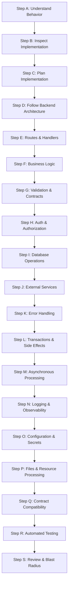

---
name: backend-development
description: Implements, modifies, debugs, and refactors server-side applications, routes, controllers, business logic, middleware, validation, authentication integration, database access, API handlers, background jobs, external services, and backend error handling. Use when translating approved software requirements and architecture into functional backend code or maintaining existing server-side functionality.
---

# Backend Development Skill

This skill guides the AI coding agent to implement, extend, debug, and refactor server-side applications, APIs, business services, and backend infrastructure. It translates approved requirements, architectural decisions, and data models into secure, reliable, testable, and maintainable backend code.

## 1. Purpose and Scope

Backend development delivers server-side business logic, data persistence, security enforcement, and API contracts. This skill ensures the agent systematically addresses core backend questions:

- **How should a feature be implemented?** Understand business rules, inputs, state transitions, and expected outputs before coding.
- **Which existing components should be reused?** Leverage established routes, controllers, services, repositories, and middleware.
- **Where should logic and data access belong?** Maintain clear separation between transport handlers, domain services, and persistence.
- **How should incoming requests be validated?** Treat all client inputs as untrusted; enforce schema validation for types, ranges, and fields.
- **How should auth and permissions be integrated?** Verify authenticated identity and enforce fine-grained server-side permission checks.
- **How should database and external operations behave?** Use parameterized queries, atomic transactions, bounded timeouts, and retries.
- **How should failures and background jobs behave?** Standardize error envelopes, sanitize disclosures, and ensure idempotent execution.
- **How should API contracts be preserved?** Maintain backward compatibility, status code semantics, and response envelopes.
- **What tests are appropriate?** Author unit tests for domain logic and integration tests for routes, databases, and middleware.
- **How is change safety verified?** Comply with [backend.md](../../rules/backend.md) and [change-safety.md](../../rules/change-safety.md) with minimal blast radius.

*Scope Boundary*: Focuses on server-side code execution. It does not replace requirements analysis (handled by [requirements-analysis](../requirements-analysis/SKILL.md)), system architecture (handled by [architecture-design](../architecture-design/SKILL.md)), database modeling (handled by [database-design](../database-design/SKILL.md)), or deployment pipelines (handled by [deployment.md](../../rules/deployment.md)).

## 2. When to Use This Skill

### Trigger Scenarios

Activate this skill when:
- **Implementing Routes & Handlers**: Building or updating REST, GraphQL, or RPC endpoints, controllers, and routing logic.
- **Authoring Domain Business Logic**: Implementing server-side services, state transitions, invariant validations, or pricing rules.
- **Integrating Data Access & Persistence**: Connecting services to databases via ORM, query builders, or parameterized SQL repositories.
- **Enforcing Authentication & Permissions**: Protecting endpoints with JWT, session tokens, RBAC, tenant checks, or ownership rules.
- **Integrating Third-Party Services**: Connecting payment gateways, external APIs, notification services, or webhooks.
- **Processing Background Jobs & Queues**: Authoring workers, scheduled tasks, event consumers, or deferred tasks.
- **Handling Server-Side Validation**: Building input schemas, DTOs, file upload verifiers, or data sanitizers.
- **Refactoring & Debugging Backend Services**: Diagnosing crashes, memory leaks, transaction deadlocks, or unhandled exceptions.

### When NOT to Use This Skill

Do not invoke this skill for:
- Pure UI wireframing or visual layout design (use [ui-ux-design](../ui-ux-design/SKILL.md)).
- Client-side React/Vue component development (use [frontend-development](../frontend-development/SKILL.md)).
- Standalone conceptual data modeling or ERD authoring without code implementation (use [database-design](../database-design/SKILL.md)).
- Infrastructure provisioning, Docker packaging, or CI/CD pipelines (use [deployment.md](../../rules/deployment.md)).

## 3. Backend Development Workflow

Follow this nineteen-step workflow (Steps A through S) when implementing or modifying backend code:



### Step A: Understand the Requested Behavior
- Identify expected backend behavior, business outcomes, and acceptance criteria from requirements.
- Determine calling clients (frontend, mobile, services, cron) and required inputs, outputs, state changes, and permissions.
- Distinguish confirmed requirements from speculative assumptions. Ask concise questions only when critical ambiguities affect security or data integrity.

### Step B: Inspect Existing Implementation
- Inspect relevant routes, controllers, domain services, repositories, models, middleware, and utility helpers.
- Trace the request pipeline: middleware ordering, auth verification, validation, business execution, and error handling.
- Review database schemas, migrations, API contracts, and existing tests to identify reusable components and prevent duplication.

### Step C: Plan the Implementation
- Identify files, modules, endpoints, and database models requiring modification or creation.
- Establish clean data flow and business logic ownership across controllers, services, and repositories.
- Define transaction boundaries, external dependencies, regression risks, and backward compatibility constraints.

### Step D: Follow the Existing Backend Architecture
- Adhere strictly to the project's language, framework, runtime, and architectural patterns (e.g., layered architecture).
- Maintain layer separation: keep transport logic in controllers, business rules in services, and persistence in repositories.
- Reuse established middleware, validators, and database helpers without introducing unneeded frameworks or ORMs.

### Step E: Implement Routes and Request Handlers
- Follow framework routing conventions (e.g., Express router, FastAPI router, NestJS controller).
- Keep request handlers thin: parse inputs, invoke application services, and return standard HTTP responses.
- Apply middleware (authentication, rate limiting, validation) at appropriate route boundaries using standard HTTP verbs.

### Step F: Implement Business Logic
- Translate approved business rules into explicit, testable, and deterministic service functions or domain models.
- Centralize domain rules in services; never duplicate identical validation or pricing logic across multiple routes or jobs.
- Validate state transitions and business invariants before mutating state (e.g., verify inventory availability before checkout).
- Never trust frontend calculations for authoritative decisions; compute prices, discounts, and quotas on the server.

### Step G: Validate Input and Enforce Contracts
- Treat all incoming client data (bodies, query params, headers, path params) as untrusted.
- Validate payloads against typed schemas (e.g., Zod, Pydantic, Joi) covering types, lengths, ranges, and required fields.
- Reject invalid payloads with consistent `400 Bad Request` responses containing actionable, field-level error messages.
- Prevent mass assignment: use explicit DTOs/schemas to prevent clients from updating sensitive fields (`role`, `balance`).

### Step H: Integrate Authentication and Authorization
- Verify authenticated identity using established trusted mechanisms (e.g., session cookies, verified JWT claims).
- Enforce server-side authorization on every protected operation, checking roles, permissions, and tenant/ownership boundaries.
- Never trust client-supplied user IDs, ownership flags, or role names without verifying against session state.
- Apply least privilege and adhere strictly to [security.md](../../rules/security.md).

### Step I: Integrate Database Operations
- Inspect existing schemas, migrations, models, and repositories before altering persistence logic.
- Execute all database operations through parameterized queries or safe ORM mappings to eliminate SQL injection.
- Wrap multi-table mutations that must succeed or fail together in atomic database transactions.
- Eliminate N+1 query patterns using eager loading or batch fetching. Follow [database.md](../../rules/database.md).

### Step J: Integrate External APIs and Services
- Inspect existing client wrappers and configure explicit connect/read timeouts on all outbound HTTP/RPC calls.
- Implement bounded retries with exponential backoff only for transient failures and idempotent operations.
- Avoid retrying non-idempotent operations (payments, external notifications) that could cause duplicate side effects.
- Isolate provider-specific payload structures within adapter modules; never expose raw external API keys or credentials.

### Step K: Handle Errors and Responses
- Use centralized error-handling middleware to translate domain exceptions into uniform HTTP error responses.
- Distinguish error classes: 400 (Validation), 401 (Unauthenticated), 403 (Forbidden), 404 (Not Found), 409 (Conflict), and 500 (Internal Error).
- Sanitize client error responses: never leak stack traces, database queries, file paths, or private credentials.
- Preserve full error details and stack traces in internal server logs with correlation IDs for diagnostics.

### Step L: Implement Transactions and Side Effects
- Keep database transactions focused and short; never make outbound HTTP calls while holding open transactions.
- Execute external side effects (notifications, emails, message publishing) only after database transactions commit.
- Ensure idempotency for operations subject to retries or network replays using idempotency keys or unique constraint checks.

### Step M: Implement Asynchronous Processing
- Follow the application's established execution model (e.g., Celery, BullMQ, native background tasks).
- Distinguish synchronous operations (must finish before responding) from deferred background tasks.
- Avoid blocking the main request thread or event loop with CPU-intensive work or synchronous file operations.
- Make background jobs idempotent and ensure failing jobs route to dead-letter queues rather than retrying indefinitely.

### Step N: Implement Logging and Observability
- Emit structured logs (JSON) with timestamps, log levels (`INFO`, `WARN`, `ERROR`), event names, and context.
- Propagate correlation/request IDs through all log entries and downstream calls to enable end-to-end tracing.
- Redact sensitive data: never log passwords, tokens, API keys, card numbers, or PII.

### Step O: Handle Configuration and Secrets
- Externalize all environment-specific variables (database URLs, ports, API keys, secrets) into environment variables.
- Validate mandatory configuration keys at application startup; fail fast with clear errors if required variables are missing.
- Never hardcode credentials or private keys in source code or sample files.

### Step P: Implement Files, Exports, and Resource Processing
- Validate uploaded file extensions, MIME types, and sizes against strict whitelists before processing.
- Prevent directory traversal by sanitizing file names and storing files outside web roots or in object storage.
- Stream large files and exports to prevent memory exhaustion; release resources reliably in `finally` blocks.

### Step Q: Preserve API and Frontend Compatibility
- Inspect existing API contracts before modifying endpoints consumed by frontends or external clients.
- Preserve field names, response envelopes, status codes, and HTTP semantics; avoid breaking changes without versioning.
- Align response structures with [api-design.md](../../rules/api-design.md).

### Step R: Test the Implementation
- Author automated tests adhering to [testing.md](../../rules/testing.md).
- **Unit Tests**: Verify isolated business calculations, domain rules, and validation logic.
- **Integration Tests**: Verify complete request-response lifecycles, database transactions, auth checks, and error responses.
- Run tests in isolated test environments with mock dependencies; confirm linting, type checks, and tests pass cleanly.

### Step S: Review the Final Changes
- Review Git diffs to confirm changes match the requested feature without extraneous edits.
- Ensure no debug statements (`console.log`), commented code, or temporary credentials remain.
- Verify authorization checks, database transactions, error sanitization, and update API specs in `docs/` where contracts changed.

## 4. Backend Implementation Principles

| Principle | Description | Implementation Rule |
|---|---|---|
| **Data Integrity First** | Reliable business rules, transactions, and access controls take precedence. | Enforce server-side authorization, parameterized queries, and ACID transactions. |
| **Separation of Concerns** | Decouple transport, business, and persistence layers. | Controllers handle HTTP; services execute business rules; repositories manage storage. |
| **Zero Client Trust** | Treat all incoming requests as untrusted. | Validate every input against typed schemas; verify roles and ownership server-side. |
| **Defensive Resilience** | Expect network failures, external outages, and invalid states. | Enforce timeouts, circuit breakers, bounded retries, and sanitized error envelopes. |
| **Clean Modularity** | Maintain clear module boundaries without circular dependencies. | High cohesion within modules; loose, explicit coupling across domains. |
| **Strict Blast Radius** | Localized modifications with zero unintended regressions. | Extend existing services safely without modifying unrelated routes or data models. |
| **Proportional Simplicity** | Prefer straightforward code over speculative distributed architecture. | Use standard language features and existing libraries before adding microservices or queues. |

## 5. Greenfield vs. Brownfield Backend Development

### Greenfield Development (New Applications or Modules)
- Establish directory taxonomy (`src/controllers/`, `src/services/`, `src/repositories/`, `src/models/`, `src/middleware/`).
- Configure environment parsing, startup configuration validation, and database connection pooling.
- Implement foundational middleware pipeline: security headers, CORS, body parsing, request tracing, auth, and error handling.
- Establish standardized response envelopes, error structures, and logging formats early.
- Configure type checking, linters, migration tools, and test harnesses before authoring domain features.

### Brownfield Development (Existing Applications)
- **Inspect Before Modifying**: Audit existing routes, services, repositories, and error conventions.
- **Match Prevailing Patterns**: If the project uses repositories, adhere to repositories; if active record, use active record.
- **Reuse Existing Services**: Extend existing domain services and middleware rather than creating parallel implementations.
- **Preserve Contract Compatibility**: Maintain existing endpoint paths, parameter names, and response structures.
- **Protect Shared Code**: Check all consuming routes when modifying shared utilities to prevent cascading regressions.

## 6. Standard Server-Side Architecture Blueprint

Every robust backend feature maintains clear separation between routes, validation schemas, domain services, repositories, and centralized error handling:

```typescript
import { z } from 'zod';
import { Request, Response, NextFunction } from 'express';

// 1. Explicit Input Validation Schema
export const ReserveBookSchema = z.object({
  bookId: z.string().uuid(),
  reservationDays: z.number().int().min(1).max(30).default(14),
});
export type ReserveBookInput = z.infer<typeof ReserveBookSchema>;

// 2. Domain Service (Authoritative Business Logic & Invariants)
export class BookReservationService {
  constructor(
    private readonly bookRepo: BookRepository,
    private readonly reservationRepo: ReservationRepository,
    private readonly txManager: TransactionManager
  ) {}

  async reserveBook(userId: string, input: ReserveBookInput): Promise<ReservationResult> {
    return await this.txManager.runInTransaction(async (tx) => {
      const book = await this.bookRepo.findByIdWithLock(input.bookId, tx);
      if (!book) throw new NotFoundError('Book not found');
      if (book.availableCopies < 1) throw new ConflictError('No copies available');

      const activeReservations = await this.reservationRepo.countActiveByUser(userId, tx);
      if (activeReservations >= 5) throw new BusinessRuleError('User reservation limit exceeded');

      await this.bookRepo.decrementCopies(book.id, 1, tx);
      const reservation = await this.reservationRepo.create({
        bookId: book.id,
        userId,
        expiresAt: new Date(Date.now() + input.reservationDays * 86400000),
      }, tx);

      return { reservationId: reservation.id, expiresAt: reservation.expiresAt };
    });
  }
}

// 3. Thin Request Controller (Transport & Status Translation)
export async function reserveBookHandler(req: Request, res: Response, next: NextFunction) {
  try {
    const validatedData = ReserveBookSchema.parse(req.body);
    const result = await reservationService.reserveBook(req.user.id, validatedData);
    return res.status(201).json({ status: 'success', data: result });
  } catch (err) {
    next(err); // Centralized error-handling middleware
  }
}
```

## 7. Output and Documentation Requirements

Maintain clear records and documentation for all backend changes:

1. **Source Code Placement**: Place backend source files strictly inside application directories (`src/`, `server/`, `app/`); never place application code inside `.agents/skills/`.
2. **API Contract Updates**: Update OpenAPI/Swagger documentation or markdown specifications in `docs/api/` whenever endpoints or schemas change.
3. **Environment & Config Notes**: Document any new required environment variables in `.env.example` and `docs/deployment/`.
4. **Verification Evidence**: Record test run results (`npm test`, `pytest`), type check outputs, and manual endpoint verifications with response codes.
5. **Change Summary**: Provide a clear summary detailing modified endpoints, added services, database interactions, and blast radius verification.

## 8. Avoid Duplication with Other Skills and Rules

This skill operates in direct alignment with project rules and complementary skills:

- [backend.md](../../rules/backend.md): Foundational backend coding and operational standards.
- [security.md](../../rules/security.md): Authentication schemes, authorization checks, and secret management.
- [database.md](../../rules/database.md): SQL parameterization, schema migrations, and transaction scopes.
- [api-design.md](../../rules/api-design.md): URI hierarchies, HTTP methods, pagination, and error envelopes.
- [testing.md](../../rules/testing.md): Testing standards, coverage goals, and integration test harnesses.
- [coding-standards.md](../../rules/coding-standards.md): Code formatting, naming conventions, and static analysis rigor.
- [change-safety.md](../../rules/change-safety.md): Minimal blast radius, regression prevention, and backward compatibility.
- [requirements-analysis](../requirements-analysis/SKILL.md) & [architecture-design](../architecture-design/SKILL.md): Upstream business rules and system module boundaries.
- [database-design](../database-design/SKILL.md): Entity models, normalization, and relational schema designs.
- [frontend-development](../frontend-development/SKILL.md): Frontend implementation consuming backend API contracts.

## 9. Final Validation Checklist

Before concluding any backend development task, verify each item:

- [ ] **Requirements Compliance**: Does the implementation satisfy all approved business rules, state transitions, and acceptance criteria?
- [ ] **Layered Separation**: Are controllers thin, business rules centralized in services, and data access decoupled in repositories?
- [ ] **Zero Client Trust**: Are all request payloads, query parameters, and route arguments validated via strict schemas?
- [ ] **Server-Side Authorization**: Are permissions, tenant boundaries, and resource ownership verified on the server independently of client claims?
- [ ] **Data Integrity & Queries**: Are all queries parameterized? Are multi-step updates wrapped in transactions? Are N+1 queries eliminated?
- [ ] **Sanitized Error Handling**: Do endpoints return appropriate HTTP status codes without leaking stack traces, SQL details, or internal paths?
- [ ] **Resilient Integrations**: Do external calls have explicit timeouts, safe retries, and bounded failure fallbacks?
- [ ] **Secret Safety**: Are credentials, tokens, and database URLs externalized in environment variables with zero hardcoded secrets?
- [ ] **Contract Compatibility**: Are existing API contracts preserved without accidental breaking changes for frontend consumers?
- [ ] **Test & Quality Verification**: Do automated unit/integration tests pass? Are TypeScript/linter checks completely clean?
- [ ] **Blast Radius Control**: Are changes strictly isolated to the requested feature without side effects in unrelated backend modules?
