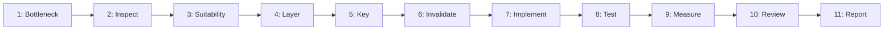

---
name: caching-strategy
description: Evaluates, designs, implements, and verifies application caching strategies, including cache selection, key design, expiration, invalidation, HTTP caching, in-memory and distributed caches, database-backed workloads, and cache observability. Use when reducing repeated computation or data retrieval, improving response times, lowering database load, or diagnosing caching-related correctness and consistency issues.
---

# Caching Strategy Skill

This skill teaches the AI coding agent to evaluate, design, implement, test, and maintain caching strategies across diverse architectures while preserving correctness, authorization, privacy, consistency, and reliability.

## 1. Purpose, Core Principles, and Caching Mindset

The central mandate of application caching is:
**Cache only when there is a justified benefit, define how cached data becomes valid and invalid, preserve security boundaries, and measure whether caching actually improves the application.**

Adhere to seven foundational principles:
- **Justified Benefit**: Never cache speculatively; confirm operations are demonstrably expensive, repeated, and bottlenecked.
- **Explicit Lifecycle**: Define population mechanisms, TTL duration, and mutation invalidation triggers upfront.
- **Strict Isolation**: Cache isolation is a security boundary; never allow data to leak across tenants or users.
- **Smallest Sufficient Layer**: Prefer request-local reuse or in-memory caches before adding distributed infrastructure.
- **Fallback & Resilience**: Caches are optimizations, not durable stores; handle misses, outages, and restarts gracefully.
- **Correctness Over Speed**: Serving stale, corrupted, or unauthorized data is a defect; invalidation correctness is paramount.
- **Evidence-Based Claims**: Never assume performance improved without measurement; verify hit ratios and latency deltas.

*Scope Boundary*: Focuses on caching strategies and data lifecycles. For bottleneck diagnosis and profiling, use [performance-profiling](../performance-profiling/SKILL.md); for SQL tuning and indexing, use [database-query-optimization](../database-query-optimization/SKILL.md); for schema normalization, use [database-design](../database-design/SKILL.md); for server routes and controllers, follow [backend-development](../backend-development/SKILL.md); for repository performance standards, follow [performance-optimization.md](../../rules/performance-optimization.md).

## 2. Scope and Trigger Scenarios

### Trigger Scenarios
Activate this skill when:
- **Repeated Expensive Work**: Heavy aggregations, complex reports, or downstream API calls with identical inputs.
- **High Read-to-Write Ratio**: Data read frequently between infrequent updates (catalogs, settings).
- **Database Read Pressure**: Connection exhaustion or I/O saturation caused by repeated identical queries.
- **API Latency Requirements**: Endpoints requiring sub-50ms response times for bounded-staleness data.
- **Cache Inconsistency Bugs**: Diagnosing stale data leaks, missing invalidations, or cross-tenant contamination.

### When NOT to Use This Skill
Do not invoke this skill for unindexed queries (use [database-query-optimization](../database-query-optimization/SKILL.md)), volatile real-time data, low-frequency requests, or primary data durability (use [database-design](../database-design/SKILL.md)).

| Activity | Primary Skill | Supporting Skills |
| :--- | :--- | :--- |
| **Evaluate & design caching** | `caching-strategy` | `performance-profiling` |
| **Tune slow SQL & indexes** | `database-query-optimization` | `database-design` |
| **Backend cache integration** | `caching-strategy` | `backend-development` |
| **HTTP / CDN cache headers** | `caching-strategy` | `cross-cutting-concerns` |
| **Audit cache security** | `caching-strategy` | `security-review` |

## 3. Distinguishing Caching from Prior Optimizations

Caching adds statefulness, invalidation complexity, and memory overhead. Always evaluate simpler optimizations first:
- **Database Indexing**: Fix unindexed queries scanning large tables with indexes (`O(log N)`), not caches.
- **Eliminating N+1 Queries**: Batch parent-child lookups or eager-load relations to eliminate round trips.
- **Algorithmic Efficiency**: Optimize algorithms ($O(N^2) \to O(N)$) for permanent stateless speedups.
- **Data Projections**: Select only required columns (`SELECT id, name`) rather than full entity trees.
- **Request-Local Memoization**: Reuse lookups within a single request lifecycle without cross-request state.

*Rule*: Do not mask an underlying software defect with a cache when a durable, stateless fix is available.

## 4. Establishing Cache Suitability & Workload Context

Before implementing a cache, quantify the workload and define expected benefits:
- **Latency & Bottleneck Type**: Determine if delay is CPU-bound (hashing, math), DB-bound (I/O, locks), or network-bound.
- **Execution Frequency & Repetition**: Verify multiple requests share identical parameters and produce identical results.
- **Read-to-Write Ratio**: High read ratios ($> 10:1$) favor caching; low ratios ($< 2:1$) cause invalidation churn.
- **Staleness Tolerance**: Define acceptable delay between source mutation and cache visibility (e.g., 5s, 10m, or strictly 0).
- **Baseline Metrics**: Record baseline response latency (p50/p95), query counts, and throughput before altering code.

## 5. Understanding the Data Before Caching

Understand semantic properties before caching:
- **Authoritative Source**: Identify the master database table or upstream service that owns authoritative data.
- **Contextual Parameters**: Identify every parameter affecting output: IDs, query filters, pagination, sort orders, dates.
- **Authorization Context**: Determine if results depend on user identity, role, tenant, campus, or department.
- **Consequences of Staleness**: Assess business impact of stale data (cosmetic delay vs. financial/security error).
- **Data Sensitivity**: Determine if payloads contain PII, payment details, or credentials requiring encryption or exclusion.

## 6. Selecting the Appropriate Caching Layer

Choose the simplest layer that satisfies architectural requirements:
- **Request-Local Reuse**: Single request scope; eliminates duplicate lookups without cross-request state.
- **In-Memory Cache**: Process-local (Node.js memory, Go sync.Map); sub-millisecond; note multi-instance drift.
- **Distributed Cache**: Shared cluster (Redis, Memcached); eliminates multi-instance drift; requires network round-trip.
- **HTTP & CDN Caching**: Edge CDN and browser caching for static assets or public endpoints via `Cache-Control`.
- **Database Buffer & Query Caching**: Database buffer pools and precomputed materialized views.

## 7. Designing Correct Cache Keys

A cache key must uniquely and deterministically capture every variable influencing output:
`[namespace]:[tenant_id]:[resource]:[identifier]:[normalized_query_hash]`
*(e.g., `app:tenant_42:reports:attendance:v2:2026-10:dept_physics`)*

- **All Dependent Dimensions**: Include campus, date range, format, or sort in key if output varies.
- **Predictable Namespaces**: Prefix by domain (`users:`, `orders:`) to isolate keys and enable scanning.
- **Normalized Parameters**: Sort query parameters and lowercase strings (`type=book&status=active`).
- **Versioned Keys**: Include schema version (`v1`, `v2`) so changes avoid deserializing old structures.
- **Zero Secrets**: Never include passwords, tokens, or raw PII in cache keys; hash if needed.

## 8. Protecting User, Role, and Tenant Data

Cache contamination across authorization boundaries is a critical vulnerability:
- **Mandatory Tenant Scoping**: Prefix all multi-tenant keys with tenant ID (`tenant:42:...`).
- **User Separation**: If response varies by user permissions or state, bind key to `user_id`.
- **Public vs Private HTTP**: Never use `Cache-Control: public` on authenticated endpoints.
- **Immediate Role Revocation**: Invalidate cached user permissions immediately when roles change.

## 9. Defining Freshness and Expiration Policies

Every cache entry must have an explicit validity and expiration strategy:
- **Domain-Calibrated TTL**: Reference data (1-24h); dynamic entities (5-15m); real-time data (1-5s or uncached).
- **Stale-While-Revalidate (SWR)**: Return cached data immediately while refreshing in background if safe.
- **Time-Boundary Awareness**: Expire at midnight for day-based reporting windows to prevent carryover.

## 10. Designing Cache Invalidation

Invalidation is the most critical correctness mechanism in caching:
- **Post-Commit Invalidation**: Invalidate keys after database commit; never inside uncommitted transactions.
- **Versioned Namespaces**: Bump namespace counters (`tenant:42:books:v3`) to invalidate sub-keys atomically.
- **Event-Driven Invalidation**: Consume domain events (`OrderCompleted`) for cross-service invalidations.
- **Targeted Invalidation**: Invalidate specific keys; avoid global flushes (`FLUSHALL`) on single edits.

## 11. Handling Related Records and Derived Data

Mutating a single entity frequently invalidates dependent aggregates:
- **Map Dependencies**: Changing a `Book` status affects book details, author catalog listings, category counts, and dashboard summaries.
- **Two-Tier Invalidation**: Invalidate specific entity keys immediately (`books:105`); allow bounded TTL for expensive aggregates.
- **Document Staleness SLAs**: Clearly document when aggregate dashboards operate under eventual consistency (e.g., "Updated every 5m").

## 12. Caching Patterns

Choose the pattern matching the architecture:
- **Cache-Aside (Lazy Loading)**: Read cache; on miss query DB and set cache. On mutation, update DB and evict.
- **Read/Write-Through**: Application reads/writes cache; cache handler coordinates synchronously with DB.
- **Write-Behind (Write-Back)**: Async DB writes carry severe data loss risk; avoid for core business records.
- **Refresh-Ahead**: Cache reloads hot keys before expiration based on predicted access patterns.

## 13. Handling Cache Misses, Cold Starts, and Negative Caching

- **Graceful Miss Handling**: Cache miss is normal; seamlessly fall back to authoritative database.
- **Negative Caching**: Cache Not Found results briefly (30-60s) to protect DB against repeated misses.
- **Cold-Start Resilience**: Pre-warm critical keys or stagger startup queries to avoid DB saturation.
- **Preserve Auth on Miss**: Never bypass authentication or authorization checks when cache misses.

## 14. Preventing Cache Stampedes and Thundering Herds

When a high-traffic key expires, hundreds of concurrent requests may simultaneously attempt to recompute it:
- **Single-Flight Coalescing**: Mutex-lock concurrent requests so only 1 executes while others await result.
- **Jittered Expiration**: Add random variance (`TTL = base + rand(0, 30s)`) to prevent simultaneous expiration.
- **Probabilistic Early Refresh**: Recompute keys in background before expiration based on traffic probability.

## 15. Handling Cache Outages and Partial Failures

Caches can fail, disconnect, or time out. Design resilient error handling:
- **Fail-Open for Reads**: On cache failure or timeout, log error, bypass cache, and query DB directly.
- **Timeouts & Circuit Breakers**: Use aggressive timeouts (50-100ms) to prevent slow cache nodes from blocking.
- **Database Overload Protection**: Ensure direct fallback traffic during complete outage does not crash DB.
- **Fail-Closed on Auth/Revocation**: If invalidating an auth token fails, revoke session rather than serve stale.

## 16. Data Serialization and Object Sizing

- **Store Minimal DTOs**: Cache only required fields; avoid full ORM entity graphs or cyclic dependencies.
- **Serialization Formats**: JSON for readability; binary (Protobuf, MessagePack) for large high-throughput payloads.
- **Payload Size Limits**: Keep entries small (< 100KB) to prevent network saturation and memory fragmentation.
- **Cross-Version Compatibility**: Ensure serialized objects can be deserialized across rolling deployments.

## 17. Managing Capacity and Eviction

- **Configure Eviction Policies**: Set explicit eviction policies on cache servers (`volatile-lru`, `allkeys-lru`, or `noeviction`).
- **Control Key Cardinality**: Avoid unbounded keys generated from unvalidated user inputs (e.g., search queries); normalize or hash inputs.
- **Monitor Memory Limits**: Establish maximum memory ceilings (`maxmemory`) and configure alerts when memory consumption exceeds 80%.

## 18. HTTP, Browser, and CDN Caching

Leverage HTTP standards for edge and client-side efficiency:
- **Explicit Cache-Control**: Use `public, max-age=31536000, immutable` for hashed assets; `private, no-store` for auth.
- **Conditional Validation**: Return `ETag` or `Last-Modified` to allow lightweight `304 Not Modified` responses.

## 19. Browser and Frontend Caching

- **Framework State Caching**: Utilize standard frontend tools (React Query, SWR, RTK Query) to handle client deduplication, revalidation, and memory caching.
- **Session & Logout Cleanup**: Clear user-specific browser caches (localStorage, sessionStorage, in-memory stores) immediately upon logout or tenant switching.
- **Storage Tier Distinctions**: Never store JWTs or sensitive personal data in unencrypted `localStorage` (vulnerable to XSS).

## 20. Database Query and Analytics Caching

- **Query Caching**: Cache pre-aggregated metrics and expensive analytics rather than raw OLTP queries.
- **Materialized Views**: Prefer database-native materialized views with scheduled refresh for large datasets.
- **Verify Calculations First**: Never cache incorrect math; optimize SQL logic first via [database-query-optimization](../database-query-optimization/SKILL.md).

## 21. Cache Security and Privacy

- **Transport & Access Security**: Require TLS and password authentication (`AUTH`) for distributed cache nodes.
- **Prevent Cache Poisoning**: Sanitize all key inputs; block header manipulation and wildcard injection.
- **Log Redaction**: Never log cached session payloads, credentials, or PII in traces or debug output.

## 22. Observability and Metrics

Track essential cache health indicators:
- **Hit Ratio**: $\frac{\text{Hits}}{\text{Hits} + \text{Misses}}$ (target $> 80\%$; investigate $< 50\%$).
- **Latency & Error Tracking**: Monitor cache read/write latency distributions (p50, p99) and timeouts.
- **Eviction & Churn**: Elevated evictions indicate memory pressure or unbounded key cardinality.
- **Database Query Offload**: Verify cache introduction measurably reduces database query volume.

## 23. Testing Caching Correctness and Failure Behavior

Validate caching rigorously using automated tests:
- **Hit/Miss Verification**: Assert first call queries DB and caches; second call returns cache without DB query.
- **Mutation Invalidation**: Assert updating source entity invalidates cache and triggers fresh DB read.
- **Tenant Isolation**: Assert Tenant A cannot access Tenant B cached records even with identical IDs.
- **Outage Fallback**: Mock cache service disconnection; verify application functions safely via DB.
- **Time Mocking**: Use deterministic fake timers to test TTL expirations without real sleeps.

## 24. Deployment and Distributed System Nuances

- **Multi-Instance Drift**: In-memory caches drift on single-instance writes; use distributed cache or pub/sub sync.
- **Rolling Deployments**: Maintain backward compatibility for cached payloads across active versions.
- **Post-Deploy Warmup**: Do not depend on pre-warmed caches for basic uptime; cold starts must stay resilient.

## 25. Before-and-After Benchmarking

Evaluate caching improvements under identical, reproducible test conditions:
1. Measure baseline latency (p50, p95), database queries/request, and memory usage.
2. Implement caching with calibrated keys, TTL, and invalidation hooks.
3. Warm up cache with representative traffic.
4. Measure post-caching latency, hit ratio, and database query reduction.
5. Disclose any measurement limitations or synthetic test conditions honestly.

## 26. Change Safety and Production Protection

- **Never Flush Production Unannounced**: Global cache flushes (`FLUSHALL`) risk database collapse from stampedes.
- **Non-Blocking Inspection**: Use `SCAN` instead of `KEYS *` in Redis to inspect keys without freezing engines.
- **Staged Rollouts**: Deploy caching behind feature flags to allow instant rollback on data discrepancies.

## 27. Recommended 11-Phase Caching Workflow



- **Phases 1-2 (Identify & Inspect)**: Profile execution time, locate source queries, and confirm repeated identical invocations.
- **Phases 3-4 (Suitability & Layer)**: Verify high read:write ratio and select request-local, memory, distributed, or HTTP caching.
- **Phases 5-6 (Key & Invalidation)**: Formulate deterministic tenant-scoped keys and wire post-commit mutation hooks.
- **Phases 7-8 (Implement & Test)**: Implement fail-open cache calls and execute automated unit/integration tests for hits and invalidations.
- **Phases 9-11 (Benchmark, Review & Document)**: Measure p95 latency deltas, conduct safety code review, and publish completion report.

## 28. Definition of Done & Standardized Completion Report

A caching task is complete only when all applicable criteria are satisfied:
- [ ] 1. **Bottleneck Justified**: Confirmed expensive computation or read repetition with concrete evidence.
- [ ] 2. **Key Design Complete**: Cache key accounts for all inputs, filters, sorting, and tenant/user scoping.
- [ ] 3. **Invalidation Wired**: Mutations reliably invalidate or update cached entries post-transaction commit.
- [ ] 4. **Tenant Isolation Verified**: Cross-tenant data leaks are mathematically impossible in key design.
- [ ] 5. **Fallback Resilience Tested**: Application functions correctly when cache service fails or times out.
- [ ] 6. **Payload Minimized**: Only necessary DTO fields are serialized; zero cyclic entities or secrets cached.
- [ ] 7. **Measurable Verification**: Hit ratios and latency improvements are verified under comparable conditions.

### Standardized Completion Report Template

```markdown
# Caching Strategy Report: [Feature / Endpoint]
## 1. Problem & Architecture
- **Target & Bottleneck**: [Endpoint / query, baseline latency, call frequency, read:write ratio]
- **Layer & Key**: [e.g., Redis; `app:tenant_{id}:courses:roster:v1:{course_id}`, TTL 300s]
- **Invalidation & Resilience**: [Post-commit domain events; fail-open 50ms timeout to DB]
## 2. Verification & Metrics
| Metric | Baseline | Cached (Warm) | Delta |
| :--- | :--- | :--- | :--- |
| **Duration (p95)** | 380ms | 12ms | -96.8% |
| **DB Queries / Req** | 6 | 0 (on hit) | -100% |
| **Hit Ratio** | N/A | 88.4% | +88.4% |
## 3. Operational Invariants & Limitations
- **Tenant Isolation**: [Strictly tenant-prefixed keys; private Cache-Control]
- **Operational Notes**: [Memory footprint, eventual consistency SLA, scale constraints]
```

## 29. Avoiding Overengineering & Anti-Patterns

Avoid these common caching anti-patterns:
- Adding Redis for data accessed once per hour.
- Caching queries instead of creating missing indexes.
- Using unbounded in-memory maps that cause out-of-memory crashes.
- Omitting critical key dimensions like `tenant_id`, `page`, or `status`.
- Relying purely on TTL when users expect immediate mutation visibility.
- Flushing entire cache clusters after a single record edit.
- Storing unencrypted credentials, tokens, or PII in shared cache instances.
- Blocking web workers on synchronous cache writes without timeout limits.

## 30. Alignment with Project Rules, Skills, and Validation Checklist

Ensure all caching strategies conform to repository standards:
- Rules: [performance-optimization.md](../../rules/performance-optimization.md) (performance benchmarks), [security.md](../../rules/security.md) (tenant isolation & encryption), [database.md](../../rules/database.md) (DB patterns), [change-safety.md](../../rules/change-safety.md) (production safeguards), [core-workflow.md](../../rules/core-workflow.md) (evidence-first workflow).
- Skills: [performance-profiling](../performance-profiling/SKILL.md) (profiling), [database-query-optimization](../database-query-optimization/SKILL.md) (SQL tuning), [database-design](../database-design/SKILL.md) (schema modeling), [backend-development](../backend-development/SKILL.md) (server logic), [debugging](../debugging/SKILL.md) (troubleshooting), [testing-qa](../testing-qa/SKILL.md) (test automation), [security-review](../security-review/SKILL.md) (security review), [cross-cutting-concerns](../cross-cutting-concerns/SKILL.md) (shared middleware).

### 10-Point Caching Strategy Validation Checklist

- [ ] 1. **Verified Need**: Caching addresses a demonstrated bottleneck, not a speculative assumption.
- [ ] 2. **Prior Fixes Evaluated**: Confirmed indexing, query optimization, or algorithmic fixes were evaluated first.
- [ ] 3. **Comprehensive Key**: Cache key incorporates all variables, filters, and tenant/user scopes.
- [ ] 4. **Safe Invalidation**: Invalidation executes post-transaction commit; no stale data leaks after edits.
- [ ] 5. **Tenant Isolation**: Keys and retrieval logic guarantee complete tenant segregation.
- [ ] 6. **Fallback Resilience**: Fail-open timeout logic prevents cache outages from taking down application.
- [ ] 7. **Stampede Protected**: Single-flight coalescing, jittered TTL, or locks prevent thundering herds.
- [ ] 8. **Clean Serialization**: Payloads are minimal DTOs; zero circular entity graphs or credentials stored.
- [ ] 9. **HTTP Directives Correct**: Authenticated endpoints use `private` or `no-store`; static assets fingerprinted.
- [ ] 10. **Evidence Collected**: Measured baseline and warm-cache metrics confirm genuine performance gain.
