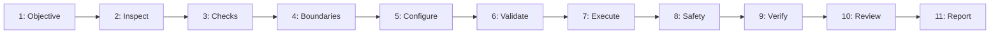

---
name: ci-cd
description: Designs, configures, reviews, and troubleshoots continuous integration and continuous delivery or deployment pipelines. Covers automated builds, tests, quality and security checks, artifact management, workflow triggers, environment separation, secrets, deployment approvals, rollback planning, and pipeline reliability. Use when automating software validation, release preparation, or controlled application deployments.
---

# CI/CD and Release Pipeline Engineering Skill

This skill teaches the AI coding agent to design, configure, review, and troubleshoot continuous integration and continuous delivery or deployment pipelines across platforms, runtimes, and environments.

## 1. Purpose, Core Principles, and Automation Mindset

The central mandate of CI/CD automation is:
**Automate repeatable software checks and release processes while preserving security, build reproducibility, environment separation, deployment safety, and human approval requirements. Never assume that a successful build proves that an application is ready for production.**

Adhere to seven foundational principles:
- **Evidence-Based Readiness**: Validate stages via observable exit codes and test logs.
- **Environment Isolation**: Strictly isolate dev, test, staging, and production tiers.
- **Least Privilege**: Grant jobs, runners, and tokens minimum required permissions.
- **Build Reproducibility**: Pin runtimes, tools, and dependencies via lockfiles.
- **Untrusted Input Defense**: Never expose secrets or deploy triggers to untrusted PRs.
- **Approval Gates**: Require authorized approval before executing production releases.
- **Non-Destructive Probes**: Validate running systems using non-destructive synthetic checks.

*Scope Boundary*: Focuses on pipeline automation and delivery. For readiness audits, see [deployment-readiness](../deployment-readiness/SKILL.md); for deployment, see [deployment](../deployment/SKILL.md); for tests, see [testing-qa](../testing-qa/SKILL.md); for secrets, see [environment-configuration](../environment-configuration/SKILL.md); for rules, see [deployment.md](../../rules/deployment.md).

## 2. Defining CI, Continuous Delivery, and Continuous Deployment

Maintain clear boundaries between automation tiers:

| Tier | Objective | Verification Gates | Production Release |
| :--- | :--- | :--- | :--- |
| **CI** | Detect defects early | Lint, types, unit & integration tests, build | None (validates code only) |
| **CDel** | Keep software releasable | CI checks + security scans, staging deploy | **Manual Approval Required** |
| **CDep** | Release every change | Full checks + automated canary/smoke tests | **Fully Automated** |

*Rule*: Never configure automatic production deployment merely because CI succeeds. Production release requires explicit authorization, defined policies, and gate satisfaction.

## 3. Determining the Project's Actual CI/CD Context

Inspect workspace evidence before modifying pipeline definitions:
- **Host & Branches**: Identify provider (GitHub, GitLab, Azure) and branch conventions.
- **Workflows**: Search for configs (`.github/workflows/`, `.gitlab-ci.yml`, `azure-pipelines.yml`).
- **Manifests & Lockfiles**: Inspect manifests and lockfiles (`pnpm-lock.yaml`, `package-lock.json`).
- **Scripts**: Identify verified test and build scripts (`npm test`, `pytest`, `cargo test`).
- **Hosting Targets**: Identify platform (Vercel, AWS, GCP, Docker, Kubernetes, Render).

*Rule*: Extend existing pipelines. If absent, recommend the simplest native approach.

## 4. Establishing Pipeline Scope and Release Policies

Explicitly specify trigger conditions, branch rules, and release gates:
- **PR Validation**: Run fast, non-privileged checks (lint, types, unit tests) on PR open or update.
- **Default Branch Builds**: Run integration tests, security scans, and packaging on merge to `main`.
- **Scheduled Checks**: Trigger nightly runs for slow E2E suites or deep dependency audits.
- **Release Tag Triggers**: Trigger production packaging and tagging upon pushed Git tags (`v*.*.*`).
- **Protected Actions**: Ensure production deployments and package publishing never run on untrusted branches.

## 5. Designing a Proportionate, Scalable Pipeline

Adopt a structured reference execution sequence adapted to project scale:

```mermaid
flowchart LR
    S1["1: Syntax"] --> S2["2: Checkout"] --> S3["3: Setup"] --> S4["4: Install"] --> S5["5: Lint & Type"] --> S6["6: Unit Test"] --> S7["7: Integration"] --> S8["8: Security"] --> S9["9: Build"] --> S10["10: Package"] --> S11["11: Publish"] --> S12["12: Deploy"] --> S13["13: Smoke"] --> S14["14: Report"]
```



- **Stages 1–4 (Setup)**: Parse syntax, checkout code, setup runtime, install locked packages.
- **Stages 5–8 (Quality)**: Run linters, type checks, unit/integration tests, and security scans.
- **Stages 9–11 (Package)**: Compile assets, package container images, and publish when authorized.
- **Stages 12–14 (Release)**: Deploy under approval, execute smoke tests, and report results.

## 6. Automating the Correct Quality Checks

Enforce quality checks matching the repository's stack:
- **Style & Types**: Validate syntax and types (`eslint`, `tsc --noEmit`, `mypy`, `ruff`, `clippy`).
- **Unit & Integration**: Run isolated unit tests and service boundary integration suites.
- **Schema Checks**: Validate migration scripts and schema consistency against a test DB.
- **Security Audits**: Detect known CVEs (`npm audit`, `pip-audit`) and secret leaks (`gitleaks`).
- **Fail-Fast**: Ensure mandatory quality checks halt the pipeline with non-zero exit codes.

## 7. Dependency Installation and Reproducible Builds

Produce deterministic, repeatable builds matching local environments:
- **Lockfiles**: Use strict frozen installs (`npm ci`, `pnpm install --frozen-lockfile`, `cargo build --locked`).
- **Pin Runtimes**: Specify exact runtime versions (Node `20.18.0`, Python `3.11.9`) in configs.
- **No Upgrades**: Never run `npm update` or alter lockfiles during automated CI jobs.
- **Local Tools**: Install tools locally via devDependencies rather than global mutations.

## 8. Workflow Triggers, Branch Protection, and Review Gates

Coordinate workflow triggers with repository collaboration rules:
- **Trigger Scoping**: Differentiate PR validation from branch pushes (`pull_request.branches` vs `push.branches`).
- **Branch Protection**: Align required CI status check names with repository protection settings.
- **Separation of Concerns**: Distinguish workflow YAML from repository settings (branch rules, required reviews).
- **Fork Safety**: Run untrusted forks under unprivileged permissions; never pass deployment secrets to fork PRs.

## 9. Managing Secrets and Credentials Safely

Protect high-value deployment keys and credentials with strict controls:
- **Native Stores**: Store credentials exclusively in repository secret vaults (`secrets.PROD_KEY`).
- **Zero Code Secrets**: Never commit `.env` files or tokens; exclude secrets from build assets.
- **Masking Limits**: Do not rely solely on log masking. Prevent secrets in CLI args or error dumps.
- **Short-Lived Tokens**: Prefer OpenID Connect (OIDC) Workload Identity over static access keys.
- **Environment Isolation**: Isolate dev, staging, and prod secrets. Tests must never touch prod.

## 10. Applying Least Privilege to Pipeline Permissions

Enforce least privilege across workflows, jobs, tokens, and cloud roles:
- **Token Scopes**: Define minimum permissions explicitly (`permissions: { contents: read }`).
- **Job Elevation**: Grant elevated scopes (`packages: write`, `id-token: write`) strictly to deploy jobs.
- **Runner Isolation**: Assess self-hosted risks. Never run untrusted public PRs on private runners.

## 11. Build Artifacts, Container Images, and Packaging

Produce clean, verifiable, and minimal release artifacts:
- **Clean Bundles**: Package production runtime assets only. Strip tests, maps, and dev utilities.
- **Container Standards**: Use multi-stage Docker builds; run as non-root users (`USER 10001`).
- **Traceable Tags**: Tag artifacts with Git commit SHA (`${{ github.sha }}`) and semantic release version.
- **Exclude Secrets**: Ensure `.dockerignore` excludes `.env`, `.git`, credentials, and build caches.

## 12. Artifact Integrity, Provenance, and Immutability

Guarantee traceability between committed source code and deployed software:
- **Digests**: Deploy container images by immutable SHA-256 digest (`image@sha256:...`).
- **Provenance**: Generate build attestations (SLSA provenance) or signatures (`cosign`) when required.
- **Immutable Tags**: Configure artifact registries to enforce immutability for production repos.
- **Honest Claims**: Only declare an artifact signed or verified if cryptographic checks ran.

## 13. Caching Dependencies Safely and Effectively

Optimize pipeline speed while preserving correctness and security boundaries:
- **Deterministic Keys**: Base keys on OS, runtime, and lockfile hash (`${{ runner.os }}-${{ hashFiles('**/pnpm-lock.yaml') }}`).
- **Prefix Fallbacks**: Reuse baseline caches safely when updating individual packages.
- **Boundary Isolation**: Ensure untrusted PRs cannot poison caches consumed by protected branches.
- **Zero Secret Caching**: Never cache secret-bearing files, runtime `.env`, or credentials.

## 14. Database Migrations and Stateful Release Management

Handle database schema migrations with care during automated pipelines:
- **Zero-Downtime**: Use expand-and-contract changes preserving backward compatibility.
- **Target Check**: Validate DB connection variables before execution to prevent wrong targets.
- **No Destructive DDL**: Never automate destructive migrations (dropping tables, truncating data).
- **Backups**: Ensure verified database snapshots exist prior to high-impact schema changes.
- **References**: Follow [database-migration](../database-migration/SKILL.md) and [database.md](../../rules/database.md).

## 15. Environment Separation and Deployment Gates

Structure pipelines across distinct environment tiers with clear gates:
- **Development**: Automated preview deployment from feature branches.
- **Staging**: Automated deployment on merge to `main`. Mirrors production for validation.
- **Production**: Gated deployment from reviewed tags or branches requiring manual sign-off.
- **Isolation**: Ensure test and staging use dedicated sandboxed databases, never production.

## 16. Distinguishing Deployment from Deployment Readiness

Track six distinct stages to prevent false claims of operational readiness:
- **1. Build Success**: Code compiled cleanly without errors or warnings.
- **2. Test Success**: Automated unit, integration, and security assertions passed.
- **3. Artifact Readiness**: Deployable package or container image produced and tagged.
- **4. Deployment Readiness**: Pre-deployment gates, migrations, secrets, and approvals verified.
- **5. Deployment Execution**: Artifact deployed to target hosting infrastructure.
- **6. Deployment Verification**: Post-release smoke tests confirm health and reachability.

*Rule*: Never declare a release deployed simply because a build succeeded or workflow YAML exists.

## 17. Deployment Safety, Rollout Strategies, and Rollbacks

Select deployment strategies that match application architecture and risk:
- **Rolling**: Incrementally replaces instances behind a load balancer for stateless apps.
- **Blue-Green**: Deploys release to an inactive environment, checks health, switches traffic.
- **Canary**: Routes small traffic percentage to the new version, monitoring error rates.
- **Rollback**: Plan rollback steps beforehand. Code rollback cannot undo destructive DDL.

## 18. Post-Deployment Verification and Smoke Testing

Verify newly deployed releases using observable, automated health probes:
- **Liveness & Readiness**: Query `/health/live` and `/health/ready` to verify runtime and DB health.
- **Smoke Tests**: Run read-only HTTP checks verifying critical routes and authentication.
- **Zero Pollution**: Ensure smoke tests do not create junk records or trigger notifications.
- **Reachability vs Health**: A 200 OK ping does not prove workers and background queues work.

## 19. Test Databases and External Service Dependencies

Manage pipeline dependencies to ensure deterministic test execution:
- **Containers**: Use containerized services (PostgreSQL, Redis) in CI runners for integration.
- **Fixtures & Reset**: Seed databases before test suites and roll back transactions cleanly.
- **Mock Third Parties**: Mock external paid APIs (Stripe, Twilio) using high-fidelity doubles.
- **Zero Prod Access**: Never allow test runner environments to connect to live databases.

## 20. Pipeline Reliability, Parallelism, and Efficiency

Optimize pipeline performance without introducing flakiness or waste:
- **Parallelize Jobs**: Run linting, unit testing, and analysis concurrently across jobs.
- **Bounded Timeouts**: Set realistic timeouts (`timeout-minutes: 15`) on all runner jobs.
- **Cancel Redundant**: Automatically cancel in-progress runs when new commits are pushed to PRs.
- **Flaky Hygiene**: Never rerun deterministic failures repeatedly to mask root defects.

## 21. Securing Third-Party Actions, Plugins, and Build Dependencies

Protect pipeline runners against software supply-chain compromise:
- **Pin Commit SHAs**: Pin actions to full immutable commit SHAs (`uses: actions/checkout@11bd...`).
- **Audit Third-Party Tools**: Restrict actions to vetted creators; avoid unreviewed scripts.
- **Lock Down Privileges**: Disallow third-party actions from modifying repository contents.

## 22. Pull Request and Untrusted Contribution Security

Prevent untrusted contributors from compromising repository secrets or runners:
- **Untrusted Events**: Run pull requests using unprivileged `pull_request` events.
- **Privileged Warning**: Never use `pull_request_target` to checkout untrusted PR code.
- **Quarantine Artifacts**: Never deploy artifacts produced by untrusted pull request runs.

## 23. Configuration Validation and Environment Variables

Validate environment requirements early in the pipeline lifecycle:
- **Fail Fast**: Validate required environment variables during setup; emit clear missing errors.
- **Client vs Server**: Distinguish client variables (`VITE_*`, `NEXT_PUBLIC_*`) from backend secrets.
- **Safe Placeholders**: Use sanitized placeholders in `.env.example` (`DB_PASSWORD=your_password`).

## 24. Versioning and Release Coordination

Integrate pipelines with structured semantic versioning and releases:
- **SemVer**: Increment `MAJOR.MINOR.PATCH` matching change severity (breaking, feature, fix).
- **Tag Triggers**: Trigger release workflows on annotated Git tags (`v1.2.0`) with authorization.
- **Release Notes**: Generate notes from verified commit history via [release-notes-writing](../release-notes-writing/SKILL.md).

## 25. Infrastructure as Code (IaC) and Drift Prevention

Apply strict safety controls when pipelines manage cloud infrastructure:
- **Plan vs. Apply**: Run `terraform plan` during PRs; run `apply` only on merge after approval.
- **State Protection**: Store state in remote, encrypted, locked buckets (S3, GCS).
- **Reject Destruction**: Flag and reject automated plans proposing destructive resource deletions.
- **Reference**: Follow [cloud-infrastructure](../cloud-infrastructure/SKILL.md).

## 26. Artifact Promotion and Environment Consistency

Follow the "Build Once, Deploy Anywhere" architectural pattern:
- **Single Compilation**: Build and package application binaries and container images once during the CI phase.
- **Promote Immutable Artifacts**: Promote the identical verified container image or artifact from Staging to Production.
- **Externalize Runtime Config**: Inject environment parameters via runtime environment variables or secret vaults.

## 27. Notifications and Failure Diagnostics

Provide clear, actionable diagnostics when pipeline stages fail:
- **Step Names**: Name steps clearly (`Run TypeScript Typecheck`, `Execute Unit Tests`).
- **Exit Codes**: Ensure failing commands exit with non-zero codes; never swallow errors.
- **Sanitized Alerts**: Ensure build notifications summarize failed steps without leaking secrets.

## 28. Recommended 11-Phase CI/CD Workflow

Execute CI/CD engineering across eleven structured phases:



- **Phases 1–3 (Scoping)**: Define goals, inspect repository tools and lockfiles, select checks.
- **Phases 4–6 (Config)**: Map triggers, author minimal pipeline YAML, validate syntax.
- **Phases 7–9 (Execution)**: Run safe checks, evaluate deployment gates, verify deployment.
- **Phases 10–11 (Reporting)**: Inspect diffs, verify least privilege, and report outcomes.

## 29. Definition of Done

A CI/CD engineering task is complete only when all criteria are satisfied:
- [ ] 1. **Context Inspected**: Respected runtime, package manager, and hosting setup.
- [ ] 2. **Scope Defined**: Documented triggers, branch filters, checks, and environments.
- [ ] 3. **Deterministic Installs**: Enforced locked installs without silent updates.
- [ ] 4. **Quality Gates Enforced**: Configured mandatory lint, type, test, and security gates.
- [ ] 5. **Least Privilege**: Scoped job tokens, runner privileges, and cloud roles.
- [ ] 6. **Secrets Defended**: Zero plaintext credentials in configs, logs, or untrusted PRs.
- [ ] 7. **Environment Gates**: Maintained approval barriers between staging and production.
- [ ] 8. **Artifact Integrity**: Defined clean release artifacts tagged with commit SHA and SemVer.
- [ ] 9. **Rollback Planned**: Evaluated rollout strategy, migrations, and rollback constraints.
- [ ] 10. **Verified Reporting**: Validated workflow syntax; reported actual executed checks.

## 30. Standardized Completion Report Template

```markdown
# CI/CD Pipeline Report: [Target Component]
### 1. Scope & Platform
- **Pipeline & Triggers**: [e.g., CI & Staging Deploy; GitHub Actions; PR/push to `main`]
### 2. Pipeline Changes & Stages
- **Files & Stages**: [e.g., `.github/workflows/ci.yml`; Lint -> Test -> Build -> Deploy]
### 3. Security & Gates
- **Tokens & Approvals**: [Scoped `contents: read`; manual approval for production]
### 4. Quality & Test Results
| Check | Tool / Command | Gate | Result |
| :--- | :--- | :--- | :--- |
| **Lint & Types** | `pnpm lint && pnpm typecheck` | Blocking | PASSED |
| **Tests** | `pnpm test` | Blocking | PASSED |
| **Security** | `pnpm audit --audit-level=high` | Blocking | PASSED |
### 5. Artifact & Verification
- **Artifact & Deploy**: [Docker image `ghcr.io/org/repo:${{ github.sha }}`; Staging deployed]
- **Post-Deploy Probe**: [GET `/health/ready` returned 200 OK; smoke tests passed]
### 6. Prerequisites & Risks
- **Prerequisites**: [OIDC provider configured; branch protection active]
- **Remaining Risks**: [Production deployment unperformed pending release window]
```

## 31. Avoiding Overengineering and CI/CD Anti-Patterns

Avoid these common CI/CD engineering mistakes:
- Introducing complex multi-cloud platforms when simple native workflows suffice.
- Duplicating identical test commands across multiple parallel jobs without cause.
- Writing brittle inline shell scripts instead of reusing established package scripts.
- Hardcoding credentials, API tokens, or server IPs in workflow files or fixtures.
- Bypassing branch protections or disabling failing tests to force green runs.
- Retrying failing tests in a loop to mask flakiness instead of fixing root causes.
- Packaging development dependencies or local `.env` files into release bundles.
- Triggering production releases automatically without human review or approval.

## 32. Avoiding Duplication with Existing Skills

Coordinate CI/CD tasks with specialized skills across the lifecycle:
- **Deployment**: [deployment](../deployment/SKILL.md) for live environment releases.
- **Readiness Audit**: [deployment-readiness](../deployment-readiness/SKILL.md) for go-live prerequisites.
- **Testing**: [testing-qa](../testing-qa/SKILL.md) for unit, integration, and regression suites.
- **E2E Testing**: [end-to-end-testing](../end-to-end-testing/SKILL.md) for browser workflows.
- **Security**: [security-review](../security-review/SKILL.md) and [threat-modeling](../threat-modeling/SKILL.md) for risk analysis.
- **Secrets & Config**: [environment-configuration](../environment-configuration/SKILL.md) for vaults and `.env`.
- **DB Migrations**: [database-migration](../database-migration/SKILL.md) for backward-compatible DDL.
- **Release Notes**: [release-notes-writing](../release-notes-writing/SKILL.md) for release changelogs.

## 33. Repository Rules Alignment and Compliance

Ensure CI/CD pipelines comply with repository rules:
- [deployment.md](../../rules/deployment.md): Isolation, non-destructive DDL, and rollbacks.
- [testing.md](../../rules/testing.md): Deterministic test execution and real integration boundaries.
- [security.md](../../rules/security.md): Secret management, least privilege, and input validation.
- [change-safety.md](../../rules/change-safety.md): Command verification and risk assessment.
- [core-workflow.md](../../rules/core-workflow.md): Systematic inspection, verification, and reporting.

## 34. 10-Point CI/CD Validation Checklist

Before completing any CI/CD automation task, verify each item:
- [ ] 1. **Verified Tooling**: Checked runtime, package manager, and test scripts.
- [ ] 2. **Deterministic Installs**: Used locked commands (`npm ci`, `pnpm install --frozen-lockfile`).
- [ ] 3. **Mandatory Gates**: Ensured lint, typecheck, and test failures halt the pipeline.
- [ ] 4. **Explicit Permissions**: Configured minimal token scopes at workflow and job levels.
- [ ] 5. **Secret Defense**: Confirmed zero secrets in code, logs, or untrusted PR paths.
- [ ] 6. **Fork Safety**: Protected deployment credentials from external fork PRs.
- [ ] 7. **Environment Gates**: Maintained approval barriers between staging and production.
- [ ] 8. **Clean Artifacts**: Excluded development tooling, tests, and `.env` from bundles.
- [ ] 9. **Stateful Safety**: Prohibited unverified migrations and destructive DDL.
- [ ] 10. **Non-Destructive Probes**: Used read-only synthetic checks for verification.
