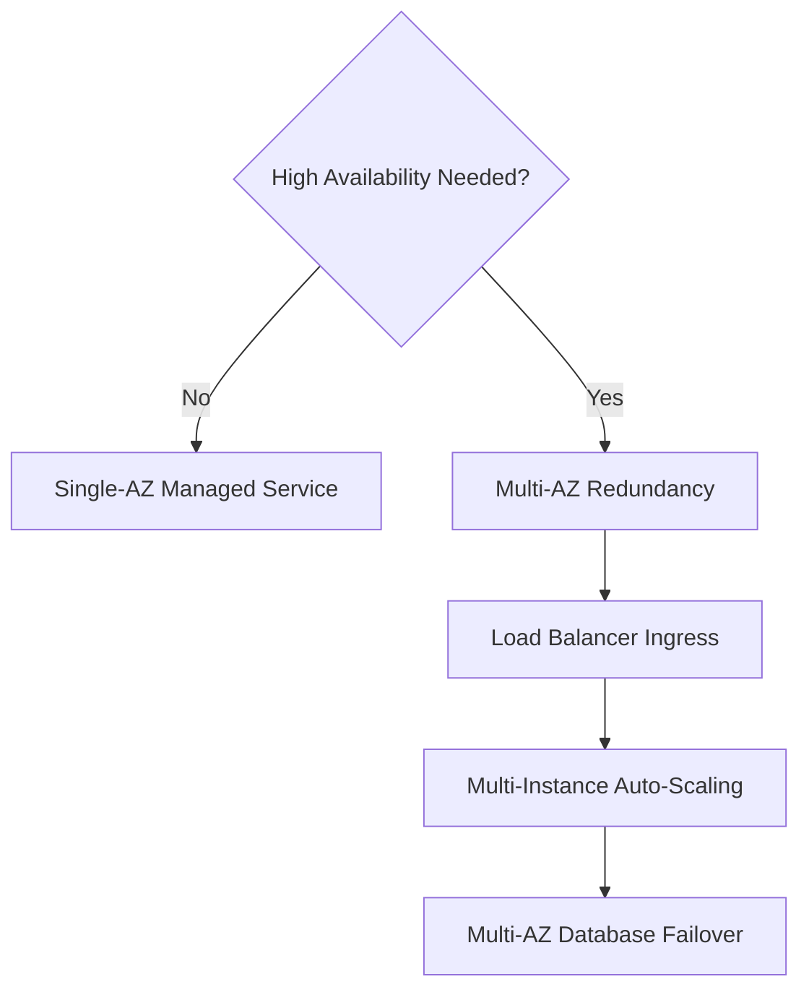
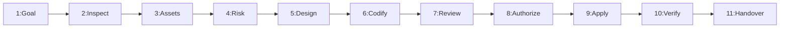

---
name: cloud-infrastructure
description: Assesses, designs, configures, validates, and maintains cloud infrastructure for software applications. Covers compute, networking, identity and access management, storage, databases, infrastructure as code, environment isolation, secrets, cost controls, reliability, monitoring, backup, and disaster recovery. Use when planning cloud resources, modifying infrastructure configuration, securing deployment environments, or evaluating cloud architecture and operational risks.
---

# Cloud Infrastructure Architecture and Operations Skill

Teaches the AI agent to assess, design, configure, validate, and maintain cloud infrastructure that supports applications securely, reliably, and cost-effectively.

## 1. Purpose, Core Principles, and Operational Cloud Mindset

The governing mandate of cloud infrastructure engineering is:
**Design infrastructure around the application's actual requirements, apply least privilege and secure network boundaries, manage changes reproducibly, control costs, and never create or modify cloud resources without the appropriate authorization.**

Adhere to seven engineering principles:
- **Evidence Over Assumption**: Design for verified workloads; avoid speculative setups.
- **Least Privilege**: Grant minimal permissions to service accounts and tokens.
- **Defense in Depth**: Segment networks, isolate data tiers, and enforce TLS.
- **State Protection**: Safeguard databases, object storage buckets, and disks.
- **Reproducible Config**: Codify infrastructure declaratively via versioned IaC.
- **Cost Discipline**: Right-size resources, track spend, and set budget alerts.
- **Explicit Approval**: Never provision, mutate, or delete assets without authorization.

Distinguish six operational states: *1. Assessed* $\rightarrow$ *2. Designed* $\rightarrow$ *3. Codified* $\rightarrow$ *4. Authorized* $\rightarrow$ *5. Applied* $\rightarrow$ *6. Verified*.

*Boundary*: Focuses on cloud topology. Application deployment belongs to sibling skills.

## 2. Defining the Scope of Cloud Infrastructure Operations

Cloud infrastructure establishes the runtime foundation supporting software systems:
- **Compute**: Managed PaaS, container runtimes, serverless, and virtual machines.
- **Networking**: VPCs, subnets, route tables, NAT gateways, and firewalls.
- **Identity**: Cloud IAM roles, service accounts, and workload federation.
- **Persistence**: Managed databases, object storage, and block disk volumes.
- **Secrets**: Cloud secret vaults, runtime injection, and KMS encryption.
- **IaC**: Declarative templates, remote state locking, and drift management.

*Rule*: Select the simplest viable architecture that satisfies functional needs.

## 3. Distinguishing Cloud Infrastructure from Related Responsibilities

Maintain strict boundaries across the release lifecycle:

| Skill | Focus | Inputs | Output |
| :--- | :--- | :--- | :--- |
| **cloud-infrastructure** | Cloud topology | Requirements | VPCs, clusters, IAM |
| **deployment** | Release & verify | Artifact, env | Running app, probes |
| **ci-cd** | Build automation | Git push | Tested artifacts |
| **deployment-readiness** | Pre-flight audit | Artifact | Readiness score |
| **environment-configuration** | Secrets & config | Vaults | Injected params |
| **database-design** | Data modeling | Schema needs | Tables, constraints |
| **database-migration** | Schema evolution | Migrations | Applied DDL |
| **backup-recovery** | Data protection | Snapshots | Verified restore |

*Axiom*: Infrastructure provides the foundation; application deployments execute upon it.

## 4. Establishing Infrastructure Requirements and Authorization

Establish operational parameters before proposing or modifying cloud resources:
- **Target & Environment**: Confirm provider and tier (`dev`, `staging`, `prod`).
- **Workload Profile**: Identify traffic volume, CPU/RAM demands, and concurrency.
- **Data Sensitivity**: Determine data classification, compliance, and retention.
- **Explicit Approval**: Require user approval before altering or creating assets.
- **Recovery Targets**: Define acceptable RPO/RTO targets and availability levels.
- **Cost Ceilings**: Review budget caps, egress costs, and pricing tiers.

## 5. Inspecting Existing Cloud and Hosting Architecture

Inspect workspace evidence before proposing or altering infrastructure:
- **Provider & Stack**: Identify cloud provider (AWS, GCP, Azure) and platform.
- **IaC Code**: Inspect Terraform, Pulumi, CloudFormation, or Bicep files.
- **Network Map**: Check existing VPCs, subnets, route tables, and firewalls.
- **Compute Profiles**: Review container manifests, serverless configs, and daemons.
- **Data Stores**: Inspect managed databases, caches, and storage buckets.
- **Read-Only Mode**: Use read-only commands; never modify live resources.

## 6. Selecting Suitable Cloud Services and Hosting Platforms

Select infrastructure matching application complexity and operational capabilities:

| Model | Suited For | Characteristics |
| :--- | :--- | :--- |
| **Static** | SPAs, docs | Edge CDN hosting, zero server operations. |
| **PaaS** | Web apps, APIs | Managed runtime, automated TLS, ephemeral disk. |
| **Containers** | Microservices | Immutable images, reproducible environments. |
| **Serverless** | Event APIs | Scale-to-zero, execution timeouts, connection caps. |
| **VMs** | Legacy daemons | OS-level control, manual patching, systemd daemons. |
| **Kubernetes** | Complex setups | Declarative pods, rolling updates, high overhead. |

*Discipline*: Avoid introducing Kubernetes when managed PaaS or containers suffice.

## 7. Network Architecture, Traffic Routing, and Edge Protection

Design secure network boundaries and control traffic flow across tiers:
- **Subnets**: Public ingress in public subnets; databases in private subnets.
- **Least Exposure**: Never expose database or cache ports to the internet.
- **Firewalls**: Restrict ingress strictly to authorized CIDRs or security groups.
- **Egress Routing**: Route private subnets through NAT; avoid public IPs on backends.
- **Edge Shielding**: Deploy Web Application Firewalls and DDoS protection.

## 8. Identity and Access Management (IAM) and Least Privilege

Cloud permissions represent critical security trust boundaries:
- **Workload Roles**: Assign dedicated IAM roles to individual workloads.
- **Least Privilege**: Grant minimal permissions needed; disallow wildcards (`*`).
- **Federation**: Use OIDC workload identity federation over static keys.
- **Role Separation**: Separate deploy identities from admin principals.
- **Audit Logging**: Enable cloud audit logging for all control-plane calls.

## 9. Secrets and Sensitive Configuration Management

Secure sensitive credentials and prevent leakage into repositories and logs:
- **Vault Storage**: Store API keys, DB passwords, and tokens in vaults.
- **Boot Injection**: Inject secrets dynamically into container memory at boot.
- **Zero Git Secrets**: Never commit credentials, private keys, or `.env` files.
- **Safe Rotation**: Implement rotation policies with zero application downtime.
- **Clean Templates**: Maintain `.env.example` with parameter placeholders.

## 10. Infrastructure as Code (IaC) and State Management

Manage all infrastructure declaratively through reproducible code:
- **Declarative IaC**: Use established frameworks (Terraform, Pulumi, Bicep).
- **Remote State**: Store state in encrypted storage with state locking.
- **State Security**: Never commit `.tfstate` files; restrict backend access.
- **Plan Review**: Inspect creation, update, and deletion diffs in plans.
- **Modular Design**: Structure IaC into cohesive modules with explicit inputs.

## 11. Environment Separation and Resource Isolation

Enforce rigid isolation between development, staging, and production tiers:

| Tier | Account/Project | Network Boundary | Database & State | Access Scope |
| :--- | :--- | :--- | :--- | :--- |
| **Dev** | Sandbox | Local or dev VPC | Synthetic seed data | Developer access |
| **Staging** | Pre-production | Staging VPC mirror | Sanitized replica | Reviewers & CI |
| **Prod** | Dedicated account | Hardened prod VPC | Encrypted live data | Strict least privilege |

*Rule*: Never share databases, networks, or credentials between staging and production tiers.

## 12. Compute Sizing, Application Hosting, and Scaling

Match compute resources to application profile and operational demands:
- **Right-Sizing**: Allocate CPU and RAM based on profiling metrics.
- **Fast Startup**: Optimize image size and entry commands for rapid scaling.
- **Clean Shutdown**: Handle `SIGTERM` cleanly; finish in-flight requests.
- **Autoscaling**: Scale on meaningful metrics (CPU, queue depth, latency).
- **Process Isolation**: Run container daemons under unprivileged users.

## 13. Database, Storage, and Persistence Infrastructure

Preserve application data durability and protect persistence layers:
- **Managed DBs**: Use managed services (RDS, Cloud SQL) with auto-patching.
- **Persistent Disks**: Use object storage for media; PVCs for persistent disks.
- **Ephemeral Storage**: Treat container filesystems as disposable scratch space.
- **Encryption**: Enforce encryption at rest via KMS and TLS in transit.
- **Private Subnets**: Keep database instances in private subnets without public IPs.

## 14. Availability, Resilience, and High Availability Design

Design systems to withstand infrastructure failures without catastrophic downtime:



- **Redundancy**: Deploy instances across multiple Availability Zones (AZs).
- **Health Probes**: Configure liveness and readiness checks to isolate nodes.
- **Eliminate SPOFs**: Identify single points of failure across APIs and queues.
- **Graceful Degradation**: Implement circuit breakers and fallback responses.
- **Realistic Claims**: Never claim HA without multi-instance, multi-AZ redundancy.

## 15. Backup and Disaster Recovery (DR) Architecture

Protect critical business assets against data corruption, outages, and disasters:
- **Automated Snapshots**: Schedule regular snapshots for databases and disks.
- **Retention Policies**: Configure lifecycle policies for retention tiers.
- **Secondary Copies**: Replicate critical backups to a secondary region.
- **Drill Testing**: Periodically verify restore procedures in isolated staging.
- **Immutability**: Protect backup storage with object locks against deletion.

## 16. Cost Management, Right-Sizing, and Resource Governance

Control ongoing cloud operational expenditure through active resource governance:
- **Right-Sizing**: Downscale overprovisioned instances based on metrics.
- **Idle Cleanup**: Delete unattached disks, unused IPs, and orphaned balancers.
- **Resource Tags**: Apply standard tags (`Environment`, `Service`, `Owner`).
- **Budget Alerts**: Configure automated budget alerts at 50%, 80%, and 100% spend.
- **Scheduled Off-Hours**: Shut down non-production resources during off-hours.

## 17. Domains, DNS, TLS, and Public Ingress

Manage external domain routing and transport security securely:
- **Managed Certs**: Use managed certificate services with auto-renewal.
- **Strict TLS**: Enforce TLS 1.3/1.2; redirect all HTTP traffic to HTTPS.
- **DNS TTL Tuning**: Lower DNS TTLs (60–300s) before migrations; restore after.
- **Proxy Headers**: Configure reverse proxies to pass sanitized headers.
- **CORS Policies**: Enforce strict origin allowlists; disallow wildcard origins.

## 18. Container Infrastructure and Orchestration

Deploy containerized applications with enterprise security and resource boundaries:
- **Base Images**: Use minimal, audited base images (Alpine, distroless).
- **Non-Root User**: Run container processes under unprivileged users.
- **Registry Security**: Store images in private registries with scanning.
- **Resource Caps**: Set explicit CPU/memory requests and limits on containers.
- **Drop Capabilities**: Drop unnecessary Linux capabilities (`CAP_DROP_ALL`).

## 19. Serverless Infrastructure and Event-Driven Services

Leverage serverless compute effectively while respecting runtime limits:
- **Stateless Runtimes**: Ensure functions avoid local disk persistence.
- **Execution Caps**: Respect platform timeouts; offload long tasks to queues.
- **Concurrency Caps**: Tune memory and concurrency caps to protect DBs.
- **Cold Start Tuning**: Keep bundles minimal; provision concurrency when justified.
- **Scratch Disks**: Direct temporary local scratch operations strictly to `/tmp`.

## 20. Infrastructure Security, Hardening, and Threat Boundaries

Hardening cloud infrastructure against unauthorized intrusion and abuse:
- **IMDSv2 Enforcement**: Enforce IMDSv2 on virtual machines to block SSRF token theft.
- **Block Public Buckets**: Enable account-wide public access blocks on buckets.
- **Audit Trails**: Retain immutable audit logs of console and API events.
- **Image Patching**: Automate security patch application for machine images.
- **CIS Benchmarks**: Audit infrastructure configurations against CIS benchmarks.

## 21. Infrastructure Observability, Metrics, and Alerting

Maintain comprehensive operational visibility into cloud resource health:
- **Core Telemetry**: Monitor CPU, RAM, disk I/O, network throughput, and pools.
- **Synthetic Probes**: Run automated health probes against critical endpoints.
- **Centralized Logs**: Aggregate container and server logs with trace IDs.
- **Actionable Alerts**: Define alerts based on actionable failure states, not noise.
- **Log Retention**: Set sensible retention policies (14–30d dev, 90+d prod).

## 22. Infrastructure Changes and Lifecycle Management

Execute infrastructure modifications methodically through a controlled lifecycle:
- **Impact Assessment**: Determine if changes create, modify, or destroy assets.
- **Blast Radius**: Identify affected environments, dependencies, and downtime.
- **Plan Previews**: Inspect plan outputs before executing state changes.
- **Approval Gate**: Obtain explicit authorization before applying deletions.
- **Audit Logging**: Record executed commands, changes, and verification checks.

## 23. Managing Infrastructure Drift and Reconciliation

Prevent divergence between declared IaC configurations and live cloud resources:
- **Drift Scans**: Run periodic read-only drift scans (`terraform plan`) for edits.
- **No Snowflake Edits**: Strictly forbid manual modifications in consoles.
- **Root Cause**: Understand why drift occurred before overwriting state.
- **Controlled Imports**: Import unmanaged resources into IaC code using tools.
- **Event Audits**: Review event logs to identify principals who made edits.

## 24. Systematic Cloud Infrastructure Troubleshooting

Diagnose cloud infrastructure anomalies methodically using layered isolation:

| Step | Focus | Diagnostic Check |
| :---: | :--- | :--- |
| **1** | **Scope** | Isolate tier: DNS, edge, network, compute, or DB. |
| **2** | **DNS** | Check resolution and TTL propagation via `dig`. |
| **3** | **TLS** | Verify certificate validity and chain trust. |
| **4** | **Routing** | Check route tables, internet gateways, NAT health. |
| **5** | **Firewall** | Inspect security groups and ACLs for blocked ports. |
| **6** | **IAM** | Review execution roles and trust policies. |
| **7** | **Compute** | Inspect container exit codes, OOM kills, restarts. |
| **8** | **Database** | Verify connection pool limits and subnet access. |
| **9** | **Logs** | Search audit and service logs for error traces. |
| **10**| **Report** | Document root cause, remedy, and prevention steps. |

*Anti-Pattern*: Never open security groups to `0.0.0.0/0` to troubleshoot database connectivity.

## 25. Deploying Background Workers, Queues, and Scheduled Jobs

Support asynchronous processing with scalable, resilient cloud messaging:
- **Managed Queues**: Use cloud-native queues (SQS, Cloud Tasks) with DLQs.
- **Queue-Based Scaling**: Scale worker instances on queue depth rather than CPU.
- **Graceful Drain**: Allow background workers sufficient timeout to finish tasks.
- **Message Idempotency**: Ensure consumers process duplicate messages safely.
- **Visibility Timeouts**: Configure visibility timeouts exceeding worker runtimes.

## 26. Documentation and Operational Handover

Keep cloud infrastructure documentation synchronized with code changes:
- **Architecture Diagrams**: Maintain network topology diagrams in `docs/architecture/`.
- **Resource Inventories**: Document resource naming conventions and asset inventories.
- **Operational Runbooks**: Provide incident response runbooks in `docs/operations/`.
- **Variable Catalogs**: Document all required variables and default values.
- **Handover Reports**: Deliver structured completion reports detailing changes and risks.

## 27. Recommended 11-Phase Cloud Infrastructure Workflow

Follow this standardized workflow for planning, configuring, and verifying cloud infrastructure:



- **Phases 1–3**: Define goals, inspect environment, map assets and boundaries.
- **Phases 4–6**: Assess risks, select minimal viable services, codify in IaC.
- **Phases 7–8**: Review execution plans, verify blast radius, obtain user approval.
- **Phases 9–11**: Apply changes cleanly, verify operational health, deliver handover docs.

## 28. Definition of Done (DoD)

A cloud infrastructure task is complete only when all criteria are met:
- [ ] 1. **Requirements**: Workload, traffic, and compliance understood.
- [ ] 2. **Provider**: Cloud provider and target hosting confirmed.
- [ ] 3. **Design**: Smallest viable architecture selected.
- [ ] 4. **Network**: Network segmentation enforced; DBs private.
- [ ] 5. **IAM**: Roles follow least privilege without wildcards.
- [ ] 6. **Secrets**: Credentials in vault; injected at runtime.
- [ ] 7. **Isolation**: Separate tiers for Dev, Staging, and Prod.
- [ ] 8. **IaC**: Configurations codified with state locking.
- [ ] 9. **Approval**: Explicit user authorization obtained.
- [ ] 10. **Persistence**: Storage, encryption, and backups verified.
- [ ] 11. **Cost & Telemetry**: Budget alerts and metrics configured.
- [ ] 12. **Handover**: Documentation updated and report delivered.

## 29. Standardized Cloud Infrastructure Completion Report Template

When concluding an infrastructure task, generate a structured report using this template:

```markdown
# Cloud Infrastructure Completion Report: [Application Name]
### 1. Objective: [Target environment; cloud provider; technical goal]
### 2. Architecture: [Services selected; network topology; subnets; IAM]
### 3. Changes Applied: [IaC files modified; cloud resources created/updated]
### 4. Security & Access: [IAM least-privilege roles; vault; TLS & firewalls]
### 5. Reliability & Recovery: [Multi-AZ setup; automated backups; health probes]
### 6. Cost & Governance: [Resource sizing; tags; budget alerts; idle cleanup]
### 7. Verification: [Plan outputs inspected; connectivity & health passed]
### 8. Remaining Risks: [Unverified assumptions; pending DNS cutovers]
```

## 30. Avoiding Overengineering and Cloud Anti-Patterns

Avoid these common infrastructure failures and architectural anti-patterns:
- **Premature Kubernetes**: Introducing container clusters when PaaS suffices.
- **Exposed Databases**: Allocating public IPs to databases or caches.
- **Snowflake Servers**: Making uncodified manual edits via SSH or console.
- **Hardcoded Credentials**: Storing API keys or DB passwords in IaC or Git.
- **Over-Privileged IAM**: Granting admin rights or wildcard permissions.
- **Blind Apply Loops**: Re-applying failed templates without diagnosing causes.
- **Unbounded Scaling**: Configuring autoscaling without maximum instance caps.
- **Orphaned Assets**: Leaving unused static IPs, NATs, and unattached disks.
- **Unverified Backups**: Assuming automated backup snapshots work without drills.

## 31. Avoiding Duplication with Existing Skills

Coordinate cloud infrastructure execution with related specialized skills:
- [deployment](../deployment/SKILL.md): Release execution and smoke tests.
- [ci-cd](../ci-cd/SKILL.md): Automated builds and CI pipelines.
- [deployment-readiness](../deployment-readiness/SKILL.md): Pre-flight release audits.
- [environment-configuration](../environment-configuration/SKILL.md): Secrets and env vars.
- [architecture-design](../architecture-design/SKILL.md): System architecture and modules.
- [database-design](../database-design/SKILL.md): Relational schemas and constraints.
- [database-migration](../database-migration/SKILL.md): Schema DDL migrations.
- [backup-recovery](../backup-recovery/SKILL.md): Pre-release database snapshots.
- [security-review](../security-review/SKILL.md): Vulnerability security audits.
- [threat-modeling](../threat-modeling/SKILL.md): Threat boundary models.
- [logging-monitoring](../logging-monitoring/SKILL.md): Telemetry, metrics, logs.

## 32. Repository Rules Alignment and Compliance

Every cloud infrastructure action must comply with repository rules:
- [architecture.md](../../rules/architecture.md): Simplicity and modular boundaries.
- [security.md](../../rules/security.md): Least privilege, vaults, TLS.
- [deployment.md](../../rules/deployment.md): Strict isolation, ephemeral disks.
- [change-safety.md](../../rules/change-safety.md): Inspect first, avoid destructive acts.
- [database.md](../../rules/database.md): Non-breaking DDL, private DB access.
- [core-workflow.md](../../rules/core-workflow.md): Plan, execute, verify, report.

## 33. 10-Point Pre-Flight Cloud Infrastructure Validation Checklist

Verify every item prior to executing any cloud infrastructure modification:
- [ ] 1. **Target**: Cloud provider, account/project, and region verified.
- [ ] 2. **Approval**: Explicit user release authorization granted.
- [ ] 3. **IaC Code**: Declarative configuration validated without errors.
- [ ] 4. **Plan**: Dry-run plan inspected for resource mutations.
- [ ] 5. **Network**: Subnets and security groups verified; DBs private.
- [ ] 6. **IAM**: Roles and policies follow least privilege.
- [ ] 7. **Secrets**: Credentials stored in vault; zero secrets in Git.
- [ ] 8. **State**: Remote state backend locked and backed up.
- [ ] 9. **Backup**: Pre-change snapshots verified for databases.
- [ ] 10. **Cost**: Budget ceilings, tagging, and sizing verified.
