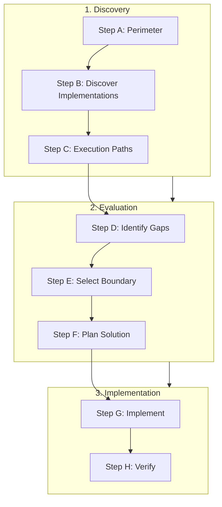
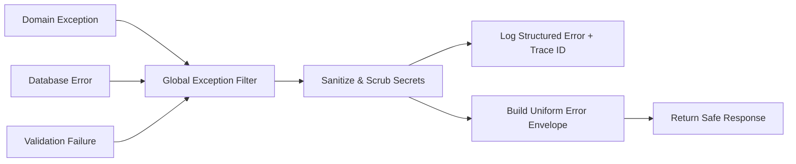

---
name: cross-cutting-concerns
description: Identifies and manages shared application concerns that span multiple modules or layers, including validation, error handling, authorization, logging, transactions, configuration, audit trails, request context, and resilience policies. Use when implementing consistent application-wide behavior, evaluating shared middleware or services, reducing duplicated cross-module logic, or reviewing how common concerns are enforced across workflows.
---

# Cross-Cutting Concerns Skill

This skill guides the AI coding agent to systematically identify, evaluate, design, implement, and review shared application concerns spanning multiple modules, layers, or workflows. It ensures consistent, secure, and observable behavior across an application without introducing premature abstractions, leaky boundaries, or excessive coupling.

## 1. Purpose, Core Principles, and Architectural Mindset

A cross-cutting concern spans multiple components or execution paths rather than belonging to a single domain entity. Poor management produces duplicated boilerplate, fragmented security, leaky boundaries, and unpredictable runtime failures.

Adhere to seven foundational principles:

- **Understand Before Centralizing**: Inspect existing patterns and framework features before proposing shared abstractions to prevent awkward wrappers.
- **Reuse Framework Mechanisms**: Leverage native runtime capabilities (middleware, interceptors, DI, transaction runners) over bespoke frameworks.
- **Separate Policy from Domain Logic**: Shared infrastructure enforces operational invariants (auth tokens, error envelopes, trace IDs); domain modules own business rules.
- **Consistency Without Erasing Differences**: Unify patterns while respecting legitimate operational variance (public vs. admin, idempotent vs. non-idempotent, web vs. jobs).
- **Enforce at the Right Boundary**: Position logic where required context exists before unauthorized or malformed data can propagate deeper.
- **Avoid Leaky Abstractions**: Never couple domain models to HTTP request objects, transport protocols, or infrastructure-specific types.
- **Reviewing vs. Implementing**: Audits are strictly read-only. Authorized implementations make surgical changes verifying HTTP and non-HTTP paths.

*Scope Boundary*: Focuses on shared application-wide behaviors. For general architecture, use [architecture-review](../architecture-review/SKILL.md) and [architecture-design](../architecture-design/SKILL.md); for server implementations, use [backend-development](../backend-development/SKILL.md); for security audits, use [security-review](../security-review/SKILL.md).

## 2. Spectrum of Genuine Cross-Cutting Concerns

Cross-cutting concerns span operational, security, data-integrity, and communication boundaries:

| Concern Domain | Core Responsibilities | Anti-Patterns to Prevent |
| :--- | :--- | :--- |
| **Input Validation** | Schema typing, structural sanitization, boundary rejection. | Controller duplication; mixing transport parsing with domain rules. |
| **Authentication** | Token verification, session resolution, identity extraction. | Ad-hoc auth checks in routes; plaintext tokens; session leakage. |
| **Authorization** | Role checks, permission evaluation, tenancy boundaries. | Scattering `if (isAdmin)` in services; ignoring auth in CLI/jobs. |
| **Error Handling** | Exception catching, status mapping, sanitized envelopes. | Swallowing errors; leaking stack traces; inconsistent error payloads. |
| **Logging & Tracing** | Structured logging, correlation IDs, PII scrubbing. | Unstructured prints; missing trace IDs; logging passwords/tokens. |
| **Configuration** | Environment variables, feature flags, typed accessors. | Reading `process.env` in domain logic; hardcoding credentials/URLs. |
| **Transactions** | Unit-of-work boundaries, atomicity, rollback on error. | Missing rollback on error; holding locks across remote API calls. |
| **Audit Trails** | Immutable historical events, actor attribution, diffs. | Conflating debug logs with audit trails; non-transactional writes. |
| **Resilience** | Timeouts, retry policies with jitter, circuit breakers. | Infinite retries on 4xx errors; cascading timeouts; missing breakers. |
| **Caching** | Response caching, query memoization, cache-aside. | Stale data without TTLs; caching unauthorized data; thundering herds. |
| **Serialization** | JSON encoding, date formatting, case conversion. | Inconsistent timestamp formats across routes; circular crashes. |
| **UI State (Client)** | Toast notifications, modal error states, global loaders. | Bespoke error popups per component; missing offline handling. |

## 3. Systematic 8-Step Workflow

Execute this structured assessment sequence from initial scoping to final deliverable:



- **Step A: Perimeter**: Target specific concerns (e.g., error handling, tracing); confirm read-only audit or authorized change.
- **Step B: Discover Implementations**: Search across modules for existing middleware, base classes, utilities, and interceptors.
- **Step C: Execution Paths**: Trace requests across HTTP endpoints, WebSockets, queues, CLI commands, and cron jobs.
- **Step D: Identify Gaps**: Document discrepancies (e.g., mismatched error schemas, workers missing trace IDs, uncommitted writes).
- **Step E: Select Boundary**: Pick the optimal tier (gateway, middleware, application service, domain, DB) with proper context.
- **Step F: Plan Solution**: Design the shared interface or hook following the Rule of Three without monolithic wrappers.
- **Step G: Implement**: When authorized, create or refactor the shared component, preserving clean dependency direction.
- **Step H: Verify**: Validate happy and unhappy paths across multiple modules, checking logs, rollbacks, and worker behavior.

## 4. Architectural Enforcement Boundaries

Enforcing a concern at the wrong layer causes duplicated logic or premature coupling. Map concerns to their appropriate tier:

| Architectural Tier | Appropriate Concerns | Avoid Enforcing Here |
| :--- | :--- | :--- |
| **Client UI** | Visual feedback, optimistic state, form syntax hints, tokens. | Business validation rules, ultimate authorization, security filters. |
| **API Gateway / Ingress** | TLS termination, DDoS rate limiting, basic IP filtering. | Complex domain authorizations, granular entity validations. |
| **HTTP Middleware** | Correlation ID injection, authentication, request logging. | Domain business logic, multi-step transaction lifecycles, DB queries. |
| **Application Service** | Transaction demarcation, authorization checks, events. | HTTP header parsing, raw socket handling, direct SQL concatenation. |
| **Domain Model / Entities**| Invariant validation, state transitions, business rules. | HTTP status codes, logger formatting, external HTTP calls, DB pools. |
| **Data Access / Repo** | Query execution, optimistic concurrency locking, schemas. | Request parsing, user identity extraction, HTTP redirect logic. |
| **Database Constraints** | Primary/foreign keys, uniqueness, check constraints. | User presentation messages, dynamic authorization, external webhooks. |
| **Background Job Runners**| Queue payload unpacking, retry policies, dead letters. | Web-specific assumptions (e.g., accessing HTTP session headers). |

## 5. Validation and Input Handling Consistency

Apply input validation in layered stages to separate structural syntax from business invariants:

- **Stage 1: Syntactic & Schema Validation (Boundary / Middleware)**: Verify field presence, types, lengths, and regex formats. Reject immediately (`400 Bad Request`) with structured field error lists before invoking business logic.
- **Stage 2: Contextual & Permission Validation (Application Service)**: Verify whether the authenticated actor is permitted to act on the target resource. Reject with `403 Forbidden` or `404 Not Found` without modifying state.
- **Stage 3: Business Invariant Validation (Domain Entities)**: Enforce domain integrity (e.g., balance sufficiency, state transitions). Reject with `422 Unprocessable Entity` or domain exceptions.
- **Stage 4: Relational Integrity Validation (Database Engine)**: Unique constraints, foreign keys, and row locks provide defense-in-depth against race conditions.
- **Uniform Error Envelope**: Return an array of field errors: `{ "status": 400, "code": "VALIDATION_ERROR", "message": "Validation failed", "errors": [{ "field": "email", "rule": "format", "message": "Must be valid email." }] }`.
- **Never Rely Solely on Client-Side Checks**: Client validation is purely for UI responsiveness. Backend must re-validate all inputs.

## 6. Authentication vs. Authorization Separation

Maintain a strict separation between verifying identity and verifying permissions:

- **Authentication (AuthN)**: Answers *"Who are you?"*. Occurs early in pipeline (middleware/gateway). Extracts credentials (JWT, cookie, API key), verifies signatures/expiry, and populates a trusted `SecurityContext` with user ID, tenant ID, and granted roles. Rejects invalid credentials with `401 Unauthorized`.
- **Authorization (AuthZ)**: Answers *"Are you permitted to perform action X on resource Y?"*. Enforced in application services or interceptors via RBAC, ABAC, or relationship policies. Rejects unauthorized attempts with `403 Forbidden` (or `404 Not Found` to conceal resource existence).
- **Tenant Isolation**: In multi-tenant systems, tenant ID must anchor in the verified security context, never trusted from an unverified request body or parameter. Queries must automatically scope by tenant.
- **Non-HTTP Contexts**: Background workers and CLI tasks lack HTTP headers. Represent system actors explicitly (`SystemUser`, `CronScheduler`, `QueueWorkerContext`) with auditable identities and least-privilege scopes.

## 7. Consistent Error Handling and Exception Translation

Uncontrolled exceptions crash processes, leak internal database schemas, and degrade developer experience. Enforce centralized translation:



- **Standardized Error Envelope**: Every non-2xx response must conform to a predictable schema: `{ "status": 409, "code": "CONFLICT", "message": "User exists.", "traceId": "c8a41b52...", "timestamp": "2026-10-25T03:00:00Z" }`.
- **Distinguish Expected vs. Unexpected Errors**:
  - *Expected operational errors* (validation, not found, forbidden, conflict): Map to 4xx codes; log at `WARN` or `INFO` levels without noisy stack traces.
  - *Unexpected system errors* (DB disconnection, unhandled runtime crashes): Map to `500 Internal Server Error`; log full stack trace at `ERROR` level; return only a generic message and `traceId` to the client.
- **Zero Information Leakage**: Never return database SQL queries, table names, file paths, or stack traces in production API responses.
- **Resource Disposal Guarantees**: Always use deterministic cleanup patterns (`try...finally`, `using`, `defer`) to guarantee connection releases, file closure, and lock relinquishment during error unwinding.

## 8. Observability, Request Context, and Distributed Correlation

Effective troubleshooting across distributed systems requires structured logging and end-to-end request correlation:

- **Correlation / Trace ID**: Accept incoming standard tracing headers (`traceparent`, `X-Correlation-ID`, `X-Request-ID`) or generate a secure UUID at entry. Attach this correlation ID to the local execution context (`AsyncLocalStorage`, `ThreadLocal`, `context.Context`). Propagate it in every log statement, downstream call, queue payload, and client error response.
- **Structured JSON Logging**: Avoid raw strings (`logger.info("user created " + id)`). Emit parseable JSON key-value pairs containing `timestamp`, `level`, `message`, `userId`, `tenantId`, `traceId`, and `durationMs`.
- **Contextual Data Scrubbing (PII & Secrets)**: Automatically filter sensitive keys before logging (`password`, `token`, `secret`, `authorization`, `creditCard`, `ssn`, `cvv`). Enforce scrubbing inside the logging serializer rather than relying on manual developer diligence.

## 9. Database Transactions and Resource Lifecycles

Data corruption occurs when multiple database mutations execute without atomicity guarantees:

- **Transaction Demarcation**: Define transaction boundaries at the Application Service layer (use cases), not within controllers or individual repository queries. Use a unit-of-work runner (`await txManager.run(async (tx) => { ... })`) to ensure all related mutations commit or roll back together.
- **Keep Transactions Short**: Never perform slow network operations (payment gateway calls, email sending, external HTTP requests) inside an open database transaction. Acquire locks and open transactions at the latest possible moment, committing or aborting immediately.
- **Outbox Pattern for External Side Effects**: If a transaction must trigger an asynchronous job or webhook, write the event to an `outbox` table within the same atomic database transaction. A separate relay process publishes events, guaranteeing at-least-once delivery without distributed two-phase commits.

## 10. Timeouts, Retries, Rate Limits, and Resilience Policies

External calls and downstream dependencies fail unpredictably. Protect the application using robust resilience patterns:

- **Enforce Strict Timeouts**: Never allow an HTTP client, query, or queue consumer to wait indefinitely. Configure explicit connect and read timeouts (e.g., 2s connect, 5s read) adapted to SLAs.
- **Retries with Exponential Backoff and Jitter**:
  - *Only retry transient errors*: Retry on 503, 429, or network timeouts. Never retry 400, 401, or 404 errors.
  - *Backoff & Jitter*: Delay retries exponentially ($2^n \times \text{base}$) with random jitter to prevent spikes.
  - *Idempotency Keys*: Ensure retried mutations carry `Idempotency-Key` headers so downstream services do not duplicate actions.
- **Circuit Breaker Pattern**: Detect continuous downstream failures and temporarily trip the circuit to `OPEN`, failing fast. After a reset timeout, enter `HALF-OPEN` to test connectivity with a single probe request before resuming full traffic.
- **Rate Limiting**: Protect endpoints against abuse using sliding window or token bucket algorithms. Rate limit by IP for unauthenticated routes, and by User ID / Tenant ID for authenticated APIs. Return `429 Too Many Requests` with a `Retry-After` header.

## 11. Durable Audit Trails vs. Diagnostic Logging

Mixing security audit logs with general application debug logs compromises security and compliance:

| Dimension | Diagnostic Logs | Durable Audit Trails |
| :--- | :--- | :--- |
| **Primary Audience** | Developers, DevOps, SREs. | Compliance officers, security auditors, legal, customers. |
| **Typical Content** | Debug traces, timings, parameters, errors. | Business state changes, administrative actions, privilege edits. |
| **Retention Policy** | Short to medium (7-90 days), rotated. | Long-term (1-7+ years), mandated by regulations (SOC2, HIPAA). |
| **Immutability** | Best-effort, may drop under pressure. | Append-only, tamper-evident, write-loss unacceptable. |
| **Storage Destination** | ElasticSearch, Loki, CloudWatch. | Dedicated audit tables, immutable object storage (WORM). |
| **Transaction Coupling** | Fire-and-forget; never fails workflow. | Written within same DB transaction or guaranteed via Outbox. |

*Audit Invariants*: Every audit record must capture **Who** (actor ID), **What** (action name), **When** (UTC timestamp), **Where** (target entity ID & type), **Why** (reason/context), and **Changes** (before/after state diff, excluding secrets).

## 12. Non-HTTP Execution Paths and Worker Consistency

A critical vulnerability occurs when cross-cutting behaviors exist only in HTTP middleware. Background workers, queues, and CLI commands bypass web middleware:

- **Avoid HTTP Middleware Coupling**: Never put core authorization, business validation, or transaction demarcation solely inside HTTP middleware. Place core invariant enforcement in application services or mediator pipelines that execute regardless of the invocation transport.
- **Worker Execution Pipelines**: Implement dedicated interceptors for queue consumers and CLI runners that:
  1. Unpack or generate the correlation ID from message metadata.
  2. Construct a trusted system execution context (`SystemUser` or `JobContext`).
  3. Initialize structured logging scopes.
  4. Demarcate transaction and retry lifecycles.
  5. Translate and handle unhandled worker exceptions without silently terminating the daemon process.

## 13. Shared Abstraction Decision Test and Practical Decision Matrix

Avoid building generic abstractions prematurely. Use the 8-Question Abstraction Test:

1. **Rule of Three**: Has this exact pattern appeared in at least three distinct, unrelated modules?
2. **Identical vs. Incidental**: Is the logic genuinely identical in intent, or does it merely look similar today?
3. **Domain Independence**: Does it operate purely on operational concerns without embedding business assumptions?
4. **Failure Blast Radius**: Does a defect in the shared abstraction risk breaking the entire application?
5. **Coupling Risk**: Will modifying the abstraction for one module force breaking changes onto others?
6. **Framework Native**: Does the underlying framework already provide an idiomatic mechanism for this?
7. **Traceability**: Can a developer easily follow execution, or does it rely on opaque metaprogramming?
8. **Testability**: Can modules be tested in isolation without spinning up global interception harnesses?

### Practical Decision Matrix

| Scenario | Recommended Approach | Rationale |
| :--- | :--- | :--- |
| **Parameter validation** | Schema validation at controller boundary. | Fails fast before domain execution; isolates transport logic. |
| **JWT verification** | Native framework HTTP guard/middleware. | Executes once per request; populates trusted security context. |
| **Resource ownership check** | Application service / repository filter. | Requires DB lookup and domain context; unsuited for gateway. |
| **Database rollback** | Declarative `@Transactional` / `tx.run()`. | Guarantees atomic rollback; prevents leaking open connections. |
| **Correlation ID injection**| Earliest HTTP middleware + worker interceptor. | Propagates trace ID across logs, queues, and downstream calls. |
| **Serialization formats** | Centralized serialization / response filter. | Ensures uniform ISO-8601 timestamps and camelCase JSON keys. |
| **Third-party API failure** | HTTP client wrapper with timeout & retries. | Prevents cascading timeouts; isolates downstream instability. |
| **Privilege modifications**| Dedicated audit repository in same transaction. | Regulatory requirement demands transactional persistence of edits. |
| **UI error notifications** | Global HTTP interceptor + event bus. | Avoids duplicating toast/alert logic across UI components. |
| **Credit card data masking**| Serializer scrubber / Value Object `toString()`. | Enforces redaction centrally so logs cannot leak cardholder data. |

## 14. Deliverable Report Template, Rules Alignment, and Validation Checklist

When conducting an audit or proposing refactoring for cross-cutting concerns, synthesize findings using this standardized report structure:

```markdown
# Cross-Cutting Concerns Assessment: [System Name]
- **Scope & Posture**: [Evaluated modules and execution paths; Consistent / Fragmented / High-Risk]

### Policy Evaluation Matrix
| Concern Domain | Boundary | Consistency | Gaps & Risks |
| :--- | :--- | :--- | :--- |
| Validation / Auth | [Boundary / Guard] | [High/Med/Low] | [Gaps observed] |
| Errors / Logging | [Filter / Logger] | [High/Med/Low] | [Gaps observed] |
| Transactions / Resilience | [Service / Client] | [High/Med/Low] | [Gaps observed] |

### Findings & Implementation Roadmap
1. **[Finding Title]**: [Observed pattern, line references, risk consequence, recommended solution]
- **Phases 1-3**: Immediate security/crash fixes -> Standardized envelopes/logging -> Resilience policies.
```

### Alignment with Project Rules and Skills

Ensure all cross-cutting work aligns with the repository's established governance:

- Rules: [architecture.md](../../rules/architecture.md) (layer boundaries), [backend.md](../../rules/backend.md) (services/routes), [api-design.md](../../rules/api-design.md) (status/envelopes), [security.md](../../rules/security.md) (least privilege/PII), [coding-standards.md](../../rules/coding-standards.md) (clean code), [database.md](../../rules/database.md) (transactions), [testing.md](../../rules/testing.md) (test coverage).
- Skills: [architecture-review](../architecture-review/SKILL.md), [backend-development](../backend-development/SKILL.md), [api-development](../api-development/SKILL.md), [security-review](../security-review/SKILL.md), [logging-monitoring](../logging-monitoring/SKILL.md).

### 10-Point Cross-Cutting Concerns Validation Checklist

Before finalizing any cross-cutting design, audit, or implementation, verify that:

- [ ] 1. **Boundary Placement**: Enforced at highest tier with context and lowest before invalid state propagates.
- [ ] 2. **Framework Alignment**: Leverages native framework capabilities over bespoke mini-frameworks.
- [ ] 3. **Non-HTTP Execution**: Queue workers, background processors, and CLI tools share equivalent enforcement.
- [ ] 4. **Uniform Envelopes**: All error responses return consistent structures with sanitized messages and trace IDs.
- [ ] 5. **Traceability**: Correlation IDs propagate across HTTP requests, logs, message queues, and external calls.
- [ ] 6. **Zero Stack Leakage**: Raw exceptions, DB schemas, and file paths are never exposed to external clients.
- [ ] 7. **Transaction Isolation**: Database mutations run in atomic units with guaranteed rollback on error.
- [ ] 8. **Resilience & Idempotency**: External calls enforce timeouts, circuit breakers, and exponential jitter retries.
- [ ] 9. **PII Protection**: Sensitive credentials, tokens, and personal data are redacted by logging serializers.
- [ ] 10. **Rule of Three**: Shared abstractions solve demonstrated duplication across >= 3 distinct modules.
