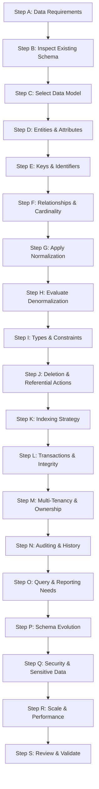

---
name: database-design
description: Analyzes data requirements and designs database models, entities, relationships, schemas, constraints, normalization strategies, indexes, data ownership, persistence boundaries, and migration considerations. Use when designing a new database, planning a new feature involving persistent data, reviewing a schema, or evaluating changes to an existing data model.
---

# Database Design Skill

This skill guides the AI coding agent to analyze data requirements, model business entities, design relational and non-relational schemas, enforce data integrity, optimize indexing strategies, establish transactional boundaries, and plan safe schema evolutions.

## 1. Purpose and Scope

Database design bridges software domain requirements with physical data persistence. This skill ensures the agent answers essential data architecture questions:

- **What information must the system persist, process, and retain?** Core entities, lifecycle data, and audit histories.
- **Which entities represent the domain concepts?** Normalized tables or document collections mapping cleanly to business models.
- **How are entities related?** Cardinality (1:1, 1:N, N:M), ownership, containment, and foreign key constraints.
- **Which constraints and validation rules are mandatory?** Data types, nullability, uniqueness, check constraints, and referential integrity.
- **Which storage model best fits the workload?** Relational (RDBMS), document, key-value, time-series, graph, or hybrid storage.
- **What normalization level is appropriate?** 3NF normalization vs. pragmatic, workload-justified denormalization.
- **Which indexes are justified?** Indexing strategy matching expected query filters, sorts, joins, and uniqueness constraints.
- **How are transactional consistency and boundaries maintained?** ACID guarantees, atomic multi-writes, and race-condition mitigations.
- **How is data isolated between modules and tenants?** Persistence boundaries, schema segregation, and multi-tenant partitioning.
- **How can the schema evolve safely?** Non-breaking migrations, expand-and-contract patterns, and zero-downtime deployment.
- **Which decisions require clarification or approval?** High-risk data drops, irreversible migrations, and business rule ambiguities.

*Scope Boundary*: Focuses strictly on data modeling, schema definition, integrity constraints, indexing, and migration planning. It does not replace code-level query execution, physical database administration, raw requirements elicitation, or application-level API routing.

## 2. When to Use This Skill

### Trigger Scenarios

Activate this skill when:
- **Designing a Greenfield Database**: Formulating the conceptual, logical, and physical schema for a new application.
- **Translating Requirements into Data Models**: Converting approved PRD or SRS specifications into entity-relationship structures.
- **Designing Persistent Data for Major Features**: Adding new tables, collections, or relations to support new capabilities.
- **Auditing Existing Schemas**: Identifying normalization anomalies, missing foreign keys, redundant indexes, or integrity gaps.
- **Evaluating Normalization & Denormalization**: Assessing trade-offs between write consistency and read-heavy query performance.
- **Planning Schema Migrations & Alterations**: Designing non-destructive, zero-downtime schema evolution strategies.
- **Documenting Data Models**: Generating Entity-Relationship Diagrams (ERDs) and data dictionaries in `docs/database/`.

### When NOT to Use This Skill

Do not invoke this skill for:
- Routine application code changes with no persistent data impact.
- Minor query tuning or localized index tweaks in existing code (use [performance-optimization.md](../../rules/performance-optimization.md)).
- Direct live database administration, operational backups, or production migration execution.
- High-level business requirement discovery (use [requirements-analysis](../requirements-analysis/SKILL.md)).

## 3. Database Design Workflow

Follow this nineteen-step procedure to analyze, structure, and validate database designs:

### Step A: Understand Data Requirements

1. **Review Upstream Specs**: Inspect approved [PRDs](../../../docs/product/), [SRS documents](../../../docs/requirements/), and domain models.
2. **Identify Business Operations**: Catalog core operations that create, read, update, delete, or aggregate persistent data.
3. **Data Lifecycle Mapping**: Identify data creation triggers, modification patterns, archival schedules, and retention/purge obligations.
4. **Resist Premature DDL**: Do not write table definitions before fully understanding the underlying information model.

### Step B: Inspect Existing Data Architecture

- **For Existing Codebases**:
  - Inspect current database schemas, migration histories, ORM models, and existing index configurations.
  - Review how backend services access persistent data (e.g., ORM repositories, raw query builders).
  - Identify existing entities that can be reused or extended rather than creating redundant tables.
  - Audit legacy conventions (naming styles, timestamp handling, soft-delete patterns) and preserve consistency.
- **For Greenfield Projects**:
  - Establish a clean baseline aligned with the chosen persistence technology and domain conventions.

### Step C: Choose an Appropriate Data Model

Select the persistence paradigm that fits the workload:
- **Relational (RDBMS)**: High ACID transaction needs, complex relational joins, strict referential integrity (e.g., PostgreSQL, MySQL).
- **Document Store**: Hierarchical or semi-structured data, polymorphic records, high write throughput (e.g., MongoDB).
- **Key-Value Store**: Ultra-low latency lookups, session states, distributed caching (e.g., Redis).
- **Graph Database**: Deeply interconnected networks, social graphs, knowledge graphs, recommendation paths.
- **Time-Series / Analytical**: Append-only metrics, telemetry, or columnar analytical stores (e.g., ClickHouse).
- *Selection Principle*: Default to the simplest, most mature data model that satisfies requirements. Avoid multi-database sprawl without compelling architectural justification.

### Step D: Identify Entities and Attributes

- Identify primary domain entities, defining a single, clear responsibility for each entity.
- Enumerate essential attributes; eliminate derived, transient, or redundant attributes that can be computed at query time.
- Determine nullability: make attributes mandatory (`NOT NULL`) by default unless a legitimate business case allows nulls.
- Avoid god-entities: separate unrelated concepts into dedicated, cohesive tables or collections.

### Step E: Define Keys and Identifiers

- **Primary Keys**: Ensure every entity has an immutable, unique primary key.
- **Surrogate vs. Natural Keys**: Prefer surrogate keys (UUIDv4/v7 or auto-incrementing integers) for internal stability; enforce natural uniqueness via `UNIQUE` constraints.
- **Foreign Keys**: Enforce referential integrity explicitly on all relationship associations.
- **Identifier Safety**: Avoid using mutable business attributes (e.g., email, phone number) as primary keys.

### Step F: Model Relationships and Cardinality

- **One-to-One (1:1)**: Enforce unique foreign key constraints on the dependent table; consider merging tables if lifecycles are identical.
- **One-to-Many (1:N)**: Place foreign key on the "many" side pointing to the parent entity.
- **Many-to-Many (N:M)**: Implement an explicit junction (associative) table with a composite primary key or surrogate key, plus foreign keys to both parent tables.
- **Self-Referencing**: Support parent-child hierarchies (e.g., nested categories) with clear acyclic validation.

### Step G: Apply Normalization Appropriately

- **1NF**: Eliminate repeated groups and ensure atomic column values (avoid CSV strings in relational columns).
- **2NF**: Ensure all non-key attributes depend fully on the primary key (eliminate partial dependencies in composite keys).
- **3NF**: Ensure non-key attributes depend only on the primary key (eliminate transitive dependencies).
- *Pragmatic Balance*: Normalize to 3NF as the default design standard; do not over-normalize to the point of operational impracticality.

### Step H: Evaluate Denormalization and Derived Data

- Justify denormalization strictly with measured read bottlenecks or severe query complexity.
- Define explicit synchronization mechanisms: write-through updates, transactional triggers, or materialized views.
- Document trade-offs: evaluate increased write latency and storage overhead against read latency improvements.
- Never duplicate authoritative data without a rigorous consistency maintenance strategy.

### Step I: Select Data Types and Constraints

- **Exact Numeric Types**: Use `DECIMAL` / `NUMERIC` for financial transactions, currency, and precision metrics; never use floating-point types (`FLOAT`, `REAL`).
- **Temporal Types**: Use timezone-aware timestamps (`TIMESTAMPTZ` or UTC ISO strings) for all date-time records.
- **Domain Constraints**: Apply `CHECK` constraints for enumerated values, allowed ranges, and valid formats.
- **Text Types**: Prefer bounded strings (`VARCHAR(N)`) for structured inputs and unbounded text (`TEXT`) only for free-form content.

### Step J: Define Referential Actions and Deletion Semantics

- **Restrict / No Action**: Default referential action to prevent accidental deletion of parent records with active children.
- **Cascade**: Use `ON DELETE CASCADE` only for tightly coupled, child-owned records (e.g., `order_items` owned by `orders`).
- **Set Null**: Use `ON DELETE SET NULL` when child records remain valid without the parent association.
- **Soft Deletion**: If business rules require auditing deleted records, implement explicit soft-delete columns (`deleted_at TIMESTAMP NULL`) with tenant-aware partial indexes.

### Step K: Identify Indexing Requirements

- **Primary & Unique Indexes**: Ensure all primary keys and natural unique constraints have supporting unique indexes.
- **Foreign Key Indexes**: Add indexes to foreign key columns to prevent table locks and accelerate relational joins.
- **Composite Index Ordering**: Order composite index columns with equality filters first, range conditions last (`WHERE status = 'active' AND created_at > ...` -> index on `(status, created_at)`).
- **Avoid Over-Indexing**: Balance read performance against write latency and storage overhead on high-throughput tables.

### Step L: Design for Data Integrity and Transactions

- Define transaction scopes: ensure multi-table writes (e.g., checkout deducting stock and creating an order) execute within an atomic transaction.
- Implement concurrency guards: use optimistic concurrency (`version INT`) or selective row locking (`SELECT FOR UPDATE`) to prevent race conditions.
- Enforce idempotency: use unique constraints or idempotency keys on mutating workflows.

### Step M: Consider Multi-Tenancy and Data Ownership

- For multi-tenant systems, include `tenant_id` on all tenant-scoped tables.
- Establish composite unique constraints incorporating `tenant_id` (`UNIQUE (tenant_id, slug)`).
- Evaluate Row-Level Security (RLS) or schema-per-tenant isolation when high security or regulatory boundaries apply.

### Step N: Plan Auditing, History, and Retention

- Include baseline audit timestamps on all mutable entities: `created_at` and `updated_at` (managed automatically).
- For financial, medical, or administrative systems, implement immutable audit log tables capturing actor ID, timestamp, before-state, and after-state.
- Establish data retention and automated purge policies for transient logs or expired sessions.

### Step O: Design for Query and Reporting Needs

- Analyze primary query access patterns: filtering, sorting, aggregations, and keyset pagination.
- Prefer keyset (cursor) pagination over large `OFFSET` queries for high-volume collection endpoints.
- Separate analytical/reporting queries from operational OLTP databases when complex aggregation threatens transaction latency.

### Step P: Plan Schema Evolution and Migrations

- Follow the **Expand-and-Contract** pattern for zero-downtime schema migrations:
  1. *Expand*: Add new column/table as optional; deploy application version that writes to both old and new.
  2. *Backfill*: Migrate historical data in small batches.
  3. *Contract*: Deprecate old column/table and drop it in a subsequent release.
- Never execute destructive schema drops in an initial release. Always preserve backward compatibility (reference [database.md](../../rules/database.md)).

### Step Q: Consider Security and Sensitive Data

- Never store credentials, API secrets, or passwords in plaintext; use salted password hashing algorithms (argon2id, bcrypt).
- Mask or encrypt sensitive Personally Identifiable Information (PII) at rest.
- Restrict column visibility and enforce least-privilege database user permissions (reference [security.md](../../rules/security.md)).

### Step R: Evaluate Scale and Performance Constraints

- Estimate data volume growth: calculate monthly row additions and storage footprints.
- Evaluate partitioning (e.g., table partitioning by range on `created_at`) for high-volume append-only datasets.
- Avoid premature sharding or distributed databases until vertical scaling and read replicas are exhausted.

### Step S: Review and Validate the Data Model

Conduct an end-to-end design validation:
- Does every business requirement map cleanly to an entity or attribute?
- Are all relational cardinalities, constraints, and foreign keys valid?
- Are transaction boundaries and concurrency risks addressed?
- Is the schema evolution plan non-destructive and backward-compatible?
- Label unconfirmed designs clearly as `[Proposed Schema]`.

## 4. Standard Database Design Output Format

When generating a formal database design document, adhere to the following standard template:

---

# Database Design Specification: [System or Module Name]

## 1. Design Overview
Summary of persistence requirements, selected database engine, architectural drivers, and core rationale.

## 2. Requirements, Constraints & Assumptions
- **Key Data Requirements**: Core domain entities and lifecycle obligations.
- **Engine & Version**: `PostgreSQL 16+` / `MongoDB 7+`
- **Assumptions**: Volume estimates, concurrency expectations, and tenant isolation models.

## 3. Storage Paradigm Choice & Trade-offs
- **Selected Technology**: `[e.g., PostgreSQL (Relational)]`
- **Rationale**: ACID transaction support, relational integrity, JSONB support for semi-structured data.
- **Alternatives Considered**: Document store rejected due to strict relational integrity requirements.

## 4. Entity Definitions Table

| Entity Name | Primary Responsibility | Authoritative System of Record | Estimated Volume (Year 1) |
|---|---|---|---|
| `users` | User credentials, roles, and profile | Core Application | 50,000 rows |
| `books` | Book catalog, author links, inventory | Core Application | 100,000 rows |
| `loans` | Checkout history, due dates, returns | Core Application | 500,000 rows |

## 5. Relationships & Cardinality Table

| Parent Entity | Relationship | Child Entity | Cardinality | Deletion Action | Integrity Rules |
|---|---|---|---|---|---|
| `users` | borrows | `loans` | 1:N | RESTRICT | Active loan prevents user deletion |
| `books` | borrowed in | `loans` | 1:N | RESTRICT | Book cannot be deleted while on active loan |

## 6. Detailed Schema & Field Definitions

### Table: `books`
| Column Name | Data Type | Nullable | Default | Constraints | Description |
|---|---|---|---|---|---|
| `id` | `UUID` | No | `gen_random_uuid()` | PRIMARY KEY | Unique surrogate identifier |
| `title` | `VARCHAR(255)` | No | None | None | Book title |
| `isbn` | `VARCHAR(13)` | No | None | UNIQUE, CHECK | 13-character ISBN format |
| `price` | `NUMERIC(10,2)` | No | None | CHECK (price >= 0) | Selling price in standard currency |
| `created_at` | `TIMESTAMPTZ` | No | `CURRENT_TIMESTAMP` | None | Row creation audit timestamp |

## 7. Normalization, Constraints & Business Invariants
- **Normalization Level**: 3NF compliant.
- **Business Invariants**: Check constraints prevent negative prices; unique constraints prevent duplicate ISBNs.

## 8. Query Patterns & Indexing Strategy

| Index Name | Target Table | Indexed Columns | Index Type | Target Query Pattern |
|---|---|---|---|---|
| `idx_books_isbn` | `books` | `(isbn)` | B-Tree (Unique) | Exact ISBN lookup |
| `idx_loans_user_status`| `loans` | `(user_id, status)` | B-Tree | Fetch active loans for specific user |

## 9. Transactions, Concurrency & Atomicity
- Checkout workflow wrapped in `BEGIN ... COMMIT` transaction with optimistic locking on inventory balance.

## 10. Multi-Tenancy & Data Lifecycle
- Tenant isolation enforced via `tenant_id` columns and composite uniqueness rules.
- Soft-delete semantics applied on customer accounts; hard deletion strictly prohibited on audit logs.

## 11. Schema Evolution & Migration Strategy
- Multi-phase expand-and-contract migration plan ensuring zero-downtime rolling releases.

## 12. Entity-Relationship Diagram (ERD)

```mermaid
erDiagram
    USER ||--o{ LOAN : borrows
    BOOK ||--o{ LOAN : "borrowed in"
    USER {
        uuid id PK
        string email UK
        string password_hash
        timestamptz created_at
    }
    BOOK {
        uuid id PK
        string title
        string isbn UK
        numeric price
        timestamptz created_at
    }
    LOAN {
        uuid id PK
        uuid user_id FK
        uuid book_id FK
        string status
        timestamptz due_date
        timestamptz returned_at
    }
```

## 13. Risks & Open Questions
- **Risk 1**: High concurrency during book drops -> *Mitigation*: Optimistic concurrency version checks.
- **Open Question 1**: Should unreturned loans trigger automated account suspensions?

---

## 5. Database Documentation Standards

- **Template Sourcing**: Inspect `.agents/templates/database/` before authoring new data specifications.
- **Persistent Location**: Save data models and schemas in `docs/database/` (e.g., `docs/database/SCHEMA.md` or `docs/database/data-dictionary.md`).
- **Never Store Schemas in Skills Folder**: Never write project-specific database schemas into `.agents/skills/database-design/`.
- **Diagram Consistency**: Maintain exact naming alignment between written entity descriptions and Mermaid ER diagrams.

## 6. Existing vs. New Database Design

- **For New Databases**: Establish cohesive naming conventions, primary key strategies, and strict referential constraints from inception.
- **For Existing Databases**: Treat the existing schema and migration history as immutable constraints. Always use non-destructive, additive migrations. Avoid mass column renames or disruptive normalization rewrites.

## 7. Interaction and Decision Principles

1. **Inspect Codebase First**: Review existing migrations, ORMs, and queries before asking the user for database details.
2. **Targeted Inquiries**: Ask questions only when missing business rules impact referential integrity, deletion semantics, or data loss risks.
3. **Safe Assumptions**: Adopt standard persistence conventions (e.g., surrogate keys, UTC timestamps) for non-critical unknowns, label them clearly, and proceed.
4. **No Premature DDL Execution**: Designing a data model does not authorize executing live SQL migrations or modifying database servers.
5. **Stakeholder Alignment**: Mark new schemas as `[Proposed Schema]` until explicitly approved by the user.

## 8. Rule Harmony and Skill Collaboration

This database design skill operates in synergy with existing project rules and skills:

- [database.md](../../rules/database.md): Establishes baseline schema safety, migration rules, and transactional integrity constraints.
- [architecture-design](../architecture-design/SKILL.md): Informs persistence boundaries, system of record definitions, and data ownership.
- [srs-writing](../srs-writing/SKILL.md) & [prd-writing](../prd-writing/SKILL.md): Supply upstream domain entities and business rules.
- [security.md](../../rules/security.md): Dictates PII masking, encryption at rest, and credential security standards.
- [performance-optimization.md](../../rules/performance-optimization.md): Governs query plan diagnostics, composite index ordering, and keyset pagination.
- [change-safety.md](../../rules/change-safety.md): Prohibits destructive drops or unverified schema alterations.
