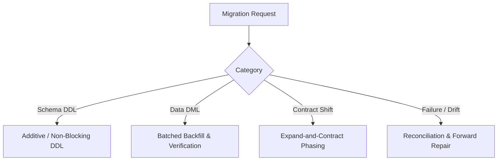
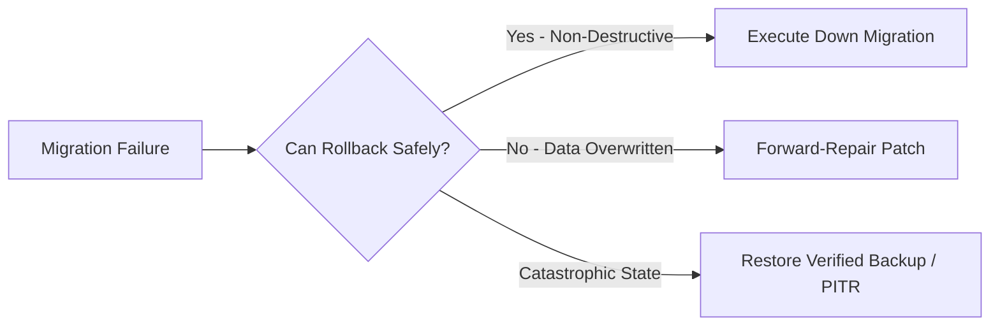
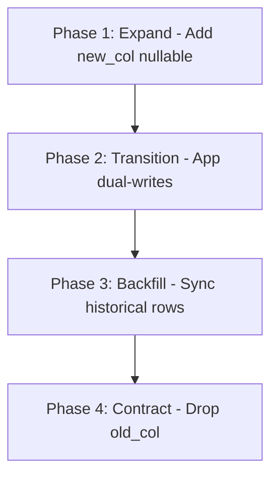
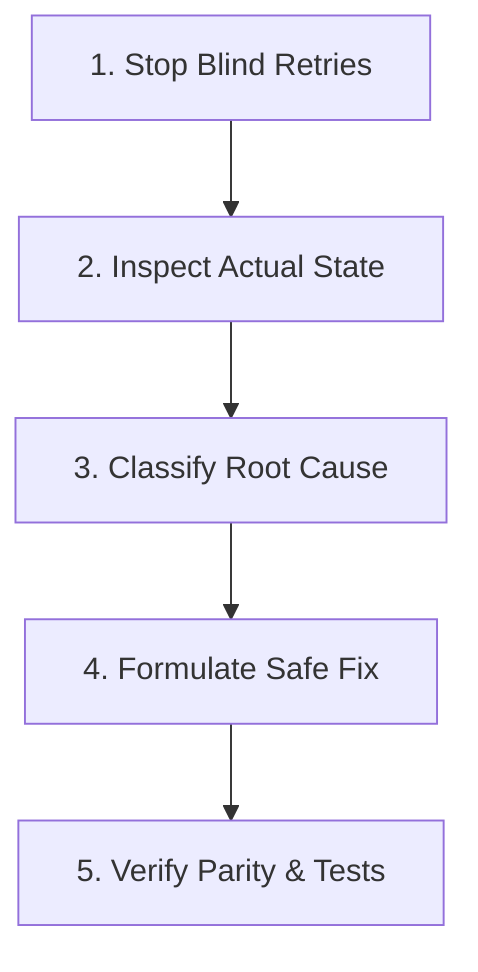

---
name: database-migration
description: Plans, creates, validates, reviews, and troubleshoots database schema and data migrations while preserving data integrity and application compatibility. Use when adding or modifying tables, columns, indexes, constraints, relationships, data transformations, database versions, or migration scripts, and when planning deployment, rollback, recovery, or production-safe schema changes.
---

# Database Migration Skill

This skill guides the AI coding agent to plan, author, review, validate, execute (when authorized), and troubleshoot database schema and data migrations across relational (PostgreSQL, MySQL, SQLite, SQL Server) and document/NoSQL databases.

## 1. Purpose and Core Principles

Database migrations represent persistent contract transitions. Every migration must prioritize data preservation, compatibility, and operational safety:

- **Inspect Before Changing**: Inspect schema definitions, migration history, engine versions, and application dependencies before authoring changes. Never assume an object is unused because it is absent from a single query.
- **Preserve Data Integrity**: Prevent silent truncation, type conversion errors, or dropped records. Enforce invariants (`NOT NULL`, `UNIQUE`, `CHECK`, `FK`) at the database level and validate existing records before tightening constraints.
- **Preserve Application Compatibility**: Support rolling deployments and multi-instance environments. Existing application versions must continue functioning while a migration executes.
- **Minimize Risk**: Prefer small, focused, reversible migrations over monolithic alterations. Differentiate schema DDL from heavy data transformations.
- **Honest Recovery Disclosure**: A down migration cannot restore deleted or transformed data. If a change is irreversible or requires point-in-time recovery (PITR), disclose that limitation explicitly.

*Scope Boundary*: Focuses on migration planning, scripting, execution safety, and troubleshooting. For schema modeling and ER diagrams, use [database-design](../database-design/SKILL.md); for database engineering rules, follow [database.md](../../rules/database.md); for application data-access logic, use [backend-development](../backend-development/SKILL.md); for testing, use [testing-qa](../testing-qa/SKILL.md).

## 2. Migration Scope and Planning

Before designing a migration, establish key parameters:
- **Change Scope**: Clarify affected tables, columns, indexes, constraints, and dependencies across models, queries, background jobs, views, and exports.
- **Migration Type**: Determine whether the change is schema DDL, a data transformation/backfill, a compatibility bridge, or a repair script.
- **Dataset Size & Lock Risk**: Estimate affected row volume. Identify whether the operation acquires exclusive table locks (`AccessExclusiveLock`) or metadata locks that could block normal traffic.
- **Deployment Strategy**: Determine whether zero-downtime rolling deployment is required (mandating expand-and-contract patterns) or whether an approved maintenance window is scheduled.
- **Authorization Level**: Verify authorization. Destructive actions (`DROP TABLE`, `DROP COLUMN`, bulk deletes) require explicit user approval.

## 3. Engine and Framework Discovery

Identify the persistence environment before generating scripts:

| Engine | Transactional DDL | Online Indexing | Key Operational Nuances |
| :--- | :---: | :--- | :--- |
| **PostgreSQL** | Yes (most DDL) | `CREATE INDEX CONCURRENTLY` | No concurrent index in transactions; supports `NOT VALID` constraint staging. |
| **MySQL** | No (implicit commit) | `ALGORITHM=INPLACE, LOCK=NONE` | DDL commits active transactions; metadata lock queues block queries. |
| **SQLite** | Yes | N/A (table lock) | Limited `ALTER TABLE`; dropping/modifying columns requires table recreation. |
| **SQL Server** | Yes | `WITH (ONLINE = ON)` | Supports transactional DDL and partition switching for large tables. |
| **NoSQL** | Engine-specific | Background indexing | Schema-on-read; requires dual-writing code and background backfills. |

- **Framework Conventions**: Follow project runner (Alembic, Prisma, Flyway, Liquibase, Knex, Django, Rails, TypeORM, native SQL). Never introduce a competing tool unprompted.
- **Tracking Table**: Identify the metadata table (e.g., `schema_migrations`, `alembic_version`, `_prisma_migrations`). Never edit migration tracking tables manually to bypass errors.

## 4. Schema Discovery and Dependency Analysis

Inspect all potential consumers before altering database structures:
- **Application References**: Scan ORM entities, raw queries, repositories, serializers, API DTOs, background workers, and schedulers.
- **Database Objects**: Check views, triggers, stored procedures, check constraints, foreign keys, and indexes.
- **External Integrations**: Review read-replicas, ETL pipelines, reporting queries, and external webhook workers.
- **Uncertain Dependencies**: If full dependency coverage cannot be verified, treat the structure as active and avoid destructive removals.

## 5. Types of Migrations

Differentiate migration categories to apply appropriate safeguards:



- **Schema Migrations**: Creating tables, adding columns, establishing foreign keys, or adding indexes.
- **Data Migrations**: Populating new columns, normalizing records, backfilling derived metrics, or migrating data representations. Must be batched and decoupled from DDL when processing large volumes.
- **Compatibility Migrations**: Transitional structures supporting old and new application versions concurrently during rolling releases.
- **Recovery / Repair Operations**: Idempotent reconciliation scripts that fix partially failed states or correct schema drift.

## 6. Migration File Design

Adhere to established repository conventions when creating migration files:
- **Focused Purpose**: Keep each migration focused on a single logical change. Do not bundle unrelated table alterations.
- **Naming & Ordering**: Follow project conventions (timestamp prefixes `YYYYMMDDHHMMSS_add_status_to_books.ts` or sequential numbering `V004__add_status.sql`).
- **Idempotency & Re-runnability**: Author migrations so execution is deterministic. Avoid blind `IF NOT EXISTS` guards that mask silent schema drift; validate state explicitly when required.
- **Immutable History**: Never edit or reorder migrations already applied to shared, staging, or production environments. Author a new forward-correcting migration instead.

## 7. Adding Tables and Columns

Follow safe patterns when expanding schemas:

### Creating New Tables
- Define an explicit primary key (UUIDv7, auto-incrementing integer, or natural key).
- Specify `NOT NULL` constraints, appropriate column types, and default expressions.
- Define foreign keys with explicit referential actions (`ON DELETE RESTRICT` or `ON DELETE CASCADE`).
- Create indexes matching known query access patterns.

### Adding Columns to Existing Tables
- **Adding Nullable Columns**: Safe, low-risk operation across modern database engines.
- **Adding Required (NOT NULL) Columns**:
  ```mermaid
  graph LR
      Step1[1. Add Nullable] --> Step2[2. Backfill Rows] --> Step3[3. Verify Parity] --> Step4[4. Add NOT NULL] --> Step5[5. Update Code]
  ```
  1. *Add Nullable*: Add column as nullable (or with safe metadata default in Postgres >= 11).
  2. *Backfill*: Populate existing records in controlled batches.
  3. *Verify*: Confirm zero remaining `NULL` values.
  4. *Enforce Constraint*: Apply `NOT NULL` constraint (`NOT VALID` / `VALIDATE` in PostgreSQL).
  5. *Update Application*: Deploy application code expecting non-nullable values.

## 8. Renaming, Modifying, and Dropping Structures

Destructive changes require phased execution to preserve uptime and data:

### Safer Renaming Strategy (Expand-and-Contract)
Directly renaming a column breaks running application instances that query the old name:
1. **Expand**: Add new column alongside old column.
2. **Transition**: Deploy code to write to both columns and read with fallback (`new_col ?? old_col`).
3. **Backfill**: Copy historical values from old column to new column.
4. **Contract**: Once all consumers use new column, drop old column in a separate authorized release.

### Dropping Columns or Tables
- **Prerequisites**: Confirm zero application queries touch the column/table. Verify external reporting and replica dependencies.
- **Explicit Authorization**: Dropping persistent data requires explicit user approval.
- **Delayed Removal**: Retain deprecated columns through a release cycle before executing the final `DROP`.

## 9. Data Transformations and Batched Backfills

Transforming large datasets within a single transaction can exhaust memory, trigger lock escalations, and introduce replication lag. Follow batched execution standards:

```sql
-- Batched backfill pattern (keyset pagination)
UPDATE books
SET status = 'published'
WHERE id IN (
    SELECT id FROM books
    WHERE status IS NULL AND id > :last_processed_id
    ORDER BY id ASC
    LIMIT 1000
);
```

- **Batch Sizing**: Process records in discrete chunks (e.g., 500 to 5,000 rows depending on row size).
- **Short Transactions**: Commit each batch independently to release row locks and allow concurrent writes.
- **Progress Tracking & Resumability**: Track progress using keyset pagination (`id > :last_id`). Enable resuming after partial failure without reprocessing.
- **Validation**: Verify record counts, null counts, and sample values before and after backfill.

## 10. Constraints, Foreign Keys, and Integrity

Enforce invariants at the database level while avoiding locking pitfalls:
- **Foreign Keys**: Check for existing orphan records before creating foreign key constraints. In PostgreSQL, use `ADD CONSTRAINT ... NOT VALID` followed by `VALIDATE CONSTRAINT` to validate without holding an exclusive lock.
- **Unique Constraints**: Identify and resolve duplicate records before applying unique constraints.
- **Check Constraints**: Validate business logic rules (e.g., `CHECK (price >= 0)`). Ensure existing data satisfies the check expression prior to enforcement.
- **Zero Silent Record Alteration**: Never delete or alter invalid existing records to make a constraint pass without explicit authorization.

## 11. Indexes and Database Performance

Index creation must balance query acceleration with write overhead and locking:
- **Column Ordering**: In composite indexes `(col_a, col_b)`, place equality columns first, followed by range/sort columns.
- **Online / Concurrent Creation**:
  - *PostgreSQL*: Use `CREATE INDEX CONCURRENTLY idx_books_author ON books(author_id);`. Note: Must run outside multi-statement transaction blocks.
  - *MySQL*: Use `ALTER TABLE books ADD INDEX idx_author (author_id), ALGORITHM=INPLACE, LOCK=NONE;`.
- **Lock Queue Hazards**: A concurrent index creation statement still acquires a brief lock to initialize and finalize. On busy tables, set a strict `lock_timeout` to prevent blocking the query queue.

## 12. Transactions, Locking, and Atomicity

Understand transaction boundaries and lock modes:
- **Transactional DDL**: In PostgreSQL and SQL Server, wrap schema changes in transactions so failures roll back completely. In MySQL, DDL causes an implicit commit; design multi-statement changes with manual recovery steps.
- **Lock Minimization**: Keep DDL transactions minimal. Never perform external network calls, heavy computations, or user-prompt waits inside an open transaction.
- **Lock Timeout Protection**: Set statement and lock timeouts (e.g., `SET lock_timeout = '3s';`) before executing DDL on high-traffic production databases to prevent queue pile-ups.

## 13. Rollback and Recovery Planning

Every migration must have an articulated failure and recovery plan:



- **Down Migrations**: Implement reverse logic (`down()` / `revert()`) when technically feasible and non-destructive.
- **Down Migration Limitations**: Dropping a newly added table in a rollback destroys any new user data written between deployment and failure. When rollback would destroy data, prefer forward-repair patches.
- **Backup Verification**: For high-risk or destructive migrations, verify that a recent, recoverable backup or snapshot exists before execution. Never claim a backup is ready without verification.

## 14. Expand-and-Contract Architecture

Use expand-and-contract (multi-phase) migrations for zero-downtime releases:



1. **Phase 1 (Expand)**: Add new structures in a backward-compatible manner.
2. **Phase 2 (Transition)**: Deploy application version that supports both schema versions (dual-writing).
3. **Phase 3 (Backfill & Verify)**: Synchronize historical records and verify data completeness.
4. **Phase 4 (Contract)**: Remove legacy columns/tables once all running instances are upgraded.

## 15. Migration Idempotency and Partial Failure

Handle interrupted or failed migration runs safely:
- **Detect Partial Execution**: If a migration fails halfway (common in non-transactional DDL engines like MySQL), inspect the database schema directly before retrying.
- **Safe Resumption**: Design backfill scripts to be idempotent (`UPDATE ... WHERE col IS NULL`).
- **Investigate Drift**: If an error states `Table already exists` or `Column missing`, investigate out-of-band schema drift before blindly overriding tracking tables.

## 16. Seeding and Reference Data

Separate operational schema changes from data seeding:
- **Reference Data**: Essential system lookups (e.g., country codes, permission types) required for application functionality. Populate using idempotent upserts (`INSERT ... ON CONFLICT DO UPDATE`).
- **Development Seeds**: Mock records and test fixtures. Keep isolated in `seeds/development/` and never trigger automatically in production environments.
- **Preserve User Modifications**: Avoid overwriting tenant-modified settings during reference data refreshes.

## 17. Migration Testing Strategy

Validate migrations in isolated environments before shared deployment:
- **Clean Schema Installation**: Verify that all migrations apply successfully from scratch (`migrate up` on an empty database).
- **Populated Upgrade Testing**: Apply migrations to a representative database containing realistic data volumes, foreign keys, and edge-case values. Migrations that succeed on empty databases often fail on production data.
- **Rollback Testing**: Test `down` migrations in development to verify clean rollback execution where supported.
- **Lock Duration Measurement**: Benchmark DDL execution and lock acquisition time on staging clones for high-traffic tables.

## 18. Deployment and Operational Planning

Coordinate migration execution with deployment pipelines:
- **Execution Timing**: Determine whether migrations run during build, as a pre-deploy release hook, or via manual operator execution.
- **Decouple from Application Boot**: In production, avoid running heavy migrations automatically on application pod startup (which can cause concurrent execution races and boot loops).
- **Pre-Flight Checks**: Verify database connectivity, migration lock status, disk space, and active replication lag before initiating execution.

## 19. Security and Sensitive Data Protection

Protect credentials and sensitive persistent records:
- **Zero Credentials in Scripts**: Never hardcode database connection strings, passwords, or secrets in migration files.
- **Sanitized Logging**: Ensure backfill logs output record counts and progress percentages, never customer PII or raw secrets.
- **Preserve Role Permissions**: If creating new tables, ensure appropriate `GRANT` permissions are applied for application service roles without granting excessive administrative privileges.

## 20. Troubleshooting Workflow

When a migration fails or produces an unexpected schema state, execute this 5-step workflow:



1. **Stop Blind Retries**: Capture exact exit codes and error logs. Halt automated deployment pipelines immediately.
2. **Inspect Actual State**: Query schema metadata and migration tracking tables. Determine whether DDL rolled back or committed partially.
3. **Classify Root Cause**: Identify the failure type (syntax, lock timeout, constraint violation on existing data, duplicate object, or permission failure).
4. **Formulate Safe Fix**: Choose the appropriate recovery: an authorized corrective migration, manual state reconciliation, or forward repair.
5. **Verify Parity & Tests**: Confirm schema matches intended application expectations and re-run integration tests.

## 21. Practical Decision Guide

Apply targeted strategies across common migration scenarios:

| Scenario | Recommended Strategy |
| :--- | :--- |
| **Add nullable column** | Add column directly; low risk across modern engines. |
| **Add required column** | Add as nullable $\rightarrow$ backfill existing rows $\rightarrow$ apply `NOT NULL` constraint. |
| **Rename column** | Expand-and-contract: add new $\rightarrow$ dual write $\rightarrow$ backfill $\rightarrow$ drop old in later release. |
| **Drop column/table** | Verify zero queries touch it $\rightarrow$ obtain explicit approval $\rightarrow$ drop in separate release. |
| **Add unique constraint** | Query for duplicates $\rightarrow$ resolve duplicates $\rightarrow$ add unique index/constraint. |
| **Add foreign key** | Query for orphan records $\rightarrow$ resolve orphans $\rightarrow$ add constraint (`NOT VALID` in Postgres). |
| **Index busy table** | Use concurrent/online indexing (`CONCURRENTLY` in Postgres, `INPLACE` in MySQL) with lock timeout. |
| **Backfill large table** | Keyset pagination with small chunks (1,000 rows); commit each batch separately. |
| **Modify data type** | Verify binary compatibility; use expand-and-contract if table rewrite locks traffic. |
| **Partial failure (MySQL)** | Inspect actual schema (DDL commits implicitly) $\rightarrow$ reconcile tracking $\rightarrow$ fix forward. |
| **Schema drift detected** | Compare live database schema with migration files $\rightarrow$ generate corrective patch. |
| **Irreversible change** | Document lack of rollback down-script; verify recent backup before execution. |
| **SQLite alteration** | Create new table $\rightarrow$ copy data $\rightarrow$ drop old table $\rightarrow$ rename new table. |
| **NoSQL document shift** | Update app model with fallback $\rightarrow$ run background worker to update legacy docs. |
| **Production lock risk** | Benchmark on staging clone; schedule maintenance window or use online DDL tools. |

## 22. Change Authorization and Safety Boundaries

Adhere to strict safety boundaries during migration tasks:
- **Authoring vs. Execution**: Creating a migration script is distinct from running it. Never execute migrations against staging or production environments without explicit authorization.
- **Zero Unprompted Data Destruction**: Never drop tables, truncate collections, or delete columns as a routine troubleshooting shortcut.
- **Preserve Working Tree**: Check git status before modifying migration files; preserve existing developer edits.
- **No Production Probing**: Never point automated integration tests or local test runners at production connection strings.

## 23. Expected Migration Report Format

Conclude substantive migration tasks with a structured diagnostic summary:

```markdown
# Database Migration Report: [Migration Name / Scope]
- **Intent**: Add `status` field to `books` table with default value and index (PostgreSQL 16, Prisma/Knex).
- **Artifacts**: `migrations/20261024120000_add_status_to_books.sql`, `src/models/book.ts`.
- **Schema & Data**: Added `status VARCHAR(32) DEFAULT 'draft' NOT NULL`, concurrent index `idx_books_status`.
- **Compatibility**: Zero-downtime safe. Default value prevents nullability errors for active v1 instances.
- **Recovery**: Down migration drops column. Limitation: records created during v2 window lose status upon rollback.
- **Verification**: Tested on populated test database (clean run PASSED, rollback PASSED, lint PASSED). NOT run in prod.
```

## 24. Alignment with Existing Rules and Skills

This skill integrates with repository governance rules and companion skills:
- **Rules**: [database.md](../../rules/database.md) (standards, referential actions, parameterized queries); [change-safety.md](../../rules/change-safety.md) & [core-workflow.md](../../rules/core-workflow.md) (inspect first, authorization for destructive ops); [security.md](../../rules/security.md) (zero secrets in migrations).
- **Companion Skills**: [database-design](../database-design/SKILL.md) (ER modeling, normalization); [backend-development](../backend-development/SKILL.md) (ORM models, repositories); [testing-qa](../testing-qa/SKILL.md) (automated migration & regression suites).

## 25. Final Validation Checklist

Before concluding any database migration task, verify all 10 criteria:

- [ ] **1. Schema & Engine Verified**: Migration scripts match target database engine and version features.
- [ ] **2. Dependency Coverage**: Models, queries, views, background workers, and exports checked for affected fields.
- [ ] **3. Non-Destructive Phasing**: Non-nullable columns, renames, and type changes use staged expand-and-contract patterns.
- [ ] **4. Lock Risk Evaluated**: Exclusive table locks and metadata queue risks evaluated and mitigated.
- [ ] **5. Batched Backfills**: Data transformations use keyset batching with short transactions rather than monolithic updates.
- [ ] **6. Invariants Preserved**: Constraints (`NOT NULL`, `UNIQUE`, `FK`) verified against existing data before enforcement.
- [ ] **7. Explicit Authorization**: Destructive operations (`DROP`, `TRUNCATE`, bulk deletes) have documented user approval.
- [ ] **8. Recovery Defined**: Rollback scripts, forward-repair strategies, or backup requirements explicitly stated.
- [ ] **9. Clean Test Execution**: Migration and rollback scripts tested on an isolated, populated test database.
- [ ] **10. Safe Scope Discipline**: Migration files authored without unauthorized production execution or unrelated code edits.
