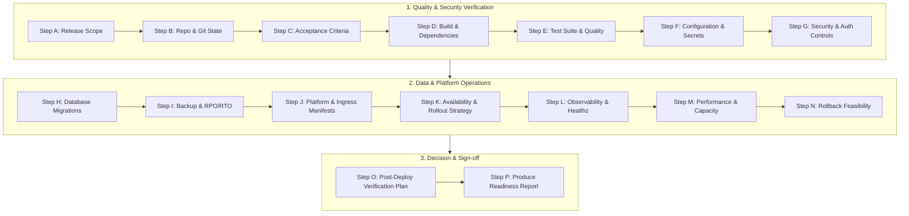
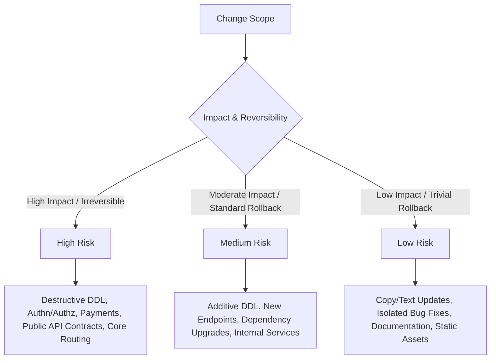

---
name: deployment-readiness
description: Assesses application and release readiness before deployment by evaluating builds, tests, dependencies, configuration, security, database migrations, backups, compatibility, monitoring, health checks, and rollback plans. Use when preparing releases, reviewing production deployment prerequisites, performing go-live checks, or identifying release blockers and operational risks. Assessment only; to execute or troubleshoot the deployment itself, use deployment.
---

# Deployment Readiness Skill

This skill guides the AI coding agent to assess, verify, and document application and release readiness prior to deployment across target environments (development, testing, staging, production).

## 1. Purpose and Core Principles

Deployment readiness evaluates whether a proposed release satisfies all stability, security, data integrity, and operational requirements. Adhere to four core engineering principles:

- **Evidence Over Assumptions**: Never equate a documented requirement, a passing local build, or an assumed configuration with verified readiness. Distinguish seven operational states:
  *1. Documented* $\rightarrow$ *2. Inspected* $\rightarrow$ *3. Executed* $\rightarrow$ *4. Observed* $\rightarrow$ *5. Target-verified* $\rightarrow$ *6. Untested* $\rightarrow$ *7. Assumption*.
- **Readiness Is Environment-Specific**: Code operational in development or staging may fail in production due to configuration drift, concurrency, networking, credentials, or scale. Always assess against the specific target environment.
- **Safety Before Convenience**: Never bypass tests, security scans, approvals, or protected-branch controls to rush a deployment. Prefer incremental, verifiable releases over monolithic rollouts.
- **Assessment Is Not Authorization**: Confirming technical readiness does NOT grant authority to deploy, trigger CI/CD pipelines, execute migrations, or alter production infrastructure. Execution requires explicit user authorization.

*Scope Boundary*: Focuses on readiness evaluation, risk classification, blocker identification, and release sign-off preparation. For deployment execution, use [deployment](../deployment/SKILL.md); for backup validation, use [backup-recovery](../backup-recovery/SKILL.md); for migrations, use [database-migration](../database-migration/SKILL.md); for environment variables, use [environment-configuration](../environment-configuration/SKILL.md); for observability, use [logging-monitoring](../logging-monitoring/SKILL.md).

## 2. Deployment Scope and Release Boundaries

Establish the precise release perimeter before commencing evaluation:

| Dimension | Target Evaluation Scope |
| :--- | :--- |
| **Release Artifact** | Target Git commit SHA, branch, tag, Docker image digest, or build package. |
| **Target Environment** | Staging, UAT, Canary, or Production (including cloud region, cluster, VPC). |
| **Change Topology** | Scope of features, bug fixes, refactors, dependencies, runtime upgrades, or IaC changes. |
| **Persistence Impact** | Schema DDL, table locks, data backfills, seed data, and migration rollbacks. |
| **Contract Stability** | Public HTTP endpoints, GraphQL schemas, gRPC protos, queue messages, and DTOs. |
| **Operational Windows**| Approved release windows, freeze periods, maintenance windows, and stakeholder sign-offs. |

*Boundary Rule*: For multi-service distributed architectures, evaluate each component independently. Never declare an entire system ready when only a single microservice has been assessed.

## 3. Systematic 16-Step Readiness Workflow

Execute this structured assessment sequence from initial scoping to final report:



- **Step A: Understand the Release**: Inspect changelogs, commit diffs, and issue tickets. Classify release type (patch, minor, major, hotfix) and determine affected customer journeys.
- **Step B: Inspect Repository & Build State**: Verify working tree state via `git status`. Ensure release branch is synchronized with upstream and tagged properly. Prevent uncommitted scratch files from contaminating builds.
- **Step C: Review Acceptance Criteria**: Reconcile changes against product specifications. Verify that all functional and non-functional acceptance criteria are substantiated by tests.
- **Step D: Evaluate Build & Dependencies**: Confirm clean build execution with zero unhandled compiler errors or warnings. Verify lockfile synchronization (`pnpm-lock.yaml`, `package-lock.json`, `poetry.lock`) and native toolchains.
- **Step E: Review Test & Quality Results**: Audit test suite execution: unit, integration, and E2E suites. Confirm static analysis, linting (`eslint`), and type checking (`tsc`) pass with zero regressions.
- **Step F: Evaluate Environment Configuration**: Validate that all required environment variables are defined in configuration schemas without printing sensitive secret values. Confirm `.env.example` templates match application requirements.
- **Step G: Review Security Readiness**: Verify authentication, authorization guards, CORS origins, security headers (CSP, HSTS), and dependency vulnerability scans (`pnpm audit`). Flag unmitigated CVEs.
- **Step H: Review Database Readiness**: Audit pending migration scripts for table locks, lock timeouts, and backward compatibility. Enforce expand-and-contract patterns for zero-downtime releases.
- **Step I: Verify Backup & Recovery Preparedness**: Confirm pre-deployment backup freshness, integrity checksums, and point-in-time recovery capabilities. Verify recovery objectives (RPO/RTO).
- **Step J: Review Deployment Configuration**: Inspect Dockerfiles, container entrypoints, Kubernetes deployment manifests, CPU/memory requests, and service discovery routing.
- **Step K: Assess Availability & Rollout Safety**: Select rollout strategy (rolling, blue-green, canary). Verify graceful shutdown signal handling (`SIGTERM`), connection draining, and readiness probes.
- **Step L: Review Monitoring & Observability**: Ensure structured logging, distributed tracing, error tracking (Sentry), Prometheus metrics, and `/healthz` endpoints are configured and active.
- **Step M: Evaluate Performance & Capacity**: Check database connection pool limits, caching layers (Redis), and response latency baselines under peak concurrency.
- **Step N: Assess Rollback and Recovery**: Define exact rollback mechanics. Differentiate instant container rollback from complex schema rollback. Formulate forward-repair contingencies if migrations are irreversible.
- **Step O: Prepare Post-Deployment Verification (PDV)**: Compile an automated, non-destructive smoke-test suite covering critical user flows, synthetic checks, and telemetry baselines.
- **Step P: Produce the Readiness Assessment**: Synthesize findings into the standardized Deployment Readiness Report with an evidence-backed status determination.

## 4. Readiness Categories and Decision Framework

Assign one of four unambiguous readiness classifications:

| Status | Operational Criteria | Permitted Next Actions |
| :--- | :--- | :--- |
| **READY** | All critical checks pass with empirical evidence; zero release blockers; backward-compatible persistence; rollback tested. | Proceed to schedule release execution during approved deployment window. |
| **CONDITIONALLY READY** | Non-blocking issues present; minor test skips or manageable config updates; clear mitigations identified. | Release blocked until specified prerequisites are met and accepted by release owner. |
| **NOT READY** | Critical test failures, unmitigated security CVEs, irreversible lock-prone DDL, missing backups, or broken build. | Deployment halted immediately. Return release to engineering for remediation. |
| **INSUFFICIENT EVIDENCE** | Inaccessible staging environment; unexecuted build/test suites; unverified production configs. | Deployment blocked. Execute missing verification steps before re-assessing. |

### Decision Rules
1. **Zero Blocker Policy**: A single unresolved critical blocker automatically forces a `NOT READY` status.
2. **No Presumed Verification**: Absence of failure evidence is NOT evidence of success. Untested systems are classified as `INSUFFICIENT EVIDENCE`.
3. **Scope Discipline**: A `READY` status applies exclusively to the inspected commit and environment scope.

## 5. Release Risk Classification Framework

Classify changes to determine required verification rigor:



- **High-Risk Releases**: Mandate staging soak time, verified database snapshots, maintenance window coordination, and real-time war-room monitoring.
- **Low-Risk Releases**: Eligible for standard automated CI/CD pipeline promotion upon clean test verification.

## 6. Comprehensive Deployment Readiness Checklist

Execute this adaptive checklist across all applicable domains:

### A. Code & Repository Integrity
- [ ] Working tree is clean with zero uncommitted scratch files or debug statements.
- [ ] Release branch is locked, reviewed, and approved via pull request.
- [ ] Target commit SHA matches the artifact built in CI.

### B. Build & Artifact Verification
- [ ] Build completes successfully in clean environment with zero warnings-as-errors.
- [ ] Package lockfiles are consistent with manifests; zero dependency drift.
- [ ] Container image is scanned, tagged with immutable digest, and pushed to registry.

### C. Testing & Quality Assurance
- [ ] Unit, integration, and end-to-end test suites executed and passed (100% green).
- [ ] Static analysis, linting, and type-checking pass with zero errors.
- [ ] Critical business paths (auth, billing, checkout, data processing) thoroughly validated.

### D. Configuration & Secrets
- [ ] Target environment variables validated against application schema.
- [ ] Secrets injected via secure KMS/Vault; zero plaintext credentials in code or Git.
- [ ] Public vs. private configuration boundaries enforced (no server keys in client bundles).

### E. Database & Data Integrity
- [ ] Database migrations tested in staging clone; lock risks and runtimes benchmarked.
- [ ] Expand-and-contract pattern applied for zero-downtime schema evolution.
- [ ] Pre-deployment backup verified with intact checksum and tested restore point.

### F. Security & Compliance
- [ ] Dependency vulnerabilities audited; zero unaddressed High/Critical CVEs.
- [ ] Authn/authz permission boundaries verified; CORS and security headers active.
- [ ] Debug endpoints and verbose stack traces disabled for target environment.

### G. Operational Observability
- [ ] Liveness (`/healthz`) and readiness (`/ready`) probes implemented and verified.
- [ ] Application logs structured in JSON; error tracking and alerting active.
- [ ] Release markers configured in APM for metric anomaly detection post-deploy.

### H. Rollout & Rollback Strategy
- [ ] Rollout sequence documented (pre-migration $\rightarrow$ deploy $\rightarrow$ post-migration).
- [ ] Automated rollback criteria established (e.g., error rate $>1\%$ for 3 mins).
- [ ] Forward-repair contingency documented if rollback is constrained by data writes.

## 7. Security, Data Integrity, and Operational Safeguards

Strictly observe these operational guardrails during readiness reviews:

- **Zero Secret Exposure**: Never display plaintext secrets, passwords, private keys, or raw connection strings in logs or reports.
- **No Unapproved Deployment Execution**: The agent must NEVER run deployment scripts, apply K8s manifests, or trigger cloud releases unprompted.
- **No Production Probing with Destructive Actions**: Never test production health by executing real credit card transactions, triggering live customer emails, or deleting records.
- **Preserve Forensic State**: Do not clear logs, overwrite test databases, or reset environment state during readiness checks.
- **Strict Read-Only Inspections**: Conduct readiness evaluations without altering application source code, package manifests, or environment files.

## 8. Verification Tools and Non-Destructive Execution

Select appropriate non-destructive verification tools based on stack:

| Stack / Domain | Non-Destructive Verification Commands | Verification Purpose |
| :--- | :--- | :--- |
| **Node.js / TypeScript** | `pnpm run build`, `pnpm test`, `tsc --noEmit`, `pnpm audit` | Compile code, run test suite, check types, audit CVEs. |
| **Python** | `pytest`, `mypy .`, `flake8`, `pip-audit` | Test suite, type validation, code style, dependency CVEs. |
| **Docker** | `docker build --no-cache`, `trivy image ` | Verify container buildability and scan image CVEs. |
| **Database** | `prisma migrate status`, `alembic current` | Check migration sync without executing alterations. |
| **Kubernetes** | `kubectl diff -f k8s/`, `kubeval`, `conftest` | Validate manifest syntax and compare live cluster state. |

*Safety Rule*: If a tool or command modifies persistent state or connects to live production systems, halt and obtain explicit confirmation before running.

## 9. Post-Deployment Verification (PDV) Protocol

Define the post-deployment verification plan prior to release execution:

- **T+0 to T+5 Minutes (Liveness & Readiness)**:
  - Query health endpoints: `GET /healthz` $\rightarrow$ 200 OK.
  - Inspect container restarts and pod startup logs for crash-loop backoffs.
  - Verify deployed version matches target release commit/tag.
- **T+5 to T+15 Minutes (Synthetic Smoke Testing)**:
  - Execute automated, non-destructive synthetic checks (login, read-only search, dashboard load).
  - Verify external service integrations (Stripe, SendGrid, S3) connect without auth failures.
- **T+15 to T+60 Minutes (Telemetry & SLA Monitoring)**:
  - Monitor HTTP error rates (5xx $< 0.05\%$).
  - Monitor P95/P99 latency against pre-release baselines.
  - Inspect APM logs for unhandled exceptions or database connection pool exhaustion.

## 10. Practical Decision Guide

| Operational Dilemma | Recommended Action & Decision Rule |
| :--- | :--- |
| **Unit tests pass, but E2E tests unrun** | Mark `CONDITIONALLY READY` or `INSUFFICIENT EVIDENCE`. Block prod release until critical user flows verified. |
| **New required env var missing in staging** | Mark `NOT READY`. Update staging environment schema and verify boot before prod sign-off. |
| **Migration adds required column without default** | Mark `NOT READY`. Mandate expand-and-contract pattern: nullable first $\rightarrow$ backfill $\rightarrow$ set not-null. |
| **Dependency has moderate vulnerability** | If no exploit path exists and fix requires breaking upgrade, document accepted risk with sign-off. |
| **Release scheduled during traffic peak** | Mark `CONDITIONALLY READY`. Reschedule deployment to approved off-peak maintenance window. |
| **Docker build succeeds locally, fails in CI** | Mark `NOT READY`. Investigate toolchain/cache discrepancies in CI environment. Never deploy local image. |
| **Pre-deployment backup is 28 hours old** | Mark `NOT READY` (if RPO $\le 24\text{h}$). Trigger fresh pre-deployment backup and verify integrity. |
| **Rollback script missing for schema DDL** | Mark `NOT READY`. Formulate explicit down-migration or documented forward-repair strategy. |
| **Staging tests pass, prod credentials unverified** | Mark `CONDITIONALLY READY`. Verify credential validity and permissions prior to deployment cutover. |
| **Liveness probe passes, readiness fails** | Mark `NOT READY`. Application boots but cannot accept traffic (likely database/dependency connection failure). |
| **Performance latency increased by 30%** | Mark `NOT READY`. Profile query execution plans or caching before authorizing production release. |
| **User requests emergency hotfix bypass** | Document bypass explicitly; run minimal unit + syntax verification; obtain documented emergency sign-off. |
| **Production database on different major version** | Mark `NOT READY`. Reconcile database engine versions between staging and production. |
| **Third-party webhook API deprecating endpoint** | Mark `CONDITIONALLY READY`. Confirm new API adapter passes contract validation before traffic switch. |

## 11. Expected Deployment Readiness Report Format

When delivering a readiness assessment, format findings using this standardized template:

```markdown
# Deployment Readiness Assessment: [Application Name] v[X.Y.Z]

- **Target Scope**: Commit `a1b2c3d` (branch: `main`) $\rightarrow$ Production (`us-central1`).
- **Readiness Classification**: READY | CONDITIONALLY READY | NOT READY | INSUFFICIENT EVIDENCE
- **Summary**: Comprehensive pre-deployment evaluation completed across build, test, config, database, and rollback domains.

## Critical Blockers
1. [Blocker Description]: [Evidence & Impact] $\rightarrow$ *Remediation: [Specific Action Required]*.
*(Or: "Zero critical blockers identified within assessed scope.")*

## Domain Verification Scorecard
| Verification Domain | Status | Key Evidence / Findings |
| :--- | :---: | :--- |
| **Build & Dependencies** | PASSED | Clean compilation in CI; lockfile synchronized; zero audit CVEs. |
| **Testing & Quality** | PASSED | 142/142 unit tests passed; E2E smoke tests verified; lint clean. |
| **Config & Secrets** | PASSED | Environment schema validated; secret manager bindings active. |
| **Database & Migrations**| PASSED | Additive migration tested; runtime $<2\text{s}$; zero table lock risk. |
| **Backup & Recovery** | PASSED | Snapshot `snap-20261024-0200` verified; PITR active (RPO $<15\text{m}$). |
| **Security & Auth** | PASSED | RBAC enforced; CORS restricted to production origin; headers active. |
| **Rollout & Rollback** | PASSED | Rolling update configured; container rollback available in $<60\text{s}$. |

## Key Operational Risks & Mitigations
- **Risk**: Database migration adds index on large table `orders`.
  - *Mitigation*: Migration uses `CONCURRENTLY` in PostgreSQL to eliminate write locks.

## Pre-Deployment Conditions (If Conditionally Ready)
1. Verify target production database connection pool scaling ($N \ge 50$).

## Recommended Post-Deployment Verification
- Run synthetic health checks: `GET https://api.example.com/healthz`.
- Observe APM 5xx error rate and P95 latency for 30 minutes post-cutover.

*Status Statement*: Technical evaluation indicates release is [READY / NOT READY]. Deployment execution requires authorized approval.
```

## 12. Alignment with Repository Rules and Companion Skills

Integrate with project governance rules and companion skills:

- **Rules**: [deployment.md](../../rules/deployment.md) (release standards); [change-safety.md](../../rules/change-safety.md) (authorization for destructive actions); [security.md](../../rules/security.md) (secrets and least privilege); [database.md](../../rules/database.md) (data integrity).
- **Companion Skills**: [deployment](../deployment/SKILL.md) (execution runbooks); [backup-recovery](../backup-recovery/SKILL.md) (recovery readiness); [database-migration](../database-migration/SKILL.md) (safe DDL evolution); [environment-configuration](../environment-configuration/SKILL.md) (secret and config auditing); [logging-monitoring](../logging-monitoring/SKILL.md) (telemetry and health tracking).

## 13. Final Validation Checklist

Before concluding any deployment readiness evaluation, verify these 10 criteria:

- [ ] **1. Evidence-Based**: Every readiness status claim is backed by empirical inspection, test output, or verified logs.
- [ ] **2. Environment-Specific**: Assessed against the exact target deployment environment, not local assumptions.
- [ ] **3. Strict Non-Execution**: Evaluates readiness without executing deployments, live migrations, or infrastructure updates.
- [ ] **4. Build & Lockfile Checked**: Clean build verified with lockfile consistency and zero toolchain drift.
- [ ] **5. Test Suite Validated**: Automated tests, linting, and type-checks inspected for actual execution results.
- [ ] **6. Persistence Safety**: Database migrations reviewed for locking, backward compatibility, and pre-release backups.
- [ ] **7. Secrets Sanitized**: Configuration verified without printing passwords, API tokens, or private keys.
- [ ] **8. Rollback Feasibility**: Explicit rollback plan and recovery limitations established before sign-off.
- [ ] **9. Clear Classification**: Categorized unambiguously as `READY`, `CONDITIONALLY READY`, `NOT READY`, or `INSUFFICIENT EVIDENCE`.
- [ ] **10. Post-Deploy Defined**: Concrete verification steps and telemetry monitoring guidelines prepared for go-live.
