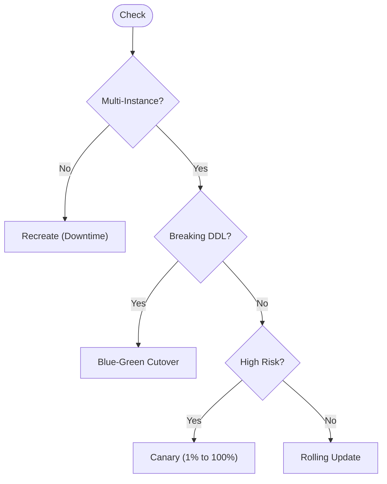
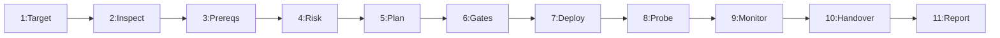

---
name: deployment
description: Plans, prepares, executes, verifies, and troubleshoots software deployments across development, staging, and production environments. Covers hosting configuration, build artifacts, environment variables, secrets, database migrations, deployment strategies, health checks, rollback and recovery, and post-deployment validation. Use when publishing an application, updating an existing deployment, moving between hosting environments, or diagnosing deployment failures. Executes the deployment; for a pre-release go or no-go assessment, use deployment-readiness first.
---

# Software Deployment and Release Execution Skill

Teaches the AI agent to plan, prepare, execute, verify, troubleshoot, and recover software deployments across development, staging, and production environments.

## 1. Purpose, Core Principles, and Operational Deployment Mindset

The governing mandate of software deployment is:
**Deploy the correct application version to the intended environment using a verified procedure, protect configuration and data, verify the deployed result, and communicate failures honestly. Never confuse preparing a deployment with actually deploying or verifying an application.**

Adhere to seven engineering principles:
- **Evidence Over Assumption**: Builds do not prove health; verify via telemetry.
- **Strict Isolation**: Segregate networks, databases, and secrets across tiers.
- **State Protection**: Safeguard databases, uploads, secrets, and volumes.
- **Least Privilege**: Grant deploy runners and containers minimal permissions.
- **Explicit Authorization**: Production releases, DDL, and DNS need approval.
- **Controlled Reversibility**: Maintain a verified rollback and recovery path.
- **Honest Telemetry**: Report executed commands, health status, and anomalies.

Distinguish six operational states: *1. Planned* $\rightarrow$ *2. Prepared* $\rightarrow$ *3. Authorized* $\rightarrow$ *4. Executed* $\rightarrow$ *5. Verified* $\rightarrow$ *6. Stabilized*.

*Scope Boundary*: Focuses on release execution. Related skills are in Section 31.

## 2. Defining the Scope of Deployment Operations

Deployment transitions a release into a target runtime and validates operational health:
- **Packaging**: Verify runtime; compile clean bundles without dev dependencies.
- **Secrets**: Inject vault parameters; verify database connectivity.
- **State**: Audit migrations, apply non-breaking DDL, preserve uploads.
- **Execution**: Roll instances, update proxy routes, configure TLS.
- **Verification**: Probe `/health/live` and `/health/ready`; run smoke tests.
- **Telemetry**: Monitor error rates and latency; trigger rollback on failure.

*Rule*: Select the simplest deployment procedure matching application requirements.

## 3. Distinguishing Deployment from CI/CD, Readiness, and Infrastructure

Maintain strict boundaries across the release lifecycle:

| Skill | Focus | Inputs | Output |
| :--- | :--- | :--- | :--- |
| **ci-cd** | Build automation | Git push | Tested artifacts |
| **deployment-readiness** | Pre-flight audit | Artifact | Readiness score |
| **cloud-infrastructure** | Cloud infra | IaC code | Clusters, VPCs |
| **deployment** | Release & verify | Artifact, env | Running app, probes |
| **database-migration** | Schema evolution | Migrations | Applied DDL |
| **environment-configuration** | Secrets & config | Vaults | Injected params |

*Core Axiom*: Passing builds do not prove deployment; successful commands do not prove health.

## 4. Establishing Deployment Objective and Authorization

Establish operational parameters before initiating deployment actions:
- **Target & Artifact**: Identify service name and exact commit SHA or digest.
- **Environment**: Confirm target tier: `development`, `staging`, or `production`.
- **Release Type**: Classify as initial rollout, update, hotfix, or rollback.
- **Explicit Approval**: Require explicit user approval before initiating rollout.
- **Quality Gates**: Verify tests, linters, security audits, and reviews passed.
- **Operational Impact**: Assess downtime risks, user impact, and lock contention.

## 5. Inspecting the Existing Application and Deployment Architecture

Inspect workspace evidence before proposing or altering deployment procedures:
- **Stack & Architecture**: Inspect manifests (`package.json`, `go.mod`); identify app type.
- **Build Commands**: Check build scripts (`npm run build`) and outputs (`dist/`).
- **Entry & Supervisors**: Verify startup commands (`node dist/server.js`) and supervisors.
- **Secrets & Volumes**: Review `.env.example`, databases, ORMs, and persistent storage.
- **Background Jobs**: Identify worker queues (Redis, BullMQ, Celery) and cron jobs.
- **Platform Configs**: Review Dockerfiles, compose files, and platform manifests.

## 6. Selecting a Suitable Deployment Model

Select a deployment architecture matching application profile and platform requirements:

| Model | Suited For | Characteristics |
| :--- | :--- | :--- |
| **Static** | SPAs, docs | Edge CDN hosting, zero server maintenance. |
| **PaaS** | Web apps, APIs | Managed runtimes, automated TLS, ephemeral disk. |
| **Containers** | Microservices | Immutable images, reproducible environments. |
| **VMs** | Legacy services | OS-level control, manual systemd management. |
| **K8s** | Complex setups | Declarative pods, rolling updates, higher overhead. |
| **Serverless** | Event APIs | Cold starts, execution timeouts, connection caps. |

*Discipline*: Never introduce Kubernetes when platform-managed services or simple containers suffice.

## 7. Identifying the Correct Build and Deployment Artifact

Verify artifact boundaries and build integrity:
- **Clean Bundles**: Package production assets only; strip `devDependencies` and tests.
- **Immutability**: Tag artifacts with commit SHA; deploy images by SHA-256 digest.
- **Secret Exclusion**: Exclude `.env` files, keys, and `.git` via ignore files.
- **Locked Builds**: Pin compiler versions and use frozen lockfiles (`npm ci`).
- **Staging Test**: Validate compiled bundle executes cleanly in staging.

## 8. Verifying Runtime and Build Compatibility

Confirm alignment between deployment package and target runtime:
- **Version Parity**: Match target runtime to tested versions (Node.js 20, Python 3.11).
- **Native Modules**: Compile native dependencies (`bcrypt`, `sharp`) for target OS/arch.
- **Non-Root User**: Run application processes under unprivileged users (`USER appuser`).
- **Resource Limits**: Verify memory caps (`max-old-space-size`), CPU shares, and DB pools.
- **Network Access**: Confirm target environment allows outbound DB and API egress.

## 9. Configuring Environment Variables and Secrets Safely

Manage configuration parameters securely and prevent credential leaks:
- **Client vs Server**: Keep public vars distinct from server secrets; client vars are public.
- **Vault Injection**: Inject credentials at runtime via secret vaults; never bake into images.
- **Sanitized Templates**: Maintain `.env.example` with placeholders; never commit secrets.
- **Redacted Telemetry**: Redact secrets in logs and CI consoles; never dump environment.
- **Startup Validation**: Validate configuration on boot via schemas (Zod); fail fast on errors.

## 10. Separating Development, Staging, and Production

Enforce rigid boundaries between deployment tiers:

| Tier | Purpose | Target Artifact | Database & State | Approval |
| :--- | :--- | :--- | :--- | :--- |
| **Dev** | Local testing | Working branch | Ephemeral container DB | None |
| **Staging** | Mirror & audit | Release candidate | Isolated synthetic DB | Review |
| **Prod** | Live traffic | Verified artifact | Redundant cluster & backup | Owner |

*Directives*: Never connect staging to production databases; use sandbox API keys.

## 11. Preparing a Comprehensive Deployment Plan

Establish a structured deployment plan before modifying live environments:
- **Metadata**: Service name, target tier, commit SHA, window, and operator.
- **Prerequisites**: Verified build artifacts, passing tests, security scans, and backup.
- **Execution Steps**: Sequenced commands: migrations, container rollout, cache flush.
- **Health Checks**: Exact HTTP URLs, expected status codes, and payload checks.
- **Rollback Triggers**: Concrete thresholds triggering rollback (error rate $> 1\%$).
- **Rollback Steps**: Procedure to redeploy previous stable digest and restore data.

## 12. Pre-Deployment Validation and Quality Gates

Verify the release candidate passes all mandatory gates prior to release:
- **Clean Build**: Confirm clean artifact compilation without warnings or errors.
- **Test Suite**: Ensure 100% pass rate across unit, integration, and contract tests.
- **Vulnerability Audit**: Check dependency scans (`npm audit`, Trivy) have zero CVEs.
- **Migration Dry-Run**: Test pending migrations against staging schema before production.
- **Secrets Audit**: Verify all required environment variables exist in target vault.
- **Branch Protection**: Confirm commit is merged into protected release branch.

## 13. Handling Database Migrations Carefully

Database migrations present significant availability and data loss risks:
- **Pre-Migration Backup**: Verify restorable DB snapshot exists prior to DDL.
- **Target Verification**: Confirm database host and database name explicitly.
- **Expand-and-Contract**: Apply changes in five non-breaking phases:
  1. *Expand*: Add nullable columns or tables without breaking old code.
  2. *Deploy*: Deploy code writing to both old and new schema columns.
  3. *Backfill*: Migrate historical data using background workers.
  4. *Contract Deploy*: Deploy code reading and writing new schema.
  5. *Contract Schema*: Drop obsolete columns in subsequent release.
- **No Destructive DDL**: Forbid `DROP TABLE`, `DROP COLUMN`, and column renames.
- **Non-Blocking DDL**: Use `CREATE INDEX CONCURRENTLY`; avoid table locks.

## 14. Managing Persistent Files, User Uploads, and State

Modern deployments replace server instances and containers dynamically:
- **Ephemeral Filesystems**: Treat container disks as temporary; local files vanish on restart.
- **Object Storage**: Offload user uploads, generated PDFs, and media to S3 or GCS.
- **Stateless Web Tiers**: Keep servers stateless; store sessions in Redis or JWTs.
- **Persistent Mounts**: Attach dedicated persistent volume claims (PVCs) for stateful data.
- **Temp Isolation**: Restrict temporary local file operations strictly to `/tmp`.

## 15. Safe Execution of Deployment Procedures

Execute deployments methodically under controlled conditions:
- **Pre-Execution**: Confirm authorization, record baseline revision, verify target health.
- **Execution**: Apply migrations via tracked tasks, roll containers, observe logs.
- **Post-Execution**: Probe `/health/live` and `/health/ready`; run smoke tests.
- **Command Logs**: Capture sanitized logs and exit codes for all deploy commands.
- **Halt on Failure**: If any step fails, halt immediately, preserve logs, assess recovery.

## 16. Selecting and Executing Deployment Strategies

Select the deployment strategy matching architecture and availability requirements:



- **Recreate**: In-place replacement; brief downtime; simple rollback.
- **Rolling**: Incremental instance rollout behind load balancer.
- **Blue-Green**: Parallel environments; instant router cutover.
- **Canary**: Incremental traffic shift (1% to 100%) to isolate risk.

*Rule*: Never claim zero downtime without multi-instance redundancy.

## 17. Domain, DNS, HTTPS, Routing, and Reverse Proxy Configuration

Ensure correct network routing, transport encryption, and edge protection:
- **Enforce TLS**: Enforce TLS 1.3/1.2 on all endpoints. Redirect HTTP to HTTPS (301).
- **Managed Certificates**: Use managed certificate services (Let's Encrypt, ACM).
- **Proxy Headers**: Configure reverse proxies (Nginx, ALB) to pass `X-Forwarded-*`.
- **Trusted Proxies**: Configure web frameworks to trust upstream proxy CIDRs only.
- **DNS TTLs**: Lower DNS TTLs (60–300s) prior to cutover; allow propagation time.
- **CORS Whitelisting**: Whitelist production domains; forbid wildcard origins.

## 18. Post-Deployment Health Checks and Smoke Testing

Verify deployed services are functioning correctly in the live environment:
- **Dual-Tier Probes**:
  - **Liveness** (`/health/live`): Confirms process is running and responsive (HTTP 200).
  - **Readiness** (`/health/ready`): Confirms DB, cache, and queue connectivity (HTTP 200).
- **Version Verification**: Confirm health JSON returns expected version and commit:
  ```json
  { "status": "healthy", "version": "1.4.2", "commit": "a8f3b9c" }
  ```
- **Smoke Tests**: Verify root route returns 200, assets load, and APIs respond.
- **Zero Pollution**: Never create dummy records, charge test cards, or email users.

## 19. Operational Monitoring, Metrics, and Regression Detection

Monitor system telemetry actively during and after deployment:
- **Telemetry Signals**:
  - **Error Rates**: Track HTTP 5xx responses; sudden spikes indicate release defects.
  - **Latency Percentiles**: Monitor p50, p95, and p99 latency against pre-release baselines.
  - **Resource Usage**: Track container CPU, memory usage, and disk I/O saturation.
  - **Database Metrics**: Observe active pool connections, query queues, and lock waits.
- **Structured Logs**: Emit JSON logs to stdout/stderr with correlation IDs (`trace_id`).
- **Observation Window**: Maintain active monitoring for 15–30 minutes post-release.

## 20. Planning Rollback and Forward Recovery

Every deployment must have a pre-planned, actionable recovery strategy:
- **Rollback Evaluation**: Confirm previous artifact digest exists and configs revert cleanly.
- **Schema Compatibility**: Never assume rolling back code works with a migrated database.
- **Rollback Steps**: Declare failure, re-route traffic to previous digest, verify probes.
- **Preserve Columns**: If database expanded, retain new columns; avoid down-migrations.
- **Forward Recovery**: When rollback is unsafe due to schema changes, apply a forward fix.

## 21. Systematic Deployment Failure Troubleshooting

When a deployment fails, diagnose the root cause systematically:

| Step | Focus | Action |
| :---: | :--- | :--- |
| **1** | **Phase** | Isolate failure: build, deploy, or probe. |
| **2** | **Logs** | Inspect exit codes and runtime traces. |
| **3** | **Target** | Verify environment tier and DB host. |
| **4** | **Config** | Check missing or invalid environment vars. |
| **5** | **Network**| Check routing, firewall, and DNS records. |
| **6** | **Database**| Verify connection pool and lock states. |
| **7** | **Limits** | Check for OOM kills (code 137) or disk full. |
| **8** | **Fix** | Apply targeted fix addressing root cause. |
| **9** | **Re-Test**| Validate fix in staging before rollout. |
| **10**| **Report** | Document root cause and prevention steps. |

*Anti-Pattern*: Never retry failed deployment commands repeatedly without diagnosing logs.

## 22. Security, Identity, and Least Privilege During Deployment

Deployment infrastructure possesses privileged access to systems and data:
- **Dedicated Identities**: Use machine service accounts or OIDC; avoid personal keys.
- **Least Privilege**: Restrict deploy tokens to target tier. Staging must not access prod.
- **Short-Lived Tokens**: Favor ephemeral OIDC tokens over static access keys.
- **Hardened Runtimes**: Run containers as non-root (`USER appuser`) with dropped capabilities.
- **Private Subnets**: Shield databases, cache nodes, and queues in private subnets.

## 23. Deploying Background Workers, Schedulers, and Queues

Applications relying on asynchronous processing require coordinated deployment:
- **Dedicated Services**: Deploy background workers (Celery, BullMQ) as separate processes.
- **Payload Parity**: Ensure job schemas support N and N-1 versions for in-flight jobs.
- **Graceful Shutdown**: Handle `SIGTERM` cleanly. Finish in-flight tasks before exit.
- **Single Schedulers**: Ensure cron schedulers run as single instances to prevent duplicates.

## 24. Deploying AI Models, RAG Systems, and Resource-Intensive Services

Deploying AI components and vector databases introduces specialized operational demands:
- **External Weights**: Store model weights in object storage; never bake into images.
- **Hardware Parity**: Verify CUDA drivers, GPU capability, and memory limits on nodes.
- **Vector DB Schema**: Maintain versioned collections, index configs, and dimensions.
- **Timeout Buffers**: Increase reverse proxy timeouts (60–120s) for streaming LLM calls.
- **Synthetic Probes**: Test health with small synthetic fixtures; avoid costly calls.

## 25. Configuration Drift and Deployment Reproducibility

Configuration drift between environments is a primary cause of deployment failure:
- **Infrastructure as Code**: Codify hosting topology, DNS, and containers via Terraform.
- **No Snowflake Servers**: Forbid undocumented manual configuration changes via SSH.
- **Deterministic Installs**: Enforce locked dependencies (`npm ci`, `pnpm install --frozen-lockfile`).
- **Drift Audits**: Reconcile live cloud resources periodically against codified definitions.

## 26. Documentation and Operational Handover

Keep deployment runbooks and documentation synchronized with code changes:
- **Runbooks**: Document prerequisites, secrets, and build steps in `docs/deployment/runbook.md`.
- **Environment Inventory**: Document variables and defaults in `docs/deployment/environments.md`.
- **Operational Handover**: Detail deployed version, commit SHA, applied DDL, and health metrics.

## 27. Recommended 11-Phase Deployment Workflow

Follow this standardized workflow for planning, executing, and validating deployments:



- **Phases 1–3**: Confirm target tier, commit SHA, runtime parity, and authorization.
- **Phases 4–6**: Assess DB risks, verify backups, prepare plan, pass quality gates.
- **Phases 7–9**: Apply migrations, deploy instances, probe endpoints, monitor telemetry.
- **Phases 10–11**: Update runbooks, record residual risks, deliver completion report.

## 28. Definition of Done (DoD)

Deployment is complete when all criteria are met:
- [ ] 1. **Target**: Environment tier and commit SHA verified.
- [ ] 2. **Approval**: Explicit release approval granted.
- [ ] 3. **Artifact**: Production bundle clean of dev files.
- [ ] 4. **Secrets**: Runtime secrets injected from vault.
- [ ] 5. **Backup**: Restorable DB backup confirmed.
- [ ] 6. **Schema**: Schema migrations verified non-breaking.
- [ ] 7. **State**: Persistent volumes and buckets attached.
- [ ] 8. **Probes**: `/health/live` and `/health/ready` verified.
- [ ] 9. **Smoke**: Non-destructive synthetic checks passed.
- [ ] 10. **Telemetry**: Error and latency baselines confirmed.
- [ ] 11. **Rollback**: Fallback digest and procedure verified.
- [ ] 12. **Handover**: Runbooks updated and report delivered.

## 29. Standardized Deployment Completion Report Template

When concluding a deployment task, generate a completion report using this template:

```markdown
# Deployment Completion Report: [Application Name]
### 1. Summary: [Target tier; Strategy: Rolling | Blue-Green; Commit SHA]
### 2. Execution: [Clean build; deploy commands; DNS, TLS, proxy verified]
### 3. Probes: [GET `/health/live` 200 OK; GET `/health/ready` 200 OK; smoke passed]
### 4. Database: [Migrations applied; DB backup snapshot verified; PVCs mounted]
### 5. Telemetry: [Vault secrets injected; error and latency within baseline]
### 6. Recovery: [Previous artifact digest recorded; rollback path validated]
### 7. Residuals: [Verified operational items; disclose any deferred checks]
```

## 30. Avoiding Overengineering and Deployment Anti-Patterns

Avoid these common deployment failures and architectural anti-patterns:
- **Snowflake Servers**: Making uncodified manual edits via SSH.
- **Monolithic K8s**: Introducing Kubernetes when PaaS suffices.
- **Destructive DDL**: Running `DROP COLUMN` during code deploys.
- **Static Host Fallacy**: Deploying dynamic backends to static hosts.
- **Hardcoded Secrets**: Embedding credentials in images or repo files.
- **Blind Deploy Loops**: Re-running failed scripts without root-cause logs.
- **Unverified Downtime**: Claiming zero downtime on single instances.
- **Smoke Pollution**: Creating fake accounts or charges.
- **Deploying Dirty Trees**: Releasing unreviewed changes.

## 31. Avoiding Duplication with Existing Skills

Coordinate deployment execution with related specialized skills:
- [ci-cd](../ci-cd/SKILL.md): Automated builds and CI.
- [deployment-readiness](../deployment-readiness/SKILL.md): Pre-flight audits.
- [cloud-infrastructure](../cloud-infrastructure/SKILL.md): Cloud VPCs and clusters.
- [environment-configuration](../environment-configuration/SKILL.md): Secrets and env vars.
- [database-migration](../database-migration/SKILL.md): Schema migrations and DDL.
- [backup-recovery](../backup-recovery/SKILL.md): Pre-release database snapshots.
- [security-review](../security-review/SKILL.md): Vulnerability code audits.
- [threat-modeling](../threat-modeling/SKILL.md): Threat boundary models.
- [logging-monitoring](../logging-monitoring/SKILL.md): Telemetry, metrics, logs.
- [release-notes-writing](../release-notes-writing/SKILL.md): Release changelogs and notes.
- [incident-response](../incident-response/SKILL.md): Outage triage and recovery.

## 32. Repository Rules Alignment and Compliance

Every deployment action must comply with repository rules:
- [deployment.md](../../rules/deployment.md): Strict isolation, smoke tests.
- [change-safety.md](../../rules/change-safety.md): Inspect first, protect state.
- [security.md](../../rules/security.md): Runtime secrets, least privilege, TLS.
- [database.md](../../rules/database.md): Non-breaking DDL, connection pools.
- [core-workflow.md](../../rules/core-workflow.md): Plan, execute, verify, report.

## 33. 10-Point Pre-Flight Deployment Validation Checklist

Verify every item prior to executing any deployment:
- [ ] 1. **Target**: Environment and commit SHA confirmed.
- [ ] 2. **Approval**: Explicit user release approval granted.
- [ ] 3. **Artifact**: Clean production bundle verified.
- [ ] 4. **Secrets**: Required secrets provisioned in vault.
- [ ] 5. **Backup**: Restorable database backup confirmed.
- [ ] 6. **Schema**: Migrations verified backward-compatible.
- [ ] 7. **State**: Persistent storage volumes mounted.
- [ ] 8. **Probes**: Liveness and readiness endpoints active.
- [ ] 9. **Rollback**: Stable previous artifact digest ready.
- [ ] 10. **Smoke**: Synthetic test procedures prepared.
