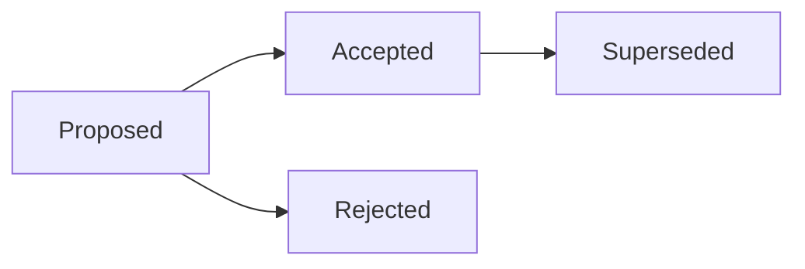
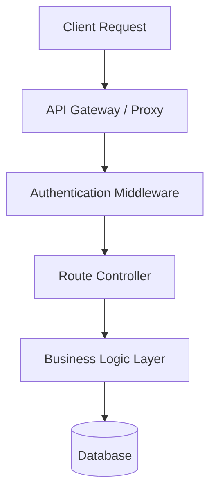
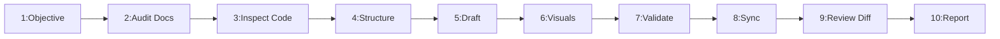

---
name: documentation
description: Creates, organizes, reviews, and maintains software project and technical documentation, including README files, development setup guides, architecture overviews, design decisions, configuration references, contribution guidelines, troubleshooting resources, and engineering workflows. Use when documenting a codebase, improving developer onboarding, recording technical decisions, updating project instructions, or keeping documentation consistent with actual implementation. Audience is developers and maintainers; for end-user guides use user-documentation-writing, and for API references use api-documentation.
---

# Technical Documentation Architecture and Engineering Skill

Teaches the AI agent to create, organize, maintain, review, and validate accurate software project documentation throughout the development lifecycle.

## 1. Purpose, Core Principles, and Operational Documentation Mindset

The governing mandate of software technical documentation is:
**Documentation must accurately reflect the actual system, help its intended audience accomplish a specific goal, and remain maintainable as the codebase evolves. Never invent implementation details, duplicate specialized documentation unnecessarily, or claim that instructions have been verified when they have not.**

Adhere to seven engineering principles:
- **Evidence**: Ground claims in verified code, configs, and test suites.
- **Goal Orientation**: Structure content around reader needs and outcomes.
- **Single Source of Truth**: Point to canonical references; avoid duplicate specs.
- **Explicit Status Labels**: Mark docs Proposed, Accepted, Implemented, or Deprecated.
- **Zero Secrets**: Never include real passwords, tokens, API keys, or PII.
- **Synchronous Upkeep**: Update documentation atomically alongside code.
- **Transparent Verification**: State what was verified via execution versus code review.

Lifecycle: *Assessed* $\rightarrow$ *Researched* $\rightarrow$ *Structured* $\rightarrow$ *Drafted* $\rightarrow$ *Validated* $\rightarrow$ *Synchronized*.

## 2. Defining the Scope of General Technical Documentation

Technical documentation provides the knowledge foundation for engineering collaboration:
- **Project Overviews**: Root `README.md`, capabilities, tech stack, and roadmap.
- **Developer Onboarding**: Setup guides, toolchains, runtimes, and startup steps.
- **System Architecture**: High-level topology, component boundaries, and data flows.
- **Technical Decisions**: Architecture Decision Records (ADRs) capturing trade-offs.
- **Project Structure**: Directory layouts, module roles, and navigation maps.
- **Configuration**: Environment variables, config schemas, and safe templates.
- **Workflows**: Build, test, lint, and contribution guides with exact commands.
- **Maintenance**: Troubleshooting guides, common pitfalls, and diagnostic runbooks.

*Rule*: Choose document types fitting the task; avoid converting small edits into sprawling docs.

## 3. Distinguishing General Documentation from Specialized Skills

Maintain strict boundaries across the documentation lifecycle:

| Skill | Primary Focus | Key Inputs | Key Output |
| :--- | :--- | :--- | :--- |
| **documentation** | Engineering docs | Code, architecture | READMEs, ADRs, setup guides |
| **user-documentation-writing** | User instructions | UI workflows, personas | Manuals, tutorials, FAQs |
| **api-documentation** | API schemas | Routes, OpenAPI | Endpoint specs, schemas |
| **release-notes-writing** | Release comms | Commits, diffs, PRs | Changelogs, upgrade guides |
| **project-context-analysis** | Repo discovery | Code exploration | Repo maps, mental model |
| **architecture-design** | System structure | System requirements | Architecture blueprints |
| **deployment** | Deployment ops | Artifacts, platform | Runbooks, deployment logs |

*Axiom*: General docs explain system design; specialized skills author deep functional specs.

## 4. Establishing the Documentation Objective and Audience Intent

Establish clear operational parameters before authoring or editing any technical document:
- **Core Need**: Identify what technical knowledge must be conveyed and why.
- **Target Audience**: Calibrate tone and depth for developers, architects, or operators.
- **Intended Outcome**: Define the concrete task or understanding to achieve.
- **Scope Boundary**: Determine which repository components are covered.
- **Target Location**: Determine whether content updates an existing doc or is new.
- **Fact Verification**: Identify commands, keys, and behaviors to verify.

## 5. Establishing the Source of Truth and Reality Grounding

Base all technical claims on verified repository evidence rather than assumptions:
- **Manifests**: Inspect package manifests and lockfiles for real dependencies.
- **Active Code**: Inspect source code, routes, and controllers for real behavior.
- **Migrations**: Use active migrations and schema definitions to verify tables.
- **Configuration**: Inspect `.env.example` and active configs for real settings.
- **Automated Tests**: Use test suites and assertions to confirm runtime behavior.
- **Zero Speculation**: Never document planned features as implemented.

## 6. Auditing Existing Documentation Before Creating New Documents

Search the repository before authoring new documents to prevent competing sources of truth:
- **Inspect `docs/`**: Check existing topical directories in the repository.
- **Update Canonical Docs**: Prefer updating an existing canonical document over duplicates.
- **Add Focused Sections**: Add missing sections to established guides when appropriate.
- **Link Sources of Truth**: Cross-reference authoritative files rather than copying text.
- **Proportional Scope**: Create a new document only for distinct topics.
- **Avoid Sprawl**: Do not produce separate setup guides that drift out of sync.

## 7. Writing Clear, Fact-Based, and Maintainable README Files

Maintain root and module README files as accurate entry points for contributors:
- **Project Identity**: State project name, core purpose, and problem space in the intro.
- **Verified Tech Stack**: List verified languages, frameworks, runtime versions, and DBs.
- **Quickstart Steps**: Provide concise setup instructions to run locally in minutes.
- **Prerequisites & Commands**: List toolchains, package install, and run commands.
- **Documentation Roadmap**: Link directly to relevant directories in `docs/` for deep specs.
- **Zero Fluff**: Avoid fabricated status badges, unverified benchmarks, or fake roadmaps.

## 8. Creating Accurate Developer Setup and Onboarding Guides

Author development environment setup guides grounded in actual repository configuration:
- **Runtime Prerequisites**: Document required language runtimes, package managers, and daemons.
- **Sequential Commands**: Provide step-by-step commands (clone, install, migrate, seed, run).
- **Working Directory**: State explicitly which directory commands must be executed from.
- **Environment Setup**: Instruct developers to copy `.env.example` to `.env`.
- **Database Initialization**: Document migration and seed commands required for local run.
- **Expected Success Signals**: Describe observable indicators of success (port, logs).

## 9. Documenting Project Structure and Codebase Layout

Explain codebase layout using actual workspace directories, modules, and boundaries:
- **Top Directories**: Document major directories (`src/`, `docs/`, `tests/`, `scripts/`).
- **Module Roles**: Explain why important directories exist and what they handle.
- **Agent Resources**: Distinguish `.agents/rules/`, `.agents/skills/`, and `.agents/templates/`.
- **Avoid File Dumps**: Provide high-level structural architecture maps rather than full trees.
- **Real Paths Only**: Use verified relative paths and maintain links when layouts change.

## 10. Documenting Architecture, System Components, and Data Flow

Explain system architecture by describing actual component responsibilities and data flows:
- **Component Topology**: Document frontend, backend, database, cache, and service layers.
- **Data Flow Paths**: Describe how requests flow from client ingress to persistence.
- **Trust Boundaries**: Identify auth gates, tenant isolation, and security perimeters.
- **Failure Modes**: Explain critical error paths, retry mechanisms, and fallbacks.
- **Reality Grounding**: Separate implemented architecture from planned designs.

## 11. Recording Architecture Decision Records (ADRs)

Capture significant, enduring technical decisions in `docs/architecture/architecture-decisions/`:



- **Standard Structure**: Title, Date, Status, Context, Decision, Alternatives, Consequences.
- **Justified Triggers**: Major framework choices, database selections, or boundaries.
- **Concrete Trade-Offs**: Document negative consequences, operational overhead, and debt.
- **Status Lifecycle**: Track decisions through Proposed, Accepted, Superseded, and Rejected.
- **Zero Trivia**: Avoid writing ADRs for routine implementation choices or minor bug fixes.

## 12. Documenting APIs at the Appropriate Architectural Level

Position API documentation appropriately between high-level project guides and detailed schemas:
- **Architectural Role**: Describe API purpose, protocols (REST, GraphQL), and consumers.
- **Link Authoritative Specs**: Link to OpenAPI specs or dedicated files in `docs/api/`.
- **Avoid Inline Duplication**: Never copy dozens of endpoint payloads into project READMEs.
- **Coordination**: Defer endpoint schema definitions to [api-documentation](../api-documentation/SKILL.md).

## 13. Documenting Database Schemas and Data Model Decisions

Document data persistence layers based strictly on active database migrations and models:
- **Entity Overview**: Document core domain entities, primary tables, and key relationships.
- **Integrity Rules**: Document unique constraints, foreign key cascades, and check constraints.
- **ER Diagrams**: Use Mermaid entity-relationship diagrams matching active database schemas.
- **Coordination**: Defer schema migration plans to [database-design](../database-design/SKILL.md).

## 14. Documenting Configuration Without Exposing Secrets

Document configuration parameters thoroughly while preventing credential leakage:

| Param | Type | Req? | Default | Purpose |
| :--- | :--- | :---: | :--- | :--- |
| `PORT` | Number | No | `3000` | HTTP server listening port. |
| `DATABASE_URL` | String | Yes | None | Database connection string. |
| `JWT_SECRET` | String | Yes | None | Secret key for signing session tokens. |
| `LOG_LEVEL` | String | No | `info` | Logging verbosity (debug, info, warn, error). |

- **Sanitized Placeholders**: Always use placeholders like `YOUR_SECRET_KEY` or `postgres://...`.
- **Zero Real Secrets**: Never commit actual API keys, certificates, or passwords to docs.
- **Template Parity**: Keep configuration documentation synchronized with `.env.example`.

## 15. Maintaining Accurate Commands and Code Examples

Ensure commands and code snippets in documentation are executable, safe, and up to date:
- **Explicit Labeling**: Clearly label blocks as Shell Commands, Application Code, or Config.
- **Verified Syntax**: Cross-check command flags and script names against project manifests.
- **Working Directory**: Specify execution directory whenever commands run outside root.
- **Prerequisites**: State any required running services or environment variables.
- **Realistic Errors**: Include basic error handling in code snippets to model reality.

## 16. Keeping Documentation and Code Synchronized

Synchronize documentation changes atomically whenever application behavior is modified:
- **Drift Triggers**: Audit docs when routes, schemas, environment vars, or scripts change.
- **Targeted Updates**: Update only the documentation files affected by the change.
- **Remove Obsolete Steps**: Delete or replace deprecated commands and outdated instructions.
- **Verify References**: Check internal Markdown links, relative file paths, and symbols.
- **Definition of Done**: Treat documentation updates as an essential acceptance criterion.

## 17. Documentation as Code, Workflows, and Tooling

Treat documentation files as first-class, version-controlled software engineering artifacts:
- **Version Control**: Commit documentation in the repository alongside code.
- **Markdown Standards**: Use clean, standard GitHub Flavored Markdown with clean headings.
- **Automated Validation**: Utilize available linters, link checkers, and spell checkers.
- **No Unsolicited Tools**: Do not install heavy documentation site generators unasked.
- **Honest Reporting**: Report executed validation checks honestly; identify missing tools.

## 18. Using Diagrams and Visual Aids Effectively

Use Mermaid diagrams to clarify complex relationships, data flows, and state machines:



- **Visual Purpose**: Include diagrams only when they clarify architectural boundaries.
- **Textual Parity**: Ensure accompanying text explains key flows independently.
- **Authentic Names**: Use authentic service and module names matching code.

## 19. Writing for Diverse Technical Audiences

Calibrate technical depth, terminology, and structure according to reader persona:

| Persona | Primary Focus | Key Documentation |
| :--- | :--- | :--- |
| **Developers** | Code & execution | Setup guides, CLI commands, repo structure, tests |
| **Architects** | Structure & design | Component topography, data flow, ADRs, trade-offs |
| **Operators** | Reliability & ops | Config vars, health checks, metrics, runbooks |
| **Contributors** | Workflow & rules | Branching rules, coding standards, PR templates |
| **End Users** | Task workflows | Defer to [user-documentation-writing](../user-documentation-writing/SKILL.md) |

## 20. Documentation Security, Privacy, and Redaction

Prevent sensitive operational data and credentials from leaking into documentation:
- **Redaction**: Mask passwords, API keys, session tokens, and secrets.
- **Sanitized Hosts**: Replace internal hostnames, IPs, and ports with placeholders.
- **No Production Dumps**: Never paste real user data, customer records, or prod logs.
- **Access Separation**: Separate public repository docs from sensitive runbooks.
- **Security Policy**: Follow security policies; avoid documenting exploit steps.

## 21. Versioning, Runtime Compatibility, and Evolution

Document software compatibility boundaries and runtime version constraints accurately:
- **Version Scope**: Clearly document supported language versions (e.g., Node.js 20+).
- **Flag Prerelease**: Explicitly label alpha, beta, or experimental features.
- **Deprecation Notices**: Mark deprecated methods or configs with migration notes.
- **Preserve History**: Retain documentation for older supported versions if needed.
- **Release Coordination**: Defer release changelogs to [release-notes-writing](../release-notes-writing/SKILL.md).

## 22. Troubleshooting Guides and Known Limitations

Help maintainers diagnose and resolve common setup, build, and development failures:
- **Symptom Driven**: Organize troubleshooting by observable error symptoms.
- **Evidence Based**: Explain root causes supported by logs and traces.
- **Safe Diagnostics**: Recommend safe diagnostic steps; avoid destructive resets.
- **Known Bounds**: Explicitly record confirmed framework gaps and limitations.
- **Debugging Coordination**: Defer defect investigation to [debugging](../debugging/SKILL.md).

## 23. Documentation Quality, Review, and Validation Standards

Audit every technical document against four quality pillars before publishing:
- **Accuracy**: Every command, file path, environment variable, and snippet matches code.
- **Completeness**: Prerequisites, execution context, and recovery paths are stated.
- **Clarity**: Active voice, concise sentences, consistent naming, and logical headings.
- **Maintainability**: Modular sections, clean Markdown formatting, and verified links.

## 24. Maintaining Information Architecture and Directory Layout

Organize project documentation cleanly according to repository conventions:
- **Standard `docs/` Layout**: Group docs into standard topical subdirectories:
  - `product/` (PRDs) | `requirements/` (SRS) | `architecture/` (topology, ADRs).
  - `database/` (schemas, ERDs) | `api/` (OpenAPI specs) | `design/` (UI tokens).
  - `testing/` (test strategies) | `deployment/` (runbooks) | `maintenance/` (runbooks).
- **Documentation Index**: Maintain an index in `docs/README.md` linking to major documents.
- **Naming Conventions**: Use lowercase kebab-case filenames without numerical prefixes.

## 25. Handling Uncertainty, Drift, and Conflicting Documentation

Resolve discrepancies between documentation and code through systematic evidence triage:
- **Triangulate Sources**: Compare source code, tests, active configs, and architecture records.
- **Code Precedence for Behavior**: Code reflects actual current execution; docs may be stale.
- **Requirements Precedence for Intent**: Approved PRDs/SRSs define intended behavior.
- **Explicit Flagging**: When a discrepancy is detected, document the conflict clearly.
- **Confine Scope**: Confine reconciliations to verified, authorized scope.

## 26. Recommended 10-Phase Technical Documentation Workflow

Follow this standardized lifecycle when authoring or revising software documentation:



- **Phases 1–3**: Define goals, audit existing docs to prevent duplicates, inspect code reality.
- **Phases 4–6**: Organize logical headings, draft actionable content, attach verified diagrams.
- **Phases 7–8**: Validate commands and links against code, then synchronize related docs.
- **Phases 9–10**: Review document diffs for quality and deliver a structured completion report.

## 27. Definition of Done (DoD)

A documentation task is complete only when all criteria are satisfied:
- [ ] 1. **Objective**: Audience and scope defined.
- [ ] 2. **Reality**: Claims match codebase reality.
- [ ] 3. **Prerequisites**: Toolchain runtimes listed.
- [ ] 4. **No Secrets**: Sanitized placeholders used.
- [ ] 5. **Structure**: Headings follow logical hierarchy.
- [ ] 6. **Paths**: File paths match verified layout.
- [ ] 7. **Commands**: Shell commands verified.
- [ ] 8. **Links**: Markdown links and images resolve.
- [ ] 9. **Single Source**: Extends canonical files.
- [ ] 10. **Synchronized**: Reflects current code state.
- [ ] 11. **Diagrams**: Mermaid flows match active logic.
- [ ] 12. **Report**: Structured report delivered.

## 28. Standardized Technical Documentation Completion Report Template

Conclude documentation tasks using this structured completion report template:

```markdown
# Technical Documentation Completion Report: [Document / Task Title]
### 1. Document Target: [File path, e.g., docs/architecture/overview.md]
### 2. Purpose & Audience: [Primary goal, target persona, and outcome]
### 3. Technical Coverage: [Architecture, setup, or workflows documented]
### 4. Source Verification: [Code, migrations, manifests, or configs inspected]
### 5. Validation Performed: [Commands, linters, links, or builds verified]
### 6. Remaining Limitations: [Unverified behaviors, open questions, or dependencies]
```

## 29. Avoiding Overengineering and Documentation Anti-Patterns

Avoid these common technical documentation failures and maintenance traps:
- **Speculative Writing**: Documenting planned features as built.
- **Fragmented Duplication**: Creating competing setup guides.
- **Monolithic README**: Cramming full API schemas into README.
- **Unverified Commands**: Pasting commands without checking tooling.
- **Secret Infiltration**: Including real database secrets or tokens.
- **Decorative Diagrams**: Adding complex diagrams that obscure flows.
- **Unsolicited Toolchains**: Introducing static site generators unasked.
- **Silent Conflict Resolution**: Picking doc version without checking code.
- **Destructive Fixes**: Suggesting DB resets as first troubleshooting step.

## 30. Avoiding Duplication with Existing Skills

Coordinate general technical documentation with related specialized skills:
- [user-documentation-writing](../user-documentation-writing/SKILL.md): User guides and tutorials.
- [api-documentation](../api-documentation/SKILL.md): API contracts and schemas.
- [release-notes-writing](../release-notes-writing/SKILL.md): Changelogs and upgrade notes.
- [project-context-analysis](../project-context-analysis/SKILL.md): Codebase structure discovery.
- [architecture-design](../architecture-design/SKILL.md): System architecture blueprints.
- [architecture-review](../architecture-review/SKILL.md): Architecture risk evaluations.
- [database-design](../database-design/SKILL.md): Database schemas and ERDs.
- [deployment](../deployment/SKILL.md): Deployment operations and configs.
- [deployment-readiness](../deployment-readiness/SKILL.md): Release readiness audits.
- [feature-implementation](../feature-implementation/SKILL.md): Feature implementation notes.
- [testing-qa](../testing-qa/SKILL.md): Test plans and verification.

## 31. Repository Rules Alignment and Compliance

Every documentation action must comply with repository engineering rules:
- [documentation.md](../../rules/documentation.md): Source of truth, docs layout, ADRs.
- [coding-standards.md](../../rules/coding-standards.md): Code comments and public contracts.
- [architecture.md](../../rules/architecture.md): Simplicity and modular boundaries.
- [change-safety.md](../../rules/change-safety.md): Inspect first; non-destructive edits.
- [core-workflow.md](../../rules/core-workflow.md): Plan, execute, verify, report.
- [security.md](../../rules/security.md): Runtime secrets and least privilege.

## 32. 10-Point Pre-Flight Documentation Validation Checklist

Verify every item prior to finalizing any documentation task:
- [ ] 1. **Audience**: Persona and goal defined.
- [ ] 2. **Reality**: Claims checked against code.
- [ ] 3. **Location**: Placed in standard docs path.
- [ ] 4. **Secrets**: Sanitized placeholders used.
- [ ] 5. **Commands**: Syntax checked against tooling.
- [ ] 6. **Links**: Internal links resolve cleanly.
- [ ] 7. **Diagrams**: Mermaid syntax valid and tested.
- [ ] 8. **Single Source**: Extends canonical docs.
- [ ] 9. **Synchronized**: Obsolete guidance updated.
- [ ] 10. **Proportional**: Scope scaled without bloat.
