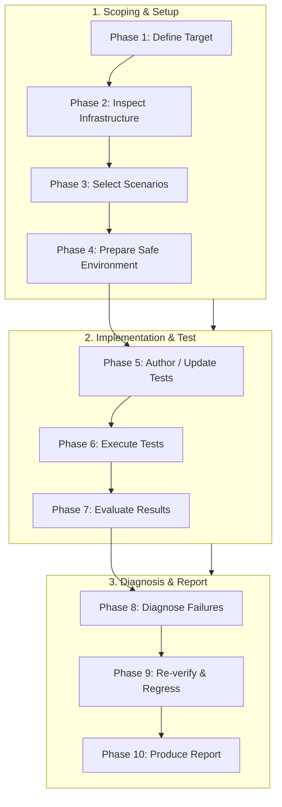

---
name: end-to-end-testing
description: Plans, executes, and verifies end-to-end tests for complete application workflows across user interfaces, APIs, backend logic, authentication, authorization, databases, and external integrations. Use when validating critical user journeys, checking frontend-to-backend integration, testing browser workflows, preventing regressions, or verifying that a complete feature works from the user's perspective.
---

# End-to-End Testing Skill

This skill guides the AI coding agent to plan, design, execute, diagnose, and report end-to-end (E2E) tests across complete application workflows. It ensures that user interactions, frontend state, network calls, backend services, database persistence, and external integrations function coherently from a real user's perspective.

## 1. Purpose, Core Principles, and E2E Mindset

The central mandate of end-to-end testing is:
**Test the application as a real user experiences it, verify the important connections between system components, and report only results that were actually observed.**

Adhere to six foundational principles:

- **User-Centric Validation**: Exercise workflows through the UI and public contracts exactly as a real end user experiences them.
- **Verify Real System Boundaries**: Test live paths across browser UI, HTTP transport, server middleware, and database persistence.
- **Evidence Over Assumption**: Base conclusions strictly on observed assertions, status codes, and persisted data—never on file creation or unverified execution.
- **Stack-Adaptive Pragmatism**: Adapt to the project's existing test runner (Playwright, Cypress, Puppeteer, Selenium) without force-installing new frameworks.
- **Proportionate Scope**: Prioritize critical business journeys, auth gates, and financial transactions over exhaustive UI permutations.
- **Safe Execution**: Never execute destructive tests on production databases or trigger irreversible external side effects (real SMS/charges).

*Scope Boundary*: Drives complete workflow execution. For unit testing, use [testing-qa](../testing-qa/SKILL.md); for feature delivery, use [feature-implementation](../feature-implementation/SKILL.md); for defect investigation, use [debugging](../debugging/SKILL.md); for security audits, use [security-review](../security-review/SKILL.md).

## 2. Scope and System Boundaries of E2E Testing

End-to-end testing validates complete journeys across architectural layers:

```
[Browser / Client UI] ──► [HTTP / Network API] ──► [Backend Controller & Auth]
                                                            │
[User Feedback] ◄── [Database Persistence] ◄── [Application Service & Domain]
```

- **Client Interaction**: Navigation, form completion, button clicks, modal dialogs, and validation prompts.
- **Authentication & Sessions**: Login, session token propagation, cookie handling, and permission boundaries.
- **Transport & APIs**: Routing, request serialization, status codes, headers, and payload structures.
- **Backend & Domain Processing**: Business invariant checks, authorization rules, and multi-entity coordination.
- **Data Persistence**: Database reads/writes, unique constraints, relational consistency, and atomic commits.
- **Asynchronous Integrations**: Background queues, emails, webhooks, and event consumers operating in test mode.

## 3. Distinguishing E2E Testing from Related Disciplines

E2E testing occupies the top tier of the test pyramid, requiring distinct boundaries:

| Testing Level | Scope & Target | Primary Purpose | When to Choose |
| :--- | :--- | :--- | :--- |
| **Unit Testing** | Individual functions, classes, domain rules. | Verify algorithmic correctness in isolation. | Calculation and domain validation logic. |
| **Integration Testing**| Interaction between two or three layers. | Verify contracts between DB, service, and API. | API schemas, database queries, pipelines. |
| **E2E Testing** | Full user workflow from UI to database. | Verify all components function as a unified system. | Critical user journeys, release gates, core flows. |

*Discipline Rule*: Do not write slow E2E tests for internal domain edge cases easily covered by unit tests. Focus E2E tests on multi-component coordination.

## 4. User Journey Mapping and Precondition Analysis

Before authoring or running tests, decompose the target workflow into clear stages:

1. **Target Persona**: Identify the specific actor (e.g., student, teacher, administrator, guest).
2. **Preconditions**: Establish required existing state (e.g., user exists, course published, account active).
3. **Action Path**: Define sequential user interactions (clicks, inputs, submissions, navigation).
4. **Observable Visible State**: Document expected UI responses (success banners, table updates, redirected URLs).
5. **Persisted State Transitions**: Identify records that must be created, modified, or deleted in the database.
6. **Terminal Outcome**: Define the explicit condition proving completion (e.g., invoice generated with status `PAID`).

## 5. Inspecting Existing Test Infrastructure & Environment

Before altering files or running tests, inspect the repository:

- **E2E Tooling**: Search for Playwright (`playwright.config.ts`), Cypress (`cypress.config.js`), Puppeteer, or custom runners.
- **Test Scripts**: Review `package.json` scripts, `Makefile`, or test scripts (e.g., `npm run test:e2e`, `pnpm exec playwright test`).
- **Environment Configuration**: Check `.env.test`, test database connection strings, and base URLs (`localhost:3000`, `localhost:8080`).
- **Seed Data & Fixtures**: Identify existing database seeders, test factories, and test user credentials.
- **Application Startup**: Understand how the application server and background workers are launched for tests.

*Tooling Invariant*: Reuse the project's existing test framework and conventions. If no E2E tool exists, recommend the lightest suitable setup only when explicitly authorized.

## 6. Comprehensive Scenario Design & Coverage Matrix

Structure E2E scenarios across seven core categories:

| Scenario Category | Objective | Verification Focus |
| :--- | :--- | :--- |
| **1. Happy Path** | Standard successful journey. | Inputs succeed, DB updates, UI confirms completion. |
| **2. Validation Failure** | Invalid/missing inputs. | Server rejects request (400), field errors displayed. |
| **3. Auth & Permissions** | Access control enforcement. | Unauthenticated redirected (401), unauthorized blocked (403). |
| **4. Data Integrity** | Constraint & relation checks. | Unique constraints prevent duplicates, foreign keys hold. |
| **5. Failure & Recovery** | Graceful degradation. | Simulated network/API error displays recoverable message. |
| **6. Edge Cases** | Boundary conditions. | Empty datasets, pagination limits, special characters. |
| **7. Critical Regressions** | High-impact existing flows. | Changes do not break core workflows (checkout, login). |

## 7. Test Data Isolation and Predictable Fixtures

Flaky tests usually stem from shared mutable state. Enforce strict isolation:

- **Deterministic Seeds**: Seed known starting states using established factories or migration seeds.
- **Unique Identifiers**: Generate unique values for emails and usernames (e.g., `test-${Date.now()}@example.com`) to prevent collisions.
- **Independent Test Lifecycle**: Each test scenario must set up its own required data and clean up created artifacts.
- **Never Depend on Test Order**: Scenario B must never assume Scenario A ran previously.
- **Production Data Protection**: Verify connection points to a dedicated test database (`*_test`). Never run destructive seeds on live databases.

## 8. Authentication, Sessions, and Role-Based Workflows

Validate access boundaries across both UI navigation and backend endpoints:

- **Authentication Flows**: Test valid login, bad passwords, session expiration, and logout.
- **Role Scoping**: Confirm administrators can access management panels while standard users are blocked.
- **Cross-Tenant Isolation**: In multi-tenant systems, verify Tenant A cannot view or manipulate records of Tenant B.
- **Direct API Tampering**: Verify that manually modifying IDs in URL paths or request bodies fails with `403 Forbidden` or `404 Not Found`.
- **Credential Hygiene**: Use dedicated test accounts. Never put real passwords or production secrets into test scripts or reports.

## 9. Frontend and Browser Workflow Execution

Interact with the UI using resilient, accessibility-focused selector patterns:

- **Resilient Selectors**: Prefer accessible roles and labels over fragile CSS classes:
  - *Best*: `getByRole('button', { name: 'Submit' })`, `getByLabel('Email Address')`, `getByTestId('checkout-btn')`.
  - *Avoid*: `div > span:nth-child(3) > button.btn-primary-2` (breaks on styling refactors).
- **Interactive Form Handling**: Populate fields sequentially, select dropdown options, and confirm checkboxes.
- **Modal and Dialog Flows**: Handle confirmation modals for consequential or destructive actions.
- **Search, Filter & Pagination**: Verify that filtering a table updates displayed rows and preserves URL query parameters.
- **Verify Real Visibility**: Assert that elements are visible, enabled, and interactive before triggering clicks.

## 10. Frontend-to-Backend Integration Verification

Ensure the test verifies live application communication:

- **Real API Communication**: Let the browser make real HTTP requests to the test backend rather than stubbing every network call.
- **Request & Response Verification**: Inspect network calls to verify endpoint paths, request payloads, and status codes (e.g., `201 Created`).
- **Response Translation**: Verify that the frontend correctly renders data returned in the response payload.
- **Distinguish Real vs. Mock**: Mocks are acceptable only for third-party external APIs (e.g., Stripe, Twilio). Never mock internal endpoints.

## 11. Data Persistence and Business Invariant Verification

Never trust the frontend alone to confirm an operation succeeded:

1. **Perform Workflow**: Submit the action through the browser interface.
2. **Observe UI Confirmation**: Check for success toast or redirection.
3. **Independent Persistence Check**: Verify the database state directly (via API query, database fixture check, or page reload).
4. **Enforce Business Invariants**: Confirm calculations, totals, account balances, and status transitions match domain rules.
5. **Reload & Revisit**: Refresh the page to verify state persists across browser reloads and is not merely ephemeral client memory.

## 12. Exercising Critical Failure Paths & Error Recovery

A robust application fails gracefully under adverse conditions:

- **Validation Rejection**: Submit invalid data; verify field highlights, clear error text, and that inputs remain populated.
- **Network Interruptions**: Simulate offline or timed-out requests using test runner route interception; verify UI displays an actionable retry button.
- **Resource Conflicts**: Attempt creating a duplicate unique record; verify the UI surfaces a user-friendly conflict message.
- **No False Success**: Verify that a 500 server error never triggers a "Saved Successfully" notification.
- **Zero Information Leakage**: Verify that server errors display sanitized user messages without revealing database stack traces.

## 13. Asynchronous Workflows and External Side Effects

Modern applications rely heavily on asynchronous jobs and queues:

- **Avoid Arbitrary Sleep**: Never use fixed delays like `sleep(5000)`. Wait for explicit DOM elements or network responses.
- **Background Job Completion**: For queued tasks (PDF exports, batch imports), poll the job status endpoint until terminal state (`COMPLETED` or `FAILED`).
- **External Notifications**: Route messages to in-memory mail catchers (Mailpit) or provider sandboxes; assert notification records were created; never message real users.
- **Payments & Billing**: Use test gateway credentials (e.g., Stripe test tokens) to verify checkout workflows safely.

## 14. Meaningful Assertions and Forensic Evidence Collection

Structure assertions to provide definitive proof and clear failure forensics:

- **Definitive Assertions**: Combine UI visibility assertions with state assertions (`toBeVisible()`, `toHaveURL()`).
- **Evidence on Failure**: Automatically capture screenshots, video recordings, browser console logs, and network failures upon test failure.
- **Sanitize Artifacts**: Ensure captured logs and screenshots do not record passwords or authorization tokens.

## 15. Flakiness Prevention, Isolation, and Repeatability

Eliminate sources of non-deterministic test behavior:

- **Independent Execution**: Tests must pass regardless of execution order or concurrency level.
- **Dynamic Port & Host Binding**: Bind test servers to free ports to avoid collisions during parallel runs.
- **Time and Clock Mocking**: If testing time-dependent logic (session timeouts), freeze or advance virtual system time deterministically.
- **Investigate Intermittent Failures**: Never mask flakiness by adding global retries (`retries: 5`). Treat flaky tests as synchronization defects.
- **Detect Before Fixing**: Confirm suspected flakiness by repetition (Playwright: `--repeat-each=10`) rather than a single rerun.
- **Quarantine Openly**: When a flaky test must be disabled temporarily, mark it with the framework's skip/fixme API and a tracking issue (`test.fixme(true, 'Flaky - Issue #123')`), and report it; never delete it silently.

### Playwright Conventions
- **Page Object Model**: Wrap each page's locators and actions in a page object (`ItemsPage.goto()`, `search(query)`) so selectors live in one place and specs read as user journeys.
- **Stable Selectors**: Prefer roles and labels; fall back to `data-testid` attributes over CSS paths.
- **Wait on Signals**: Wait for a specific response or element state (`page.waitForResponse(...)`), not fixed timeouts.
- **Evidence on Failure**: Configure `trace: 'on-first-retry'`, `screenshot: 'only-on-failure'`, and `video: 'retain-on-failure'`, and keep HTML/JUnit reports as CI artifacts.
- **CI Settings**: `forbidOnly` in CI, a dev server through `webServer` with `reuseExistingServer` off in CI, and at most a small CI-only retry count whose retried tests are still reported as flaky.

*Flakiness detection, quarantine, and Playwright conventions adapted from ECC `e2e-testing` (MIT); see THIRD_PARTY_NOTICES.md.*

## 16. Regression Testing Strategy & Blast Radius Analysis

When testing modifications or bug fixes, choose targeted regression sets:

- **Direct Impact**: The specific workflow modified.
- **Adjacent Integrations**: Modules consuming shared services, models, or UI components.
- **Critical Business Paths**: High-risk flows (authentication, checkout, payment processing, registration).
- **Execution Cost vs. Confidence**: Run targeted E2E suites locally; run comprehensive suites in CI before releases.

## 17. Accessibility, Responsiveness, and Stability Checks

Incorporate automated baseline checks into browser tests:

- **Keyboard Navigation**: Ensure key flows (dialogs, forms) are completable using `Tab`, `Enter`, `Escape`, and arrow keys.
- **Responsive Viewports**: Execute critical workflows across standard desktop (1280x800) and mobile (375x667) viewports.
- **Console Stability**: Assert that no unhandled JavaScript exceptions or broken resource links appear in the browser console.

## 18. CI Integration and Headless Execution

Ensure E2E tests run reliably in continuous integration environments:

- **Headless Mode**: Run browsers headlessly in CI while retaining headed mode for local debugging.
- **Deterministic Bootstrapping**: Script startup, health check, and teardown of backend servers and test databases.
- **Artifact Archiving**: Save failure screenshots, traces, and JUnit XML test reports as CI build artifacts.
- **Exit Code Propagation**: Ensure the runner returns non-zero exit codes on failure to halt deployment pipelines.

## 19. Failure Diagnosis and Root Cause Classification

When an E2E test fails, follow a structured diagnostic protocol:

1. **Pinpoint Failing Assertion**: Identify the exact step, selector, or timeout that failed.
2. **Review Evidence**: Inspect screenshot, DOM snapshot, console errors, and network logs.
3. **Classify Root Cause**:
   - *Infrastructure Issue*: Server failed to start, port collision, missing environment variable.
   - *Script Defect*: Stale selector, missing wait condition, race condition in test code.
   - *Application Regression*: Real bug in UI rendering, API contract, domain logic, or DB query.
   - *External Sandbox Drop*: Third-party test sandbox unavailable or timing out.
4. **Isolate and Fix**: Fix the underlying root cause. Never weaken assertions or increase timeouts to force a pass.

## 20. Change Safety, Security, and Data Protection Invariants

Strictly enforce safety constraints during all test activities:

- Inspect Git status before touching test files.
- Preserve uncommitted user changes; never overwrite work.
- Never connect E2E tests to production databases or live external services.
- Never store plaintext credentials, secrets, or PII in test files or fixtures.
- Never commit, push, or deploy changes automatically without explicit user approval.

## 21. Recommended 10-Phase End-to-End Testing Workflow

Follow this structured workflow for all E2E testing tasks:



- **Phase 1: Target**: Clarify user goals, roles, business rules, and acceptance criteria.
- **Phase 2: Infrastructure**: Inspect existing runners, scripts, fixtures, and database seeders.
- **Phase 3: Scenarios**: Prioritize happy path, validation failures, authorization, and data integrity.
- **Phase 4: Environment**: Boot test server, seed isolated test database, verify base URLs.
- **Phase 5: Author**: Write maintainable tests using accessible selectors and clear assertions.
- **Phase 6: Execute**: Run focused test suite headlessly or headed as appropriate.
- **Phase 7: Evaluate**: Classify outcomes (Passed, Failed, Blocked, Skipped).
- **Phase 8: Diagnose**: Investigate failed steps using screenshots, traces, and logs.
- **Phase 9: Re-verify**: Fix root causes and execute targeted regression suites.
- **Phase 10: Report**: Document executed tests, observed outcomes, defects, and limitations.

## 22. Definition of Done (DoD)

An E2E testing task is complete only when all applicable criteria are met:

- [ ] 1. **Workflow Identified**: Target journey, user roles, and expected outcomes explicitly documented.
- [ ] 2. **Environment Verified**: Dedicated test environment, safe database, and base URLs confirmed.
- [ ] 3. **Real Boundaries Tested**: Exercises live browser-to-backend communication and database persistence.
- [ ] 4. **Resilient Selectors**: Uses accessible roles, labels, or test IDs rather than brittle CSS paths.
- [ ] 5. **Meaningful Assertions**: Validates user-visible feedback and independent persisted state.
- [ ] 6. **Failure Paths Covered**: Validation errors, unauthorized requests, or error recovery verified.
- [ ] 7. **Explicit Synchronization**: Waits on visible elements or network responses rather than sleeps.
- [ ] 8. **Side Effects Protected**: Payments, emails, and SMS routed to sandboxes or test doubles.
- [ ] 9. **Accurate Statuses**: Results categorized as Passed, Failed, Blocked, Skipped, or Not Run.
- [ ] 10. **Zero Production Leakage**: Logs, reports, and screenshots are sanitized of credentials and PII.

## 23. Standardized E2E Test Report Template

Synthesize testing outcomes using this structured format:

```markdown
# End-to-End Test Report: [Workflow Name]
- **User Journey & Roles**: [Description of tested workflow and target roles]
- **Boundaries Exercised**: [Browser UI, API endpoints, Services, Database, Workers]

### Execution Summary
| Scenario | Category | Status | Observed Outcome |
| :--- | :--- | :--- | :--- |
| Valid Workflow | Happy Path | Passed | UI confirms, DB record created |
| Invalid Input | Validation | Passed | Form displays field errors |
| Unauthorized Access | Security | Passed | 403 Forbidden redirected |
| Network Timeout | Resilience | Blocked | Sandbox simulator unavailable |

### Results, Evidence & Defects
- **Passed Scenarios**: [Key assertions verified, record IDs checked]
- **Failures & Blockers**: [Failing step, error message, screenshot reference]
- **Defects Discovered**: [Confirmed application bugs discovered during testing]
- **Files Modified & Limitations**: [Test scripts/fixtures edited; untested third-party services]
```

## 24. Overengineering Traps & Anti-Patterns to Avoid

Avoid these common E2E testing pitfalls:

- **Framework Churn**: Installing a new test framework when an existing one already works.
- **Sleep-Driven Sync**: Using arbitrary timeouts (`sleep(5000)`) instead of explicit state synchronization.
- **Mocking Everything**: Mocking internal APIs so heavily that real integration is no longer verified.
- **Monolithic Tests**: Writing oversized test scripts testing unrelated features in a single run.
- **Fragile Selectors**: Relying on generated CSS classes or deeply nested DOM paths.
- **Global Mutable State**: Sharing test database records across parallel tests without isolation.
- **Masking Flakes with Retries**: Setting high retry counts to hide legitimate concurrency defects.
- **Faking Results**: Claiming complete verification when external services or databases were inaccessible.

## 25. Alignment with Project Rules and Skills

Ensure all E2E testing activities align with repository governance:

- Rules: [testing.md](../../rules/testing.md) (test standards), [core-workflow.md](../../rules/core-workflow.md) (workflow discipline), [change-safety.md](../../rules/change-safety.md) (safety invariants), [security.md](../../rules/security.md) (credential safety), [api-design.md](../../rules/api-design.md) (contracts), [architecture.md](../../rules/architecture.md) (boundaries), [accessibility.md](../../rules/accessibility.md) (a11y).
- Skills: [testing-qa](../testing-qa/SKILL.md), [feature-implementation](../feature-implementation/SKILL.md), [debugging](../debugging/SKILL.md), [project-context-analysis](../project-context-analysis/SKILL.md), [security-review](../security-review/SKILL.md), [accessibility-audit](../accessibility-audit/SKILL.md), [performance-profiling](../performance-profiling/SKILL.md).

### 10-Point E2E Testing Validation Checklist

Before concluding any E2E testing task, verify that:

- [ ] 1. **Complete Journey Validated**: Exercises the workflow from initial user action to persisted state.
- [ ] 2. **Native Tooling Leveraged**: Used the project's existing test framework and execution scripts.
- [ ] 3. **Data Isolation Guaranteed**: Test uses unique, isolated records; never mutates shared or production data.
- [ ] 4. **Resilient Selectors Used**: Targeted accessible roles and labels rather than brittle DOM paths.
- [ ] 5. **Persistence Independently Checked**: Verified database or API records beyond ephemeral UI state.
- [ ] 6. **Failure Scenarios Tested**: Covered validation rejections, unauthorized requests, or error recovery.
- [ ] 7. **Explicit Synchronization**: Waited on visible elements or network responses rather than arbitrary sleeps.
- [ ] 8. **External Side Effects Protected**: Payments, emails, and SMS routed to sandboxes or test doubles.
- [ ] 9. **Accurate Statuses Reported**: Results categorized as Passed, Failed, Blocked, Skipped, or Not Run.
- [ ] 10. **Zero Production Leakage**: Logs, reports, and screenshots are sanitized of credentials and sensitive data.
