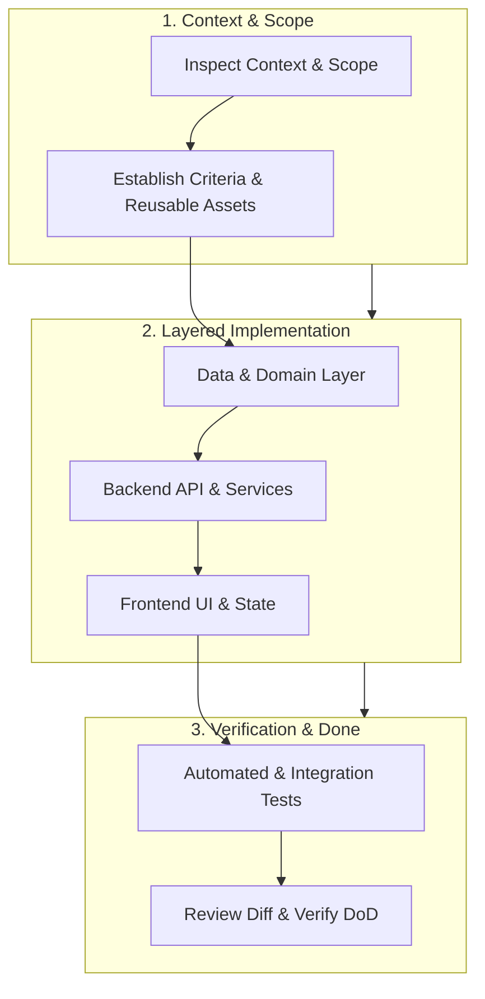

---
name: feature-implementation
description: Implements complete software features within an existing codebase by analyzing requirements, inspecting project context, planning affected layers, reusing existing components, integrating frontend and backend behavior, handling data and permissions, adding appropriate tests, and verifying the final result. Use when building new features, extending existing functionality, implementing end-to-end workflows, or completing incomplete feature implementations.
---

# Feature Implementation Skill

This skill guides the AI coding agent to transform feature requests into complete, integrated, maintainable, and verified software functionality within an existing codebase. It ensures features work seamlessly across UI, backend, database, API, and security layers while following established architectural conventions.

## 1. Purpose, Core Principles, and Architectural Mindset

The central mandate of feature implementation is:
**Deliver the complete requested feature within the existing application, not merely an isolated component, partial implementation, or collection of code snippets.**

Adhere to five foundational principles:

- **Understand Before Coding**: Review the intended user outcome, business rules, affected entities, and constraints before altering files. Never write code based solely on a feature title without understanding project context.
- **Implement Complete Scope**: A feature is complete only when all necessary layers—user interaction, state management, input validation, server-side processing, persistence, authorization, error handling, tests, and workflow integrations—function as a unified whole.
- **Follow Existing Conventions**: Reuse established components, service patterns, styling tokens, and database abstractions. Avoid introducing redundant libraries, parallel patterns, or unprompted architectural rewrites.
- **Verify Real Behavior Honestly**: Run real tests, verify build checks, and trace live integrations. Never claim a feature works merely because files were created or code compiles without errors.
- **Maintain Proportionate Effort**: Scale planning and ceremony to the feature's actual complexity. Localized UI tweaks require focused edits, while cross-module persistent workflows demand phased execution.

*Scope Boundary*: Drives end-to-end feature delivery. For code exploration, use [project-context-analysis](../project-context-analysis/SKILL.md); for requirements, use [requirements-analysis](../requirements-analysis/SKILL.md); for layer-specific work, coordinate with [frontend-development](../frontend-development/SKILL.md), [backend-development](../backend-development/SKILL.md), [database-design](../database-design/SKILL.md), and [testing-qa](../testing-qa/SKILL.md).

## 2. Scope Definition and Acceptance Criteria

Before modifying code, establish the exact operational boundary:

- **Target Persona & Outcome**: Who uses the feature (e.g., student, admin, teacher), what action they perform, and what business value is delivered.
- **Explicit Scope Boundaries**: Clearly delineate what is in-scope vs. out-of-scope to prevent speculative feature creep. Do not invent unprompted features.
- **Convert Requirements into Testable Criteria**:
  - *Happy Path*: Expected user inputs, state transitions, and successful outputs.
  - *Validation Rules*: Required fields, format restrictions, value ranges, and multi-field dependencies.
  - *Permission Gates*: Role/tenant access restrictions (401 Unauthorized vs. 403 Forbidden behavior).
  - *Edge & Failure Scenarios*: Missing resources (404), duplicate submissions, database/network timeouts, empty data sets.
- **Identify Ambiguities Early**: If a missing decision materially affects security, data integrity, or financial calculations, pause and clarify rather than making hazardous assumptions.

## 3. Existing Project Context and Extension Points

Always inspect the codebase before designing or implementing a solution:

- **Entry Points & Routing**: Find where existing pages and API endpoints are registered.
- **Reusable UI Components**: Locate shared buttons, modals, form controls, tables, loaders, and toast notification systems.
- **Service & Domain Boundaries**: Identify existing business services, repositories, and domain models rather than creating duplicates.
- **Data Access & Schema**: Inspect database tables, foreign keys, indexes, and existing migration conventions.
- **Authentication & Security Context**: Understand how the current user/tenant identity is extracted and passed to services.
- **Test Infrastructure**: Review existing test suites, runners, mocks, and fixtures to match testing conventions.
- **Complex Reporting Patterns**: When implementing reports (e.g., attendance, accounting, inventory), trace models, date filters, authorization, reusable table components, and chart libraries before authoring new code.

*Extension Rule*: Prefer extending existing modules and controllers over creating isolated parallel silos with similar names.

## 4. Proportionate Implementation Workflows

Adapt planning and implementation depth to the size and risk of the feature:



### Workflow by Feature Size

| Size Category | Characteristics | Required Workflow |
| :--- | :--- | :--- |
| **Small Feature** | Localized UI tweak, minor field addition, simple filter. | 1. Inspect component & rules.<br>2. Targeted code edit.<br>3. Run relevant test/linter.<br>4. Review diff. |
| **Medium Feature** | New form, new API endpoint, database-backed CRUD flow. | 1. Define acceptance criteria.<br>2. Plan affected layers.<br>3. Implement schema/backend/UI.<br>4. Add tests & verify integration. |
| **Large Feature** | Cross-module workflow, external integration, multi-role flow. | 1. Decompose into verifiable stages.<br>2. Execute data model -> API -> UI sequentially.<br>3. End-to-end integration test.<br>4. Regression review. |

## 5. Architectural Enforcement Boundaries

Enforce concerns at the appropriate architectural tier to maintain clean separation:

| Architectural Tier | Responsibilities | Anti-Patterns to Avoid |
| :--- | :--- | :--- |
| **Client UI** | Presentation, optimistic state, form validation hints, accessibility. | Sole enforcement of business or security rules. |
| **API / Controller** | Route handling, HTTP status codes, request parsing, response formatting. | Putting domain business rules or SQL inside controllers. |
| **Application Service** | Use-case orchestration, transaction demarcation, authorization checks. | Transport-specific logic (HTTP headers, raw cookies). |
| **Domain Model** | Business invariants, entity state transitions, calculations. | Database queries, HTTP calls, framework dependencies. |
| **Data Access / Repo** | Query execution, relational mapping, concurrency locking. | Presentation logic, request validation. |
| **Database Engine** | Referential integrity, uniqueness, check constraints, ACID guarantees. | Storing unvalidated corrupt data relying on app code. |
| **Background Workers** | Asynchronous execution, retries, dead-letter routing, idempotency. | Relying on HTTP request session headers. |

## 6. Frontend Implementation and UI State Completeness

When building user interfaces, implement all required operational states:

- **Comprehensive UI States**:
  - *Initial / Empty State*: Informative empty-state view with actionable call-to-action when no data exists.
  - *Loading State*: Accessible skeletons or spinners; prevent interactive button clicks during requests.
  - *Success State*: Clear feedback (toasts, page transitions, banners) confirming completed action.
  - *Validation Failure*: Inline field-level error messages preserving already entered user inputs.
  - *Server / Network Error*: Meaningful error messages with retry options; never leave the UI frozen.
  - *Permission Denied*: Explicit forbidden state or hidden actions according to role requirements.
  - *Destructive Action Confirmations*: Modal confirmation dialogs before executing irreversible actions.
  - *Error Recovery*: Clear paths for users to re-attempt or correct inputs after a failed operation.
- **State Management & Concurrency**:
  - Keep state localized to the component when possible; lift only when shared across siblings.
  - Handle out-of-order responses: ensure stale network responses do not overwrite recent user actions.
  - Prevent duplicate form submissions by disabling submit controls upon trigger.
- **Component & Design System Reuse**:
  - Use existing buttons, inputs, modals, and typography tokens. Do not introduce custom styles that clash with the project's visual hierarchy.

## 7. Backend and Business Logic Implementation

Implement backend functionality following the project's established conventions:

- **Strict Input Validation**: Validate all inputs at the server boundary (types, formats, allowed values, bounds) before passing data to domain services.
- **Enforce Business Invariants**: Place business logic (e.g., calculations, state machines) in domain entities or application services, not inside route handlers.
- **Uniform Error Envelopes**: Return consistent JSON error structures matching the project's API design standard (e.g., `{ status, code, message, errors }`).
- **Zero Information Leakage**: Catch unhandled exceptions; return sanitized client error messages while logging full stack traces with correlation IDs internally.
- **Transaction Safety**: Wrap multi-entity mutations in atomic database transactions (`await tx.run(...)`). Guarantee clean rollback on failure.

## 8. Database Persistence and Data Integrity

When persistent storage is involved, preserve relational integrity and migration history:

- **Inspect Before Schema Edits**: Review existing tables, columns, indexes, and relationships before creating new entities. Do not add redundant tables.
- **Safe Schema Migrations**:
  - Always generate forward migrations through the project's migration CLI (e.g., Prisma, TypeORM, Knex, Flyway, Django, Laravel).
  - Define non-null constraints with safe defaults; verify foreign keys and unique constraints.
  - Avoid destructive migrations (dropping columns/tables) during feature additions.
- **Accurate Calculations & Business Semantics**:
  - In financial, attendance, fee, grading, or inventory workflows, verify exact calculation formulas and rounding rules.
  - Never guess calculation logic based solely on field names. Verify business meaning.

## 9. API and External Integration Implementation

Ensure API endpoints and third-party integrations are robust and consistent:

- **API Contract Consistency**: Follow established REST/GraphQL/RPC patterns, URL naming (`/api/v1/resources`), HTTP methods, and pagination conventions.
- **External Third-Party Integrations**:
  - *Secure Credentials*: Read secrets from environment configuration; never hardcode API keys.
  - *Timeouts & Retries*: Set explicit connection and read timeouts. Apply exponential backoff with full jitter only on transient failures (503, 429).
  - *Idempotency*: Include idempotency keys (`Idempotency-Key` header) for non-idempotent operations (payments, external mutations) to prevent double execution.
  - *Safe Sandbox Testing*: Use mock servers or sandboxes during development and automated testing; never trigger real external side effects without authorization.

## 10. Authentication, Authorization, and Multi-Tenant Safety

Security must be enforced unconditionally on the trusted server side:

- **Server-Side Access Enforcement**: Never rely on frontend UI hiding (`display: none` or conditional rendering) to secure endpoints. Every API handler must verify identity and permissions.
- **Multi-Tenant Isolation**: Always scope database queries by tenant ID/organization ID anchored in the verified security context (`req.user.tenantId`), never from untrusted client input.
- **Resource Ownership Verification**: Verify that the authenticated user owns or has delegated permission to access the specific resource ID requested.

## 11. Cross-Module Interactions, Asynchronous Jobs, and Side Effects

When a feature spans multiple domain modules or background tasks:

- **Respect Single Source of Truth**: Identify which module owns the data. Interact via public service interfaces or events rather than reaching directly into private module tables (e.g., fee transactions querying student accounts via student service).
- **Asynchronous Execution & Background Jobs**:
  - For long-running operations (exports, bulk imports, emails, reports, WhatsApp notifications), dispatch background jobs to a queue.
  - Use the Transactional Outbox pattern when publishing events alongside database mutations to prevent dual-write discrepancies.
  - Background workers must initialize their own security and logging context (`traceId`, `SystemUser`).
- **Never Fake Completion**: Do not report that a message was delivered when the application only accepted the request for queuing. Do not record a payment as completed before validating gateway confirmation.

## 12. Testing Strategy and Integration Verification

Validate the feature across multiple testing dimensions proportionate to its risk:

- **Testing Matrix**:
  - *Unit Tests*: Verify core domain logic, formulas, validation rules, and state machine transitions.
  - *Component Tests*: Verify frontend rendering across initial, loading, error, and validation states.
  - *Integration / API Tests*: Verify HTTP endpoints, status codes, request validation, and database persistence.
  - *Authorization Tests*: Test both authorized access and rejection of unauthorized or cross-tenant attempts.
  - *End-to-End Checks*: Verify the complete workflow from user interaction through API to persistent database storage.
- **Avoid False Verification**:
  - Do not use hardcoded mock data in the UI when real backend integration is required.
  - Do not alter test assertions simply to make broken code pass without fixing root causes.

## 13. Non-Functional Qualities: Performance, Accessibility, Reliability

Embed operational quality into the implementation:

- **Performance**:
  - Avoid N+1 queries by using eager loading, batching, or projection joins.
  - Enforce pagination or limits on query results; never load unbounded datasets.
  - Index frequently filtered and joined columns to avoid sequential table scans.
- **Accessibility (a11y)**:
  - Use semantic HTML (`<button>`, `<main>`, `<nav>`, `<form>`).
  - Ensure full keyboard navigability, logical tab order, and clear focus indicators.
  - Provide descriptive `aria-label` attributes and associate form inputs with `<label>` tags.
  - Use `aria-live` regions for dynamic status updates and toast messages.
- **Reliability & Resource Disposal**:
  - Ensure open connections, file handles, and streams are closed in `finally` blocks.
  - Handle rate limits and transient connection drops gracefully with bounded retries.

## 14. Handling Pre-Existing Bugs and Scope Changes

During implementation, agents frequently encounter pre-existing codebase defects or emerging scope questions:

- **Distinguish Defect Origins**:
  - *Self-Introduced Defects*: Bugs caused by new changes; must be debugged and resolved immediately before proceeding.
  - *Pre-Existing Blockers*: Existing defects directly preventing the feature from operating. If a safe, minimal fix is within scope, apply it; otherwise, document the blocker and report it.
  - *Unrelated Existing Defects*: Non-blocking existing bugs. Do not derail the current feature task into an open-ended refactor; log them for follow-up via [technical-debt-management](../technical-debt-management/SKILL.md).
- **Scope Discipline**: Resist expanding the feature beyond agreed acceptance criteria. If additional requirements emerge, document them as recommended enhancements rather than silently inflating delivery scope.

## 15. Change Safety and Authorization Invariants

Maintain repository stability and respect user intent:

- Inspect Git status before and after editing files to track change boundaries.
- Preserve uncommitted user work and unrelated modifications.
- Avoid destructive schema operations (dropping columns or tables) without explicit authorization.
- Never trigger live third-party external side effects (real SMS, emails, real payment charges) during testing without authorization.
- Never commit, push, merge, or deploy automatically.

## 16. Definition of Done (DoD)

A feature is complete only when all applicable criteria are satisfied:

- [ ] 1. **Functional Completeness**: All explicit acceptance criteria and user outcomes are implemented.
- [ ] 2. **Boundary Layering**: Responsibilities are properly placed (UI, API, Service, Domain, Database).
- [ ] 3. **Input Validation**: Server-side validation rejects malformed requests with structured error messages.
- [ ] 4. **Authorization & Security**: Protected operations enforce role, ownership, and tenant checks on the server.
- [ ] 5. **UI State Completeness**: Loading, empty, success, validation failure, and error states are fully handled.
- [ ] 6. **Database Integrity**: Schema migrations are safe, non-destructive, and preserve constraints/indexes.
- [ ] 7. **Integration Verified**: Frontend and backend communicate via live API contracts without hardcoded mock overrides.
- [ ] 8. **Automated Testing**: Unit, integration, and security tests pass, covering positive and negative cases.
- [ ] 9. **Non-Functional Checks**: No N+1 queries, accessibility barriers, or unhandled promise rejections.
- [ ] 10. **Diff Hygiene**: Final diff contains zero placeholder code, zero unneeded dependencies, and no scope creep.

## 17. Feature Completion Report Template

Synthesize completed work using this standardized report structure:

```markdown
# Feature Implementation Report: [Feature Name]

## 1. Feature Summary
- **Outcome**: [Concise summary of implemented user capability]
- **Target Roles**: [Roles or personas granted access]

## 2. Implementation Details
- **Frontend**: [Modified pages, components, hooks, styling tokens]
- **Backend & APIs**: [Endpoints created/updated, controllers, services]
- **Database & Persistence**: [Tables, migrations, constraints added/modified]
- **Key Files Modified**:
  - `path/to/component.tsx`: [Description of changes]
  - `path/to/service.ts`: [Description of changes]

## 3. Business Rules & Access Control
- **Validation**: [Key validation rules enforced]
- **Authorization**: [Roles permitted, tenant isolation applied]

## 4. Verification & Testing
| Test / Check | Scope | Result | Notes |
| :--- | :--- | :--- | :--- |
| Unit Tests | [Domain logic / utility] | Passed | [Count / coverage] |
| API / Integration | [Endpoints / Persistence] | Passed | [HTTP status verified] |
| Build / Typecheck | [Full project build] | Passed | [0 errors] |

## 5. Integration Status & Remaining Limitations
- **Integration**: [Fully integrated end-to-end / Sandbox verified]
- **Remaining Limitations**: [Any deferred requirements or external dependencies]
```

### Alignment with Project Rules and Skills

Coordinate with the repository's established governance:

- Rules: [core-workflow.md](../../rules/core-workflow.md), [change-safety.md](../../rules/change-safety.md), [architecture.md](../../rules/architecture.md), [backend.md](../../rules/backend.md), [frontend.md](../../rules/frontend.md), [database.md](../../rules/database.md), [api-design.md](../../rules/api-design.md), [security.md](../../rules/security.md), [testing.md](../../rules/testing.md), [accessibility.md](../../rules/accessibility.md).
- Skills: [project-context-analysis](../project-context-analysis/SKILL.md), [requirements-analysis](../requirements-analysis/SKILL.md), [frontend-development](../frontend-development/SKILL.md), [backend-development](../backend-development/SKILL.md), [database-design](../database-design/SKILL.md), [database-migration](../database-migration/SKILL.md), [api-development](../api-development/SKILL.md), [cross-cutting-concerns](../cross-cutting-concerns/SKILL.md), [testing-qa](../testing-qa/SKILL.md), [code-review](../code-review/SKILL.md).

### 10-Point Feature Implementation Validation Checklist

Before declaring the implementation task complete, verify that:

- [ ] 1. **Complete Scope Delivered**: The end-to-end user workflow functions rather than an isolated snippet.
- [ ] 2. **Context Respected**: Followed existing framework patterns and reused available components/services.
- [ ] 3. **Layer Separation**: Enforced logic at appropriate tiers without leaking domain rules into controllers or UI.
- [ ] 4. **Full UI States**: Addressed initial, loading, success, empty, validation failure, and error views.
- [ ] 5. **Server-Side Security**: Protected all endpoints with server-side authentication, authorization, and tenant scoping.
- [ ] 6. **Data Integrity Protected**: Migrations follow project conventions and preserve constraints without data loss.
- [ ] 7. **No Hardcoded Mocks**: End-to-end integration verified against live application contracts.
- [ ] 8. **Tests Executed**: Appropriate automated tests added, executed, and reported with true outcomes.
- [ ] 9. **Diff Inspected**: Final diff contains no unintended edits, leftover debug prints, or premature abstractions.
- [ ] 10. **Honest Reporting**: Completion report explicitly identifies any unverified behavior or external blockers.
