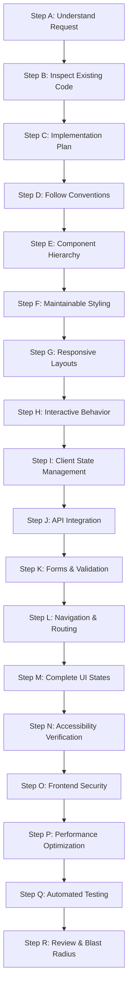

---
name: frontend-development
description: Implements, modifies, debugs, and refactors frontend applications, pages, components, layouts, forms, navigation, styling, client-side state, API integrations, and responsive interactions. Use when translating approved UI/UX designs and software requirements into functional frontend code or when maintaining existing frontend functionality.
---

# Frontend Development Skill

This skill guides the AI coding agent to implement, extend, debug, and refactor client-side user interfaces, web applications, and interactive components. It translates approved requirements, wireframes, and UI/UX specifications into reliable, maintainable, performant, and accessible frontend code.

## 1. Purpose and Scope

Frontend development delivers the visual, interactive, and client-side computational capabilities of an application. This skill ensures the agent systematically addresses core implementation questions:

- **What changes are needed and why?** Understand business value, user stories, and acceptance criteria.
- **What approved specifications guide the work?** Trace to [prd-writing](../prd-writing/SKILL.md), [srs-writing](../srs-writing/SKILL.md), and [ui-ux-design](../ui-ux-design/SKILL.md).
- **What existing stack and tools are present?** Identify frameworks (React, Vue, Svelte, Angular), bundlers, styling, and TypeScript setup.
- **How should components be composed?** Design modular, single-responsibility components with clean prop interfaces.
- **How is client state and caching handled?** Enforce unidirectional flow; separate server cache from local UI state.
- **How are APIs and backend services integrated?** Use typed HTTP clients, explicit status handling, and cancellation tokens.
- **How are forms and inputs validated?** Provide accessible labels, real-time validation, and state preservation.
- **How are accessibility, responsiveness, and speed guaranteed?** WCAG 2.2 AA, fluid layouts, and bundle budgets.
- **What tests and verification validate changes?** Unit, component, and interaction tests with static type checking.
- **How is change safety preserved?** Comply with [frontend.md](../../rules/frontend.md) and [change-safety.md](../../rules/change-safety.md) with minimal blast radius.

*Scope Boundary*: Focuses on client-side code execution. It does not replace wireframing (handled by [ui-ux-design](../ui-ux-design/SKILL.md)), backend logic (handled by [backend.md](../../rules/backend.md)), or DevOps deployment pipelines (handled by [deployment.md](../../rules/deployment.md)).

## 2. When to Use This Skill

### Trigger Scenarios

Activate this skill when:
- **Implementing New Pages and Features**: Building views, routes, or portals from approved designs and user stories.
- **Authoring Reusable UI Primitives**: Creating buttons, inputs, dialogs, drawers, data tables, navbars, and cards.
- **Integrating Client-Side APIs**: Connecting views to REST, GraphQL, or WebSocket endpoints with full state lifecycles.
- **Refactoring UI Components**: Decomposing monolithic components, eliminating duplication, or upgrading types.
- **Building Forms & Validation**: Implementing multi-step wizards, dynamic fields, and schema-based validations.
- **Remediating Accessibility Issues**: Resolving keyboard traps, missing ARIA tags, contrast failures, or focus handling.
- **Fixing Frontend Bugs**: Resolving layout shifts, race conditions, broken event handlers, or rendering anomalies.
- **Optimizing Frontend Performance**: Code-splitting routes, reducing bundle sizes, lazy-loading media, or minimizing re-renders.

### When NOT to Use This Skill

Do not invoke this skill for:
- Pure UX research, persona definition, or visual wireframing without code (use [ui-ux-design](../ui-ux-design/SKILL.md)).
- Database modeling, migrations, or query optimization (use [database-design](../database-design/SKILL.md)).
- Authoring server endpoints, business logic, or RPC handlers (use [backend.md](../../rules/backend.md)).
- Infrastructure provisioning, Docker packaging, or CI/CD pipelines (use [deployment.md](../../rules/deployment.md)).

## 3. Frontend Development Workflow

Follow this eighteen-step workflow (Steps A through R) when authoring or modifying frontend code:



### Step A: Understand the Requested Frontend Change
- Analyze the user request, PRD specifications, and acceptance criteria.
- Clarify user personas, target viewports, and functional goals.
- Categorize the change (new feature, enhancement, refactor, or bug fix) and define verifiable success criteria.

### Step B: Inspect the Existing Frontend Implementation
- Inspect project structure: review `package.json`, build configs, dependencies, and asset folders.
- Identify the UI framework, styling paradigm (Tailwind, CSS Modules), state libraries, and existing component primitives.
- Review prevailing conventions: file naming, colocation (`Component.tsx`, `Component.test.tsx`), hooks, and types.

### Step C: Formulate a Focused Implementation Plan
- Decompose views into page wrappers, domain containers, and presentational primitives.
- Map state boundaries: identify local UI state, lifted shared state, and server cache boundaries.
- Define API contracts and endpoints, outline files to create or modify, and establish test scenarios.

### Step D: Follow Established Stack and Project Patterns
- Adhere strictly to the project's framework paradigms (e.g., idiomatic functional components with hooks, Vue Composition API).
- Align with existing directory taxonomy (e.g., `src/components/ui/` for primitives, `src/features/` for domain views).
- Reuse existing helper utilities (e.g., `clsx`, date helpers) rather than introducing duplicate packages.

### Step E: Translate Designs and Requirements into Components
- Decompose mockups into cohesive, single-responsibility components with strict TypeScript interfaces.
- Separate presentational components (pure render, props-in, events-out) from container components (data fetching, hooks).
- Design intuitive prop contracts with sensible defaults. Use composition and slots to avoid excessive prop drilling.
- Maintain backward compatibility for shared components when introducing new variants.

### Step F: Implement Clean, Maintainable Styling
- Use existing design tokens, CSS custom properties, or utility classes for colors, typography, spacing, and shadows.
- Avoid hardcoded pixel values and magic hex codes; reference token variables (`var(--color-primary)`).
- Support both Light and Dark themes if supported by the project, maintaining compliant contrast in both modes.
- Keep styling rules scoped and modular, preventing global style leaks or cascading specificity conflicts.

### Step G: Ensure Responsive and Adaptive Layouts
- Implement mobile-first layouts using flexible flexbox and grid structures rather than fixed pixel dimensions.
- Adhere to project breakpoints (`sm: 640px`, `md: 768px`, `lg: 1024px`, `xl: 1280px`).
- Prevent overflow: handle text truncation, wrapping, dynamic heights, and touch targets (minimum 44x44px).
- Adapt data tables on small screens using horizontal scrolling wrappers or responsive card transformations.

### Step H: Implement Functional and Interactive Behavior
- Wire interactive controls: click handlers, dropdown toggles, modal dialogs, and tab panels.
- Provide immediate visual feedback for all user interactions (hover, active, focus, loading spinners, disabled states).
- Debounce rapid-fire inputs (search fields) and throttle high-frequency events (scroll, resize).
- Prevent duplicate submissions by disabling triggers while asynchronous requests are pending. Respect `prefers-reduced-motion`.

### Step I: Manage Client-Side State Effectively
- Distinguish **Local UI State** (form inputs, modal toggles, tabs) from **Server Cache State** (remote records, query data).
- Use local primitives (`useState`, `useReducer`) for view state, caching libraries (React Query, SWR) for server state, and stores for global state.
- Ensure immutable updates; avoid direct mutations. Colocate state as close as possible to consuming components.

### Step J: Integrate with APIs and Backend Services
- Centralize API calls in typed service modules or query hooks; never embed raw `fetch` calls in JSX templates.
- Define explicit TypeScript interfaces for all request payloads, query parameters, and response structures.
- Attach required headers (Auth tokens, Content-Type) and support request aborts via `AbortController`.
- Map backend error envelopes and HTTP status codes (400, 401, 403, 404, 422, 500) into intuitive user error banners.

### Step K: Implement Robust Forms and Input Validation
- Explicitly associate every input with a `<label>` via matching `id`/`for` attributes or `aria-labelledby`.
- Combine instant client-side validation with authoritative server error handling.
- Group related options (radios, checkboxes) in `<fieldset>` containers with `<legend>` descriptions.
- Preserve user-entered input on submission failures; never wipe valid field data when submission fails.

### Step L: Configure Navigation and Routing
- Define declarative route parameters, query strings, and nested route outlets matching project conventions.
- Enforce route authentication guards, redirecting unauthenticated users while storing the target return URL.
- Manage scroll restoration across navigation. Provide clean 404 Not Found fallback views with clear recovery links.

### Step M: Handle All UI States and Edge Cases
Implement every state in the complete lifecycle for data-driven views:
1. **Initial / Idle**: Clean baseline presentation before user interaction.
2. **Loading**: Content-shaped skeleton loaders or spinners preventing Cumulative Layout Shift (CLS).
3. **Success / Populated**: Rendered data items, cards, or tables with complete metadata.
4. **Empty**: Contextual illustration or icon, helpful explanation, and primary action button (e.g., "Create Item").
5. **Validation Error**: High-contrast inline field-level error messages with descriptive guidance.
6. **Network / Server Error**: Non-blocking alert banner with an actionable retry button.
7. **Partial / Stale Data**: Subtle non-intrusive refresh indicators during background revalidation.

### Step N: Satisfy Accessibility Requirements
- Comply with [accessibility.md](../../rules/accessibility.md) and WCAG 2.2 AA standards.
- Use native semantic HTML (`<main>`, `<nav>`, `<header>`, `<article>`, `<button>`, `<a>`) before applying ARIA.
- Ensure full keyboard accessibility: logical Tab sequence, Enter/Space activation, and Escape key dismissal.
- Trap focus within modal overlays and return focus to the trigger element upon closing.
- Provide visible `:focus-visible` rings. Maintain contrast ratio of at least 4.5:1 for normal text and 3:1 for controls.

### Step O: Enforce Frontend Security Best Practices
- Rely on framework auto-escaping; avoid `dangerouslySetInnerHTML`, `v-html`, or `innerHTML` without sanitization (e.g., DOMPurify).
- Validate and sanitize external URLs in `href` links, preventing `javascript:` or `data:` URL exploits.
- Protect against CSRF via CSRF tokens or SameSite cookie policies. Avoid storing sensitive credentials in `localStorage`.

### Step P: Optimize Frontend Performance
- Adhere to [performance-optimization.md](../../rules/performance-optimization.md).
- Apply route-level and component-level code splitting using dynamic imports (`React.lazy`).
- Optimize media: modern formats (WebP, AVIF), explicit dimensions to prevent CLS, and lazy-loading for offscreen assets.
- Minimize re-renders: memoize expensive calculations (`useMemo`), stable handlers (`useCallback`), and fine-tune selectors.

### Step Q: Test the Implementation
- Follow [testing.md](../../rules/testing.md).
- Author unit tests for utility functions, custom hooks, and validation schemas.
- Write component tests asserting on accessibility roles, user interactions, and visual states.
- Cleanly mock network responses, verifying loading skeletons, successful rendering, and error recovery.
- Confirm type compilation (`tsc --noEmit`) and linter checks pass with zero errors.

### Step R: Review Final Changes and Verification
- Review Git diffs to remove debug logs (`console.log`), unused imports, or temporary test data.
- Verify blast radius: confirm changes are strictly scoped to the target feature without regressions in adjacent views.
- Test across responsive breakpoints (Mobile 375px, Tablet 768px, Desktop 1280px) and active themes.

## 4. Frontend Implementation Principles

| Principle | Description | Implementation Rule |
|---|---|---|
| **Component Modularity** | Single, well-defined responsibility per component. | Keep components focused under ~200 lines; decompose complex subtrees. |
| **Separation of Concerns** | Decouple UI rendering from data processing and networking. | Presentation components take props; hooks/services handle data logic. |
| **Predictable Data Flow** | Unidirectional data flow from parent to child. | Props flow down, events bubble up via callbacks; avoid circular updates. |
| **Defensive Resilience** | Gracefully handle slow, missing, or malformed data. | Use optional chaining, safe defaults, error boundaries, and skeletons. |
| **Accessibility by Default** | Inclusive interfaces usable by all users regardless of ability. | Native semantic HTML, visible focus states, and verified contrast ratios. |
| **Strict Blast Radius** | Localized modifications with zero unintended side effects. | Never modify shared layouts or global styles for single-page requests. |
| **Minimal Dependencies** | Native platform capabilities over third-party bloat. | Reuse existing dependencies; avoid introducing new libraries unprompted. |

## 5. Greenfield vs. Brownfield Frontend Development

### Greenfield Development (New Applications or Modules)
- Establish directory taxonomy (`src/components/`, `src/features/`, `src/hooks/`, `src/services/`, `src/types/`).
- Set up foundational design tokens, typography scales, and semantic color palettes.
- Author foundational UI primitives (Button, Input, Card, Modal, Badge) before orchestrating complex feature views.
- Configure root routing, layout templates, error boundaries, type definitions, and test harnesses.

### Brownfield Development (Existing Applications)
- **Inspect Before Editing**: Audit existing design tokens, components, and utilities to preserve consistency.
- **Reuse Over Invention**: Reuse established component primitives rather than building redundant duplicates.
- **Match Existing Patterns**: Maintain the project's prevailing state paradigms, directory structure, and styling approach.
- **Preserve Compatibility**: Keep existing props intact and make newly added props optional.
- **Respect Theme & Breakpoints**: Match existing breakpoint variables and theme tokens.

## 6. Standard Component Architecture Reference

Every robust component exhibits clear separation between types, state, interaction handlers, and accessible rendering:

```typescript
export interface BookCardProps {
  id: string;
  title: string;
  author: string;
  coverImageUrl?: string;
  availableCopies: number;
  onReserve: (bookId: string) => Promise<void>;
  className?: string;
}

export const BookCard: React.FC<BookCardProps> = ({
  id,
  title,
  author,
  coverImageUrl,
  availableCopies,
  onReserve,
  className = '',
}) => {
  const [isSubmitting, setIsSubmitting] = useState(false);
  const [feedback, setFeedback] = useState<string | null>(null);

  const handleReserve = async () => {
    if (availableCopies <= 0 || isSubmitting) return;
    try {
      setIsSubmitting(true);
      setFeedback(null);
      await onReserve(id);
      setFeedback('Reserved successfully!');
    } catch {
      setFeedback('Unable to reserve book. Please try again.');
    } finally {
      setIsSubmitting(false);
    }
  };

  const isAvailable = availableCopies > 0;

  return (
    <article className={`book-card rounded-lg border p-4 shadow-sm ${className}`} aria-labelledby={`title-${id}`}>
      {coverImageUrl ? (
        
      ) : (
        <div className="h-48 w-full bg-slate-100 rounded-md mb-3 flex items-center justify-center text-slate-400">No Image</div>
      )}
      <h3 id={`title-${id}`} className="text-lg font-semibold text-slate-900 truncate">{title}</h3>
      <p className="text-sm text-slate-600 mb-2">by {author}</p>
      <div className="flex items-center justify-between mt-4">
        <span className={`text-xs px-2 py-1 rounded-full font-medium ${isAvailable ? 'bg-emerald-100 text-emerald-800' : 'bg-rose-100 text-rose-800'}`}>
          {isAvailable ? `${availableCopies} available` : 'Out of stock'}
        </span>
        <button
          type="button"
          onClick={handleReserve}
          disabled={!isAvailable || isSubmitting}
          aria-busy={isSubmitting}
          className="btn-primary text-sm px-3 py-1.5 rounded disabled:opacity-50"
        >
          {isSubmitting ? 'Reserving...' : 'Reserve'}
        </button>
      </div>
      {feedback && <p role="status" aria-live="polite" className="text-xs text-slate-700 mt-2">{feedback}</p>}
    </article>
  );
};
```

## 7. Output and Documentation Requirements

Provide structured documentation and verification artifacts upon completing frontend changes:

1. **Component Interface Specs**: Document props, types, and event callbacks for new or modified components.
2. **Architecture & State Notes**: Document state flows, caching policies, and route structures in `docs/architecture/` or feature READMEs.
3. **Automated Test Results**: Report unit, component, and static analysis outputs (`npm test`, `npm run lint`, `tsc`).
4. **Verification Checklist**: Document verified breakpoints (Mobile, Tablet, Desktop), themes, and UI states (Loading, Empty, Error).
5. **Change Summary**: Provide a clear summary of touched files, functional enhancements, and bug fixes.

## 8. Avoid Duplication with Other Skills and Rules

This skill functions in direct collaboration with project rules and skills:

- [frontend.md](../../rules/frontend.md): Dictates component design, styling, and responsive requirements.
- [accessibility.md](../../rules/accessibility.md): Enforces WCAG 2.2 AA compliance, semantic markup, and screen reader support.
- [security.md](../../rules/security.md): Governs XSS sanitization, CSRF tokens, and secure token storage.
- [performance-optimization.md](../../rules/performance-optimization.md): Governs Core Web Vitals, code splitting, and bundle size discipline.
- [ui-ux-design](../ui-ux-design/SKILL.md): Produces upstream wireframes, design tokens, and layout specifications.
- [api-design.md](../../rules/api-design.md): Establishes backend endpoint contracts and error envelopes.
- [testing.md](../../rules/testing.md): Sets test coverage standards and mocking paradigms.
- [coding-standards.md](../../rules/coding-standards.md): Governs naming, formatting, and TypeScript conventions.
- [change-safety.md](../../rules/change-safety.md): Mandates minimal blast radius and backward compatibility.

## 9. Final Validation Checklist

Before completing any frontend development task, verify each item:

- [ ] **Requirements Traceability**: Does the UI satisfy all acceptance criteria from the PRD, SRS, or user request?
- [ ] **Component Reusability**: Are existing design system primitives reused? Are new components modular and cohesive?
- [ ] **Strict Typing**: Are all props, state variables, and API responses strictly typed without `any`?
- [ ] **Complete UI States**: Are Idle, Loading/Skeleton, Success, Empty, and Error states fully implemented?
- [ ] **Responsive Reflow**: Does the view adapt smoothly across mobile (375px), tablet (768px), and desktop (1280px)?
- [ ] **Accessibility Compliance**: Are semantic HTML elements used? Are focus states visible and keyboard-navigable?
- [ ] **Security Standards**: Is dynamic content escaped? Are external links secured? Is HTML injection prevented?
- [ ] **Performance Discipline**: Are offscreen assets lazy-loaded? Are routes code-split? Are re-renders minimized?
- [ ] **Verification & Tests**: Do unit and component tests pass? Are linting and TypeScript checks error-free?
- [ ] **Blast Radius Control**: Are changes strictly confined to target features without regressions in adjacent views?
