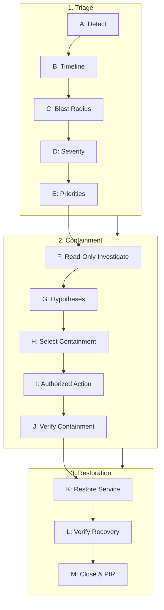

---
name: incident-response
description: Assesses, coordinates, documents, and supports recovery from application, database, infrastructure, availability, data-integrity, and security incidents. Use when services are unavailable or degraded, errors spike, deployments fail, data appears corrupted or missing, external dependencies cause outages, or suspicious activity requires structured incident handling.
---

# Incident Response Skill

This skill guides the AI coding agent to assess, coordinate, document, contain, investigate, and support recovery from production, application, infrastructure, database, data-integrity, and security incidents.

## 1. Purpose, Core Principles, and Operational Mindset

Incident response prioritizes human safety, data integrity, customer trust, and service availability over speculative troubleshooting. Adhere to five foundational principles:

- **Protect People, Data, and Availability (In Order)**: Restoring availability must never compromise data integrity, leak credentials, or worsen vulnerabilities. A system online while corrupting persistent records is actively malfunctioning.
- **Establish Facts Before Drawing Conclusions**: Categorize incident data into five epistemic states:
  *1. Confirmed Observations* $\rightarrow$ *2. Reported Symptoms* $\rightarrow$ *3. Strongly Supported Hypotheses* $\rightarrow$ *4. Unverified Suspicions* $\rightarrow$ *5. Known Unknowns*.
  Never treat temporal correlation (e.g., a recent release) as definitive causation.
- **Contain Before Making Broad Changes**: When harm is ongoing, apply the smallest effective, reversible intervention. Avoid wide code refactors or broad infrastructure resets during active disruption.
- **Communicate Transparently and Blamelessly**: Clearly articulate confirmed facts, known unknowns, measured blast radius, and completed versus planned actions. Eliminate individual blame; focus on systemic resilience.
- **Assessment Is Not Authorization**: The agent evaluates signals, correlates timelines, drafts runbooks, and proposes remediations. The agent must **never** execute state-changing production commands, drop database tables, rotate live credentials, or alter live infrastructure without explicit human authorization.

*Scope Boundary*: Focuses on degradation control and recovery. For isolated defects, use [debugging](../debugging/SKILL.md); for release checks, use [deployment-readiness](../deployment-readiness/SKILL.md); for restores, use [backup-recovery](../backup-recovery/SKILL.md); for security audits, use [security-review](../security-review/SKILL.md).

## 2. Incident Scope, Boundaries, and Severity Classification

Establish the incident perimeter before taking action:

| Dimension | Scope Assessment Criteria |
| :--- | :--- |
| **Affected Perimeter** | Specific microservices, HTTP routes, queues, DB clusters, or cloud regions. |
| **User & Tenant Impact**| Affected users, tenant isolation boundaries, public vs. authenticated traffic. |
| **Data & Integrity** | Evidence of data loss, table corruption, inconsistent state, or unauthorized writes. |
| **Security & Privacy** | Credential exposure, PII leakage, privilege escalation, or intrusion signals. |
| **Operational Windows**| Peak traffic hours, active maintenance windows, upstream SaaS outages. |

### Severity Classification Model

If the project lacks a formal model, apply these four provisional levels:

| Severity Level | Operational Criteria | Response Target & Escalation |
| :--- | :--- | :--- |
| **SEV-1 — Critical** | Core service outage, active data corruption, security breach, severe financial risk. | War-room, $15\text{m}$ updates, incident commander engaged immediately. |
| **SEV-2 — High** | Major workflow broken (checkout/auth), core API degraded, no simple workaround. | Hourly status updates, technical leads engaged, dedicated investigation. |
| **SEV-3 — Moderate** | Non-critical feature down, localized degradation, viable workaround, zero data risk. | Business-hours resolution, standard issue tracking, milestone updates. |
| **SEV-4 — Low** | Minor cosmetic defect, non-blocking administrative issue, localized glitch. | Regular sprint backlog or standard bug fix workflow. |

*Escalation Rule*: Never downgrade severity because an issue is difficult to diagnose or because a restart temporarily lowered error spikes. If data integrity or security remains uncertain, sustain elevated severity.

## 3. Systematic 13-Step Incident Response Lifecycle

Execute this structured assessment sequence from initial detection to final resolution:



- **Step A: Detect & Acknowledge**: Ingest alerts from APM, Sentry, or uptime checks; record detection timestamp and raw alert payload.
- **Step B: Establish Timeline**: Correlate event timestamps across systems in UTC (alerts, deployments, migrations, config changes).
- **Step C: Assess Blast Radius**: Quantify affected users, request drops, 5xx rates, queue depth, and geographic reach for critical paths.
- **Step D: Classify Severity**: Assign SEV-1 through SEV-4 based on impact and urgency; record classification explicitly.
- **Step E: Establish Priorities**: Follow tactical order: *1. Stop corruption $\rightarrow$ 2. Protect secrets/evidence $\rightarrow$ 3. Restore service $\rightarrow$ 4. Root cause*.
- **Step F: Safe Read-Only Investigation**: Run scoped read-only queries (logs, APM traces, system metrics, git diffs) without system overload.
- **Step G: Verify Hypotheses**: Formulate focused, falsifiable hypotheses; weigh telemetry; never confuse correlation with causation.
- **Step H: Select Containment**: Identify smallest reversible action (feature flags, pausing queues, circuit breakers, stateless rollback).
- **Step I: Execute Authorized Actions**: Verify environment context, obtain human sign-off, run commands individually, inspect output.
- **Step J: Verify Containment**: Confirm harmful activity halted, error rates stabilize, and no collateral regressions emerge.
- **Step K: Restore Service**: Deploy permanent recovery (hotfix, forward schema repair, resuming drained queues) ensuring integrity.
- **Step L: Verify Recovery & Soak**: Validate `/healthz`, synthetic smoke checks, error baselines, and DB pools across a $15\text{m}$–$60\text{m}$ soak window.
- **Step M: Close & Hand Off**: Document final state, log residual follow-ups, notify stakeholders, and initiate blameless Post-Incident Review.

## 4. Operational Distinctions: Containment, Mitigation, Recovery, and Root-Cause Correction

Conflating these four stages leads to premature incident closure and recurring outages:

| Phase | Definition | Operational Example | Verification Criterion |
| :--- | :--- | :--- | :--- |
| **Containment** | Halting ongoing damage or blast-radius expansion. | Pausing an errant worker; isolating an exposed API key. | Damaging operations cease. |
| **Mitigation** | Reducing user severity or restoring degraded functionality. | Rerouting traffic around a failing gateway to a backup. | User workflows resume. |
| **Recovery** | Returning the system to full, verified, normal capability. | Rolling back a defective release; completing PITR restore. | Critical paths pass; data intact. |
| **Root-Cause Correction** | Fixing the fundamental architectural or procedural flaw. | Adding idempotency keys; fixing memory leak; adding index. | Automated regression test passing. |

*Warning*: Never declare an incident "Resolved" when only Containment or Mitigation has occurred.

## 5. Specialized Response Runbooks by Incident Category

| Incident Category | Primary Diagnostics | Containment & Mitigation | Safe Recovery Path |
| :--- | :--- | :--- | :--- |
| **Application Failure** | Sentry stack traces, OOM logs (exit 137), recent commits. | Scale replicas to absorb memory load; disable feature flag. | Roll back to prior stable build tag or deploy minimal hotfix. |
| **Deployment Failure** | `kubectl rollout status`, Docker health checks, migration logs. | Halt rollout immediately to prevent replacing healthy pods. | Execute container rollback to prior immutable image digest. |
| **Database Outage** | `pg_stat_activity`, `SHOW PROCESSLIST`, lock waits, CPU/IOPS. | Terminate non-critical long queries; scale read replicas. | Terminate deadlocked transactions; restart PgBouncer; add index. |
| **Data Corruption / Loss** | Audit logs, affected table IDs, timestamp range, write source. | Revoke write permissions; pause mutating workers immediately. | PITR restore to staging clone; extract lost records; backfill. |
| **External API Outage** | Upstream status pages, HTTP 502/503/504 spikes, egress timeouts. | Trip circuit breakers; enable cached fallbacks; disable widget. | Await upstream recovery; ramp traffic with exponential backoff. |
| **Performance Incident** | P95/P99 latency, DB slow query logs, Redis cache hit ratio. | Enable aggressive CDN caching; rate-limit abusive IP ranges. | Follow [performance-profiling](../performance-profiling/SKILL.md) to optimize slow queries. |
| **Auth / Access Incident** | Auth service logs, expired JWT keys, OAuth callback failures. | Revoke compromised sessions; adjust lockout rate-limiters. | Rotate signing keys cleanly or restore corrupted session store. |
| **Infrastructure / Network**| TLS expiry (`openssl s_client`), DNS (`dig`), ingress proxy logs. | Shift traffic at CDN/DNS layer to backup origin server. | Renew TLS certificates via ACME; correct upstream proxy routing. |
| **Suspected Security** | Audit logs, WAF alerts, anomalous logins, outbound netflow. | Isolate affected host/container; rotate suspected credentials. | Complete forensic capture; patch vulnerability; execute PIR. |

## 6. Security Incident Handling and Forensic Evidence Preservation

Security incidents require heightened operational discipline to prevent evidence destruction or alerting adversaries:

$$\text{Security Signal} \longrightarrow \text{Preserve Forensics (Memory/Logs)} \longrightarrow \text{Isolate \& Rotate Secrets} \longrightarrow \text{SecOps/Legal} \longrightarrow \text{Sanitized Remediation}$$

- **Protect Secrets and Sensitive Data**: Never display leaked tokens, passwords, private keys, or PII in incident channels or logs. Refer to credentials by key ID, fingerprint, or prefix (`sk_live_...4a2b`).
- **Preserve Forensic State Before Rebooting**: Volatile memory contains network sockets, active processes, and injected code. Never reboot, delete, or redeploy a compromised machine before capturing memory dumps and disk snapshots.
- **Controlled Secret Revocation**: When a credential leak occurs:
  *1. Generate replacement secret $\rightarrow$ 2. Deploy secret to app $\rightarrow$ 3. Verify connectivity $\rightarrow$ 4. Revoke compromised secret in KMS/IAM*.
- **Segregate Investigation Environment**: Perform malware analysis, decompilation, and log queries in an isolated sandbox, never in production.
- **Legal & Regulatory Obligations**: If personal user data or payment data is compromised, notify designated legal/compliance officers immediately (e.g., GDPR 72h).

## 7. Safe Diagnostics vs. Production State-Changing Operations

### Read-Only Diagnostic Matrix (Permitted for Evidence Gathering)

| Domain | Non-Destructive Inspection Commands | Purpose |
| :--- | :--- | :--- |
| **Health** | `curl -f -i https://localhost:port/healthz` | Probe application liveness/readiness without load. |
| **Processes**| `ps aux`, `top -b -n 1`, `systemctl status <service>` | Check memory/CPU footprints and uptime. |
| **Containers**| `docker ps`, `docker logs --tail 200 <id>`, `kubectl get pods -o wide` | Inspect container status and recent error traces. |
| **Database** | `SELECT pid, now() - query_start, query FROM pg_stat_activity WHERE state != 'idle';` | Identify blocked queries without modifying data. |
| **Network** | `netstat -tlpn`, `ss -s`, `curl -v telnet://host:port` | Verify open sockets and listener health. |
| **Git / VCS** | `git log -n 5 --oneline`, `git status --short` | Check deployed commit and working tree state. |

### State-Changing Operations (Mandatory Human Authorization)

Formulate a proposal, evaluate reversibility, and obtain explicit user approval before:
1. Restarting production services, web servers, or databases.
2. Executing database rollback scripts, DDL statements, or data backfills.
3. Modifying routing rules, DNS records, load balancer targets, or firewall rules.
4. Revoking, rotating, or creating IAM roles, API keys, or security certificates.
5. Terminating active user sessions, clearing Redis caches, or purging message queues.
6. Rolling back container images or redeploying code to production.

## 8. Common Operational Anti-Patterns and Mistakes to Avoid

Avoid these high-risk failure modes during active incidents:

- ❌ **The Blind Restart**: Repeatedly restarting a service without checking logs; re-triggers poison-pill crashes.
- ❌ **Destructive Database Probing**: Running `DELETE` or `TRUNCATE` directly against production tables without snapshots.
- ❌ **Queue Flushing**: Purging message queues to alleviate memory pressure, permanently destroying customer orders.
- ❌ **Disabling Security Controls**: Disabling CORS, CSRF, auth middleware, or firewalls as an outage workaround.
- ❌ **Shotgun Debugging**: Modifying multiple configuration variables, code paths, and settings simultaneously.
- ❌ **Premature Victory Declaration**: Marking an incident resolved after one passing health check while queues remain blocked.
- ❌ **Tampering with Evidence**: Deleting system logs, clearing shell histories, or overwriting database backups during diagnosis.
- ❌ **Blaming Individuals**: Framing causes as "human error" rather than examining why CI/staging failed to intercept defects.

## 9. Incident Roles, Escalation Matrix, and Human Authorization

Operational responsibilities:
- **Incident Commander (IC)**: Sets strategy, priorities, authorizes changes, leads communication.
- **Technical Lead (TL)**: Formulates hypotheses, investigates evidence, drafts mitigations.
- **Comms Lead**: Coordinates internal and external stakeholder updates.
- **SRE / Operations**: Executes authorized system commands, monitors telemetry.
- **DB / SecOps Specialists**: Lead database diagnostics, data recovery, and forensics.

### Escalation Triggers
Escalate to human incident commanders or senior engineers when:
- Core workflows remain unavailable after initial triage ($>15\text{m}$).
- Data corruption, permanent data loss, or database consistency failures are detected.
- Evidence suggests active intrusion, credential theft, or unauthorized data exfiltration.
- Mitigation requires irreversible actions (e.g., dropping partitions, restoring snapshot).
- Recovery timeline threatens contractual Service Level Agreements (SLAs).

## 10. Real-Time Incident Communication and Coordination

Provide structured status updates at regular intervals ($15\text{m}$ for SEV-1, $30\text{m}$ for SEV-2):

```markdown
### Incident Status Update: [Incident Name]
- **Status**: [Investigating | Containing | Mitigating | Recovering | Monitoring | Resolved] | **Severity**: SEV-[1-4]
- **Current Impact**: [User symptoms, affected routes, error percentage, blast radius]
- **Confirmed Evidence**: [Key metrics, error logs, and timestamps observed so far]
- **Actions Completed**: [Specific commands or mitigations executed and verified results]
- **Ongoing Risks**: [Remaining threats to data integrity, system stability, or capacity]
- **Immediate Next Step & Approvals**: [Next concrete action; approvals required from commanders]
```

*Communication Discipline*: Never make public statements, post to customer status pages, or email users without explicit authorization from the designated communications lead.

## 11. Practical Decision Guide

| Incident Scenario | Recommended Operational Decision |
| :--- | :--- |
| **Error spike post-deploy** | Roll back immediately if schema DDL is backward-compatible; otherwise forward-repair. |
| **DB pool maxed out** | Inspect `pg_stat_activity`; terminate idle-in-transaction sessions before considering restart. |
| **Queue memory climbing** | Pause queue consumption or route poison-pill messages to dead-letter queue (DLQ). |
| **Third-party API outage** | Trip circuit breaker; return graceful degraded response instead of raw 500 errors. |
| **Suspected SQL injection** | Block offending IP/session at WAF/load balancer; inspect audit logs; engage Security Lead. |
| **Disk space at 98% on DB** | Drop temp tables or archive rotated logs to S3; do NOT run `VACUUM FULL` (needs disk). |
| **Periodic memory leak** | Schedule rolling worker restarts as temporary containment while profiling heap in staging. |
| **Root cause unknown** | Log tested hypotheses; gather diagnostics; verify backups; escalate; avoid guessing. |
| **Fix modifies data** | Snapshot first; test script in staging clone; verify row count (`SELECT COUNT(*)`); get approval. |
| **Health passes, 500s seen** | Audit `/healthz`: verify it probes DB connectivity rather than just process uptime. |
| **SSL cert expired** | Trigger automated ACME renewal or deploy cert; verify TLS handshake across clients. |
| **Accidental table drop** | Isolate environment; restore affected data from latest snapshot via [backup-recovery](../backup-recovery/SKILL.md). |

## 12. Post-Incident Review (PIR) and Blameless Root-Cause Analysis

Every SEV-1 and SEV-2 incident requires a formal, blameless Post-Incident Review within 48 hours.

### 1. Root Cause vs. Contributing Factors
Conduct a multi-factor analysis rather than stopping at a single "root cause":
- **Trigger**: Specific event that initiated failure (e.g., malformed input payload).
- **Direct Cause**: Technical breakdown mechanism (e.g., uncaught `NullPointerException`).
- **Contributing Factors**: Architectural/procedural conditions permitting failure (e.g., missing validation).
- **Detection Gaps**: Why monitoring failed to detect the problem earlier.
- **Recovery Bottlenecks**: What hindered swift restoration (e.g., slow rollback, missing runbooks).

### 2. Action Items Framework (SMART)
Every corrective action must be documented as a trackable engineering item:

| Priority | Corrective Action Description | Owner | Verifiable Acceptance Criteria | Target Date |
| :--- | :--- | :--- | :--- | :--- |
| **P0** | Add regression test intercepting null payload. | Backend Lead | CI fails if null input is provided to endpoint. | $T+3\text{d}$ |
| **P1** | Implement circuit breaker on payment client. | SRE Lead | Mock gateway outage triggers graceful fallback in $<2\text{s}$. | $T+7\text{d}$ |
| **P2** | Add Prometheus alert for queue backlog depth $>500$. | DevOps | Alert fires in Slack #alerts during simulated backlog. | $T+14\text{d}$ |

## 13. Standardized Incident Response and Communication Report Template

When delivering the final incident summary or hand-off, use this standardized markdown deliverable:

```markdown
# Incident Report: [Service] - [Title]
- **ID**: INC-[YYYYMMDD]-[#] | **Severity**: SEV-[1-4] | **Status**: RESOLVED | **Duration**: [Xh Ym]
- **Impact**: [User impact summary, affected routes, business reach]

## Timeline (UTC)
- **HH:MM** - *Trigger*: Deploy `a1b2c3d`. | **HH:MM** - *Alarm*: 5xx $>5\%$. | **HH:MM** - *SEV-1 Declared*.
- **HH:MM** - *Mitigated*: Flag disabled. | **HH:MM** - *Verified*: 5xx $<0.01\%$. | **HH:MM** - *Closed*.

## Root Cause & Action Summary
- **Direct Cause**: [Technical breakdown] | **Contributing**: [Validation gaps, drift]
- **Actions**: Containment: [Action] | Mitigation: [Workaround] | Recovery: [Permanent fix]

## Recovery Verification
| Metric | Baseline | Observed Post-Incident | Status |
| :--- | :--- | :--- | :---: |
| HTTP 5xx Error Rate | $<0.05\%$ | $0.01\%$ over 30 mins | PASSED |
| API P95 Latency | $<250\text{ms}$ | $185\text{ms}$ | PASSED |
| Database Connections | $<40\%$ capacity | $22\%$ capacity | PASSED |
| Core Smoke Workflow | $100\%$ success | 15/15 synthetic runs | PASSED |

## Corrective Actions (PIR)
1. **[P0]** [Immediate remediation task]: [Role] $\rightarrow$ *Due: [Date]*
2. **[P1]** [Safeguard / alert refinement]: [Role] $\rightarrow$ *Due: [Date]*
```

## 14. Alignment with Repository Rules and Companion Skills

Integrate seamlessly with project standards:

- **Repository Rules**: [change-safety.md](../../rules/change-safety.md) (authorizations), [core-workflow.md](../../rules/core-workflow.md) (grounding), [security.md](../../rules/security.md) (credentials), [database.md](../../rules/database.md) (data integrity), [deployment.md](../../rules/deployment.md) (release/rollback).
- **Companion Skills**: [deployment-readiness](../deployment-readiness/SKILL.md), [backup-recovery](../backup-recovery/SKILL.md), [database-migration](../database-migration/SKILL.md), [logging-monitoring](../logging-monitoring/SKILL.md), [debugging](../debugging/SKILL.md), [security-review](../security-review/SKILL.md), [performance-profiling](../performance-profiling/SKILL.md).

## 15. Final Validation Checklist

Before concluding any incident response engagement, verify these 10 criteria:

- [ ] **1. Evidence-Backed Decisions**: Claims, root-cause findings, and severity rankings are supported by concrete logs, metrics, or traces.
- [ ] **2. Facts vs. Assumptions Separated**: Confirmed facts are clearly distinguished from unverified hypotheses and reported symptoms.
- [ ] **3. Containment Verified**: Measured confirmation that ongoing harm or error propagation has ceased before declaring progress.
- [ ] **4. Zero Unauthorized Production Operations**: All state-changing actions, restarts, rollbacks, and schema changes received explicit human approval.
- [ ] **5. Secrets & Privacy Preserved**: No plaintext API keys, passwords, customer PII, or confidential data exposed in incident summaries.
- [ ] **6. Safe Read-Only Diagnostics First**: Non-destructive diagnostic commands prioritized over disruptive restarts or blind cache flushes.
- [ ] **7. Forensic State Protected**: Volatile memory, crash logs, and audit trails preserved prior to rebooting or redeploying infrastructure.
- [ ] **8. Four Operational Stages Distinguished**: Containment, mitigation, recovery, and root-cause correction are separated and accurately reported.
- [ ] **9. Multi-Signal Recovery Confirmed**: Recovery verified across HTTP endpoints, business transactions, queue processing, and a sufficient soak period.
- [ ] **10. Blameless Follow-Up Established**: SMART corrective action items documented with clear owners, verifiable acceptance criteria, and PIR scheduling.
