---
name: input-validation
description: Designs, implements, and tests input validation across frontend forms, API requests, backend services, file uploads, and data-persistence workflows. Covers type and format checks, required fields, normalization, business-rule validation, schema validation, safe error responses, and data-integrity constraints. Use when accepting, transforming, importing, or persisting untrusted input.
---

# Input Validation Skill

This skill teaches the AI coding agent to define, implement, test, and maintain input validation across frontend forms, APIs, backend services, file uploads, and database operations while preserving correctness, security, and data integrity.

## 1. Purpose, Core Principles, and Validation Mindset

The central mandate of input validation is:
**Treat all external input as untrusted, validate it at the appropriate trust boundaries, enforce business rules on the server, and preserve correct application behavior without confusing validation with authorization, sanitization, or output encoding.**

Adhere to seven foundational principles:
- **Server Authoritativeness**: Client validation aids UX; server enforcement is mandatory.
- **Explicit Trust Boundaries**: Treat all data crossing network or process edges as untrusted.
- **Strict Data Contracts**: Enforce explicit schemas, types, lengths, ranges, and allowed sets.
- **Separation of Concerns**: Keep validation distinct from auth and output encoding.
- **Fail-Fast Discipline**: Reject invalid data before triggering state mutations or side effects.
- **Safe Feedback**: Return actionable field errors without leaking internal paths or secrets.
- **Defense-in-Depth**: Pair application validation with persistent database constraints.

*Scope Boundary*: Focuses on input validation and schema integrity. For security audits, use [security-review](../security-review/SKILL.md); for APIs, follow [backend-development](../backend-development/SKILL.md) and [api-development](../api-development/SKILL.md); for schemas, use [database-design](../database-design/SKILL.md); for repo rules, follow [security.md](../../rules/security.md) and [api-design.md](../../rules/api-design.md).

## 2. Scope and Trigger Scenarios

### Trigger Scenarios
Activate this skill when:
- **Web Forms & UI Controls**: Designing client-side form validation and instant feedback.
- **API Request Processing**: Validating path parameters, query strings, headers, and bodies.
- **File Uploads & Documents**: Validating extensions, MIME types, signatures, and size bounds.
- **Data Imports & Bulk Ops**: Parsing and validating CSV, Excel, JSON batches, or webhooks.
- **Entity Persistence**: Enforcing model invariants, value objects, and database constraints.

### When NOT to Use This Skill
Do not use this skill for:
- Checking permissions or resource ownership (use [security-review](../security-review/SKILL.md)).
- Output escaping or HTML sanitization alone (use context-aware encoding in views).
- Mitigating slow queries without proper indexes (use [database-query-optimization](../database-query-optimization/SKILL.md)).
- Volumetric network DDoS defense (defer to network infrastructure or edge WAFs).

| Activity | Primary Skill | Supporting Skills |
| :--- | :--- | :--- |
| **Validate API schemas** | `input-validation` | `api-development` |
| **Validate web forms** | `input-validation` | `frontend-development` |
| **Enforce DB constraints** | `input-validation` | `database-design` |
| **Audit injection paths** | `input-validation` | `security-review` |
| **Validate file uploads** | `input-validation` | `backend-development` |

## 3. Distinguishing Validation from Complementary Controls

Input validation operates alongside other critical security mechanisms:
- **Input Validation**: Verifies data meets expected type, structure, range, and format rules.
- **Normalization**: Canonicalizes allowed values (e.g., trimming spaces, lowercasing emails).
- **Sanitization & Encoding**: Sanitization strips content; encoding escapes output for contexts.
- **Authentication & AuthZ**: AuthN verifies identity; AuthZ verifies permission to act.
- **Database Constraints**: Enforces low-level storage invariants (`NOT NULL`, `UNIQUE`, FKs).

## 4. Identifying Trust Boundaries and Ingress Points

Identify every point where external data enters the system:
- **Client Ingress**: Browser form submissions, SPA API requests, and mobile client inputs.
- **External Interfaces**: Public endpoints, third-party webhooks, and partner callbacks.
- **Asynchronous Ingress**: Background workers consuming queue messages or event streams.
- **Never Assume Trust**: Never trust input because it comes from an authenticated user.

## 5. Establishing the Data Contract and Semantic Context

Determine the full data contract before writing validation rules:
- **Required vs Optional**: Distinguish mandatory properties from those that may be omitted.
- **Allowed Sets & Formats**: Identify acceptable formats, regex patterns, and enumerated sets.
- **Nullability Semantics**: Determine whether `null` has semantic meaning or is forbidden.
- **Evidence-Based Contracts**: Never invent field lengths or rules without schema evidence.

## 6. Schema-Based Validation and DTOs

Use declarative validation schemas and Data Transfer Objects (DTOs) for structured payloads:
- **Leverage Existing Tools**: Reuse established libraries (e.g., Zod, Joi, Yup, Pydantic).
- **Unknown Field Handling**: Strip or reject unexpected properties to prevent pollution.
- **Contract Sharing**: Share schemas between client and server, keeping server authoritative.

## 7. Validating Required, Optional, and Nullable Fields

Distinguish between distinct field absence and empty states:
- **Missing / Omitted**: Field absent from request (in PATCH, implies "leave unchanged").
- **Explicit Null**: Field present with `null` (in PATCH, implies "clear or reset field").
- **Empty String**: Field present with `""` (reject if field requires non-blank content).
- **Creation vs Update**: Enforce required fields on POST; validate only supplied on PATCH.

## 8. Validating Data Types and Formats

Enforce explicit types and semantic formats for all scalar fields:
- **Strings**: Validate character limits, trim spaces, and preserve legitimate Unicode.
- **Numbers**: Check integer vs. decimal, min/max bounds, and reject unexpected coercions.
- **Booleans & Dates**: Accept strict booleans; validate ISO 8601 formatting and timezones.

## 9. Validating Lengths, Ranges, and Boundaries

Enforce concrete boundaries to preserve system performance and storage integrity:
- **String Lengths**: Define min and max character lengths aligned with database columns.
- **Numeric Ranges**: Enforce minimum, maximum, and decimal scale limits.
- **Pagination Bounds**: Cap pagination `limit` (e.g., max 100) and validate non-negative `offset`.
- **Boundary Testing**: Test values at $min-1$, $min$, nominal, $max$, and $max+1$.

## 10. Validating Identifiers and Enumerated Values

Validate reference keys and bounded option lists strictly:
- **Format & Existence**: Validate ID formats before DB lookup; verify referenced entity exists.
- **Separate Authorization**: Confirm caller has permission to access the referenced entity ID.
- **Enum Allowlists**: Reject values not present in the authoritative enum or domain set.
- **Privileged Fields**: Treat client-supplied roles and tier flags with strict scrutiny.

## 11. Enforcing Business-Rule and State Validation

Validate complex domain rules that depend on application context and existing state:
- **Multi-Field Rules**: Enforce dependencies (e.g., `startDate <= endDate`, conditional rules).
- **State Transitions**: Verify entity lifecycle changes (e.g., draft $\to$ published).
- **Concurrency & TOCTOU**: Address time-of-check to time-of-use races using DB locks.

## 12. Cross-Field and Conditional Validation

Handle fields whose validity depends on related payload properties:
- **Dependent Fields**: If `paymentMethod == 'card'`, require `cardNumber` and `cvv`.
- **Mutual Exclusivity**: Ensure mutually exclusive options cannot both be provided at once.
- **Server Enforcement**: Never rely on UI hiding logic; always enforce rules on the server.

## 13. Validating Nested Objects, Arrays, and Bulk Requests

Validate complex hierarchical payloads and bulk data operations thoroughly:
- **Structure Conformance**: Validate nested object schemas, required sub-fields, and max depth.
- **Array Item Validation**: Validate each element in a collection against item-level schemas.
- **Collection Limits**: Impose max item limits on bulk arrays (e.g., max 500 items per import).
- **Batch Error Granularity**: Report item-indexed errors (`items[3].sku`) for granular feedback.

## 14. Preventing Unsafe Type Coercion and Mass Assignment

Protect internal models from unintended field binding and loose type evaluation:
- **Strict Parsing**: Reject ambiguous string-to-boolean or string-to-number auto-conversions.
- **Explicit Allowed DTOs**: Bind only explicitly permitted fields; never pass raw bodies to ORMs.
- **Protect Sensitive Fields**: Guard `role`, `is_verified`, `tenant_id`, and balance properties.
- **No Implicit Defaults**: Reject invalid values rather than coercing them silently into defaults.

## 15. Frontend Validation and User Experience

Implement client-side validation to provide immediate, accessible user feedback:
- **Instant Usability**: Give instant inline feedback on blur or submit; avoid typing interrupts.
- **Accessible Attributes**: Use semantic HTML (`type="email"`, `required`, `aria-invalid`).
- **Preserve User Input**: Retain entered form values after failed submission for easy correction.
- **Non-Reliance**: Never treat frontend validation as security; clients can bypass it completely.

## 16. Backend and API Validation

Enforce validation authoritatively at the backend API boundary:
- **Controller Middleware**: Validate requests at the perimeter before calling business logic.
- **Comprehensive Coverage**: Validate URL path parameters, query parameters, headers, and body.
- **Standard HTTP Status**: Return `400 Bad Request` or `422 Unprocessable Entity` for invalid input.
- **Consistent Schemas**: Ensure all endpoints return a uniform error structure matching API contracts.

## 17. Database Constraints and Data Integrity

Reinforce application validation with persistent storage constraints:
- **Storage Invariants**: Use `NOT NULL`, `UNIQUE`, `FOREIGN KEY`, and `CHECK` constraints in schemas.
- **Column Sizing**: Match database column types and lengths to application validation maximums.
- **Migration Safety**: Verify existing database rows satisfy new constraints before migrating.
- **Complementary Roles**: Database constraints prevent corruption; app validation gives clear errors.

## 18. Safe SQL, Query Parameters, and Injection Defense

Combine input validation with parameterized database interactions:
- **Parameterized Queries**: Always use query parameters or ORMs; never interpolate raw input.
- **Dynamic Identifiers**: Validate column names for sorting or tables against hardcoded allowlists.
- **Validation Limitations**: Input validation reduces malformed data but cannot replace parameters.

## 19. HTML, JavaScript, URLs, and Output Contexts

Differentiate input validation from context-aware output encoding:
- **Context-Specific Encoding**: Encode untrusted data when rendering HTML, attributes, or URLs.
- **Safe URL Schemes**: Allow only `http:` and `https:`; reject `javascript:` and `data:`.
- **Rich-Text Sanitization**: When rich text is required, use audited sanitizers (e.g., DOMPurify).

## 20. File Upload Validation

Validate uploaded files rigorously across metadata and content:
- **Extension & MIME**: Verify extensions against allowlists; verify declared `Content-Type`.
- **File Signatures (Magic Bytes)**: Inspect binary magic bytes to verify actual format.
- **Size Bounds**: Enforce strict per-file and total payload size limits at gateway and server.
- **Filename Sanitization**: Strip path traversal sequences (`../`) or generate UUID names.
- **Storage & Decompression**: Store outside web roots; cap decompression limits for archives.

## 21. Careful Data Normalization

Apply normalization consistently without altering intended semantics:
- **Whitespace Trimming**: Strip leading and trailing whitespace from names and text fields.
- **Email Canonicalization**: Lowercase email addresses for consistent lookups and uniqueness.
- **Preserve Sensitive Values**: Never trim, lowercase, or normalize passwords or raw secrets.

## 22. Validation of Authentication Secrets

Handle credentials and security tokens with specialized validation care:
- **Structural Checks Only**: Verify password length and policy without altering the secret.
- **Zero Logging**: Never log, echo, or cache raw passwords, MFA tokens, or private keys.
- **Constant-Time Verification**: Use timing-safe comparison functions when checking hashes.

## 23. External APIs, Webhooks, and Background Jobs

Validate data arriving from external integrations and asynchronous queues:
- **Webhook Verification**: Verify HMAC signatures or tokens before processing payloads.
- **Queue Payload Validation**: Validate serialized message structure before executing tasks.
- **Idempotency Safeguards**: Check idempotency keys to safely ignore duplicate webhook deliveries.

## 24. Validation Errors and Safe User Feedback

Return clear, actionable error messages without exposing system internals:
- **Actionable Guidance**: Explain clearly what is wrong and how to fix it in user-facing terms.
- **Structured Error Schema**: Provide field-level error mappings alongside top-level summaries.
- **Information Masking**: Never expose database column names, internal paths, or stack traces.

```json
{"error":{"code":"VALIDATION_FAILED","message":"Invalid fields","details":[{"field":"email","issue":"Invalid format"}]}}
```

## 25. Validation Order and Side-Effect Control

Sequence request evaluation to ensure safety before state mutation:
1. **Perimeter Parsing**: Safely parse request body, content type, and headers.
2. **Structural Validation**: Verify schema, field types, required fields, and string lengths.
3. **AuthN & AuthZ**: Verify caller identity and permissions on the endpoint.
4. **Business-Rule Validation**: Check entity state, cross-field rules, and domain constraints.
5. **Stateful Verification**: Check database existence, unique invariants, and concurrency locks.
6. **Atomic Execution**: Execute mutations inside database transactions; rollback on errors.
7. **Safe Response**: Return standard success DTO or structured validation error.

## 26. Privacy and Safe Logging

Prevent sensitive or untrusted user input from compromising logs:
- **Redact Sensitive Fields**: Strip passwords, credit cards, tokens, and PII from logs.
- **Log Categories, Not Payloads**: Log that validation failed on a route and field, not raw bad input.
- **Correlation IDs**: Attach request IDs to validation log events for diagnostic tracing.

## 27. Testing Strategy for Input Validation

Implement automated tests covering the full spectrum of valid and invalid scenarios:
- **Happy Path**: Verify valid payloads with minimal, nominal, and maximal inputs.
- **Missing Required Fields**: Assert 400/422 errors when mandatory properties are omitted.
- **Type Mismatches**: Send strings for numbers, arrays for objects, and verify rejections.
- **Boundary Testing**: Test values at $min-1$, $min$, $max$, and $max+1$ for lengths and numbers.
- **Cross-Field Conflicts**: Verify rejection when interdependent fields contradict each other.

## 28. Maintaining Consistency Across the Application

Maintain uniform validation patterns across codebase modules:
- **Shared Schemas**: Define reusable schemas or DTO classes for shared domain entities.
- **Domain Value Objects**: Encapsulate validation logic inside rich value objects (e.g., `EmailAddress`).
- **Consistent Error Formats**: Ensure all controllers return identical error JSON structures.

## 29. Handling Validation Changes and Compatibility

Manage the operational impact of tightening or modifying validation rules:
- **Audit Existing Data**: Check existing database rows before adding stricter column or schema rules.
- **Client Compatibility**: Avoid breaking existing API consumers; version endpoints when necessary.
- **Data Migration**: Run database cleanup scripts before introducing new constraints.

## 30. Recommended 11-Phase Input Validation Workflow

```mermaid
flowchart LR
    P1["1: Ingress Boundary"] --> P2["2: Establish Contract"] --> P3["3: Inspect Code"] --> P4["4: Security Rules"] --> P5["5: Select Layer"] --> P6["6: Implement Schema"] --> P7["7: Error Schema"] --> P8["8: Automated Tests"] --> P9["9: Compatibility"] --> P10["10: Code Review"] --> P11["11: Report"]
```



- **Phases 1-3 (Boundary, Contract & Code)**: Map ingress, define required fields, and inspect existing validators.
- **Phases 4-6 (Security, Layer & Schema)**: Identify trust boundaries, pick server/DB layer, code DTO schema.
- **Phases 7-9 (Errors, Tests & Compatibility)**: Format 400/422 responses, run boundary tests, check DB compatibility.
- **Phases 10-11 (Review & Report)**: Inspect diff for injection risks and document results in completion report.

## 31. Definition of Done

An input validation task is complete only when all criteria are satisfied:
- [ ] 1. **Data Contract Defined**: Documented all required, optional, and nullable field constraints.
- [ ] 2. **Server Enforcement Active**: Validation runs authoritatively on the server for all inputs.
- [ ] 3. **Separation of Concerns**: Kept validation separate from auth, output encoding, and business logic.
- [ ] 4. **Boundaries & Types Checked**: Enforced explicit types, string lengths, numeric ranges, and enums.
- [ ] 5. **Safe Error Responses**: Returns standard `400`/`422` JSON without leaking internals or paths.
- [ ] 6. **Database Integrity Enforced**: Storage constraints (`NOT NULL`, `CHECK`, FKs) match app rules.
- [ ] 7. **Automated Tests Passing**: Valid, boundary, missing, malformed, and type-mismatch tests pass.

## 32. Standardized Completion Report Template

```markdown
# Input Validation Report: [Feature / Endpoint]
## 1. Context & Ingress Boundary
- **Target Ingress**: [e.g., POST /api/v1/courses, Registration Form]
- **Trust Boundary**: [Public client to API gateway; Internal service to worker]
- **Payload Schema**: [DTO name, schema validator, required/optional fields]
## 2. Validation & Security Rules
- **Type & Bounds**: [String lengths, numeric ranges, regex, enum allowlists]
- **Business Rules**: [Multi-field constraints, state transitions, unique checks]
- **Security Controls**: [Parameterized queries, file signature checks, mass-assignment guards]
## 3. Verification & Test Outcomes
| Scenario | Payload | Expected | Actual | Result |
| :--- | :--- | :--- | :--- | :--- |
| **Valid** | Valid body | 200 OK | 200 OK | PASS |
| **Missing** | Omit field | 400 Bad Request | 400 (field error) | PASS |
| **Exceeded** | Value > max | 422 Unprocessable | 422 (range error) | PASS |
| **Invalid Enum** | Unapproved | 400 Bad Request | 400 (enum error) | PASS |
## 4. Compatibility & Limitations
- **Compatibility**: [Verified against existing database rows and active consumers]
- **Limitations**: [Document any unverified external services or pending migrations]
```

## 33. Avoiding Overengineering and Validation Anti-Patterns

Avoid these common input validation anti-patterns:
- Trusting client-side validation as the sole security boundary.
- Inventing restrictive regex patterns that reject legitimate international names or email domains.
- Applying one universal sanitization function across HTML, SQL, shell, and URL contexts.
- Automatically coercing invalid inputs into arbitrary defaults instead of rejecting them.
- Binding raw request payloads directly to ORM models without explicit DTO property allowlists.
- Relying solely on preliminary queries for uniqueness without database constraints.

## 34. Cross-Skill Coordination and Alignment

Coordinate input validation seamlessly with other engineering competencies:
- **Backend & APIs**: Use [backend-development](../backend-development/SKILL.md) and [api-development](../api-development/SKILL.md) for controller DTOs.
- **Frontend & UX**: Follow [frontend-development](../frontend-development/SKILL.md) and [ui-ux-design](../ui-ux-design/SKILL.md) for forms.
- **Security Audits**: Consult [security-review](../security-review/SKILL.md) for injection and auth reviews.
- **Database Architecture**: Align with [database-design](../database-design/SKILL.md) and [database-migration](../database-migration/SKILL.md).
- **Testing & Throttling**: Pair with [testing-qa](../testing-qa/SKILL.md) and [rate-limiting](../rate-limiting/SKILL.md).

## 35. Repository Rules Alignment and 10-Point Validation Checklist

Ensure all input validation implementations conform to repository standards:
- **Rules**: [security.md](../../rules/security.md), [api-design.md](../../rules/api-design.md), [backend.md](../../rules/backend.md), [frontend.md](../../rules/frontend.md), [database.md](../../rules/database.md), [change-safety.md](../../rules/change-safety.md), [core-workflow.md](../../rules/core-workflow.md).
- **Supporting Skills**: [backend-development](../backend-development/SKILL.md), [security-review](../security-review/SKILL.md), [database-design](../database-design/SKILL.md).

### 10-Point Input Validation Checklist

- [ ] 1. **Untrusted Input Identified**: Identified all ingress points and treat external data as untrusted.
- [ ] 2. **Authoritative Server Enforcement**: Server validates all parameters regardless of client checks.
- [ ] 3. **Separation of Controls**: Kept validation distinct from authorization, sanitization, and encoding.
- [ ] 4. **Explicit Types & Formats**: Validated field types, lengths, ranges, regex, and enums strictly.
- [ ] 5. **Mass-Assignment Guarded**: Bound only allowed DTO fields; protected privileged model properties.
- [ ] 6. **File Uploads Verified**: Validated extensions, MIME types, magic bytes, and enforced size limits.
- [ ] 7. **Database Constraints Present**: Schema enforces `NOT NULL`, `UNIQUE`, `CHECK`, and FK constraints.
- [ ] 8. **Structured Safe Errors**: Returned standard `400`/`422` JSON without leaking internal paths or secrets.
- [ ] 9. **Zero Sensitive Logging**: Omitted or redacted passwords, tokens, and PII from log output.
- [ ] 10. **Automated Tests Complete**: Verified nominal, boundary, missing, type-mismatch, and error cases.
