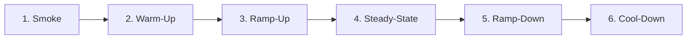
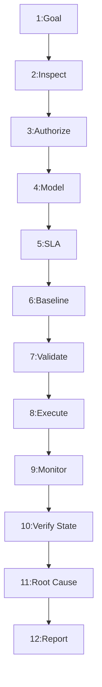

---
name: load-testing
description: Plans, executes, analyzes, and reports controlled load tests for software applications and APIs. Covers workload modeling, virtual users, request rates, ramp-up, latency percentiles, throughput, error rates, resource utilization, database bottlenecks, capacity limits, stress and endurance testing, and performance regression detection. Use when evaluating application capacity, validating performance requirements, investigating behavior under concurrent traffic, or establishing evidence-based load-test baselines.
---

# Load Testing Engineering and Capacity Verification Skill

Teaches the AI agent to plan, execute, analyze, and report controlled performance tests evaluating system capacity, scalability, and stability under realistic workloads.

## 1. Purpose, Core Principles, and Operational Load Testing Mindset

The governing mandate of load testing and performance engineering is:
**Measure application behavior under a representative and controlled workload, identify evidence-based bottlenecks, protect the test environment and real user data, and never claim that an application supports a particular capacity without sufficient test evidence.**

Core principles:
- **Representative Workload**: Emulate real user flows, think times, and payload spreads.
- **Empirical Evidence**: Base findings on measured percentiles, traces, and telemetry.
- **Tail-Latency Focus**: Evaluate p95/p99 distributions; never rely on averages alone.
- **Isolation & Safety**: Confine tests to authorized environments with synthetic data.
- **Amdahl's Law**: Target the critical path rather than micro-optimizations.
- **Zero Speculation**: Never extrapolate capacity claims from unverified benchmarks.
- **Atomic Verification**: Retest post-optimization workloads under identical parameters.

Lifecycle: Assessed $\rightarrow$ Modeled $\rightarrow$ Scripted $\rightarrow$ Executed $\rightarrow$ Analyzed $\rightarrow$ Reported.

## 2. Defining the Scope of Load Testing

Evaluate application behavior under controlled concurrent demand:
- **API Performance**: Latency and throughput under concurrent HTTP/gRPC traffic.
- **User Journeys**: Multi-step workflows (auth, catalog search, checkout).
- **Throughput Bounds**: Sustainable request and transaction rates (RPS).
- **Latency Distributions**: Median (p50), 95th (p95), and 99th (p99).
- **Resource Saturation**: CPU, memory footprint, GC pauses, and disk I/O.
- **Database Limits**: Connection pool exhaustion, lock contention, and slow queries.
- **Concurrency Bounds**: Thread starvation, event-loop blocking, backlogs.
- **Capacity Limits**: Breaking points and graceful degradation limits.
- **Regression Detection**: Catching performance regressions before deployment.

## 3. Distinguishing Load Testing from Related Performance Disciplines

Select the performance testing discipline tailored to the specific engineering question:

| Discipline | Objective | Workload Pattern | Key Metric |
| :--- | :--- | :--- | :--- |
| **Load Testing** | Capacity validation | Production traffic | p95 latency, RPS |
| **Stress Testing** | Breaking point discovery | Beyond limits | Failure mode, recovery |
| **Spike Testing** | Surge resilience | Sudden surge/drop | Backlog, scale lag |
| **Endurance Testing**| Leak & creep detection | Steady load (4–24h) | Memory leaks, pools |
| **Scalability Testing**| Scale efficiency | Scaling nodes | Scaling linearity |
| **Capacity Testing**| Max compliant load | Stepped ramp | Compliant RPS |
| **Benchmarking** | Config comparisons | Micro-benchmarks | Duration, ops/sec |
| **Profiling** | Hotspot diagnosis | Sampled traces | CPU time, heap alloc |

*Axiom*: Load testing evaluates systemic capacity; profiling locates code hotspots.

## 4. Establishing Performance Objectives and Service-Level Expectations

Define quantitative performance targets before designing or executing tests:
- **Throughput**: Target steady-state and peak requests per second (RPS).
- **Latency Targets**: p50 ($<50\text{ms}$), p95 ($<200\text{ms}$), p99 ($<500\text{ms}$).
- **Error Budgets**: Allowable HTTP 5xx or unhandled error ceiling ($<0.1\%$).
- **Resource Limits**: Host utilization limits (CPU $<75\%$, RAM $<80\%$).
- **Concurrency**: Target concurrent active sessions or client connections.
- **Provisional Targets**: Label targets provisional when formal SLAs are missing.

## 5. Inspecting Application Architecture and Test Infrastructure

Inspect architecture to identify targets and constraints:
- **Routing**: Reverse proxies, API gateways, and ingress routers.
- **Runtime**: Language version, thread model (event loop vs. workers), GC.
- **Persistence**: Database engine, pool size, replica routing, indexes.
- **Caching**: In-memory caches, Redis clusters, and HTTP headers.
- **Queues**: Message brokers (Kafka, RabbitMQ) and worker concurrency.
- **External Services**: Third-party APIs, payment gateways, and auth providers.
- **Load Generator**: Verify generator CPU, RAM, and socket capacity.

## 6. Defining Safe, Isolated, and Authorized Test Environments

Confine resource-intensive load generation to protected, authorized systems:
- **Environment**: Dedicated staging environment matching production scale.
- **Authorization**: Explicit written approval before generating load.
- **Data Isolation**: Dedicated test databases; never run mutating load on prod.
- **Network Boundaries**: Confine test traffic to isolated VPCs or hosts.
- **Third-Party Safety**: Stub or mock external APIs with test doubles.
- **Emergency Abort**: Establish documented stop triggers and cancellation commands.

## 7. Selecting the Appropriate Load-Testing Tool

Leverage existing project tooling or select the minimal viable tool based on requirements:

| Tool | Language | Best Suited For | Key Strengths |
| :--- | :--- | :--- | :--- |
| **k6** | JS / Go | Modern APIs & web flows | Low overhead, CLI/CI native |
| **Locust** | Python | User flow modeling | Python scripting, UI |
| **Gatling** | Scala/Java | High concurrency | Akka actors, HTML reports |
| **Artillery** | YAML / JS | Serverless & browser | Fast scenarios, Playwright |
| **Vegeta** | Go / CLI | Constant arrival rate | CLI speed, pipeline checks |

*Rule*: Select tooling matching team languages; avoid redundant tool sprawl.

## 8. Designing a Realistic Workload Model

Reflect realistic user behavior and multi-step flows:
- **User Journeys**: Model core user flows (e.g. 60% browse, 25% search, 15% buy).
- **Operation Ratios**: Match realistic read-to-write traffic distributions.
- **Think Time**: Implement realistic pauses using stochastic distributions (1–5s).
- **Dynamic Payloads**: Parameterize requests with varied IDs to avoid caching.
- **Session Lifecycles**: Simulate auth, session state, multi-step actions, and logout.

## 9. Distinguishing Concurrency, Arrival Rate, and Throughput

Mathematical relationships governing throughput and concurrency:
- **Virtual Users**: Concurrent simulated user threads or coroutines.
- **Arrival Rate ($\lambda$)**: Frequency of new requests initiated per second.
- **Throughput ($X$)**: Rate of successfully completed requests per second.
- **Little's Law**: $N = \lambda \times R$ (Concurrency = Arrival Rate $\times$ Latency).
- **Fallacy**: High VU count $\neq$ capacity if latency spikes and throughput drops.

## 10. Open versus Closed Workload Models

Align the workload model with real-world traffic characteristics:
- **Closed Workload Model**:
  - VUs execute an operation, wait for response, pause, and repeat.
  - If the system slows, VUs wait longer, and generated arrival rate drops.
  - Best for fixed-user pool systems (intranets, call centers).
- **Open Workload Model**:
  - Requests arrive at scheduled arrival rates independent of completion speed.
  - If the system slows, requests queue up, exposing true latency saturation.
  - Essential for public websites, e-commerce checkouts, and public APIs.

## 11. Planning Warm-Up, Ramp-Up, Steady-State, and Cool-Down Stages

Structure phases to isolate initialization from sustained capacity:



- **Smoke Test**: 1–5 VUs for 1 min to verify auth, routes, and parsing.
- **Warm-Up**: Low load priming JIT compilers, connection pools, and caches.
- **Ramp-Up**: Gradually increase traffic over 5–15 min to observe limits.
- **Steady-State**: Maintain peak load for 10–30 min to collect valid metrics.
- **Cool-Down**: Taper traffic to monitor recovery, queue drain, and pool cleanup.

## 12. Defining Performance Metrics and Statistical Latency Percentiles

Evaluate statistical distributions rather than averages:
- **Throughput**: Completed requests per second (RPS) and data transfer rate.
- **Response Percentiles**:
  - **p50 (Median)**: Typical latency for 50% of requests.
  - **p90 / p95**: Latency under minor queuing and network jitter.
  - **p99 (Tail)**: Worst-case latency exposing GC pauses and lock waits.
- **Averages Flaw**: A 100ms average hides tails where 10% wait 10s.
- **Error Rates**: Percentage of failed requests (HTTP 4xx/5xx, timeouts, socket resets).
- **Resource Telemetry**: Host CPU%, memory usage, GC pauses, and disk I/O wait.

## 13. Establishing a Rigorous Performance Baseline

Record an empirical baseline before evaluating optimizations or releases:
- **Artifact Metadata**: Git commit SHA, build version, runtime, and flags.
- **Hardware Profile**: CPU cores, RAM, network bandwidth, and storage specs.
- **Data Volume**: Database record count matching production volume.
- **Workload Parameters**: Tool version, virtual user ramp, arrival rate, duration.
- **Repetition**: Run at least three baseline iterations to measure variance.

## 14. Defining Testable Performance Acceptance Criteria

Translate operational expectations into pass/fail criteria:
- **Throughput**: Must sustain target RPS without error degradation.
- **Latency Ceilings**: p95 latency $< 250\text{ms}$; p99 $< 750\text{ms}$.
- **Error Budget**: Failed requests must not exceed $0.1\%$ of transactions.
- **Resource Headroom**: Host CPU must not exceed $80\%$ under peak load.
- **Transactional Integrity**: All state-modifying operations must preserve data consistency.

## 15. Testing Complete User Workflows and API Contracts

Test multi-step customer journeys rather than cheap, isolated endpoints:
- **Stateful Flows**: Authenticate $\rightarrow$ Browse $\rightarrow$ Select $\rightarrow$ Order.
- **Contract Adherence**: Include valid request headers and Content-Type.
- **State Validation**: Verify that business operations succeeded in the database.
- **Negative Paths**: Realistic invalid request ratios to verify rate limits.

## 16. Protecting Data Integrity and Test Isolation

Prevent tests from corrupting shared data or inducing artificial lock contention:
- **Synthetic Fixtures**: Seed dedicated test accounts and records before tests.
- **Tenant Isolation**: Distinct accounts per virtual user to avoid lock contention.
- **Idempotency Keys**: Use unique UUIDs for order creation and mutations.
- **Cleanup**: Purge only records tagged with test batch IDs after runs.

## 17. Authenticating Load-Test Clients Safely

Simulate authentic client sessions without compromising credential security:
- **Pre-Generated Tokens**: Pre-generate test tokens to avoid auth bottlenecks.
- **Dedicated Auth Testing**: Test login endpoints separately when evaluating auth capacity.
- **Secret Safety**: Load credentials via env vars; never commit secrets.
- **Token Refresh**: Model token expiration and refresh in endurance tests.

## 18. Database and Persistence Behavior Under Load

Track database health metrics during load to diagnose persistence bottlenecks:
- **Connection Pools**: Track active vs. idle connections; exhaustion queues calls.
- **Query Latencies**: Identify slow queries under load via `EXPLAIN`.
- **Lock Contention**: Detect table locks, row lock waits, and deadlocks.
- **Index Health**: Confirm queries use indexes; sequential scans spike CPU.
- **Query Tuning**: Defer SQL optimization to [database-query-optimization](../database-query-optimization/SKILL.md).

## 19. Full-Stack System Monitoring and Telemetry Correlation

Correlate client-side load generator metrics with server-side telemetry:
- **Clock Sync**: Ensure generator and target host clocks sync via NTP.
- **Correlation**: Correlate p99 latency spikes with CPU, GC cycles, and queries.
- **Generator Saturation**: Monitor generator CPU/network to avoid false bottlenecks.
- **Observability**: Coordinate with [logging-monitoring](../logging-monitoring/SKILL.md) for telemetry.

## 20. Isolating Bottlenecks and Capacity Limits

Classify bottlenecks systematically by constraining resource:
- **CPU Bound**: Application logic, JSON serialization, regex, or crypto.
- **Memory / GC Bound**: High allocation rates triggering GC pauses.
- **Database Bound**: Unindexed queries, pool exhaustion, or lock waits.
- **Concurrency Bound**: Thread exhaustion, event blocking, or lock contention.
- **Network / IO Bound**: Bandwidth exhaustion, TCP handshakes, or disk latency.
- **Amdahl's Law**: Optimizing code accounting for 5% of runtime yields trivial gains.

## 21. Handling Caches, Buffers, and Warm-Up States

Account for caching layers to avoid invalid performance conclusions:
- **Cold vs. Warm**: Distinguish cold-cache latency from steady-state warm latency.
- **Cache Invalidation**: Test cache expiration and stampedes when VUs miss.
- **Buffer Pools**: Ensure buffer pools are warm before baseline measurements.
- **Fair Comparison**: Never compare cold runs with warm runs; see [caching-strategy](../caching-strategy/SKILL.md).

## 22. Load Generation, Rate Control, and Safety Limits

Bound load generation to prevent self-inflicted denial-of-service conditions:
- **Concurrency Caps**: Enforce hard ceilings on virtual users and sockets.
- **Rate Limiting**: Enforce token-bucket or leaky-bucket rates.
- **Timeouts**: Client timeouts (5–10s) to prevent socket exhaustion.
- **Bounded Retries**: Avoid aggressive retries causing client-side storms.

## 23. Stop Conditions and Emergency Abort Procedures

Establish non-negotiable automated stop triggers to protect test targets:
- **Error Surge**: Abort immediately if error rate exceeds $5\%$ over 30 seconds.
- **Latency Explosion**: Abort if p95 latency exceeds $5\times$ SLA limit.
- **Database Saturation**: Abort if DB CPU $>95\%$ or connections hit pool cap.
- **Emergency Abort**: Document shell termination key (`Ctrl+C`) and abort commands.

## 24. Evaluating Stress, Spike, Endurance, and Scalability Workloads

Apply specialized workload profiles for specific architectural questions:
- **Stress Testing**: Incremental load to find breaking thresholds.
- **Spike Testing**: Sudden load surges verifying autoscaling and queue recovery.
- **Endurance Testing**: Sustained load for 4–24 hours detecting memory/pool leaks.
- **Scalability Testing**: Scale compute instances to verify throughput linearity.

## 25. Analyzing Errors and Application Correctness

Audit failed requests to separate infrastructure limits from code defects:
- **HTTP Status**: Distinguish rate limits (429) from errors (500, 502, 504).
- **Exceptions**: Inspect server logs for uncaught exceptions and deadlocks.
- **Data Inconsistencies**: Verify business state; confirm records remain accurate.

## 26. Managing Rate Limits, Third-Party Integrations, and Quotas

Isolate application capacity from third-party quotas and rate limits:
- **Internal Limits**: Verify that application rate limiters return HTTP 429.
- **Third-Party Mocks**: Replace external payment/email APIs with test stubs.
- **Quota Separation**: Distinguish provider API throttling from internal bottlenecks.

## 27. Performance Regression Testing and CI/CD Integration

Embed performance gates into CI pipelines without introducing flaky builds:
- **Two-Tier Strategy**:
  - *PR Tier*: 2-min performance smoke tests on key endpoints.
  - *Nightly Tier*: 30-min load and endurance suites against staging.
- **Variance**: Allow a $5–10\%$ tolerance band before failing CI pipelines.

## 28. Security, Privacy, and Authorization Standards

Enforce data protection, privacy, and security boundaries throughout testing:
- **Zero PII**: Populate test databases exclusively with synthetic fixtures.
- **Secret Protection**: Never commit API keys, tokens, or passwords to scripts.
- **Authorization Records**: Verifiable approval records for every performance run.

## 29. Troubleshooting Load-Test Failures

Diagnose unexpected test failures before attributing issues to application code:
- **Generator Limits**: Check if generator exhausted CPU, RAM, or sockets.
- **Network & DNS**: Check for DNS throttling, socket resets (`ECONNRESET`), TLS costs.
- **Configuration**: Verify target URLs, port bindings, and environment settings.
- **Triage Tree**: Isolate whether failure stems from scripts, data, or product code.

## 30. Recommended 12-Phase Load Testing Workflow

Standardized lifecycle when planning, executing, and reporting load tests:



- **Phases 1–3**: Define goals, inspect architecture, authorize.
- **Phases 4–6**: Model journeys, set criteria, record baseline.
- **Phases 7–9**: Validate scripts, run load, track telemetry.
- **Phases 10–12**: Verify data state, isolate bottlenecks, report.

## 31. Definition of Done (DoD)

A load-testing task is complete only when all criteria are satisfied:
- [ ] 1. **Objective**: Target RPS and latency bounds defined.
- [ ] 2. **Authorization**: Environment and schedule approved.
- [ ] 3. **Workload**: Journeys, think times, and ratios modeled.
- [ ] 4. **Safety**: Concurrency caps and abort triggers set.
- [ ] 5. **Baseline**: Pre-test measurements documented.
- [ ] 6. **Tail Latency**: Percentiles (p50/p95/p99) captured.
- [ ] 7. **Telemetry**: CPU, memory, and DB metrics correlated.
- [ ] 8. **Data Safety**: Synthetic fixtures used; zero PII.
- [ ] 9. **Correctness**: Database state and integrity verified.
- [ ] 10. **Bottlenecks**: Root causes isolated with evidence.
- [ ] 11. **Regression**: Comparison under identical setup.
- [ ] 12. **Report**: Structured completion report delivered.

## 32. Standardized Load Testing Completion Report Template

Conclude load-testing engagements with a structured technical report:

```markdown
# Load Testing and Capacity Report: [Application / Endpoint]
### 1. Objective & Scope: [Target service, environment, and performance goals]
### 2. Workload Model: [Tool, model (Open/Closed), VUs, arrival rate, ramp]
### 3. Measured Performance:
| Metric | Baseline | Current Test | Delta | Target SLA | Status |
| :--- | :--- | :--- | :--- | :--- | :---: |
| Throughput (RPS) | 250 RPS | 480 RPS | +230 RPS | $\ge 450$ RPS | PASS |
| Latency p50 | 42 ms | 55 ms | +13 ms | $< 75$ ms | PASS |
| Latency p95 | 120 ms | 210 ms | +90 ms | $< 250$ ms | PASS |
| Latency p99 | 310 ms | 640 ms | +330 ms | $< 750$ ms | PASS |
| Error Rate | 0.02% | 0.08% | +0.06% | $< 0.10%$ | PASS |

### 4. Bottleneck Analysis: [Constraining resource, telemetry, root cause]
### 5. Data Integrity: [Test fixtures, isolation, transactional audit]
### 6. Actionable Interventions: [Prioritized code, database, infra fixes]
### 7. Limitations: [Mocked third parties, missing telemetry, assumptions]
```

## 33. Avoiding Overengineering and Load Testing Anti-Patterns

Guard against common performance testing missteps and overengineering traps:
- **Unverified Claims**: Declaring capacity without test evidence.
- **Cold vs. Warm**: Comparing cold runs to warm candidate runs.
- **Cheap Endpoints**: Testing health checks instead of business routes.
- **Uncontrolled DoS**: High concurrency without abort triggers.
- **Coordinated Omission**: Closed loops hiding latency behind sleep.
- **Ignoring State**: Asserting HTTP 200 while transactions fail.
- **Hardcoded Secrets**: Storing plain credentials in test scripts.
- **Unbounded Retries**: Generating retry storms during degradation.
- **Tool Sprawl**: Installing redundant tools when one works.
- **Destructive Teardown**: Broad database deletes without test IDs.

## 34. Avoiding Duplication with Existing Skills

Coordinate load-testing activities with related specialized engineering skills:
- [performance-profiling](../performance-profiling/SKILL.md): Profiling code hotspots.
- [database-query-optimization](../database-query-optimization/SKILL.md): Query optimization and plans.
- [caching-strategy](../caching-strategy/SKILL.md): Cache layers and invalidation.
- [testing-qa](../testing-qa/SKILL.md): General test automation.
- [end-to-end-testing](../end-to-end-testing/SKILL.md): E2E browser workflows.
- [logging-monitoring](../logging-monitoring/SKILL.md): APM telemetry and metrics.
- [ci-cd](../ci-cd/SKILL.md): Automated CI performance gates.
- [deployment-readiness](../deployment-readiness/SKILL.md): Pre-release capacity audits.
- [security-review](../security-review/SKILL.md): Auth and access boundaries.
- [threat-modeling](../threat-modeling/SKILL.md): Denial of service modeling.

## 35. Repository Rules Alignment and Compliance

Every load-testing engagement must strictly adhere to repository engineering standards:
- [performance-optimization.md](../../rules/performance-optimization.md): Measurement and tail latency.
- [testing.md](../../rules/testing.md): Test reliability and determinism.
- [change-safety.md](../../rules/change-safety.md): Non-destructive testing and safety.
- [core-workflow.md](../../rules/core-workflow.md): Plan, execute, verify, report.
- [database.md](../../rules/database.md): Connection pooling and queries.
- [security.md](../../rules/security.md): Secret protection and least privilege.

## 36. 10-Point Pre-Flight Load Testing Validation Checklist

Verify all 10 criteria before launching or finalizing any load-testing task:
- [ ] 1. **Objective**: Target RPS and latency ceilings defined.
- [ ] 2. **Authorization**: Written authorization confirmed.
- [ ] 3. **Environment**: Isolated environment; zero production risk.
- [ ] 4. **Workload**: User journeys and think times modeled.
- [ ] 5. **Tool Limits**: Concurrency caps and timeouts set.
- [ ] 6. **Stop Triggers**: Automatic abort thresholds verified.
- [ ] 7. **Telemetry**: Clocks synced; APM and DB metrics active.
- [ ] 8. **Data Fixtures**: Synthetic fixtures seeded; zero secrets.
- [ ] 9. **Correctness**: Transactional verification asserts state.
- [ ] 10. **Report**: Findings documented with percentiles and root causes.
