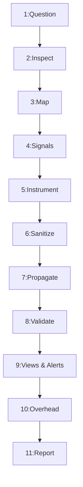

---
name: observability
description: Designs, implements, and evaluates application observability using structured logs, metrics, distributed traces, health checks, dashboards, alerts, and service-level objectives. Use when diagnosing production behavior, investigating errors and latency, instrumenting application components, correlating cross-service requests, or improving operational visibility and incident diagnosis. Covers system-wide strategy such as SLOs, cross-service tracing, and dashboards; for adding logs, error tracking, or health endpoints inside one application, use logging-monitoring instead.
---

# Observability Engineering and Operational Visibility Skill

Teaches the AI agent to instrument, evaluate, and enhance application observability using structured logs, metrics, distributed traces, health signals, dashboards, and actionable alerts to reveal internal system behavior.

## 1. Purpose, Core Principles, and Operational Observability Mindset

The governing mandate of application observability and site reliability engineering is:
**Make important application behavior observable, connect telemetry to real operational questions, protect sensitive information, and use evidence to diagnose problems. Do not collect telemetry without a clear purpose or claim that an application is healthy merely because it emits logs.**

Core principles:
- **Inference from Externals**: Infer internal runtime states from external telemetry.
- **Operational Intent**: Every log, metric, trace, and alert must answer a concrete question.
- **Signal Synergy**: Correlate logs, metrics, traces, and health checks; no single signal suffices.
- **Privacy by Default**: Sanitize credentials, PII, and secrets before telemetry leaves trust boundaries.
- **Cardinality Governance**: Bound metric dimensions strictly to prevent storage degradation.
- **Negligible Overhead**: Keep overhead negligible ($<1\%$ CPU/latency) on critical paths.
- **Empirical Grounding**: Differentiate implemented code from verified telemetry delivery.

Lifecycle: Question $\rightarrow$ Map $\rightarrow$ Instrument $\rightarrow$ Sanitize $\rightarrow$ Correlate $\rightarrow$ Verify $\rightarrow$ Operate.

## 2. Defining the Scope and Boundaries of Application Observability

Application observability governs the full lifecycle of diagnostic signals across systems:
- **Signal Generation**: In-process SDKs, middleware, log formatters, and runtime hooks.
- **Structured Logging**: JSON event streams detailing decisions and failures.
- **Metrics Aggregation**: Time-series counters, gauges, and histograms tracking trends.
- **Distributed Tracing**: Context propagation across services and queues.
- **Health Probing**: Liveness, readiness, and dependency health checks.
- **Operational Views**: Dashboards distinguishing real data from missing telemetry.
- **Alert Engineering**: Threshold- and SLO-based alerting mapped to runbooks.
- **Scope Boundary**: Observability provides diagnostic evidence; bug fixing belongs to [debugging](../debugging/SKILL.md), optimization to [performance-optimization.md](../../rules/performance-optimization.md), recovery to [incident-response](../incident-response/SKILL.md).

## 3. The Four Core Telemetry Signals and Their Interplay

Understand the distinct characteristics, roles, and trade-offs of the primary telemetry signals:

| Signal | Nature | Primary Role | Strengths | Limitations |
| :--- | :--- | :--- | :--- | :--- |
| **Logs** | Discrete events | Context & causality | Rich error details | High storage volume |
| **Metrics** | Numeric aggregates | Trend detection & alerts | Low storage, real-time | Lacks request context |
| **Traces** | Request graphs | Latency & dependency paths | Pinpoints slow calls | Sampling required |
| **Health Probes**| State signals | Orchestration & routing | Instant triage | Binary; no deep context |

*Synergy Pattern*: Metric alert triggers $\rightarrow$ trace isolates slow call $\rightarrow$ log reveals error cause $\rightarrow$ probe verifies instance survival.

## 4. Distinguishing Observability from Related Engineering Disciplines

Focus on systemic visibility, telemetry correlation, and diagnostic readiness:
- **vs. Logging & Monitoring**: Observability explains *why* states occur; monitoring checks thresholds.
- **vs. Profiling**: Observability tracks continuous telemetry; profiling takes high-overhead snapshots.
- **vs. Load Testing**: Observability monitors systems under any load; load testing finds limits.
- **vs. Incident Response**: Observability supplies triage evidence; incident response coordinates recovery.
- **vs. Testing & QA**: Observability observes runtime behavior; testing validates assertions pre-release.

## 5. Establishing Operational Questions Before Instrumentation

Never emit telemetry without identifying the operational hypothesis it must resolve:
- **Availability**: Is the service reachable, running, and accepting user traffic?
- **User Impact**: What fraction of requests are failing or degraded?
- **Latency**: Which endpoints exceed latency budgets at p95/p99?
- **Dependencies**: Does latency stem from local code or dependencies?
- **Saturation**: Are DB pools, thread pools, or queues exhausted?
- **Regressions**: Did error rates or memory rise after release?
- **Root Cause**: What input, tenant, or condition triggered the error?
- **Async Queues**: Are queues draining or are delayed jobs accumulating?
- **Quotas**: Are third-party API quotas or token budgets near limits?

## 6. Inspecting Existing Architecture and Telemetry Coverage

Audit existing codebase before modifying or adding telemetry components:
- **Entry Points**: HTTP routers, gRPC handlers, GraphQL, WebSockets.
- **Middleware**: Request tracking, error handlers, auth middleware, compression.
- **Data Layers**: ORMs, connection pools, cache clients (Redis/Memcached).
- **Async Workers**: Queue consumers (BullMQ, Celery, Kafka), cron runners.
- **Loggers & Exporters**: Active libraries (Pino, Winston) and collectors (OpenTelemetry).
- **Health Endpoints**: Existing `/health`, `/healthz`, `/ready`, and status routes.
- **Configuration**: Settings governing log levels, sampling, and endpoints.

## 7. Structured Logging Standards and Contextual Fields

Emit application logs as machine-readable JSON objects with standard schemas:
- **Core Fields**: `timestamp` (ISO 8601 UTC), `level` (severity), `message` (static summary), `service`, `environment`, `version`.
- **Correlation Fields**: `requestId`, `traceId`, `spanId`, `tenantId` (sanitized), `durationMs`, `errorCategory`.
- **Severity Discipline**: Reserve `ERROR` for system failures; `WARN` for degradations; `INFO` for milestones; `DEBUG` for diagnostics.
- **No Dynamic Strings**: Record variables in structured payload keys rather than interpolating text.

## 8. Selecting High-Value Diagnostic Log Events

Selectively capture events that inform operational diagnoses:
- **Milestones**: Process startup, graceful shutdown, migrations, worker ready.
- **Security**: Auth failures (bad credentials, expired token), access denials.
- **State Changes**: Order placement, payments, role updates, config reloads.
- **Failures**: DB connection timeouts, circuit trips, unhandled exceptions.
- **Async Jobs**: Dead-letter queue arrivals, permanent job aborts after retries.
- **Anti-Spam**: Avoid logging routine HTTP 200 GET calls at `INFO`; rely on metrics.

## 9. Protecting Sensitive Information, PII, and Secrets in Telemetry

Never emit confidential, sensitive, or regulated data into telemetry:
- **Prohibited Data**: Passwords, hashes, tokens, JWTs, cookies, API keys, card PANs, CVVs, SSNs, health data, connection strings.
- **Sanitization**: Mask auth/cookie headers; redact JSON keys; replace SQL params with placeholders (`$1`); strip query params.
- **Access & Retention**: Restrict telemetry access via RBAC; isolate multi-tenant streams; enforce retention.

## 10. Defining Metrics That Answer Operational Questions

Model quantitative system behavior using appropriate metric primitives:
- **Counters**: Monotonically increasing values tracking volume (e.g. `http_requests_total`).
- **Gauges**: Snapshots of fluctuating states (e.g. `db_connections_active`, `queue_depth`).
- **Histograms**: Measurement distributions across buckets (e.g. `http_request_duration_seconds`).
- **Summary**: Client-calculated quantiles; prefer histograms when aggregating across nodes.
- **Naming**: Standard format (`namespace_subsystem_name_unit`, e.g. `http_server_duration_seconds`).

## 11. Monitoring the Four Golden Signals in Practice

Implement Google SRE Four Golden Signals across request-handling components:
- **Latency**: Duration to service requests (p50/p95/p99); separate success and failure latency.
- **Traffic**: Demand placed on system (e.g. requests per second, active sessions).
- **Errors**: Rate of requests failing explicitly (5xx), implicitly, or by policy (timeouts).
- **Saturation**: Fractional constraint on resources (CPU, RAM, DB pools, queues).

## 12. Controlling Metric Cardinality and Dimensional Bounds

Prevent cardinality explosion from crashing metrics databases and inflating storage costs:
- **Prohibited Labels**: User IDs, emails, UUIDs, raw URLs with IDs, request/trace IDs, stack snippets.
- **Bounded Labels**: Route templates (`/users/{id}`), HTTP method, status class, environment, error codes.
- **Identity Isolation**: Use logs or traces for individual user/tenant diagnosis rather than metric dimensions.

## 13. Instrumenting Request Latency, Throughput, and Outcomes

Capture ingress and egress API performance comprehensively:
- **Route Normalization**: Map dynamic paths to static templates before metric recording.
- **Attribution**: Distinguish client drops (HTTP 499) from server timeouts (504).
- **Outcomes**: Differentiate business rejects (422 validation) from server errors (500).
- **Async Handoffs**: For 202 Accepted routes, record acceptance latency separately from job duration.

## 14. Distributed Tracing and Context Propagation

Trace requests across asynchronous network and process boundaries:
- **W3C Trace Context**: Standardize on `traceparent` for propagation.
- **Span Hierarchy**: Root span covers ingress; child spans encapsulate DB/cache/HTTP calls.
- **Attributes**: Include bounded metadata (`http.status_code`, `db.system`); zero secrets.
- **Async Spans**: Link consumer spans to producer trace context via span links.
- **Sampling**: Head-based sampling for routine calls; retain 100% of errors via tail sampling.

## 15. Instrumenting Databases, Caches, and External Dependencies

Ensure external integrations and persistence layers are fully observable:
- **Database**: Pool utilization (active, idle), query latency per template, slow query logs ($>200\text{ms}$).
- **Cache**: Cache hit/miss counters per namespace, connection health, key evictions.
- **Third-Party**: Outbound latency, status codes, timeouts; isolate provider throttling (429).

## 16. Capturing Errors, Exceptions, and Failure Boundaries Correctly

Handle and record application exceptions without losing diagnostic context:
- **Global Handlers**: Catch unhandled exceptions at boundaries to prevent silent crashes.
- **Single-Layer**: Log an exception once at handling boundary; avoid multi-layer log spam.
- **Preserve Causality**: Retain root cause error objects when wrapping exceptions (`error.cause`).
- **Sanitization**: Return safe errors to clients; log full stack traces internally with `requestId`.

## 17. Health, Readiness, and Liveness Probe Architectures

Design probe endpoints matching container orchestrator lifecycle semantics:
- **Liveness (`/healthz`)**: Checks if process is alive. Never check external deps; avoids restart loops.
- **Readiness (`/ready`)**: Checks if instance can accept traffic (DB/cache ready). Stops routing on failure.
- **Security**: Protect health diagnostic details from public exposure; return basic status codes.

## 18. Designing Actionable Dashboards and Operational Views

Construct operational dashboards answering critical questions in seconds:
- **Executive / SRE**: Service availability, golden signals, error budget burn rates.
- **Application Tier**: Endpoint throughput, p95/p99 heatmaps, status breakdown, instances.
- **Persistence Tier**: DB pool saturation, cache hit ratios, queue backlog and latency.
- **Visual Hygiene**: Label units explicitly (ms, req/s); set threshold lines; distinguish zero from missing telemetry.

## 19. Designing Actionable, Low-Noise Alerting Systems

Alert only on symptoms requiring human intervention; eliminate alert fatigue:
- **Actionability**: Every alert must require immediate human action; otherwise, convert to a dashboard panel.
- **Alert Anatomy**: `AlertName`, falsifiable `Condition`, `Severity` (P1–P3), user `Impact`, `Runbook` link.
- **Dampening**: Use sustained evaluation windows (e.g. 5 min) to avoid alerting on temporary blips.

## 20. Service-Level Indicators (SLIs), Objectives (SLOs), and Error Budgets

Ground reliability engineering in service-level objectives:
- **SLI**: Ratio of good events to valid events: $\text{SLI} = (\sum \text{Good} / \sum \text{Valid}) \times 100\%$.
- **SLO**: Target over rolling compliance window (e.g. $99.9\%$ good requests over 30 days).
- **Error Budget**: Permitted unreliability: $\text{Budget} = 100\% - \text{SLO}$ (e.g. $0.1\%$ allowed).
- **Burn-Rate Alerting**: Alert on budget consumption speed (e.g. 5% budget in 1 hr indicates incident).

## 21. Correlating Telemetry Across Distributed Components

Stitch disconnected telemetry signals into a coherent diagnostic timeline:
- **Propagation Keys**: Propagate `requestId`, `traceId`, and `tenantId` across logs, traces, and metrics.
- **Release Tracking**: Tag metrics and logs with commit SHA to isolate release regressions.
- **Causation Fallacy**: Coincidence indicates correlation, not causation; verify traces before rollback.

## 22. Observability for Background Jobs and Asynchronous Queues

Instrument asynchronous decoupled pipelines beyond web request boundaries:
- **Metrics**: `queue_depth`, `job_queue_latency_seconds`, `job_execution_duration_seconds`, `job_failures_total`.
- **Trace Context**: Embed W3C trace context in message metadata; restore context in worker spans.
- **Dead-Letter**: Alert on dead-letter queue arrivals to catch poison pills.

## 23. Observability for AI, LLM Pipelines, and Model Services

Specialized telemetry for generative AI, agentic workflows, and external model APIs:
- **Metrics**: Token counts (prompt, completion), latency (TTFT, total), HTTP status, 429 limits, retries.
- **Agent Traces**: Spans for tool calls, vector search, retrieval, LLMs; record duration and outcomes.
- **Privacy**: Never log raw prompts or model outputs containing PII or secrets without redaction.

## 24. Sampling Strategies, Retention Policies, and Telemetry Costs

Balance diagnostic depth against storage costs and performance overhead:
- **Sampling**: Head-based uniform sampling for routine calls (5%); tail-based retaining 100% of errors.
- **Retention**: Raw logs/traces (7–14 days); aggregated metrics (30–90 days); rollups (1 yr).

## 25. Observability During Deployments and Active Incidents

Leverage observability tools for safe rollouts and structured triage:
- **Canary**: Compare golden signals between canary and baseline nodes in real time.
- **Triage**: Check SLO dashboard $\rightarrow$ check deploy markers $\rightarrow$ sample traces $\rightarrow$ inspect error logs.

## 26. Testing and Verifying Observability Instrumentation

Treat telemetry code as critical logic covered by automated tests:
- **Schema Validation**: Unit test formatters confirming emitted JSON conforms to schema.
- **Redaction**: Test that sensitive attributes (`password`, `token`) are masked in logs.
- **Metrics**: Verify invoking an endpoint increments counters and records histograms.
- **Context**: Test outgoing calls include valid `traceparent` matching the active span.

## 27. Troubleshooting Missing, Broken, or Misleading Telemetry

Diagnose observability pipeline failures systematically:
- **Missing Logs**: Verify log level environment setting (`LOG_LEVEL=info`); check buffering.
- **Missing Metrics**: Confirm exporter endpoint is listening; check scrape jobs and firewalls.
- **Broken Traces**: Check for dropped headers in proxies or async worker handoffs.
- **Misleading Metrics**: Verify metric units (seconds vs. ms); audit histogram buckets.

## 28. Preventing Over-Instrumentation and Runtime Performance Overhead

Ensure monitoring does not degrade application responsiveness:
- **Async Logging**: Stream logs via non-blocking writers; avoid sync disk I/O.
- **Batch Exporting**: Buffer telemetry in memory; export asynchronously in batches (5–10s).
- **Bounded Buffers**: Enforce memory limits; drop events rather than OOM under load.

## 29. Security, Privacy, and Access Controls for Telemetry Data

Apply strict security boundaries to stored observability repositories:
- **RBAC**: Restrict access to production logs/traces to authorized staff.
- **Tenant Isolation**: Partition multi-tenant logs to prevent data leakage.
- **Encryption**: Export telemetry via TLS; authenticate collectors securely.

## 30. Recommended 11-Phase Observability Lifecycle Workflow

Follow this standardized lifecycle when planning, implementing, and reviewing observability:



- **Phases 1–3**: Define operational questions, audit telemetry, map components.
- **Phases 4–6**: Select minimal signals, implement telemetry, redact PII.
- **Phases 7–8**: Propagate trace context, verify telemetry via tests.
- **Phases 9–11**: Configure dashboards and alerts, evaluate overhead, report.

## 31. Definition of Done (DoD) for Observability Tasks

An observability task is complete only when all criteria are satisfied:
- [ ] 1. **Intent**: Concrete diagnostic question identified.
- [ ] 2. **Audit**: Existing frameworks and exporters inspected.
- [ ] 3. **JSON Logs**: Machine-readable JSON with standard fields.
- [ ] 4. **Redacted**: Secrets and PII masked at source.
- [ ] 5. **Metrics**: Bounded cardinality counters, gauges, histograms.
- [ ] 6. **Golden Signals**: Latency, traffic, errors, saturation tracked.
- [ ] 7. **Context**: Request/trace context passed across boundaries.
- [ ] 8. **Dependencies**: DB and external API health observable.
- [ ] 9. **Probes**: Liveness and readiness semantics verified.
- [ ] 10. **Alerts**: Actionable thresholds tied to runbooks.
- [ ] 11. **Overhead**: Async batching verified ($<1\%$ impact).
- [ ] 12. **Evidence**: Emitted telemetry confirmed via tests.

## 32. Standardized Observability Completion Report Template

Conclude observability engineering engagements with a structured technical report:

```markdown
# Observability Verification Report: [Service / Component]
### 1. Objective: [Operational question or diagnostic gap addressed]
### 2. Instrumentation: [Logs, metrics, traces, health probes modified]
### 3. Correlation & Coverage:
| Component / Workflow | Telemetry Implemented | Correlation ID | Status |
| :--- | :--- | :--- | :---: |
| Ingress API Handler | Latency histogram, 5xx counter | `traceparent`, `requestId` | PASS |
| Database Layer | Slow query log, pool gauge | `spanId` child span | PASS |
| Background Worker | Queue latency, failure counter | Job metadata trace link | PASS |

### 4. Privacy & Security: [Redaction filters applied, headers masked, bounded labels]
### 5. Validation Results: [Tests executed, log samples inspected, trace graphs checked]
### 6. Operational Impact: [Overhead assessment, buffer limits, export frequency]
### 7. Remaining Gaps: [Uninstrumented dependencies, missing dashboards, next steps]
```

## 33. Avoiding Overengineering and Observability Anti-Patterns

Guard against common observability pitfalls and engineering antipatterns:
- **Vanity Logging**: Emitting routine logs without diagnostic value.
- **Cardinality Explosion**: Putting user IDs or URLs into metric labels.
- **Alert Fatigue**: Alerts on fluctuating metrics without runbooks.
- **Log Parsing Fragility**: Parsing text with regex instead of JSON.
- **Leaking Secrets**: Emitting bearer tokens or PII into logs.
- **Cascading Restarts**: Checking external deps in liveness probes.
- **Redundant Stacks**: Logging errors at every call stack layer.
- **Unbounded Buffering**: Telemetry buffers exhausting server memory.
- **Correlation Fallacy**: Assuming release caused issues without proof.
- **Tool Sprawl**: Adding redundant tools when existing tools suffice.

## 34. Avoiding Duplication with Existing Skills

Coordinate observability engineering with related specialized skills:
- [logging-monitoring](../logging-monitoring/SKILL.md): Logging frameworks and exporters.
- [performance-profiling](../performance-profiling/SKILL.md): Code hotspots.
- [load-testing](../load-testing/SKILL.md): Load and capacity tests.
- [database-query-optimization](../database-query-optimization/SKILL.md): Query optimization.
- [caching-strategy](../caching-strategy/SKILL.md): Cache metrics and invalidation.
- [incident-response](../incident-response/SKILL.md): Incident triage and recovery.
- [security-review](../security-review/SKILL.md): Telemetry privacy and audit.
- [threat-modeling](../threat-modeling/SKILL.md): Attack surface analysis.
- [deployment](../deployment/SKILL.md): Post-release verification.
- [ci-cd](../ci-cd/SKILL.md): CI telemetry smoke tests.

## 35. Repository Rules Alignment and Compliance

Every observability change must strictly comply with repository engineering standards:
- [performance-optimization.md](../../rules/performance-optimization.md): Overhead limits.
- [security.md](../../rules/security.md): Secret protection.
- [backend.md](../../rules/backend.md): Error boundaries.
- [database.md](../../rules/database.md): Connection pools.
- [testing.md](../../rules/testing.md): Deterministic testing.
- [change-safety.md](../../rules/change-safety.md): Non-destructive changes.

## 36. 10-Point Pre-Flight Observability Validation Checklist

Verify all 10 criteria before launching or finalizing any observability task:
- [ ] 1. **Intent**: Concrete diagnostic question identified.
- [ ] 2. **Audit**: Existing loggers and exporters inspected.
- [ ] 3. **JSON Logs**: Machine-readable JSON with standard fields.
- [ ] 4. **Redacted**: Strict redaction for secrets and tokens.
- [ ] 5. **Cardinality**: Route templates used instead of raw URLs.
- [ ] 6. **Golden Signals**: Latency, traffic, errors, saturation tracked.
- [ ] 7. **Probe Safety**: Liveness isolated from external deps.
- [ ] 8. **Trace Context**: W3C trace context passed across calls.
- [ ] 9. **Alerts**: Alert thresholds mapped to runbooks.
- [ ] 10. **Overhead**: Non-blocking asynchronous export confirmed.
