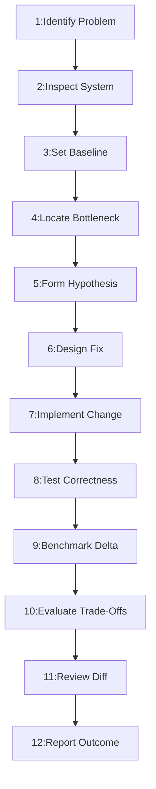

---
name: performance-optimization
description: Diagnoses and improves application performance across frontend rendering, backend execution, algorithms, databases, APIs, networking, caching, concurrency, and resource usage. Uses profiling, baselines, workload analysis, focused optimization, regression testing, and before-and-after measurements. Use when an application is slow, resource-intensive, inefficient under load, or requires evidence-based performance improvements. Use once a bottleneck is known and code must change; to measure and locate bottlenecks first, use performance-profiling.
---

# Performance Optimization and Engineering Standards Skill

Systematically diagnose, plan, implement, benchmark, and verify software performance improvements across frontend, backend, database, API, and runtime layers while strictly preserving functional correctness, security, and maintainability.

## 1. Purpose, Core Principles, and Performance Engineering Mindset

**Measure before optimizing, address the bottleneck that materially affects users, preserve correct application behavior, and verify improvements under comparable conditions. Never invent performance results or make speculative changes without a reasonable technical basis.**

Core principles:
- **Evidence Over Assumption**: Require empirical profiling before code changes.
- **Amdahl's Law Focus**: Optimize the critical path dominating runtime; avoid micro-tweaks.
- **Invariance of Correctness**: Correctness, security checks, and data integrity are non-negotiable.
- **Controlled Baselines**: Measure existing behavior under reproducible workloads.
- **Minimal Invasive Change**: Choose targeted fixes over broad rewrites.
- **Comparable Verification**: Benchmark post-change under identical parameters.
- **Zero Hallucination**: Never report synthetic metrics or unverified speedups.

Lifecycle: *Measure* $\rightarrow$ *Locate* $\rightarrow$ *Hypothesize* $\rightarrow$ *Optimize* $\rightarrow$ *Test* $\rightarrow$ *Benchmark* $\rightarrow$ *Verify*.

## 2. Defining the Scope and Boundaries of Performance Optimization

Target systemic bottlenecks across architectural layers:
- **Frontend**: Rendering lifecycles, DOM complexity, virtual lists, bundle sizes, Web Vitals (LCP, INP, CLS).
- **Backend**: Algorithmic Big-O efficiency, serialization overhead, async I/O, worker thread pools.
- **Database**: SQL execution plans, composite indexes, N+1 query elimination, connection pool sizing.
- **Network & API**: Payload trimming, HTTP compression, connection reuse, request batching, keyset pagination.
- **Caching**: In-memory caches, distributed cache-aside, cache freshness guarantees, stampede mitigation.
- **Resources**: Memory leak elimination, GC pause reduction, CPU utilization, thread contention.
- **Boundaries**: Optimization implements targeted structural fixes; deep runtime profiling belongs to [performance-profiling](../performance-profiling/SKILL.md), capacity testing to [load-testing](../load-testing/SKILL.md), and telemetry to [observability](../observability/SKILL.md).

## 3. Distinguishing Optimization from Profiling, Benchmarking, and Testing

Understand the distinct roles, workflows, and deliverables:

| Discipline | Core Activity | Primary Tooling | Key Output |
| :--- | :--- | :--- | :--- |
| **Profiling** | Sampling execution hotspots | CPU/Heap profilers | Flamegraphs, call trees |
| **Optimization** | Restructuring code, queries, caches | Refactoring, algorithms | Faster execution, lower CPU |
| **Benchmarking** | Measuring isolated operations | Micro-benchmarks, timers | Ops/sec, elapsed ms |
| **Load Testing** | Simulating concurrent user demand | k6, Locust, Gatling | p95/p99 latency, RPS bounds |
| **Observability** | Tracking production telemetry | OpenTelemetry, Prometheus | Metrics, traces, logs |

*Principle*: Profiling locates bottlenecks; optimization applies fixes; benchmarks verify results.

## 4. Establishing the Performance Problem and User Impact

Identify operational reality and user impact before code changes:
- **Target Workflow**: Isolate the degraded route, screen, or job.
- **Impact Surface**: Identify affected users or high-volume paths.
- **Temporal Pattern**: Distinguish continuous lag from spikes.
- **Resource Nature**: Classify as CPU, memory, I/O, or DB-bound.
- **Regression Timeline**: Correlate with recent commits or migrations.
- **SLA Breach**: Identify the specific latency or SLA violated.

## 5. Defining Quantitative Success Targets and Performance SLAs

Establish falsifiable criteria to verify optimization success:
- **Latency Targets**: Percentiles: p50 ($<50\text{ms}$), p95 ($<200\text{ms}$), p99 ($<500\text{ms}$).
- **Throughput Bounds**: Target sustained throughput (e.g. $\ge 500\text{ RPS}$).
- **Resource Ceilings**: Maximum CPU ($<75\%$) or heap allocations.
- **Database Bounds**: Query reductions (e.g. 50 queries to 1 batched query).
- **Provisional Targets**: If SLAs are missing, document provisional targets.

## 6. Establishing a Reproducible Baseline Under Controlled Conditions

Capture trustworthy baseline metrics before code changes:
- **Isolated Environment**: Benchmark on hardware matching production specs.
- **Realistic Data**: Seed database with representative volumes; no toy data.
- **Warm-Up Iterations**: Run throwaway runs to prime JIT and caches.
- **Repeated Samples**: Collect 3–5 runs to measure variance and stdev.
- **Parameter Recording**: Record Git commit SHA, runtime version, and config.

## 7. Inspecting Application Architecture and the Critical Path

Trace the request journey to locate the true critical path:
- **Lifecycle Traversal**: Gateway $\rightarrow$ Auth $\rightarrow$ Controller $\rightarrow$ Service $\rightarrow$ DB $\rightarrow$ Serializer.
- **Amdahl's Law**: Optimizing a 5% runtime step yields at most 5% total gain.
- **Contention Shifting**: Ensure speeding up one tier does not overload downstream tiers.
- **Dominant Component**: Focus efforts on components consuming $\ge 70\%$ duration.

## 8. Evidence-Based Profiling and Bottleneck Identification

Use diagnostics to gather empirical execution evidence:
- **CPU Profiling**: Generate flamegraphs to identify expensive call stacks.
- **Memory Profiling**: Capture heap snapshots to inspect retention trees.
- **Database Profiling**: Run `EXPLAIN ANALYZE` to locate unindexed joins and scans.
- **Network Profiling**: Inspect transfer payload sizes and uncompressed responses.
- **Falsifiable Hypothesis**: State root cause: "Function X causes 80% delay via $O(N^2)$ lookup."

## 9. Algorithmic and Data Structure Optimization

Choose data structures and algorithms matching workload volume:
- **Complexity Reduction**: Replace $O(N^2)$ iterations with $O(N)$ lookups or $O(N \log N)$ sorts.
- **Lookup Optimization**: Replace array linear scans (`find`) with Sets/Maps for $O(1)$.
- **Loop Invariants**: Precompute invariant values outside iteration loops.
- **Zero Defensive Cloning**: Use in-place transforms or iterators on large arrays.
- **Semantic Preservation**: Ensure algorithm changes preserve edge cases and errors.

## 10. Frontend Performance Optimization and Web Vitals

Accelerate client-side rendering and user responsiveness:
- **Bundle Splitting**: Implement dynamic code splitting; eliminate heavy packages.
- **DOM Virtualization**: Virtualize long lists; avoid rendering unneeded DOM nodes.
- **Render Cascades**: Isolate frequent state updates; memoize with profiling proof.
- **Asset Delivery**: Serve modern formats (WebP/AVIF) and lazy-load images.
- **Core Web Vitals**: Target LCP ($<2.5\text{s}$), INP ($<200\text{ms}$), CLS ($<0.1$).
- **Accessibility**: Never remove focus rings, ARIA roles, or layouts for speed.

## 11. Backend Execution and Request Processing Optimization

Optimize execution paths, serialization, and I/O concurrency:
- **Non-Blocking I/O**: Use async non-blocking I/O for network, file, and DB calls.
- **Serialization**: Eliminate repeated JSON serialization; project only needed fields.
- **Request Batching**: Consolidate individual I/O calls into batched requests.
- **Timeouts**: Enforce strict connection and read timeouts on external calls.
- **Connection Pooling**: Maintain warm pools for databases and HTTP clients.

## 12. Database Access, Indexing, and Query Optimization

Remediate persistence-layer inefficiencies dominating latency:
- **Eliminate N+1 Queries**: Replace loop queries with eager loading or batching.
- **Targeted Indexing**: Create composite indexes for `WHERE`, `JOIN`, and `ORDER BY`.
- **Selective Projection**: Select only necessary columns; avoid `SELECT *`.
- **Keyset Pagination**: Use keyset/cursor pagination over high offsets (`OFFSET`).
- **Short Transactions**: Minimize transaction duration; never run HTTP in transactions.
- **Reference**: Defer complex SQL tuning to [database-query-optimization](../database-query-optimization/SKILL.md).

## 13. Caching Strategy, Freshness, and Invalidation Invariants

Apply caching where expensive computations are reused frequently:
- **Suitability Criteria**: Cache read-heavy data with acceptable staleness.
- **Explicit Invalidation**: Define event-driven invalidation or strict TTLs.
- **Cache Key Scoping**: Include query params, user permissions, and tenant IDs in keys.
- **Stampede Mitigation**: Use mutex locks or early expiry to prevent stampedes.
- **Reference**: Apply comprehensive caching patterns in [caching-strategy](../caching-strategy/SKILL.md).

## 14. API Design, Serialization, and Network Efficiency

Streamline payload size and network overhead:
- **Payload Trimming**: Exclude null or unrequested fields; support partial responses.
- **HTTP Compression**: Enable Gzip or Brotli compression on responses $>1\text{ KB}$.
- **Conditional Requests**: Support `ETag` and `If-None-Match` to return 304 Not Modified.
- **Multiplexing**: Use HTTP/2 or HTTP/3 multiplexing and keep-alive connections.

## 15. Memory Management, Leaks, and Allocation Controls

Control heap consumption and garbage collection pressure:
- **Memory Leak Remediation**: Unregister listeners, close streams, and clear timers.
- **Stream Processing**: Stream large file downloads, exports, and DB cursors.
- **Allocation Churn**: Avoid throwaway objects in tight loops to minimize GC pauses.
- **Bounded Buffers**: Enforce capacity caps on in-memory queues to prevent OOMs.

## 16. CPU Utilization and Computation Hotspot Mitigation

Alleviate intensive compute operations blocking runtimes:
- **Worker Offloading**: Offload expensive crypto or compression to worker threads.
- **Regex Backtracking**: Audit regexes for catastrophic backtracking ($O(2^N)$); use parsers.
- **Chunked Parsing**: Avoid parsing large JSON payloads synchronously on main thread.

## 17. Asynchronous Processing, Threading, and Concurrency Controls

Scale throughput safely without race conditions or contention:
- **Bounded Concurrency**: Bound parallel promises or workers to prevent exhaustion.
- **Lock Contention**: Minimize critical sections; prefer lock-free or atomic operations.
- **Race Prevention**: Ensure concurrent mutations maintain isolation and idempotency.

## 18. Application Startup and Initialization Optimization

Reduce service boot times and container cold starts:
- **Deferred Loading**: Lazy-load non-critical modules and administrative routes.
- **Parallel Initialization**: Initialize independent connections via `Promise.all`.
- **Pre-Compilation**: Compile templates, DI containers, and schemas during build.
- **Readiness Probes**: Ensure initialization finishes before marking `/ready` valid.

## 19. Background Jobs and Long-Running Workload Efficiency

Move heavy tasks to asynchronous worker queues:
- **Decoupled Workers**: Offload bulk emails and report generation to background workers.
- **Queue Health Metrics**: Monitor backlog depth, worker latency, and execution duration.
- **Dead-Letter Handling**: Configure retries with exponential backoff and dead-letter queues.

## 20. External Dependency Latency and Resilient Integration

Isolate the application from third-party slowness and failures:
- **Strict Timeouts**: Enforce tight connection (2s) and read timeouts (5s) on HTTP calls.
- **Circuit Breakers**: Trip circuit breakers after consecutive failures to fail fast.
- **Graceful Fallbacks**: Return cached or degraded responses when third parties fail.

## 21. Correctness, Security, and Maintainability as Non-Negotiable Invariants

Optimization must never sacrifice software integrity or safety:
- **Zero Security Skips**: Never bypass validation, auth checks, or tenant isolation for speed.
- **Data Integrity**: Never remove DB constraints, transaction isolation, or foreign keys.
- **Maintainability**: Reject convoluted micro-optimizations that damage readability.

## 22. Rigorous Correctness and Regression Testing After Changes

Verify functionality remains identical after optimization:
- **Regression Suite**: Run unit, integration, and E2E test suites against optimized code.
- **Edge-Case Validation**: Explicitly test empty collections, boundary inputs, and errors.
- **Data Parity**: Verify optimized queries or algorithms produce identical outputs.

## 23. Rigorous Before-and-After Benchmarking Methodology

Measure performance deltas under comparable conditions:
- **Isolated Hardware**: Run benchmarks on dedicated hardware free from noisy neighbors.
- **Statistical Significance**: Measure median (p50), p95, and p99; disregard single-run outliers.
- **Side-by-Side**: Document baseline vs. post-optimization metrics, deltas, and percentage gains.
- **Zero Extrapolation**: Report only measured numbers; never extrapolate unverified claims.

## 24. Avoiding Single-Metric Blindspots and Architectural Trade-Offs

Evaluate optimization impact across competing dimensions:
- **Memory vs. CPU**: Fast lookup tables consume heap; verify footprint avoids GC thrashing.
- **Read vs. Write**: Indexes accelerate queries but add write latency; balance additions.
- **Throughput vs. Latency**: High batching increases throughput but adds initial latency.

## 25. Production Safety Guardrails and Non-Destructive Execution

Ensure investigation and optimization do not disrupt systems:
- **Staging Verification**: Benchmark and validate optimizations in staging environments first.
- **Safe Profiling**: Avoid high-overhead profilers on production instances without approval.
- **Non-Destructive**: Never drop indexes, purge live caches, or alter schemas during peak traffic.

## 26. Prioritizing Improvements by Impact, Bottleneck Severity, and Effort

Rank optimization candidates to maximize engineering return:
- **Priority 1 (High Impact, Low Effort)**: Missing composite index, N+1 fix, redundant API removal.
- **Priority 2 (High Impact, Medium Effort)**: Route-based code splitting, cache-aside layer, virtualizing lists.
- **Priority 3 (Medium Impact, High Effort)**: Architectural refactoring, migrating sync to async workers.
- **De-prioritize**: Micro-optimizing rarely executed utility loops or speculative bottlenecks.

## 27. Detecting, Triaging, and Resolving Performance Regressions

Act decisively when an optimization degrades performance:
- **Immediate Triage**: Compare telemetry against baseline; isolate latency, memory, or error spikes.
- **Safe Rollback**: Revert immediately if degradation threatens SLAs or data consistency.
- **Root Cause Analysis**: Profile reverted code under identical workload to explain the regression.

## 28. Integrating Automated Performance Gates into CI/CD Pipelines

Prevent regressions from merging into mainline repositories:
- **Bundle Budgets**: Fail CI builds if bundle size exceeds thresholds (e.g. $>250\text{ KB}$).
- **Lighthouse CI**: Automate Core Web Vitals checks on pull request preview deployments.
- **Query Assertions**: Use assertions verifying API endpoints execute a bounded query count.

## 29. Diagnostic Tooling Selection and Environment Instrumentation

Leverage existing tooling or lightweight diagnostics:
- **Node.js / JS**: Chrome DevTools, Clinic.js, `node --prof`, 0x, Playwright traces.
- **Python**: cProfile, Py-Spy, memory_profiler, Locust, SQLAlchemy query logs.
- **Database**: `EXPLAIN (ANALYZE, BUFFERS)`, `pg_stat_statements`, MySQL slow query logs.
- **Tooling Rule**: Prefer built-in profilers before introducing third-party dependencies.

## 30. Recommended 12-Phase Performance Optimization Workflow

Follow this standardized lifecycle for performance tasks:



- **Phases 1–3**: Problem identification, system inspection, baseline capture.
- **Phases 4–6**: Bottleneck profiling, hypothesis formulation, targeted design.
- **Phases 7–9**: Focused implementation, correctness testing, benchmark delta.
- **Phases 10–12**: Trade-off evaluation, git diff review, completion reporting.

## 31. Definition of Done (DoD) for Performance Optimization Tasks

Complete only when all criteria pass:
- [ ] 1. **Bottleneck Verified**: Profiling or baseline evidence confirms root cause.
- [ ] 2. **Controlled Baseline**: Pre-change metrics recorded under known parameters.
- [ ] 3. **Focused Implementation**: Minimal targeted fix addressing the bottleneck.
- [ ] 4. **Correctness Preserved**: All automated tests pass; business logic intact.
- [ ] 5. **Security Intact**: Validation, auth checks, and tenant isolation preserved.
- [ ] 6. **Comparable Benchmark**: Post-change metrics captured under identical conditions.
- [ ] 7. **Documented Gain**: Measurable latency, throughput, or resource improvement verified.
- [ ] 8. **No Regressions**: Memory footprint, tail latency, and error rates checked.
- [ ] 9. **Trade-offs Evaluated**: Memory, CPU, and caching trade-offs documented.
- [ ] 10. **Code Cleanliness**: No debug logs, temporary benchmarks, or profiler hooks.
- [ ] 11. **Scoped Diff**: Zero unrequested refactoring or unrelated formatting.
- [ ] 12. **Report Delivered**: Formal before-and-after report documented.

## 32. Standardized Performance Optimization Completion Report Template

Document final results using this structured report:

```markdown
# Performance Optimization Completion Report: [Component / Route]
### 1. Problem Identified: [Degraded route and breached SLA]
### 2. Evidence & Root Cause: [Flamegraph, EXPLAIN plan, or heap snapshot]
### 3. Optimization Applied: [Algorithmic, database, caching, or code change]
### 4. Correctness Verification: [Automated regression test results]
### 5. Before-and-After Benchmark Results:
| Metric | Baseline | Optimized | Delta | Gain | Status |
| :--- | :--- | :--- | :--- | :--- | :---: |
| Latency p50 | 180 ms | 45 ms | -135 ms | 75% faster | PASS |
| Latency p95 | 450 ms | 110 ms | -340 ms | 75% faster | PASS |
| DB Queries | 52 | 2 | -50 | 96% drop | PASS |
| Peak Memory | 256 MB | 140 MB | -116 MB | 45% drop | PASS |

### 6. Trade-Offs: [Memory vs CPU, caching limits, complexity]
### 7. Limitations: [Secondary paths and future recommendations]
```

## 33. Avoiding Overengineering and Performance Anti-Patterns

Avoid common performance anti-patterns:
- **Premature Optimization**: Optimizing clean code before profiling proves a bottleneck.
- **Speculative Complexity**: Adding caches or queues when simpler code meets SLAs.
- **Ignoring Amdahl's Law**: Micro-optimizing fast code while slow queries dominate runtime.
- **Indiscriminate Indexing**: Adding excess indexes that degrade write throughput.
- **Unbounded In-Memory Caching**: Caching without TTLs or eviction, causing OOMs.
- **Skipping Validation for Speed**: Bypassing auth or schema checks to game benchmarks.
- **Single-Run Hallucination**: Claiming speedup based on one unrepeatable benchmark run.
- **Micro-Benchmark Fallacy**: Assuming micro-benchmark gains translate to real user traffic.
- **Disregarding Tail Latency**: Optimizing average response time while p99 spikes.
- **Over-Concurrency**: Spawning unbounded workers that exhaust connection pools.

## 34. Avoiding Duplication with Existing Skills

Coordinate performance work with related skills:
- [performance-profiling](../performance-profiling/SKILL.md): Runtime profiling and flamegraphs.
- [database-query-optimization](../database-query-optimization/SKILL.md): SQL query and index tuning.
- [caching-strategy](../caching-strategy/SKILL.md): Cache-aside and stampede mitigation.
- [load-testing](../load-testing/SKILL.md): Concurrent traffic and capacity testing.
- [observability](../observability/SKILL.md): Telemetry, metrics, and tracing.
- [testing-qa](../testing-qa/SKILL.md): Functional and regression test suites.
- [end-to-end-testing](../end-to-end-testing/SKILL.md): Browser user workflow verification.
- [feature-implementation](../feature-implementation/SKILL.md): Full-stack feature implementation.
- [code-review](../code-review/SKILL.md): Quality, safety, and defect review.
- [ci-cd](../ci-cd/SKILL.md): Automated pipelines and quality gates.

## 35. Repository Rules Alignment and Compliance

Performance optimizations must adhere to repository rules:
- [performance-optimization.md](../../rules/performance-optimization.md): Core performance engineering rules.
- [coding-standards.md](../../rules/coding-standards.md): Code readability, formatting, and simplicity.
- [backend.md](../../rules/backend.md): Server architecture, boundaries, and errors.
- [frontend.md](../../rules/frontend.md): UI structure, accessibility, and state.
- [database.md](../../rules/database.md): Schema constraints, migrations, and query safety.
- [change-safety.md](../../rules/change-safety.md): Non-destructive changes and regression safety.

## 36. 10-Point Pre-Flight Performance Optimization Validation Checklist

Verify all 10 criteria before finalizing optimizations:
- [ ] 1. **Bottleneck Proven**: Empirical profiling confirms the hotspot.
- [ ] 2. **Baseline Documented**: Controlled pre-change metrics recorded with parameters.
- [ ] 3. **Success Target Defined**: Falsifiable latency, throughput, or resource goal set.
- [ ] 4. **Correctness Invariant**: Validation, business logic, and auth remain intact.
- [ ] 5. **Minimal Scope**: Smallest effective change addressing root cause implemented.
- [ ] 6. **Regression Tests Pass**: Automated test suites pass without failures.
- [ ] 7. **Comparable Benchmark**: Post-change metrics captured under identical conditions.
- [ ] 8. **Trade-offs Evaluated**: Memory, CPU, caching, and maintenance trade-offs checked.
- [ ] 9. **Production Safe**: No unapproved production profiling or schema drops.
- [ ] 10. **Report Documented**: Complete before-and-after report delivered with evidence.
