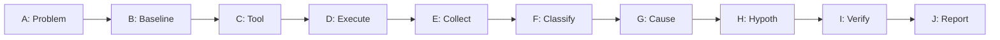

---
name: performance-profiling
description: Measures application performance and identifies evidence-based bottlenecks across CPU, memory, database queries, APIs, network activity, rendering, concurrency, and I/O. Use when investigating slow responses, high resource consumption, memory leaks, throughput limitations, frontend performance problems, or performance regressions, and when establishing or validating performance baselines. Measurement only; to implement fixes for identified bottlenecks, use performance-optimization.
---

# Performance Profiling Skill

This skill teaches the agent how to measure application performance, collect empirical data, isolate critical-path bottlenecks, establish baselines, and formulate evidence-based optimization hypotheses across full-stack architectures.

## 1. Purpose and Core Principles

Performance engineering is strictly empirical. Guesswork targets non-bottlenecks and adds complexity without improving capacity. Follow four principles:

- **Measure Before Diagnosing**: Never claim a component is slow without verifiable profiling traces, query plans, latency distributions, or memory graphs. Distinguish empirical measurements from analytical estimates.
- **Optimize the Critical Bottleneck (Amdahl's Law)**: Focus exclusively on the dominant cost on the critical path. Optimizing code accounting for 2% of total duration yields negligible total gain.
- **Preserve Correctness and Maintainability**: Never trade correctness or clean abstractions for unmeasured micro-optimizations. Fast code producing incorrect results is broken.
- **Honest and Verifiable Reporting**: Document workload characteristics, concurrency, datasets, runtime flags, and profiler overhead. Distinguish observed data from hypotheses.

*Scope Boundary*: Focuses strictly on measurement, diagnostic profiling, bottleneck isolation, and baselining. For applying optimizations, consult [performance-optimization.md](../../rules/performance-optimization.md) and [refactoring](../refactoring/SKILL.md); for functional bugs, use [debugging](../debugging/SKILL.md); for testing, use [testing-qa](../testing-qa/SKILL.md).

## 2. When to Use This Skill

### Trigger Scenarios
Activate this skill whenever:
- **Degraded Latency**: Elevated p95/p99 response times, request timeouts, or slow API transactions.
- **Resource Saturation**: Unexplained CPU spikes, high memory footprint, or disk I/O thrashing.
- **Suspected Memory Leaks**: Heap size steadily climbing across Garbage Collection (GC) cycles under sustained load.
- **Database Degradation**: Slow queries, table lock contention, connection pool starvation, or sequential scans.
- **Throughput & Concurrency Bottlenecks**: Throughput plateauing despite available CPU/RAM, thread starvation, or event loop stalls.
- **Frontend Stalls & CWV Regressions**: Poor Interaction to Next Paint (INP), Largest Contentful Paint (LCP), Cumulative Layout Shift (CLS), or main-thread jank.
- **Baseline Establishment**: Measuring reference performance profiles prior to major refactoring or upgrades.

### When NOT to Use
Do not use for functional debugging (use [debugging](../debugging/SKILL.md)), feature development (use [backend-development](../backend-development/SKILL.md) / [frontend-development](../frontend-development/SKILL.md)), or speculative micro-optimizations without prior profiling evidence.

## 3. Performance Investigation Workflow

Execute investigations systematically through ten structured phases:



- **Phase A (Problem Definition)**: Quantify symptom (e.g., checkout p99 latency rose from 180ms to 1200ms at 50 req/s); record payloads, concurrency, and dataset size.
- **Phase B (Baseline & Environment)**: Isolate environment, stop background tasks, log flags, and record idle baseline metrics.
- **Phase C (Tool Selection)**: Select low-overhead profilers (prefer statistical sampling over method interception).
- **Phase D (Workload Execution)**: Run warm-up cycles to prime JIT/caches; run sustained workloads across multiple GC cycles.
- **Phase E (Data Collection)**: Capture raw traces; compute percentiles (p50, p90, p95, p99) and standard deviation (reject mean alone).
- **Phase F (Bottleneck Isolation)**: Classify constraining resource (CPU, Memory, DB, Network, Concurrency, I/O) on the critical path.
- **Phase G (Root Cause on Hot Path)**: Trace hotspot to exact file, function, line, or query; identify mechanical root cause ($O(n^2)$ loops, missing indexes).
- **Phase H (Optimization Hypothesis)**: State falsifiable hypotheses; predict latency deltas using Amdahl's Law.
- **Phase I (Verification Plan)**: Define repeatable verification test with identical workload and thresholds.
- **Phase J (Profiling Report)**: Produce structured report (Section 20) and archive raw profiles.

## 4. CPU Profiling

CPU profiling determines whether threads spend cycles actively computing or waiting on external resources.

- **Sampling vs. Instrumentation**: Sampling inspects call stacks periodically (1-10ms) with low overhead (~1-3%), ideal for realistic workloads. Instrumentation hooks function entry/exit, imposing high overhead (15-100%+) and distorting hot loops. Use instrumentation only when exact call counts are required.
- **Interpreting Flame Graphs**: Width represents percentage of sample time; depth represents call stack depth. Wide tops ("plateaus") indicate high self-time; wide bodies with narrow children indicate high total-time wrappers.
- **Wall-Clock vs. CPU Time**: If Wall-Clock $\gg$ CPU time, threads are idle, waiting on I/O, database queries, network, or locks. If CPU time $\approx$ Wall-Clock, the routine is compute-bound.
- **Common CPU Hotspots**: Algorithmic complexity ($O(n^2)$ loops), repeated JSON/XML parsing in hot loops, regex backtracking, and dynamic reflection.

## 5. Memory Profiling and Leak Detection

Memory profiling separates normal generational allocation churn from pathological leaks and GC pauses.

- **Allocation Rate vs. Retained Heap**: High allocation rate (MB/s) triggers frequent minor GC pauses and tail-latency jitter even if heap size remains stable. Retained size is the memory freed if an object and its subgraph are collected.
- **Heap Snapshot Differencing**: Take snapshot $S_1$ after warm-up. Run workload loop $N$ times. Force GC. Take snapshot $S_2$. Filter objects allocated between $S_1$ and $S_2$ that survive GC to find retained dominators.
- **GC Overhead**: If GC pause time exceeds 5% of execution time or triggers frequent major/full stop-the-world collections, memory churn is degrading throughput.
- **Common Memory Leaks**: Unbounded maps lacking TTL/LRU eviction, forgotten event listeners on global emitters, detached DOM nodes in SPAs, and unclosed streams.

## 6. Database Performance Profiling

Database interactions represent the most common backend bottleneck. Inspect actual execution plans rather than query syntax.

- **EXPLAIN and EXPLAIN ANALYZE**:
  - *Sequential Scan (Seq Scan)*: Scans entire table page by page. Indicates missing/unused indexes or low-cardinality filters.
  - *Index Scan vs. Index Only Scan*: Index Only Scan satisfies query directly from index pages (covering index) without reading table heap pages.
  - *Estimated vs. Actual Rows*: Large divergence indicates stale table statistics or skewed data distribution; requires `ANALYZE`.
- **N+1 Query Antipatterns**: 1 query fetches parent rows, followed by $N$ repetitive child queries in a loop. Profiler reveals high query counts with identical templates. Resolve via batching, eager joins, or DataLoaders.
- **Index Health & Write Bloat**: Ensure composite indexes match query filter order (`WHERE tenant_id = ? AND status = ?`). Remove unused indexes to reduce write amplification and buffer cache bloat.
- **Connection Pools & Locks**: Monitor active vs. idle pool connections. Saturation forces requests to queue in memory before reaching the DB. Detect long transactions holding exclusive row/table locks.

## 7. API and Backend Latency Profiling

Deconstruct request latency: $\text{Latency} = T_{\text{network}} + T_{\text{routing}} + T_{\text{middleware}} + T_{\text{controller}} + T_{\text{database}} + T_{\text{downstream}} + T_{\text{serialization}}$.

- **Middleware Overhead**: Audit authentication, body-parsing, logging, and CORS middleware for synchronous blocking operations.
- **Event Loop & Thread Starvation**:
  - In single-threaded event loops (Node.js, Python asyncio), running synchronous CPU tasks (crypto, massive JSON parsing) stalls concurrent request handling.
  - In thread-pool runtimes (JVM, Go, .NET), worker thread exhaustion occurs when all threads block synchronously on slow external dependencies without timeouts.

## 8. Network and External-Service Profiling

When profiling distributed systems, network transit and downstream services frequently dominate end-to-end latency:

- **Transport Latency**: Inspect DNS resolution, TCP handshakes, and TLS negotiation. Ensure HTTP Keep-Alive and connection pooling are enabled to eliminate repeated handshakes.
- **Downstream Dependency Calls**: Measure individual downstream API call duration. Implement strict timeout budgets, circuit breakers, and exponential backoff with jitter to prevent cascading failures and retry storms.
- **Payload Bloat**: Eliminate large over-fetched payloads by requesting only necessary fields and enabling HTTP gzip/brotli compression.

## 9. Frontend Performance Profiling

Frontend profiling evaluates user-perceived responsiveness, rendering stability, and asset pipelines:

- **Core Web Vitals (CWV)**:
  - *LCP (Largest Contentful Paint $\le 2.5\text{s}$)*: Main content render time. Bottlenecks: slow TTFB, render-blocking resources, unoptimized images.
  - *INP (Interaction to Next Paint $\le 200\text{ms}$)*: Interaction responsiveness. Bottlenecks: main-thread long tasks, heavy event handlers.
  - *CLS (Cumulative Layout Shift $\le 0.1$)*: Visual stability. Bottlenecks: unsized media, dynamic DOM injections, font swaps.
- **Main Thread & Long Tasks**: Tasks $>50\text{ms}$ block the main thread, inducing input delay and animation jank. Eliminate layout thrashing (interleaving DOM reads and writes in loops).
- **Bundle Analysis**: Audit JavaScript bundles using source-map visualizers. Identify duplicate dependencies, non-treeshaken packages, and un-chunked routes.

## 10. Concurrency, Locking, and Throughput

Throughput profiling measures system capacity under load and exposes concurrency synchronization bottlenecks:

- **Lock Contention**: Threads competing for mutexes or synchronized blocks exhibit high lock wait times alongside depressed CPU utilization.
- **Worker Starvation & Queuing**: Tasks queuing up in thread pools or message brokers indicate arrival rates exceeding processing throughput.
- **The USE Method**: For each resource, measure:
  - *Utilization*: Percentage of time or capacity the resource is active.
  - *Saturation*: Degree to which extra work queues waiting for the resource.
  - *Errors*: Explicit error counts (e.g., dropped connections, socket resets).

## 11. File I/O, Serialization, and Miscellaneous Bottlenecks

- **Unbuffered Disk I/O**: Issuing frequent small reads/writes instead of buffered batching.
- **Synchronous File Operations**: Blocking request threads on synchronous file checks.
- **Serialization Overhead**: Monolithic serialization of nested graphs. Use streaming or binary serializers.
- **ORM Over-Fetching**: Executing `SELECT *` when few columns are needed, causing hydration and memory churn.

## 12. Benchmark Design and Measurement Quality

Rigorous measurement demands disciplined statistical controls:

- **Representative Workloads**: Use production-like data distributions, realistic concurrency, and queries.
- **Warm-Up Runs**: Discard initial test runs to allow JIT compilation, buffer pools, and caches to stabilize.
- **Percentiles Over Averages**: Arithmetic mean obscures tail latency. Always measure $p50$ (median), $p90$, $p95$, and $p99$ percentiles.
- **Isolate Environment**: Run benchmarks on dedicated hardware or isolated staging instances; avoid machines running competing background tasks.
- **Adequate Sample Size**: Collect sufficient iterations ($N \ge 1,000$ operations) to guarantee statistical confidence.

## 13. Profiling Tools and Technology Selection

Select vendor-neutral, low-overhead tools tailored to the technology stack:

| Layer / Runtime | Profilers & Tools | Diagnostic Focus |
| :--- | :--- | :--- |
| **Node.js / V8** | `node --prof`, clinic.js, DevTools | CPU flame graphs, event loop latency, heap snapshots |
| **Python** | `py-spy`, `cProfile`, `tracemalloc` | Sampling profiles, call trees, allocation tracking |
| **JVM (Java/Kotlin)** | Async-Profiler, JFR, VisualVM | Low-overhead sampling, GC pause analysis |
| **Go** | `pprof` (cpu, heap, mutex) | Built-in profiling, goroutines, lock contention |
| **.NET / C#** | `dotnet-trace`, `dotnet-gcdump` | Event tracing, allocation profiling, thread stalls |
| **PostgreSQL / MySQL**| `EXPLAIN (ANALYZE, BUFFERS)`, pg_stat_statements | Query plans, buffer hits, index usage, lock waits |
| **Browser Frontend** | DevTools Performance & Memory, Lighthouse | Core Web Vitals, long tasks, layout thrashing, DOM memory |
| **Linux OS / Kernel** | `perf`, `eBPF / bpftrace`, `htop` | Kernel vs user CPU, context switches, disk I/O |

## 14. Profiling Environments: Dev vs. Staging vs. Prod

- **Local Development**: Supports deep instrumentation, step-through profilers, and heap dumps. *Risk*: Fast local SSDs and mini-datasets mask production concurrency and query plan degradation.
- **Staging / Pre-Production**: Ideal for load testing, stress benchmarking, and full-volume database query plan analysis under controlled concurrency.
- **Production Systems**: Enforce low-overhead continuous sampling profilers (sampling rate $\le 1\%-2\%$). Never trigger stop-the-world full heap dumps or intrusive instrumentation on live customer traffic. Rely on distributed tracing, pool telemetry, and sampled slow query logs.

## 15. Profiling Data Security and Privacy

Profiling captures runtime memory and query parameters, introducing exposure risks:

- **Redact Sensitive Telemetry**: Strip passwords, tokens, and PII from database query logs and trace payloads before recording or sharing.
- **Quarantine Heap Snapshots**: Heap dumps contain decrypted in-memory secrets and session keys. Store them in access-restricted, encrypted locations with short auto-deletion lifecycles. Never commit dumps to source control.
- **Sanitize Network Captures**: Strip `Authorization`, `Cookie`, and secret headers from HAR traces and HTTP recordings.

## 16. From Profiling Evidence to Optimization

Transform diagnostic profiling evidence into safe engineering improvements:

1. **Verify Bottleneck Magnitude**: Ensure hotspot accounts for $\ge 20\%$ of total execution duration.
2. **Formulate Minimal Interventions**: Propose the simplest targeted change (e.g., adding a composite index rather than rewriting the database layer).
3. **Reject Premature Optimizations**: Leave minor routines (e.g., taking $<1\%$ of runtime) alone to preserve clean, maintainable code.
4. **Handoff to Implementation**: Once empirical evidence is documented, implement changes via [performance-optimization.md](../../rules/performance-optimization.md) and [refactoring](../refactoring/SKILL.md).

## 17. Regression Detection and Comparative Profiling

Verify optimizations and catch performance regressions through comparative analysis:

- **Differential Flame Graphs (Diffs)**: Compare before and after flame graphs (Red = increased time, Blue = decreased time) to confirm target routine shrunk without regressing siblings.
- **Baseline Metric Comparison**: Compare $p50$, $p95$, and $p99$ response times, throughput (req/s), memory allocation rate, and query counts under identical workloads.
- **Verify Causation**: Ensure measured improvements stem directly from the code change and not from cached data, warm caches, or transient network conditions.

## 18. Performance Investigation Decision Guide

| Symptom | Suspect | Tool | Investigation Steps |
| :--- | :--- | :--- | :--- |
| **High CPU under low load** | Algorithmic Complexity | Sampling CPU profiler, Flame graph | Find top self-time frames for $O(n^2)$ loops, regex backtrack, or serialization. |
| **High latency, idle CPU** | Database / Network / Locks | Distributed tracing, thread dump | Check thread states (BLOCKED/WAITING); check slow query logs and external HTTP calls. |
| **Steady memory growth** | Memory Leak | Multi-snapshot heap comparison | Force GC; diff heap snapshots; trace dominators to GC roots for leaks. |
| **Latency spikes & jitter** | GC Pauses / Lock Contention | GC logging, mutex profiler | Measure GC pause duration; check allocation rate (MB/s); inspect lock wait times. |
| **High p99, normal p50** | Queueing / Head-of-Line | Latency histogram, pool telemetry | Check connection pool saturation, worker queue depth, or event-loop stalls. |
| **Slow database queries** | Missing Indexes / Bad Plan | `EXPLAIN (ANALYZE, BUFFERS)` | Look for `Seq Scan` on large tables; verify composite index order; detect N+1 queries. |
| **Frontend UI input lag** | Main Thread Blocking | Browser DevTools Performance panel | Identify Long Tasks (>50ms); audit layout thrashing and heavy handlers. |
| **Slow initial page load** | Network / Bundle Bloat | Lighthouse, Web Vitals, Bundle analyzer| Inspect LCP element; audit render-blocking scripts; check compression and bundle sizes. |

## 19. Risk Management and Change Safety

- **Manage Observer Overhead**: Intrusive profiling can degrade live system capacity. Use sampling profilers and throttle trace collection rates.
- **Prevent Heap Dump Freezes**: Dumping large heaps ($>8\text{GB}$) causes severe process pauses. Route traffic away before memory dumping.
- **Prevent Disk Exhaustion**: Enforce strict size limits and retention policies on trace logs and profile dumps.
- **Ensure Clean Teardown**: Deactivate profilers, debug flags, and verbose loggers immediately upon test completion.

## 20. Expected Profiling Report Format

Every profiling investigation must produce a structured diagnostic report following this format:

```markdown
# Performance Profiling Report: [Component or Endpoint Name]

## 1. Executive Summary
- **Primary Finding**: [1-2 sentence statement of isolated bottleneck]
- **Measured Impact**: [Current latency/throughput vs. baseline target]
- **Recommended Remediation**: [Summary of proposed solution]

## 2. System and Workload Context
- **Environment**: [e.g., Staging, Node.js 20.x, PostgreSQL 16, 4 vCPU, 16GB RAM]
- **Workload Parameters**: [e.g., 50 concurrent virtual users, 250 req/sec, 150,000 DB rows]
- **Profiling Tools Used**: [e.g., clinic.js flame, pg_stat_statements, Chrome DevTools]

## 3. Baseline vs. Current Measurements
| Metric | Baseline | Current | Delta | Target |
| :--- | :--- | :--- | :--- | :--- |
| Latency p50 | 45ms | 52ms | +7ms (+15%) | < 50ms |
| Latency p95 | 110ms | 480ms | +370ms (+336%) | < 150ms |
| Throughput | 450 req/s | 180 req/s | -270 req/s (-60%)| > 400 req/s |

## 4. Bottleneck Analysis and Classification
- **Resource Classification**: [CPU | Memory | Database | Network | Concurrency | I/O]
- **Critical Path Breakdown**: [Sequence of operations accounting for elapsed duration]

## 5. Root Cause and Empirical Evidence
- **Exact Code Location**: `src/services/order.service.ts:142` (`processOrderBatch`)
- **Diagnostic Evidence**:
  - EXPLAIN ANALYZE showing sequential scan on `orders` (145,000 rows).
  - CPU Flame graph showing 68% of thread time in `JSON.parse` of nested items.

## 6. Recommended Interventions
1. **Primary Intervention**: [e.g., Add composite index `idx_orders_customer_status` on `orders(customer_id, status)`]
2. **Secondary Intervention**: [e.g., Stream order item deserialization using SAX parser]
3. **Predicted Improvement**: [e.g., Estimated reduction in p95 latency from 480ms to ~85ms]

## 7. Verification and Regression Plan
- **Verification Workload**: Exact script to re-run (`scripts/perf/load-test-checkout.js`).
- **Success Criteria**: p95 latency $< 150\text{ms}$ at 250 req/sec without memory regression.
```

## 21. Alignment with Existing Rules and Skills

This skill operates in conjunction with repository governance rules and development skills:
- **Governance Rules**:
  - Conforms to [performance-optimization.md](../../rules/performance-optimization.md) for caching, query optimization, and latency standards.
  - Adheres to [change-safety.md](../../rules/change-safety.md) through non-destructive profiling and baseline verification.
  - Follows [core-workflow.md](../../rules/core-workflow.md) by inspecting, planning, and verifying before modifying code.
- **Related Skills**:
  - [debugging](../debugging/SKILL.md): Defer functional defect investigations lacking performance timing issues.
  - [testing-qa](../testing-qa/SKILL.md): Coordinate automated benchmark suites and regression test verification.
  - [refactoring](../refactoring/SKILL.md): Restructure bottlenecks once profiling diagnoses the root cause.
  - [database-design](../database-design/SKILL.md): Review schema indexing and normalization when query bottlenecks emerge.
  - [logging-monitoring](../logging-monitoring/SKILL.md): Ingest APM telemetry and distributed traces as initial profiling inputs.

## 22. Final Validation Checklist

Before concluding any performance profiling investigation, verify all 10 criteria:

- [ ] **1. Quantitative Problem Definition**: Symptom is quantified with concrete metrics (latency percentiles, throughput, memory).
- [ ] **2. Controlled Environment**: Host environment variables, runtime flags, and background processes were isolated and documented.
- [ ] **3. Low-Overhead Tooling**: Selected profiler introduced minimal observer-effect overhead during measurement.
- [ ] **4. Representative Workload**: Benchmark replicated authentic user patterns, concurrency, and production-scale data volumes.
- [ ] **5. Statistical Percentiles Captured**: Latency distributions were evaluated using p50, p90, p95, and p99 percentiles instead of means alone.
- [ ] **6. Critical Path Isolated**: Bottleneck was confirmed to reside directly on the critical execution path (Amdahl's Law).
- [ ] **7. Concrete Code Mapping**: Hotspots were traced to exact file paths, line numbers, queries, or architectural modules.
- [ ] **8. Security & Privacy Protected**: Traces, memory dumps, and query logs were sanitized of credentials, tokens, and PII.
- [ ] **9. Actionable Hypotheses Formulated**: Recommendations propose minimal targeted interventions with predicted performance deltas.
- [ ] **10. Verification Plan Defined**: An identical, repeatable verification benchmark was established to validate post-optimization performance.
