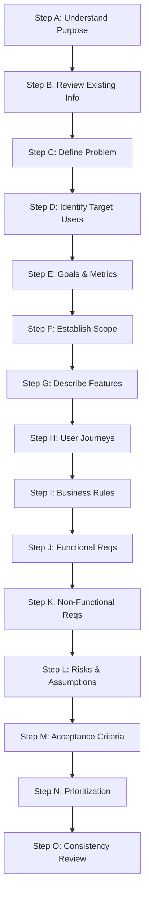

---
name: prd-writing
description: Creates, structures, reviews, and updates Product Requirements Documents for new software products, existing applications, and major features. Use when product goals, target users, scope, user journeys, business value, product requirements, success metrics, and product acceptance criteria need to be documented.
---

# Product Requirements Document (PRD) Writing Skill

This skill guides the AI coding agent to author, structure, review, and maintain production-quality Product Requirements Documents (PRDs). It ensures that software products and major features are defined with crisp problem statements, validated user personas, explicit scope boundaries, unambiguous business rules, verifiable acceptance criteria, and measurable success metrics.

## 1. Purpose and Scope

A Product Requirements Document (PRD) defines the *what* and *why* of a product or feature before engineering teams design the *how*. This skill ensures the PRD answers essential product questions:

- **What product or feature is being built?** A clear, unambiguous definition of the product vision.
- **What problem does it solve?** The core user pain points, workflow bottlenecks, and unmet market needs.
- **Who are the intended users?** The specific user roles, personas, permissions, and operational contexts.
- **Why is it valuable?** The strategic benefits, user value propositions, and organizational goals.
- **What should users be able to accomplish?** Key user journeys, functional capabilities, and task outcomes.
- **What belongs within scope?** Distinct boundaries separating in-scope commitments, explicit exclusions, and future considerations.
- **What business rules govern behavior?** Policies, calculations, status transitions, approval limits, and access controls.
- **How will product success be evaluated?** Empirically measurable outcome indicators and key results.
- **What constraints, assumptions, and risks influence delivery?** Technical boundaries, external service dependencies, and mitigation strategies.
- **What must be clarified or approved?** Open questions, pending stakeholder decisions, and pre-implementation gates.

*Scope Boundary*: This skill focuses strictly on product vision, user requirements, feature scope, business logic, and acceptance criteria. It does not replace technical Software Requirements Specifications (SRS), software architecture diagrams, physical database schemas, or low-level implementation roadmaps.

## 2. When to Use This Skill

### Trigger Conditions

Activate this skill when:
- **Authoring a New Product PRD**: Defining the initial product baseline for a greenfield application.
- **Documenting a Major Feature or Subsystem**: Specifying substantial capabilities that alter user workflows or business rules.
- **Translating Analyzed Requirements into a Formal PRD**: Synthesizing raw requirements analysis into a structured, stakeholder-ready document.
- **Revising Product Scope**: Updating the PRD to reflect verified requirement changes, descaled features, or expanded roadmaps.
- **Reviewing Existing PRDs**: Evaluating product documents for internal consistency, testability, missing edge cases, and scope creep.
- **Preparing for Stakeholder Approval**: Establishing an authoritative specification prior to technical design and engineering estimation.

### When NOT to Use This Skill

Do not invoke this skill for:
- Routine bug fixes or minor patch releases.
- Code-level refactoring tasks that preserve identical user behavior.
- Purely technical infrastructure, DevOps scripts, or CI/CD updates.
- Small enhancements where existing tickets or inline user stories provide sufficient context.

## 3. PRD Authoring Workflow

Follow this fifteen-step procedure to analyze, compose, and refine a PRD:

### Step A: Understand the Purpose

1. **Clarify the Core Intent**: Identify the specific product, subsystem, or feature being proposed.
2. **Review Upstream Discoveries**: Inspect existing outputs from [requirements-analysis](../requirements-analysis/SKILL.md) to avoid repetitive elicitation.
3. **Resist Implementation Prescriptions**: Focus purely on user needs and business capabilities; avoid dictating specific frameworks, database engines, or code patterns.
4. **Separate Confirmed from Proposed**: Clearly distinguish verified client instructions from agent suggestions.

### Step B: Review Existing Information

- Audit repository documentation (`docs/product/`, `docs/requirements/`, `docs/planning/`).
- Review active user stories, customer briefs, existing application behavior, and issue trackers.
- Identify discrepancies between existing product behavior and proposed requirements.
- **Zero Hallucination Standard**: Never invent fictitious user quotes, market research figures, competitor metrics, or commercial projections. If data is absent, document it as an information gap.

### Step C: Define the Problem Statement

- **The Problem**: Describe the specific operational bottleneck, user frustration, or manual inefficiency.
- **Affected Audience**: State clearly who experiences the problem and under what conditions.
- **Cost of Inaction**: Explain why solving this problem matters now and the consequences of leaving it unresolved.
- **Outcome Objective**: Describe what the future state looks like once the problem is resolved.
- *Rule*: Distinguish the underlying problem from the proposed solution. Do not mistake a feature request for the underlying user need.

### Step D: Identify Target Users

- Define primary, secondary, and administrative user groups.
- Document user roles, operational contexts, technical familiarity, and primary motivations.
- Highlight permission boundaries and workflow differences across distinct roles.
- Use role summaries rather than fictionalized demographic biographies; focus on behavioral goals and capabilities.

### Step E: Define Product Goals and Success Criteria

- **Product Goals**: State 2–4 qualitative goals that reflect user value and operational success.
- **Success Metrics (KPIs / OKRs)**: Define observable, verifiable metrics (e.g., task completion rates, error reduction percentages).
- **Provisional Targets**: Label unverified metric targets as `[Proposed Target]` until validated by project stakeholders.
- Avoid vague metrics (e.g., "Make users happy"); require empirical indicators.

### Step F: Establish Product Scope

Explicitly categorize features to prevent scope creep:
- **In-Scope**: Capabilities committed for the current product release.
- **Out-of-Scope**: Functionality intentionally excluded from the current initiative.
- **Future Considerations**: Candidate ideas deferred to future iterations without active delivery commitment.
- **Constraints**: Fixed business, regulatory, platform, or timeline boundaries.
- **Dependencies**: Prerequisites relying on third-party services, external approvals, or partner teams.

### Step G: Describe Product Features

For every meaningful feature, specify:
- **Feature Identifier & Name**: Stable key (e.g., `FEAT-CATALOG-01`).
- **User Problem Solved**: The direct link back to user pain points.
- **Target Role**: Primary beneficiary or actor.
- **Expected User-Facing Behavior**: What the user sees, interacts with, and experiences.
- **Dependencies**: Required upstream capabilities or external APIs.
- **Feature Priority**: Criticality ranking (Must/Should/Could).

### Step H: Define User Journeys and Workflows

- Map the end-to-end journey from initial user trigger to final state.
- Include the standard happy path, common alternative flows, and validation/error paths.
- Specify how the system communicates progress, asynchronous state changes, and confirmation.
- Format features as user stories where beneficial:
  > *As a* `[user role]`, *I want to* `[perform an action]`, *so that* `[achieve user value]`.

### Step I: Document Business Rules

Detail the fundamental domain rules that govern operations:
- Eligibility rules, role-based permissions, and data visibility restrictions.
- Calculation formulas, tax/fee derivations, and currency handling.
- Finite state machine transitions (e.g., `Draft` -> `Submitted` -> `Approved` / `Rejected`).
- Thresholds, quotas, retry limits, and operational deadlines.
- *Integrity Rule*: Never invent domain-specific formulas or regulatory rules without explicit confirmation.

### Step J: Define Functional Requirements

- Enumerate specific capabilities the product must exhibit.
- Use precise, unambiguous language: avoid vague modifiers like "user-friendly" or "efficient".
- Link each requirement to its parent feature, user journey, and acceptance criteria.
- Use stable identifiers (e.g., `PRD-FR-01`) for clear downstream traceability.

### Step K: Define Product-Level Non-Functional Expectations

Describe operational quality expectations in product-facing terms:
- **Usability & UX**: Discoverability, navigation conventions, and feedback consistency.
- **Accessibility**: Compliance standards (WCAG 2.2 AA, keyboard operability, screen reader support; reference [accessibility.md](../../rules/accessibility.md)).
- **Security & Privacy**: Authentication expectations, data isolation, GDPR/PII handling, and audit logging (reference [security.md](../../rules/security.md)).
- **Performance**: User-perceived latency boundaries (e.g., search results display in < 300ms; reference [performance-optimization.md](../../rules/performance-optimization.md)).
- **Reliability & Recovery**: Graceful error degradation, offline handling, and data preservation during unexpected disruptions.

### Step L: Capture Constraints, Assumptions, Risks, and Dependencies

- **Confirmed Constraints**: Non-negotiable technical, legal, or commercial boundaries.
- **Documented Assumptions**: Working assumptions adopted to sustain progress; highlighted for review.
- **Identified Risks**: Operational, user adoption, and integration risks paired with mitigation plans.
- **External Dependencies**: Third-party APIs, vendor relationships, and shared platform services.

### Step M: Define Acceptance Criteria

For every significant requirement, define observable conditions for verification:
- State exact preconditions, user actions, and expected system outcomes.
- Include boundary values, permission checks, and failure recovery scenarios.
- Use Given-When-Then criteria where appropriate:
  > **Given** `[user state and context]`,  
  > **When** `[user initiates an action]`,  
  > **Then** `[expected observable response and state update]`.

### Step N: Prioritize Product Requirements

- Prioritize using the MoSCoW framework:
  - **Must-Have**: Core baseline for the Minimum Viable Product (MVP).
  - **Should-Have**: High-impact features that can be worked around if necessary.
  - **Could-Have**: Desirable additions included only if capacity allows.
  - **Won't-Have**: Explicitly deferred items for later releases.
- Explain prioritization rationale based on user value, technical risk, and foundational dependencies.

### Step O: Review PRD Consistency and Quality

Perform a rigorous quality audit before publication:
- Verify that features directly address the stated problem statement.
- Check that in-scope capabilities do not conflict with stated exclusions.
- Ensure all user roles have complete journeys covering error and empty states.
- Confirm that non-functional expectations are realistic and verifiable.
- Mark all unconfirmed elements as `[Draft - Pending Approval]`.

## 4. Standard PRD Document Structure

When authoring a formal PRD, structure the document using the following comprehensive layout:

---

# Product Requirements Document: [Product or Feature Title]

## 1. Document Control & Metadata
- **Status**: `[Draft / In Review / Approved / Superseded]`
- **Version**: `1.0.0`
- **Last Updated**: `YYYY-MM-DD`
- **Product Owner / Author**: `[Name or Team]`
- **Target Release**: `[Release Milestone / MVP]`

## 2. Executive Summary
A concise narrative summarizing the product vision, core audience, problem solved, and expected business outcome.

## 3. Problem Statement & Opportunity
- **The Core Problem**: Detailed description of the user friction or market gap.
- **Impacted Users**: Who experiences the pain and current workarounds.
- **Value Proposition**: Why solving this problem provides strategic advantage.

## 4. Product Vision, Goals & Success Metrics
- **Strategic Goals**: 2–4 qualitative goals.
- **Success Metrics Table**:

| Goal | Success Metric | Baseline (if known) | Target | Measurement Method |
|---|---|---|---|---|
| Streamline checkout | Checkout completion rate | Unknown | > 85% [Proposed] | Analytics funnel |
| Mobile access | Mobile bounce rate | 60% | < 35% [Proposed] | Web analytics |

## 5. Target Users & Personas
- **Primary Persona**: `[Role Name]` - Goals, technical proficiency, key pain points.
- **Secondary Persona**: `[Role Name]` - Operational responsibilities and administrative needs.

## 6. Scope Boundaries
- **In-Scope (Release 1.0)**:
  - Itemized committed capabilities.
- **Explicitly Out-of-Scope**:
  - Itemized deferred or excluded features.
- **Future Roadmap Considerations**:
  - Plausible post-1.0 enhancements.

## 7. User Journeys & Core Workflows
- **Workflow 1: [Workflow Title]**:
  1. User navigates to...
  2. System prompts for...
  3. User submits...
  4. System validates and displays...
  - *Edge Cases & Alternative Paths*: Handling validation failures, network disconnects, or permission limits.

## 8. Functional Requirements Table

| Req ID | Feature Category | Description | User Role | Priority |
|---|---|---|---|---|
| PRD-FR-01 | Catalog Browsing | User can filter books by genre, author, and price | Shopper | Must |
| PRD-FR-02 | Inventory Alert | Admin receives email alert when stock falls below 5 | Admin | Should |

## 9. Business Rules
- **BR-01**: Only verified users with active accounts can submit book reviews.
- **BR-02**: Orders exceeding $50 automatically qualify for free shipping.

## 10. Non-Functional Expectations
- **Accessibility**: WCAG 2.2 AA conformance; 100% keyboard navigability.
- **Performance**: Search query response rendered within 300ms.
- **Security & Privacy**: User passwords hashed using argon2id; PII masked in UI.
- **Reliability**: Graceful offline notifications with local draft retention.

## 11. Acceptance Criteria Table

| Req ID | Acceptance Criteria (Given-When-Then) | Verification Approach |
|---|---|---|
| PRD-FR-01 | Given a catalog of 100 books, When user filters by "Fiction", Then only fiction books are displayed | Automated E2E Test |

## 12. Prioritization & Release Phasing
- **Phase 1 (MVP)**: Must-Have core workflow.
- **Phase 2 (Enhancement)**: Should-Have automations and notifications.

## 13. Constraints, Assumptions & Dependencies
- **Constraints**: Platform must be responsive across modern mobile and desktop browsers.
- **Assumptions**: Users have access to modern email clients for email verification.
- **Dependencies**: Stripe API for payment processing; SendGrid for transactional emails.

## 14. Risks & Open Questions
- **Risk 1**: External payment gateway latency -> *Mitigation*: Asynchronous webhook processing.
- **Open Question 1**: Should guest users be allowed to purchase books without registering?

## 15. Related Documentation Links
- Requirements Analysis: `docs/requirements/requirements-analysis.md`
- Project Plan: `docs/planning/project-plan.md`

---

## 5. Formatting and Writing Standards

- **Precision Over Ambiguity**: Write unambiguous, active-voice statements ("The system displays...", "The user selects...").
- **Visual Structure**: Utilize tables for requirements, metrics, and acceptance criteria; use numbered lists for sequential workflows.
- **Traceable Identifiers**: Maintain stable IDs (`PRD-FR-XX`, `BR-XX`) across versions so downstream technical designs can link directly to requirements.
- **Fact-Assumption Delineation**: Never state unverified assumptions as facts. Always tag unverified targets as `[Proposed]`.
- **Audience Accessibility**: Ensure the PRD is readable by non-technical stakeholders while remaining rigorous enough for software engineers and QA teams.

## 6. PRD Maintenance and Change Management

When updating an existing PRD:
- **Inspect Prior Versions**: Review current document history and preserve approved decisions.
- **Targeted Diffs**: Modify only the affected sections; do not rewrite unrelated features.
- **Impact Assessment**: Evaluate how a feature change affects scope, dependencies, acceptance criteria, and technical architecture.
- **Revision Tracking**: Increment version numbers (`1.0.0` -> `1.1.0` for features, `1.0.1` for minor clarifications) and record notes in Document Control.
- **Never Overwrite Silently**: Highlight modified requirements so downstream engineering and QA teams can adjust plans accordingly.

## 7. Storage and Template Conventions

- **Template Source**: Inspect `.agents/templates/prd/` before authoring to reuse established project templates.
- **Persistent Location**: Store persistent PRD artifacts in `docs/product/` (e.g., `docs/product/PRD.md` or `docs/product/features/<feature-name>-prd.md`).
- **Never Store PRDs in Skills Directory**: Never place project-specific PRDs into `.agents/skills/prd-writing/`.
- **Pre-Approval Labeling**: Mark documents as `[Draft - Proposed]` until explicitly authorized by the project stakeholder.

## 8. Interaction and Decision-Making Principles

1. **Context-First Inquiry**: Check existing requirements and code before asking questions.
2. **High-Impact Questions Only**: Inquire only when missing information blocks core business logic, user safety, or scope definition.
3. **Drafting Autonomy**: Use sensible, clearly marked assumptions to draft the PRD rather than stalling for non-blocking details.
4. **No Implementation Authorization**: Writing or updating a PRD does not constitute approval to begin immediate code implementation.
5. **Stakeholder Alignment**: Explicit user approval is required before marking a PRD as `Approved`.

## 9. Rule Harmony and Skill Collaboration

This PRD writing skill operates in close concert with adjacent engineering rules and skills:

- [requirements-analysis](../requirements-analysis/SKILL.md): Performs foundational problem discovery and ambiguity resolution before PRD drafting.
- [project-planning](../project-planning/SKILL.md): Converts approved PRD requirements into sequenced phases, milestones, and implementation tasks.
- [documentation.md](../../rules/documentation.md): Governs document versioning, formatting, and file organization.
- [change-safety.md](../../rules/change-safety.md): Ensures PRD modifications do not cause uncontrolled scope creep.
- [security.md](../../rules/security.md): Informs product-level security and privacy requirements.
- [accessibility.md](../../rules/accessibility.md): Defines product accessibility baselines (WCAG 2.2 AA).
- [performance-optimization.md](../../rules/performance-optimization.md): Sets user-perceived performance expectations.

*Downstream Skills*: Provides the authoritative product basis for `srs-writing`, `architecture-design`, and `database-design`.
