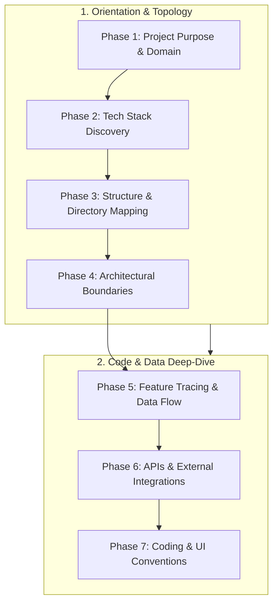
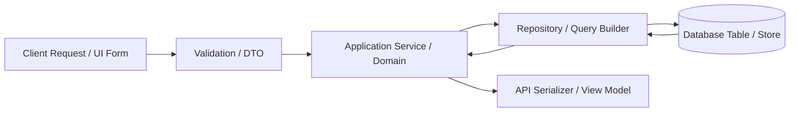

---
name: project-context-analysis
description: Analyzes an existing software project to understand its purpose, technology stack, structure, modules, dependencies, business logic, data flows, conventions, and constraints before making changes. Use when entering an unfamiliar codebase, preparing to implement a feature, locating existing functionality, investigating system behavior, assessing cross-module impacts, or building a context-aware implementation plan.
---

# Project Context Analysis Skill

This skill guides the AI coding agent to systematically discover, inspect, and synthesize relevant project context before implementing features, modifying code, debugging defects, reviewing architecture, or proposing substantial modifications.

## 1. Purpose, Core Principles, and Context Mindset

Safe software modification requires grounded understanding. Rushing into code changes based solely on user prompts without inspecting existing repository context leads to duplicated logic, broken contracts, conflicting patterns, and regressions. Adhere to five foundational principles:

- **Understand Before Implementing**: Clarify the business domain, existing components, data flows, and design conventions before deciding how to change code. Never guess when the repository contains authoritative evidence.
- **Gather Context Proportionately**: Calibrate investigation depth strictly to the task's blast radius. Avoid exhaustive whole-repository scans for localized fixes, but avoid superficial single-file edits when cross-module boundaries are affected.
- **Evidence Over Assumptions**: Distinguish verified facts from inferences, outdated documentation, and unverified assumptions. Reconcile conflicting sources by giving precedence to active implementation and passing tests over stale comments.
- **Preserve Established Context & Maximize Reuse**: Build upon existing services, components, utilities, and conventions. Never introduce competing libraries, redundant helper functions, or contradictory patterns without explicit architectural justification.
- **Read-Only Context Discovery**: Context gathering is strictly read-only. Never modify application files, alter configuration, run destructive database commands, or rewrite Git history to inspect system behavior.

*Scope Boundary*: Focuses on codebase investigation, context discovery, and context-aware implementation planning. For high-level project roadmaps, use [project-planning](../project-planning/SKILL.md); for requirements elicitation, use [requirements-analysis](../requirements-analysis/SKILL.md); for structural health audits, use [architecture-review](../architecture-review/SKILL.md); for bug root causes, use [debugging](../debugging/SKILL.md).

## 2. Context Gathering Depth Framework (6 Task Tiers)

Calibrate investigation depth to prevent under-investigation and wasteful repository scanning:

| Task Tier | Operational Scope | Required Context Depth | Primary Artifacts Inspected |
| :--- | :--- | :--- | :--- |
| **Tier 1: Localized Fix** | Single-line fix, copy update, typo, minor CSS adjustment. | *Targeted File Scope*: Inspect immediate file, enclosing component, and direct style rules. | Target file, immediate test file. |
| **Tier 2: Feature Modification** | Updating validation, modifying an existing report, altering route response. | *Feature Perimeter Scope*: Inspect handler, service layer, input validation, DTOs, and related tests. | Route handler, controller, service, schema, unit tests. |
| **Tier 3: New Feature in System** | Adding a new view, API endpoint, or data-backed entity within existing stack. | *Subsystem Scope*: Inspect routing, component library, data models, migrations, auth guards, and conventions. | Routes, ORM models, migrations, shared UI components, API contracts. |
| **Tier 4: Cross-Module Feature** | Shared notifications, multi-tenant billing, cross-domain workflows. | *Integration Scope*: Map inter-module communication, message queues, shared transactions, and permission models. | Module boundaries, event publishers/consumers, shared DB tables, RBAC rules. |
| **Tier 5: Architecture / Infra Shift** | Upgrading major runtime, replacing database, rewriting auth flow. | *Systemic Scope*: Inspect deployment manifests, CI/CD pipelines, backward compatibility, and recovery runbooks. | Dockerfiles, IaC, migration history, environment schemas, APM configs. |
| **Tier 6: Codebase Onboarding** | Entering an unfamiliar repository; orientation and topology assessment. | *Bird's-Eye Scope*: Map entry points, high-level directory layout, technology stack, and core user journeys. | `README.md`, package manifests, entry points, architecture docs, core routes. |

## 3. Systematic 7-Phase Context Discovery Workflow

Execute this structured discovery sequence to establish reliable context:



- **Phase 1: Understand Project Purpose & Business Domain**: Inspect `README.md`, product specs, domain models, and UI workflows. Identify the primary users, business capabilities, core entities, and essential workflows without guessing business rules from names alone.
- **Phase 2: Discover Actual Technology Stack**: Inspect package manifests (`package.json`, `Cargo.toml`, `pyproject.toml`), lockfiles, runtime configs (`.nvmrc`, `Dockerfile`), and build scripts. Differentiate declared dependencies from actively utilized libraries.
- **Phase 3: Map Project Structure & Layout**: Identify entry points (`index.ts`, `server.ts`, `main.go`), route directories, application services, domain models, persistence layers, shared utilities, and test suites. Locate generated files that must not be edited.
- **Phase 4: Identify Architectural Boundaries**: Trace inward dependency flow, separation of concerns (presentation vs. domain vs. persistence), synchronous vs. asynchronous processing, and trust boundaries.
- **Phase 5: Trace Existing Functionality & Data Flow**: Follow end-to-end execution paths from user input/HTTP request through validation, domain orchestration, and persistence queries to response formatting.
- **Phase 6: Understand APIs & External Integrations**: Audit internal API contracts, external third-party SDK clients, webhook handlers, timeout/retry policies, and authentication headers.
- **Phase 7: Discover Coding & UI Conventions**: Inspect established naming patterns, state management, error handling idioms, component hierarchies, form handling, and styling strategies.

## 4. Epistemic Confidence Model and Source Reconciliation

Categorize all context findings into five confidence states:

```
[Verified (Code/Tests)] > [Strongly Supported (Multiple Docs)] > [Inferred (Pattern)] > [Unknown] / [Conflicting]
```

- **Verified**: Directly corroborated by inspected source code, configuration schemas, or passing automated tests.
- **Strongly Supported**: Corroborated by multiple consistent configuration files and architectural specifications, but lacking runtime validation.
- **Inferred**: A reasonable engineering deduction based on standard framework conventions and nearby code patterns.
- **Unknown**: Critical context is absent from the repository; requires safe targeted discovery or explicit user clarification.
- **Conflicting**: Documentation contradicts implementation, or two modules implement divergent patterns.

### Source Reconciliation Hierarchy
When sources disagree, apply this strict precedence order:
$$\text{Active Implementation (Code/Queries)} \ge \text{Automated Test Assertions} > \text{Runtime Config} > \text{Recent ADRs} > \text{Comments/Documentation}$$
*Rule*: Never trust an outdated comment or stale `README.md` claim over active, compiling source code. If discrepancies create functional uncertainty, state the conflict explicitly.

## 5. Maximizing Reuse and Checking Existing Work

Prevent code duplication and architectural fragmentation before writing new code:

- **Search Existing Abstractions**: Search the codebase for existing helper functions, UI components, date/currency formatters, validation utilities, or API clients with the same intended purpose.
- **Examine Component Completeness**: Determine whether an existing component is complete, partially implemented, deprecated, or intentionally restricted to a specific domain.
- **Extend Rather Than Duplicate**: Prefer parameterizing or cleanly extending an existing service over introducing a parallel service with $90\%$ overlapping logic.
- **Detect Hidden Consumers**: Check for dynamic imports, framework reflection, event listeners, or route decorators before assuming an existing utility is unused.

## 6. Tracing Data Flow, State, and Persistence

For any task touching stored data, trace the full persistence lifecycle:



- **Data Ownership**: Identify which domain service or module owns the target database table or collection. Unrelated features must interact via the owner's public API rather than direct foreign SQL joins.
- **Transaction Boundaries**: Identify where ACID transactions begin and commit. Ensure multi-table mutations are wrapped in transactional boundaries.
- **Validation Consistency**: Ensure incoming data is validated against schema constraints at the application ingress layer before reaching database drivers.
- **Migration Synchronization**: Inspect migration history to verify column nullability, foreign key constraints, default values, and index definitions before proposing schema changes.

## 7. Security, Privacy, and Sensitive Information Safeguards

Maintain strict confidentiality during codebase exploration:

- **Zero Secret Exposure**: Never display plaintext passwords, private API keys, JWT secrets, or connection strings in analysis summaries or chat output. Refer to secrets by environment variable name (`STRIPE_SECRET_KEY`) or redacted fingerprint.
- **Inspect Schemas, Not Values**: Inspect `.env.example` templates, configuration schemas, and validation structs to understand required settings without dumping actual `.env` secrets.
- **Respect Trust Boundaries**: Distinguish trusted server-side execution from untrusted client-side inputs. Verify that authentication and authorization checks occur server-side.
- **Privacy Compliance**: Ensure sensitive user PII (names, emails, payment data) is identified and handled according to project data protection conventions.

## 8. Git State, Workspace Inspection, and User Work Preservation

Always inspect version control state prior to planning changes:

- **Check Working Tree**: Run `git status --short` to inspect modified, staged, untracked, or conflicted files.
- **Preserve User Changes**: Never discard, overwrite, stash, or reset uncommitted user modifications.
- **Identify Active Branch**: Confirm the active branch name to understand feature context and avoid working on stale or detached heads.
- **Strict Read-Only Discovery**: Never execute `git checkout`, `git reset`, `git clean`, or `git commit` as part of context discovery.

## 9. Context-Aware Implementation Planning (14-Step Protocol)

Once context is gathered, structure the implementation plan using this rigorous sequence:

1. **Restate User Goal**: Define the requested functional capability in implementation-specific terms.
2. **Identify Target Modules**: Specify the exact directories, modules, and layers where changes will reside.
3. **Identify Reusable Assets**: List existing services, components, utilities, and queries to reuse.
4. **Define Minimal Change Scope**: Establish the smallest viable modification that satisfies all requirements.
5. **Enumerate Affected Files**: List files to create, modify, or delete with specific path references.
6. **Map API & Schema Impacts**: Detail required schema migrations, endpoint additions, or contract updates.
7. **Trace Boundary Contracts**: Ensure modified interfaces preserve backward compatibility for consuming modules.
8. **Analyze Security & Authorization**: Define required role guards, session checks, and input sanitization.
9. **Identify Edge Cases & Failure Modes**: Detail error states, network timeouts, invalid inputs, and nullability.
10. **Plan Automated Verification**: Define unit, integration, and E2E test cases required to validate changes.
11. **Assess Rollback & Migration Safety**: Confirm that database changes follow expand-and-contract zero-downtime rules.
12. **Separate Necessary from Optional**: Distinguish mandatory feature tasks from optional opportunistic improvements.
13. **Document Assumptions & Gaps**: Clearly state any unverified assumptions and their risk mitigations.
14. **Formulate Verification Commands**: Specify exact non-destructive build, lint, and test commands to run.

## 10. Context Analysis Anti-Patterns to Avoid

Avoid these frequent context-engineering failure modes:

- ❌ **The Whole-Repo Dump**: Reading dozens of unrelated files or dumping the entire database schema for a single UI bug fix.
- ❌ **Tunnel Vision**: Modifying a function without checking its callers, causing cascading runtime failures across unrelated modules.
- ❌ **The Cargo-Cult Re-Implementation**: Writing a custom date formatter, modal dialog, or API client when the project already has an established utility.
- ❌ **Blind Copy-Pasting**: Duplicating a nearby component without realizing it contains legacy workarounds or anti-patterns.
- ❌ **Folder Name Dogma**: Assuming a directory named `controllers` or `utils` behaves strictly according to generic textbook definitions without inspecting the code.
- ❌ **Ignoring Git Status**: Proposing edits to files currently in merge conflict or overwriting unstaged user work.
- ❌ **Printing Secrets**: Exposing `.env` contents, API tokens, or customer data in chat responses.
- ❌ **Inventing Business Rules**: Assuming business logic from a database column name rather than inspecting the service implementation.

## 11. Practical Decision Guide

| Investigation Scenario | Recommended Evaluative Decision & Action |
| :--- | :--- |
| **Adding a field to an existing form** | Inspect form component, validation schema, API DTO, service handler, and DB migration; verify end-to-end field flow. |
| **User asks for a feature with vague scope** | Inspect related existing modules and business rules; identify the single material ambiguity that alters architecture. |
| **Two competing utilities exist for same task** | Inspect call-sites across repository; identify which is newer, tested, and actively used; reuse the dominant one. |
| **Requested feature matches existing partial code** | Evaluate whether the existing implementation is active, deprecated, or incomplete; extend it rather than writing a duplicate. |
| **Database schema lacks expected column** | Check migration history and ORM models; determine if column was renamed or lives in an associative join table. |
| **Code contradicts project README** | Trust active code and passing automated tests; flag documentation discrepancy in the context summary. |
| **Unfamiliar repository with zero documentation** | Inspect `package.json`/manifests $\rightarrow$ entry points $\rightarrow$ routing table $\rightarrow$ core domain entities. |
| **Fixing an intermittent backend error** | Inspect recent commit history, APM logs, error boundary handlers, and database connection pool settings. |
| **Styling a new UI component** | Inspect design system tokens, Tailwind config, or CSS modules; use established UI primitives (buttons, modals). |
| **Task touches cross-cutting auth logic** | Trace token issuance, middleware guards, session stores, and role permission tables before editing guards. |
| **Repository contains legacy & modern modules** | Follow conventions of the specific subsystem being edited; do not arbitrarily mix paradigms within the same module. |
| **User requests massive refactoring during simple fix** | Scope discipline: solve the requested fix first using existing patterns; document technical debt separately. |

## 12. Standardized Context Analysis Report Deliverable Template

Deliver substantive context investigations using this structured markdown deliverable:

```markdown
# Project Context Analysis: [Feature / Task Name]

## 1. Task Understanding & Target Scope
- **User Objective**: [Concise restatement of what needs to be implemented or resolved]
- **Task Tier**: [Tier 1: Localized | Tier 2: Feature Mod | Tier 3: New Feature | Tier 4: Cross-Module | Tier 5: Systemic]
- **Target Boundary**: [`src/modules/...`, `src/components/...`]

## 2. Relevant Architectural & Stack Context
- **Runtime & Frameworks**: [e.g., Node.js v20, Next.js App Router, TypeScript, Prisma ORM, PostgreSQL]
- **Architectural Style**: [e.g., Modular Monolith with Domain-Driven service boundaries]
- **Relevant Subsystems**: [e.g., Authentication (JWT), Billing (Stripe), Inventory Service]

## 3. Existing Implementation & Reusable Assets
- **Related Entry Points**: [`src/app/api/orders/route.ts#L15-L45`]
- **Core Business Logic**: [`src/services/OrderService.ts#L80-L120`]
- **Data Models & Schemas**: [`prisma/schema.prisma#L30-L55` (`Order`, `OrderItem`)]
- **Reusable Primitives**: [`src/components/ui/Button.tsx`, `src/utils/formatCurrency.ts`]

## 4. End-to-End Data Flow & Dependencies
- **Ingress to Storage**: `OrderForm.tsx` $\rightarrow$ `POST /api/orders` $\rightarrow$ `OrderService.createOrder()` $\rightarrow$ `prisma.order.create()`.
- **External Touchpoints**: Calls Stripe PaymentIntent API; publishes `order_created` event to Redis queue.

## 5. Applicable Conventions & Quality Constraints
- **Conventions**: Zod validation schemas colocated with API routes; repository functions return Result types.
- **Constraints**: Multi-tenant isolation (all queries must include `tenantId`); backward-compatible API contracts.

## 6. Unknowns & Epistemic Confidence
- **Verified Facts**: Database schema and route handlers verified via code inspection.
- **Assumptions**: Assuming Redis queue consumer runs in standard background worker container.
- **Open Gaps**: [None blocking implementation / Specific question if critical].

## 7. Context-Aware Implementation Plan
1. **Extend Schema**: Add `trackingNumber` to `prisma/schema.prisma` with non-blocking migration.
2. **Update Service**: Add validation in `OrderService.ts` checking carrier format.
3. **Expose in API**: Update Zod schema in `src/app/api/orders/[id]/route.ts`.
4. **Update UI**: Render tracking badge in `OrderDetailView.tsx` using existing `Badge` component.
5. **Verification**: Run `pnpm test src/services/OrderService.test.ts` and `pnpm lint`.
```

## 13. Alignment with Repository Rules and Companion Skills

Integrate seamlessly with repository standards:

- **Repository Rules**:
  - [core-workflow.md](../../rules/core-workflow.md): Grounding in context, proportional planning, and reuse before implementation.
  - [change-safety.md](../../rules/change-safety.md): Read-only safety, user work preservation, and authorization.
  - [architecture.md](../../rules/architecture.md): Preserving module boundaries, layering, and inward dependency flow.
  - [coding-standards.md](../../rules/coding-standards.md): Adhering to project naming, formatting, and organization conventions.
  - [security.md](../../rules/security.md): Protecting credentials, sanitizing inputs, and respecting trust boundaries.
  - [database.md](../../rules/database.md): Schema responsibilities, transaction safety, and persistence conventions.
- **Companion Skills**:
  - [project-planning](../project-planning/SKILL.md): Structuring complex development roadmaps from context findings.
  - [requirements-analysis](../requirements-analysis/SKILL.md): Eliciting and refining user specifications.
  - [architecture-review](../architecture-review/SKILL.md): Evaluating structural coupling, cohesion, and architectural risks.
  - [debugging](../debugging/SKILL.md): Investigating defects and tracing failing execution paths.
  - [code-review](../code-review/SKILL.md): Inspecting proposed diffs against project conventions.
  - [refactoring](../refactoring/SKILL.md): Safely improving code structure while preserving behavior.

## 14. Final Validation Checklist

Before concluding any project context analysis, verify these 10 criteria:

- [ ] **1. Grounded in Evidence**: Every conclusion cites concrete files, lines, imports, schemas, or test results.
- [ ] **2. Proportional Depth Applied**: Investigation matched to task tier; avoided whole-repo dumping.
- [ ] **3. Reuse Maximized**: Existing services, components, utilities, and queries identified before proposing new code.
- [ ] **4. Epistemic Confidence Stated**: Facts, inferences, and unresolved gaps clearly distinguished.
- [ ] **5. Data Flow Traced**: Ingress, validation, domain logic, persistence, and egress fully mapped.
- [ ] **6. Secrets Protected**: Zero passwords, tokens, or private credentials displayed in summaries.
- [ ] **7. Git State Inspected**: Working tree and active branch checked; uncommitted user work preserved.
- [ ] **8. Strict Read-Only Execution**: Analysis completed without altering source code, schemas, or configs.
- [ ] **9. Actionable Plan Formulated**: Concrete, phased implementation steps and verification commands specified.
- [ ] **10. Standardized Format Delivered**: Report follows the structured 7-part context deliverable schema.
