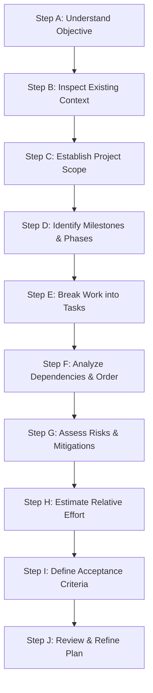

---
name: project-planning
description: Creates structured software project plans, implementation roadmaps, milestones, task breakdowns, dependency maps, risk assessments, and delivery strategies. Use when starting a new software project, planning a major feature, organizing approved requirements into implementation phases, or revising an existing project roadmap.
---

# Project Planning Skill

This skill guides the AI coding agent to transform project ideas, approved requirements, product specifications, or complex feature requests into actionable, dependency-aware implementation plans. It ensures development proceeds systematically with clear milestones, verified prerequisites, realistic scope boundaries, and robust risk mitigations.

## 1. Purpose and Scope

Project planning provides engineering direction and structural clarity before code execution begins. This skill answers key planning questions:

- **What are we building?** The defined system, feature set, or technical capability.
- **What outcomes must the project achieve?** The business objectives, user capabilities, and operational standards.
- **What requirements and constraints already exist?** Approved specifications, legacy contracts, architectural patterns, and technology stack choices.
- **What work needs to be completed?** The discrete, testable development tasks required for delivery.
- **In what order should the work happen?** The sequential and parallel workflow based on technical dependencies.
- **Which tasks depend on other tasks?** Foundational services, schema migrations, and core APIs that block downstream UI or integrations.
- **What risks and technical uncertainties must be addressed?** Unresolved requirements, third-party limits, data integrity risks, and migration friction.
- **How will we determine whether the work is complete?** Objective acceptance criteria, regression verification, and operational readiness checks.

*Scope Boundary*: This skill focuses strictly on project planning, task decomposition, dependency mapping, and roadmap sequencing. It does not replace detailed requirements elicitation (PRD/SRS), low-level architectural design, database modeling, or actual code implementation.

## 2. When to Use This Skill

### Trigger Conditions

Apply this skill when:
- **Starting a New Software Project**: Establishing initial milestones, foundational setup, and phased delivery from scratch.
- **Translating Approved Requirements**: Converting a Product Requirement Document (PRD), Software Requirements Specification (SRS), or feature specification into an execution plan.
- **Planning Major Multi-Module Features**: Organizing work that spans database migrations, backend services, API contracts, frontend interfaces, or background tasks.
- **Refactoring & Architectural Migrations**: Structuring large-scale refactorings, database replacements, or API redesigns to ensure continuous system availability.
- **Reorganizing Roadmaps**: Adjusting delivery sequences following material requirement changes, technical discoveries, or scope modifications.
- **Pre-Implementation Dependency Audits**: Mapping prerequisites and critical integration paths before initiating implementation.

### When NOT to Use This Skill

Do not invoke this skill for:
- Trivial, isolated code edits or single-file improvements.
- Standard bug fixes with clear reproduction steps and localized scope.
- Minor documentation or typographical corrections.
- Small feature additions that fit naturally within an existing module and require no multi-step sequencing.

## 3. Project Planning Workflow

Follow this ten-step procedure to analyze, structure, and refine implementation plans.

### Step A: Understand the Objective

1. **Clarify Business Goals**: Identify the primary problem being solved, target user personas, and intended organizational or user outcomes.
2. **Review Source Materials**: Review provided feature briefs, PRDs, user stories, issue descriptions, or client requirements.
3. **Distinguish Facts from Assumptions**: Separate explicitly confirmed requirements from working assumptions, design suggestions, and unresolved questions.
4. **Resist Scope Invention**: Never invent unrequested functional capabilities or assume unconfirmed business rules without verification.

### Step B: Inspect Existing Context

- **For Existing Codebases**:
  - Inspect directory layout, configuration files, and package dependencies.
  - Review architectural boundaries, data models, API conventions, and existing UI components.
  - Identify reusable services, existing utility helpers, and shared UI primitives to avoid duplication.
  - Audit existing test suites, CI/CD pipelines, and active database migrations.
  - Identify ongoing work or open pull requests that could collide with the proposed plan.
- **For New Greenfield Projects**:
  - Verify if a technology stack (language, framework, runtime, database) has been mandated or agreed upon.
  - If undecided, identify prerequisites and evaluate architectural trade-offs before locking in technologies.
  - Audit infrastructure requirements, deployment targets, and developer tooling conventions.

### Step C: Establish Project Scope

Categorize requirements into distinct boundaries:
- **Core Requirements (Must-Have)**: Essential capabilities without which the project or feature cannot function.
- **Supporting Requirements (Should-Have)**: Important functional additions that enhance usability or operational efficiency but do not block initial core delivery.
- **Quality & Non-Functional Requirements**: Performance SLAs, security standards, WCAG accessibility targets, test coverage thresholds, and browser/device support.
- **Explicit Exclusions (Out of Scope)**: Specific features, platforms, or workflows intentionally deferred to prevent scope creep.
- **External Constraints**: Third-party API rate limits, regulatory frameworks, legacy browser compatibility, and delivery deadlines.
- **Unverified Assumptions**: Working hypotheses that require testing or stakeholder confirmation before execution.

### Step D: Identify Deliverables and Milestones

Structure the project into logical, cohesive phases:
1. **Foundations**: Core infrastructure, database schemas, authentication boundaries, and base configurations.
2. **Core Domain Capabilities**: Primary entities, business logic, service layers, and internal operations.
3. **APIs & Data Contracts**: External and internal endpoints, validation schemas, and serialization layers.
4. **User Interfaces & Client Workflows**: Views, components, state management, form validations, and keyboard navigation.
5. **System Integration & End-to-End Testing**: Cross-module flows, third-party integrations, and automated regression checks.
6. **Hardening & Release Preparation**: Performance tuning, accessibility auditing, documentation updates, and deployment pipelines.

*Adaptability Note*: Scale the phases to the project. A medium feature might require only Foundations, Feature Implementation, and Verification phases. Never create bloated bureaucratic milestones for small initiatives.

### Step E: Break Work into Tasks

Decompose each phase into discrete, testable units of work. For each task, define:
- **Identifier**: A short, stable reference key (e.g., `TASK-01`, `AUTH-02`).
- **Title & Objective**: Concise description of what is being built and why.
- **Scope & Expected Result**: Exact behavioral outcome or artifact produced.
- **Relevant Requirements**: Traceability link to the business or functional requirement.
- **Dependencies**: Specific task IDs or prerequisites that must be completed first.
- **Affected Components**: Modules, directories, schemas, or files expected to change (grounded in actual repository inspection).
- **Acceptance Criteria**: Concrete, observable conditions for task completion.
- **Verification Strategy**: Unit tests, integration tests, manual checks, or schema validations.

*Granularity Principle*: Tasks should be sized for independent implementation and testing (typically 1–4 hours of focused coding effort). Avoid overly microscopic steps (e.g., "Add one import line") and monolithic tasks (e.g., "Build the entire frontend").

### Step F: Analyze Dependencies and Ordering

- **Critical Path Identification**: Map the linear chain of foundational tasks that govern the minimum delivery timeline (e.g., DB Schema -> Data Repository -> Service Layer -> API Handler -> UI Component).
- **Decoupled Parallelism**: Identify independent tasks that can be implemented concurrently without creating merge conflicts in shared files or database locks.
- **Bottleneck Prevention**: Flag tasks that block multiple downstream components and prioritize their early completion.
- **Conflict Avoidance**: Do not schedule simultaneous modifications to the same migration file, router configuration, or shared state store.

### Step G: Assess Risks and Uncertainty

Analyze and document technical, architectural, and operational risks:
- **Technical Uncertainties**: Unproven libraries, complex mathematical algorithms, or unverified performance bottlenecks.
- **Data Integrity & Migration Risks**: High-risk schema alterations, data loss exposure, or backward compatibility breaks (reference [database.md](../../rules/database.md)).
- **Integration & External Constraints**: Downstream API quotas, undocumented third-party quirks, or network latency limits.
- **Security & Authorization Risks**: Unprotected endpoints, credential exposure, or tenant boundary leakage (reference [security.md](../../rules/security.md)).
- **Mitigation Protocols**: For every high or medium risk, specify a concrete mitigation action (e.g., spike research task, fallback provider, transaction wrapping).

### Step H: Estimate Effort Responsibly

- **Relative Sizing**: Use relative sizing (Small, Medium, Large) or high-level point ranges rather than misleadingly exact hour/date guarantees.
- **Acknowledge Unknowns**: Explicitly state where lack of detailed API specifications or codebase familiarity introduces estimation variance.
- **Omit for Trivial Work**: Do not produce artificial sizing metrics for self-evident, small-scope development tasks.

### Step I: Define Acceptance and Completion Criteria

Establish verifiable quality gates for each task and milestone:
- **Observable Outcomes**: Define expected HTTP status codes, UI state transitions, database mutations, and return values.
- **Avoid Ambiguity**: Reject non-verifiable criteria such as "code is clean" or "system is fast"; use "all input fields have explicit labels and test coverage exceeds 85%".
- **Separation of Stages**: Differentiate implementation completion (code written) from verification completion (tests passing, linting clean) and operational completion (deployment verified).

### Step J: Review and Refine the Plan

Perform a holistic plan audit before presenting or executing:
- **Dependency Completeness**: Are all necessary database migrations scheduled before services that query new columns?
- **Scope Alignment**: Does the plan deliver everything required without introducing unrequested features or over-engineering?
- **Cross-Cutting Quality**: Are security, performance, accessibility, testing, and documentation explicitly accounted for?
- **Open Questions**: Are blocking ambiguities highlighted for user clarification?

## 4. Standard Planning Output Format

When presenting a comprehensive implementation plan, structure the output using the following standard template:

---

### Project Plan: [Project or Feature Title]

#### 1. Objective
A concise summary of the goal, target users, and expected business/technical outcome.

#### 2. Scope & Boundaries
- **In-Scope**: Key functional features, non-functional requirements, and supported platforms.
- **Out-of-Scope**: Explicitly excluded capabilities, future enhancements, and deferred integrations.
- **Core Assumptions**: Key technical assumptions underlying this plan.

#### 3. Architecture & Context Summary
Summary of the verified tech stack, architectural patterns, and reusable components identified in the codebase.

#### 4. Phases and Milestones

| Phase | Objective | Key Deliverables | Dependencies |
|---|---|---|---|
| Phase 1: Foundations | Setup data schemas, security, and base config | Migration scripts, models, config | None |
| Phase 2: Core Domain | Implement business rules and service handlers | Services, domain logic, unit tests | Phase 1 |
| Phase 3: API & Contracts | Expose endpoints and request validation | API routes, DTOs, integration tests | Phase 2 |
| Phase 4: UI & Workflows | Build user-facing components and views | Frontend pages, state stores, a11y | Phase 3 |
| Phase 5: Verification | End-to-end testing, auditing, and docs | E2E suite, user docs, release plan | Phase 4 |

#### 5. Implementation Tasks

| ID | Task Description | Target Components / Files | Dependencies | Acceptance Criteria | Priority |
|---|---|---|---|---|---|
| T-01 | Create database schema & migration | `src/db/migrations/`, `src/models/` | None | Migration runs cleanly; models reflect constraints | Must |
| T-02 | Implement service layer logic | `src/services/`, `tests/unit/` | T-01 | Domain methods pass 100% unit tests | Must |
| T-03 | Build API controller & validation | `src/api/routes/`, `src/validators/` | T-02 | REST endpoints return valid JSON; input schema validated | Must |
| T-04 | Develop UI view & form controls | `src/components/`, `src/pages/` | T-03 | Accessible form submission; handles loading/error states | Should |
| T-05 | Add E2E tests & update docs | `tests/e2e/`, `docs/api/` | T-03, T-04 | User workflow passes in browser; API docs updated | Should |

#### 6. Risks, Mitigations & Open Questions
- **Risk 1**: [Description] -> *Mitigation*: [Concrete action].
- **Open Question 1**: [Specific question requiring user feedback].

#### 7. Verification & Quality Strategy
- **Automated Tests**: Unit, integration, and E2E requirements.
- **Compliance & Audits**: Security sanitization, WCAG 2.2 AA accessibility checks, and performance budgets.
- **Documentation**: Required updates to `docs/` and API specifications.

#### 8. Next Action
The immediate, single step to take upon approval (e.g., "Begin Task T-01: Create database schema migration").

---

## 5. Planning Artifacts and Template Usage

- **Template Inspection**: Inspect `.agents/templates/project-planning/` for existing project templates before generating new plans.
- **Persistent Plans**: When creating a permanent project roadmap or implementation plan, save it to `docs/planning/` (e.g., `docs/planning/feature-x-plan.md`) following [documentation.md](../../rules/documentation.md).
- **Never Store Plans in Skills**: Do not write project-specific roadmaps or plans into `.agents/skills/project-planning/`.
- **Preserve Existing Plans**: When updating an existing plan, preserve completed milestones, verified decisions, and historical context; never overwrite without inspection.
- **Distinguish Proposed from Approved**: Label generated plans as `[Proposed]` until the user explicitly approves execution.

## 6. Interaction and Decision Principles

1. **Inspect Before Asking**: Extract all discoverable facts from the codebase, dependencies, and docs before prompting the user.
2. **Targeted Questions**: Ask only when missing information blocks core architecture, data integrity, security, or scope.
3. **Safe Assumptions**: If a reasonable engineering convention allows planning to advance safely, state the assumption clearly and proceed.
4. **Planning Precedes Coding**: Do not modify application code, write feature implementations, or alter schemas while executing this planning skill.
5. **Acknowledge Approvals**: Require explicit user consent before initiating consequential or destructive implementation phases.

## 7. Rule Harmony and Skill Collaboration

This planning skill collaborates with existing rules and specialized engineering skills:

- [core-workflow.md](../../rules/core-workflow.md): Governs the master analyze-plan-implement-verify lifecycle.
- [change-safety.md](../../rules/change-safety.md): Ensures plans protect existing functionality and limit blast radius.
- [coding-standards.md](../../rules/coding-standards.md): Guides task breakdown for code maintainability.
- [architecture.md](../../rules/architecture.md): Informs phase ordering and module boundary alignment.
- [security.md](../../rules/security.md): Ensures threat modeling and security verification are planned upfront.
- [database.md](../../rules/database.md): Mandates expand-and-contract migration sequencing.
- [frontend.md](../../rules/frontend.md) & [backend.md](../../rules/backend.md): Informs tier-specific implementation sequencing.
- [api-design.md](../../rules/api-design.md): Guides contract-first API task definitions.
- [testing.md](../../rules/testing.md): Sets criteria for test coverage milestones.
- [documentation.md](../../rules/documentation.md): Directs persistent plan placement in `docs/planning/`.
- [deployment.md](../../rules/deployment.md): Guides staging, verification, and release phases.
- [performance-optimization.md](../../rules/performance-optimization.md): Embeds baseline metrics into task acceptance criteria.
- [accessibility.md](../../rules/accessibility.md): Embeds WCAG 2.2 AA and keyboard navigation criteria into UI tasks.

*Complementary Skills*: When available, collaborate with `requirements-analysis` (for PRD/SRS refinement), `architecture-design` (for structural diagrams), and `database-design` (for ERDs and schema specs) without duplicating their specialized instructions.
