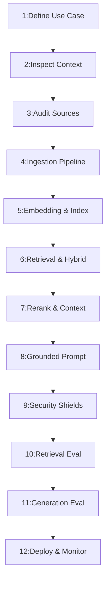

---
name: rag-systems
description: Designs, implements, evaluates, and secures retrieval-augmented generation systems, including document ingestion, parsing, chunking, embeddings, vector and hybrid search, reranking, grounded generation, citations, access control, retrieval evaluation, and knowledge freshness. Use when building or improving LLM applications that answer questions using external documents, private knowledge bases, or connected data sources.
---

# Retrieval-Augmented Generation (RAG) Systems Skill

Architect, implement, evaluate, secure, and operate enterprise-grade Retrieval-Augmented Generation (RAG) systems combining information retrieval with language models to deliver accurate, grounded, cited, and authorized answers from private knowledge sources.

## 1. Purpose, Core Principles, and RAG Engineering Mindset

The governing mandate of retrieval-augmented generation engineering is:
**Retrieve relevant and authorized information, ground generated answers in reliable evidence, evaluate retrieval and generation separately, protect against untrusted content, and never invent evaluation results or claim unsupported answer accuracy.**

Core principles:
- **Evidence Over Assumption**: Every answer claim must be directly supported by retrieved evidence; never extrapolate facts.
- **Authorization Parity**: Users may only retrieve documents and passages they are explicitly authorized to access in source systems.
- **Separate Retrieval from Generation**: Measure retrieval quality independently from generation quality.
- **Untrusted Document Boundary**: Treat retrieved document content strictly as untrusted data; never execute embedded instructions.
- **Honest Abstention**: When evidence is missing or inconclusive, explicitly abstain rather than fabricate plausible answers.
- **Systemic Lifecycle**: *Discover* $\rightarrow$ *Ingest* $\rightarrow$ *Chunk* $\rightarrow$ *Embed* $\rightarrow$ *Index* $\rightarrow$ *Retrieve* $\rightarrow$ *Rerank* $\rightarrow$ *Prompt* $\rightarrow$ *Generate* $\rightarrow$ *Cite* $\rightarrow$ *Evaluate*.

## 2. Defining Scope, Boundaries, and Skill File Standards

This skill governs the end-to-end engineering of retrieval-augmented generation systems:
- **Ingestion**: Document parsing, normalization, structure preservation, and content-aware chunking.
- **Indexing**: Embedding generation, vector database selection, hybrid search indexing, and metadata tagging.
- **Retrieval**: Semantic retrieval, BM25 keyword matching, reciprocal rank fusion, and cross-encoder reranking.
- **Generation**: Context assembly, prompt fencing, citation binding, and honest abstention behavior.
- **Security**: Pre-retrieval authorization, tenant isolation, prompt injection shielding, and secret protection.
- **Evaluation**: Golden dataset curation, retrieval metrics, generation faithfulness, and operational monitoring.
- **Boundaries**: Coordinate model APIs with [api-development](../api-development/SKILL.md), authentication with [authentication-authorization](../authentication-authorization/SKILL.md), threat modeling with [threat-modeling](../threat-modeling/SKILL.md), and storage with [database-design](../database-design/SKILL.md).

## 3. Defining RAG and Its Architectural Purpose

RAG bridges static parametric model knowledge with dynamic, external, non-parametric knowledge sources:

| Architecture Pattern | Knowledge Source | Update Velocity | Factual Grounding | Computational Cost | Primary Use Case |
| :--- | :--- | :--- | :--- | :--- | :--- |
| **RAG System** | External docs / DBs | Seconds / Minutes | Explicit citations | Low (inference only) | Dynamic private knowledge bases |
| **Model Fine-Tuning** | Parameter weights | Days / Weeks | Latent memory (risk) | High (GPU training) | Domain tone, vocabulary, syntax |
| **Pure Vector Search** | Embedding index | Seconds | Raw text passages | Very Low | Document lookup, passage ranking |
| **Direct SQL / Query** | Relational database | Real-time | Authoritative records | Extremely Low | Exact numbers, balances, inventory |

*Principle*: RAG is an end-to-end distributed system engineering challenge, not simply wiring a vector database to an LLM.

## 4. Assessing Problem Suitability and Simpler Alternatives to RAG

Evaluate problem suitability before introducing RAG complexity:
- **Suitable Workloads**: Complex policies, documentation, and dynamic knowledge bases.
- **Prefer Structured SQL**: Use relational queries for exact counts, balances, and IDs.
- **Prefer Static Context**: Pass small document sets ($<20$ pages) directly in prompts.

## 5. Analyzing Source Data Characteristics, Formats, and Constraints

Audit source knowledge assets thoroughly before designing pipelines:
- **Format Diversity**: Ingest PDF, Word (.docx), Markdown, HTML, CSV, and DB records.
- **Structure Analysis**: Assess document length, update cadence, and heading depth.
- **Governance & Identity**: Enforce tenant boundaries, retention, and canonical IDs.

## 6. Designing the Document Ingestion Pipeline

Build repeatable, observable, idempotent document ingestion pipelines:
- **Pipeline Stages**: Discovery, authorization, extraction, chunking, and indexing.
- **Extraction Resilience**: Handle malformed files, encodings, and layouts cleanly.
- **Idempotency & Auditing**: Use SHA-256 hashes for deduplication and log failures.

## 7. Document Parsing, Extraction Quality, and Structural Fidelity

Downstream retrieval and generation depend on extracted text fidelity:
- **Structural Integrity**: Preserve heading hierarchies (H1/H2/H3) and paragraphs.
- **Table Preservation**: Convert tables to Markdown or JSON to bind cells to headers.
- **Artifact Stripping**: Remove repeated running headers, footers, and page chrome.

## 8. Designing a Content-Aware Chunking Strategy

Partition documents into retrievable passages aligned with semantic boundaries:
- **Recursive Splitting**: Split progressively on paragraphs and sentences by grammar.
- **Structure-Aware**: Partition on heading levels (Markdown H2/H3) for cohesion.
- **Parent-Child Retrieval**: Match small child chunks; return containing parent sections.

## 9. Embedding Models, Semantic Representation, and Dimension Compatibility

Select and manage vector representations with strict compatibility controls:
- **Model Parameters**: Evaluate vector dimensions (384, 768, 1536) and distance metrics.
- **Strict Compatibility**: Document and query embedding models must match identically.
- **Batching & Re-indexing**: Batch calls with backoff; re-index atomically on updates.

## 10. Vector Search and Index Design

Select vector storage and indexing mechanisms matching dataset scale and capacity:
- **Search Algorithms**: Exact Flat search for $<10\text{k}$ vectors; ANN (HNSW) for large sets.
- **Relational Extension**: PostgreSQL with `pgvector` for unified transactions and joins.
- **Dedicated Vector Store**: Qdrant or Milvus for high-throughput, massive vector collections.

## 11. Hybrid Search, Keyword Retrieval, and Rank Fusion

Combine dense semantic search with sparse lexical search to address exact lookups:
- **Complementary Roles**: Dense vectors capture intent; BM25 captures exact SKUs and codes.
- **Reciprocal Rank Fusion**: Merge ranked lists via $$RRF\_Score(d) = \sum_{m \in M} \frac{1}{60 + rank_m(d)}$$.
- **Authorization Parity**: Lexical search paths must enforce identical security filters.

## 12. Metadata Filtering and Pre-Retrieval Authorization Enforcement

Metadata enables precise scoping and enforces security boundaries at the storage layer:
- **Core Schema**: Record `tenant_id`, `document_id`, `user_id`, `role_required`, and `version`.
- **Pre-Filtering Mandatory**: Enforce tenant and RBAC filters in queries before similarity.
- **Prompt Failsafe Rejection**: Never retrieve unauthorized data and rely on LLMs to hide it.

## 13. Query Processing, Normalization, and Intent Routing

Transform raw user inputs into optimized retrieval queries without altering intent:
- **Input Sanitization**: Strip control characters, normalize whitespace, and detect language.
- **Query Rewriting & HyDE**: Generate hypothetical passages or expand acronyms cleanly.
- **Intent Routing**: Route factual questions to RAG, exact lookups to SQL, greetings to LLMs.

## 14. Candidate Retrieval, Reranking, and Context Pruning

Employ a two-stage retrieval architecture to maximize recall and precision:
- **Two-Stage Architecture**: Bi-encoder search retrieves top $K_1$; cross-encoder reranks top $K_2$.
- **Latency Budget**: Cross-encoders add 50–150ms latency; apply rerankers with proven gains.
- **Context Pruning**: Enforce minimum score cutoffs to discard low-scoring noise passages.

## 15. Context Assembly and Grounded Prompt Construction

Assemble the final prompt from validated evidence with rigorous boundary isolation:
- **Delimiter Fencing**: Enclose retrieved context in distinct tags (`<retrieved_evidence>`).
- **Passage Metadata**: Tag every passage clearly with title, source path, and page number.
- **Instruction Primacy**: Instruct model to answer solely from context and reject outside bias.

## 16. Grounded Generation, Evidence Adherence, and Abstention Behavior

Enforce strict factual adherence to retrieved passages while forbidding speculation:
- **Evidence Grounding**: Base all factual claims strictly on retrieved evidence statements.
- **Honest Abstention**: When evidence is missing, state: "The documents do not establish this."
- **Contradiction Handling**: Surface conflicting source statements explicitly without guessing.

## 17. Citations, Source Attribution, and Verification Standards

Implement verifiable citations linking generated assertions to underlying evidence:
- **Attribution Fields**: Include source title, document ID, file path, and page number.
- **Granular Claim Binding**: Place citation markers directly after the specific asserted clause.
- **Zero Hallucination**: Programmatically verify cited document IDs exist in prompt context.

## 18. Multi-Stage RAG and Advanced Retrieval Patterns

Adopt advanced retrieval patterns only when simpler architectures fail quality targets:
- **Parent-Child Retrieval**: Match granular sentence vectors; return containing parent context.
- **Contextual Retrieval**: Prepend document summaries and section titles prior to embedding.
- **Query Decomposition**: Deconstruct complex multi-part questions into sub-queries.

## 19. RAG Evaluation: Measuring Retrieval Quality Independently

Evaluate retrieval performance independently from generation to locate bottlenecks:
- **Retrieval Metrics**: Track Recall@k, Precision@k, Mean Reciprocal Rank (MRR), and nDCG@k.
- **Golden Evaluation Sets**: Curate 50–200 verified question-passage pairs for testing.
- **Baseline Comparison**: Benchmark retrieval parameter changes against a fixed baseline.

## 20. RAG Evaluation: Measuring Generation Quality, Faithfulness, and Accuracy

Measure the fidelity, relevance, and factual accuracy of synthesized responses:
- **Generation Dimensions**: Measure Faithfulness, Answer Relevance, and Citation Precision.
- **Judge Calibration**: Calibrate LLM judge prompts with human-reviewed gold standard examples.
- **Automated Gates**: Block releases when faithfulness or citation precision drops below targets.

## 21. End-to-End Evaluation, Golden Datasets, and Regression Testing

Validate the unified RAG workflow across all pipeline stages before production release:
- **Full Pipeline Audit**: Ingestion $\rightarrow$ Chunking $\rightarrow$ Embedding $\rightarrow$ Retrieval $\rightarrow$ Generation.
- **Regression Gates**: Rerun evaluation suites when embedding models or prompt templates change.
- **Falsifiable Benchmarks**: Enforce criteria: Recall@5 $\ge 0.85$, Faithfulness $\ge 0.95$, Zero hallucinations.

## 22. Security Controls, Untrusted Content, and Indirect Prompt Injection

Treat all retrieved document content strictly as untrusted user data:
- **Threat Vector**: Ingested documents may contain indirect prompt injections seeking secrets.
- **Structural Separation**: Use rigid delimiter fencing and explicit instructions that text is data.
- **Zero Tool Execution**: Ingested document text must never trigger tool calls or system commands.

## 23. Data Privacy, Tenant Isolation, and Access Control Invariants

Prevent unauthorized cross-tenant data leakage and protect sensitive records:
- **Hard Multi-Tenancy**: Every query must include a mandatory `tenant_id = :tenant_id` clause.
- **Cache Scoping**: Scope semantic caches by tenant and user permission hash; never share entries.
- **Data Retention**: Support immediate, verifiable deletion of user documents across indexes.

## 24. Index Updates, Knowledge Freshness, and Deletion Lifecycle

Maintain synchronization between external knowledge repositories and retrieval indexes:
- **Synchronization Models**: Use event-driven webhooks or scheduled batch indexing.
- **Atomic Deletions**: Purge metadata, chunks, and vector embeddings immediately on deletion.
- **Tombstone Filtering**: Ensure search queries explicitly filter out soft-deleted records.

## 25. Resilient Error Handling, Fallbacks, and Failure Recovery

Handle transient outages and partial failures gracefully without compromising security:
- **Failure Classification**: Differentiate provider rate limits, network timeouts, and auth denials.
- **Clear User Messaging**: Never display "No information found" when caused by a database outage.
- **Safe Fallbacks**: Fall back from vector to lexical search during outages; never invent text.

## 26. Performance Optimization, Latency Budgets, and Token Cost Controls

Manage latency and expenditure across multi-stage RAG pipelines:
- **Latency Budgets**: Query embedding (30–80ms) + Vector search (10–30ms) + LLM TTFT (300–800ms).
- **Cost Reduction**: Cache query embeddings for repeated searches, prune redundant passages.
- **Context Bounds**: Limit retrieved context to the highest-scoring 3–5 chunks to control costs.

## 27. Observability, Telemetry, and Operational Monitoring

Implement deep operational visibility across all RAG pipeline stages:
- **Core Telemetry Metrics**: Retrieval latency, generation latency, top-k similarity, and costs.
- **Distributed Tracing**: Trace request journeys with OpenTelemetry spans across pipeline stages.
- **Privacy in Logs**: Redact private user queries and retrieved document excerpts from logs.

## 28. LLM and Retrieval Provider Abstraction and Portability

Design clean, swappable interfaces while avoiding overengineered universal abstractions:
- **Core Interfaces**: Define focused contracts for parser, embedding provider, vector store, and LLM.
- **Expose Provider Realities**: Do not hide differences in token limits, rate limits, or dimensions.
- **Configuration Driven**: Configure model names, endpoints, and timeouts via environment variables.

## 29. Structured Data Integration and Authoritative Query Routing

Combine unstructured document knowledge with authoritative structured relational data:
- **Query Routing**: Direct policy questions to RAG; direct balances and inventory to SQL.
- **Hybrid Questions**: Decompose composite queries into parallel document and database requests.
- **Strict SQL Safety**: Models must never construct raw SQL; execute parameterized queries only.

## 30. Deployment Architecture, Infrastructure, and Security Hardening

Deploy RAG components safely within isolated, production-grade network topologies:
- **Network Boundaries**: Place vector databases and document stores inside private VPC subnets.
- **Secret Management**: Store provider API keys in managed secret managers; inject via environment.
- **Resource Sizing**: Allocate adequate RAM for in-memory vector index caches (HNSW) and compute.

## 31. Recommended 12-Phase RAG Implementation Workflow

Follow this standardized engineering workflow for designing, building, and deploying RAG capabilities:



- **Phases 1–3**: Use case definition, existing system inspection, source data auditing.
- **Phases 4–6**: Ingestion pipeline, embedding/indexing, hybrid retrieval design.
- **Phases 7–9**: Context pruning/reranking, grounded prompt construction, security shields.
- **Phases 10–12**: Retrieval quality evaluation, generation quality evaluation, deployment and monitoring.

## 32. Definition of Done (DoD) for RAG Systems

Complete only when all criteria pass:
- [ ] 1. **Use Case Validated**: Confirmed need for RAG over structured SQL or static prompts.
- [ ] 2. **Ingestion Verified**: Extraction preserves document structure, tables, and metadata.
- [ ] 3. **Chunking Calibrated**: Boundaries respect document grammar and parent hierarchy.
- [ ] 4. **Model Compatibility**: Document and query embedding models match identically.
- [ ] 5. **Pre-Filtering Active**: Tenant and RBAC filters enforced at database layer.
- [ ] 6. **Grounded Generation**: Output claims strictly supported by retrieved passages.
- [ ] 7. **Verifiable Citations**: All citations link to valid retrieved documents and pages.
- [ ] 8. **Honest Abstention**: System abstains cleanly when evidence is missing.
- [ ] 9. **Prompt Shielded**: Delimiters isolate untrusted retrieved text from system prompt.
- [ ] 10. **Dual Evaluation**: Retrieval recall and generation faithfulness verified.
- [ ] 11. **Freshness Tested**: Document updates and deletions synchronize with index.
- [ ] 12. **Telemetry Active**: Latency, token costs, empty rates, and errors tracked.

## 33. Standardized RAG Completion Report Template

Document final implementation results using this standardized structure:

```markdown
# RAG System Completion Report: [Knowledge Domain / Feature]
### 1. Problem & Use Case: [Scope, documents, and objectives]
### 2. Architecture & Ingestion: [Tooling, chunking, embedding model, index store]
### 3. Security & Access Control: [Tenant isolation, pre-filtering, injection shields]
### 4. Independent Evaluation Results:
| Metric | Baseline | Target | Observed | Status |
| :--- | :--- | :--- | :--- | :---: |
| Retrieval Recall@5 | 0.65 | $\ge 0.85$ | 0.89 | PASS |
| Retrieval MRR | 0.50 | $\ge 0.75$ | 0.82 | PASS |
| Generation Faithfulness | 0.78 | $\ge 0.95$ | 0.97 | PASS |
| Citation Accuracy | 0.70 | $\ge 0.98$ | 0.99 | PASS |
| Abstention Precision | 0.80 | $\ge 0.95$ | 0.96 | PASS |

### 5. Performance & Cost: [p95 latency, token usage, cost per 1k queries]
### 6. Components Changed: [Modified ingestion, retrieval, and prompt files]
### 7. Test Results: [Unit, integration, and golden evaluation results]
### 8. Limitations & Next Steps: [Edge cases, refresh cadence, and roadmap]
```

## 34. Avoiding Overengineering and Common RAG Anti-Patterns

Avoid critical RAG architectural and operational traps:
- **Vector DB Default Reflex**: Adding vector databases when relational SQL solves the problem.
- **Blind Chunking**: Splitting text at arbitrary offsets without respecting document structure.
- **Similarity Conflated with Truth**: Assuming high cosine similarity guarantees factual truth.
- **Prompt-Only Access Control**: Retrieving unrestricted documents and relying on LLMs to hide data.
- **Trusting Ingested Prompts**: Allowing text inside indexed documents to override system rules.
- **Fabricated Citations**: Letting models invent document titles, page numbers, or URLs.
- **Conflating Retrieval with Generation**: Failing to isolate missed context from hallucination.
- **Ignoring Abstention**: Forcing the model to guess when retrieved evidence is absent.
- **Unbounded Context Stuffing**: Flooding prompts with dozens of marginal chunks.
- **Silent Ingestion Failures**: Catching file extraction exceptions without recording failures.

## 35. Avoiding Duplication with Existing Skills and Repository Rules Alignment

Coordinate RAG engineering with related capabilities:
- [authentication-authorization](../authentication-authorization/SKILL.md): Tenant access and RBAC.
- [threat-modeling](../threat-modeling/SKILL.md): Prompt injection analysis.
- [security-review](../security-review/SKILL.md): Pipeline security.
- [database-design](../database-design/SKILL.md): Vector storage schemas.
- [database-query-optimization](../database-query-optimization/SKILL.md): Query and index tuning.
- [performance-optimization](../performance-optimization/SKILL.md): Retrieval latency tuning.
- [caching-strategy](../caching-strategy/SKILL.md): Embedding cache strategy.
- [observability](../observability/SKILL.md): Telemetry and tracing.
- [load-testing](../load-testing/SKILL.md): Search capacity bounds.
- [testing-qa](../testing-qa/SKILL.md): Golden evaluation suites.
- [api-development](../api-development/SKILL.md): Retrieval API endpoints.
- [documentation](../documentation/SKILL.md): Architecture and runbooks.

Repository rules alignment:
- [security.md](../../rules/security.md): Secret protection and least privilege.
- [backend.md](../../rules/backend.md): Controller-service boundaries.
- [api-design.md](../../rules/api-design.md): REST contracts and schemas.
- [database.md](../../rules/database.md): Migration safety and queries.
- [coding-standards.md](../../rules/coding-standards.md): Code clarity and typing.
- [change-safety.md](../../rules/change-safety.md): Non-destructive changes.
- [architecture.md](../../rules/architecture.md): Modular system design.

## 36. 10-Point Pre-Flight RAG Validation Checklist

Verify all 10 criteria before finalizing any RAG system implementation or modification:
- [ ] 1. **Problem Suitability**: Verified need for RAG over relational SQL or static prompts.
- [ ] 2. **Ingestion Tested**: Documents parsed with headings, tables, and metadata intact.
- [ ] 3. **Structure-Aware Chunking**: Boundaries respect grammar; parent context preserved.
- [ ] 4. **Model Compatibility**: Document and query embedding models matched in version.
- [ ] 5. **Pre-Retrieval Authorization**: Multi-tenant and RBAC filters enforced at DB query.
- [ ] 6. **Fenced Prompting**: Retrieved context enclosed in rigid delimiters.
- [ ] 7. **Grounded Answers**: Output statements strictly backed by retrieved evidence.
- [ ] 8. **Granular Citations**: Citations link to real retrieved passages with page numbers.
- [ ] 9. **Honest Abstention**: System abstains cleanly when evidence is missing.
- [ ] 10. **Dual Evaluation Passed**: Retrieval recall and generation faithfulness verified.