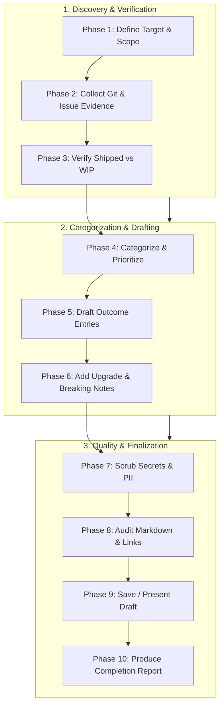

---
name: release-notes-writing
description: Writes accurate, structured release notes and changelog entries from verified code changes, Git history, version information, implementation summaries, and release requirements. Use when documenting a software release, preparing changelog entries, summarizing shipped features and bug fixes, explaining breaking changes, or communicating upgrade requirements to technical and non-technical audiences.
---

# Release Notes Writing Skill

This skill guides the AI coding agent to author accurate, readable, well-structured release notes and changelog entries grounded in verified project changes. It ensures that shipped features, improvements, fixes, breaking changes, and upgrade instructions are clearly communicated across technical and non-technical audiences without inventing details or inflating scope.

## 1. Purpose, Core Principles, and Release Communication Mindset

The central mandate of release notes authoring is:
**Every release note must be grounded in verified changes. Clearly explain what changed, why it matters, who is affected, and what action—if any—the user must take. Never invent features, fixes, or release details.**

Adhere to six foundational principles:

- **Grounded in Verified Reality**: Document only functionality confirmed through code diffs, closed issues, test reports, or verified release requests. Never assume an unmerged branch or speculative commit is part of a release.
- **Outcome Over Implementation**: Frame entries around user-visible capabilities and operational impact rather than internal variable renames or routine refactoring.
- **Tailored to the Target Audience**: Adapt tone, detail, and technical depth depending on whether the document targets end users, administrators, developers, or release teams.
- **Explicit Actionable Guidance**: When breaking changes, schema migrations, or configuration updates occur, state the required user or operator actions unambiguously.
- **Responsible Security Communication**: Describe security enhancements and fixes factually without leaking credentials, tokens, internal paths, or exploit mechanics.
- **Proportionate Ceremony**: Scale documentation depth to release magnitude. A minor patch requires concise bullet points; a major version demands structured sections and migration guidance.

*Scope Boundary*: Focuses on release and changelog communication. For API reference contracts, use [api-documentation](../api-documentation/SKILL.md); for general project documentation standards, use [documentation.md](../../rules/documentation.md); for Git inspection, use [git-workflow](../git-workflow/SKILL.md); for deployment checks, use [deployment-readiness](../deployment-readiness/SKILL.md).

## 2. Establishing the Source of Truth and Release Scope

Never write release notes from memory or feature titles alone. Synthesize verified evidence:

- **Authoritative Sources**:
  - *Git History & Diffs*: Inspect commits between explicit release tags (e.g., `git log v1.2.0..v1.3.0 --oneline` and `git diff v1.2.0..v1.3.0`).
  - *Implementation & Test Reports*: Review verified test outcomes and DoD checklists from [feature-implementation](../feature-implementation/SKILL.md) and [testing-qa](../testing-qa/SKILL.md).
  - *Pull Requests & Issues*: Cross-reference merged pull requests, closed issue tickets, and release manifests.
  - *Database Migrations*: Inspect new files in migration directories to identify persistent schema shifts.
  - *Configuration Manifests*: Check `.env.example`, Dockerfiles, and Helm charts for modified environment variables or runtime requirements.
- **Verify Release Perimeter**:
  - Determine exact version boundaries. Do not assume all commits on the default branch belong to the current release.
  - Exclude unmerged, experimental, incomplete, or reverted changes from shipped release notes.
  - If release scope or target version is ambiguous, state the uncertainty explicitly rather than guessing.

## 3. Deep Change Analysis and Impact Assessment

Before drafting entries, evaluate the operational significance of each candidate change:

- **What changed?** Contrast previous system behavior with the new behavior.
- **Who is affected?** Identify affected user personas (e.g., students, teachers, administrators) or system consumers (APIs, third-party integrations).
- **Why does it matter?** Clarify the business value, usability improvement, or defect resolved.
- **Is user action required?** Determine whether users or administrators must update settings, run migrations, or alter workflows.
- **Avoid Commit Message Traps**: A commit titled `fix dashboard` or `update styles` is a clue, not a release entry. Inspect the diff to confirm what actually changed.

## 4. Standard Categorization Taxonomy

Organize release entries using established conventions (e.g., *Keep a Changelog*). Use only relevant categories:

| Category | Definition | Example Entry |
| :--- | :--- | :--- |
| **Added** | New user-facing features, endpoints, or capabilities. | Added CSV export capability to the student attendance report. |
| **Changed** | Modifications to existing behavior, UI, or workflows. | Updated pagination on the fee summary table to default to 25 rows. |
| **Fixed** | Verified corrections of defects or erroneous calculations. | Fixed grade averaging formula when handling optional credit courses. |
| **Security** | Hardened access controls, vulnerability patches, sanitizer fixes. | Enforced strict tenant isolation checks on invoice download endpoints. |
| **Deprecated** | Features scheduled for removal in future releases. | Deprecated `/api/v1/students/search` in favor of `/api/v2/students`. |
| **Removed** | Capabilities or endpoints permanently removed. | Removed legacy XML export endpoint `/api/v1/export/xml`. |
| **Performance** | Measured responsiveness, query, or resource improvements. | Optimized student list query, reducing load latency by 45%. |
| **Database & Migration** | Schema shifts requiring migration runs during deployment. | Added `status` column to `enrollments` table with automated migration. |
| **Configuration** | New environment variables, runtime flags, or service requirements. | Added `REDIS_URL` requirement for distributed queue processing. |
| **Known Issues** | Confirmed unresolved problems relevant to operators or users. | Bulk report generation may time out on datasets exceeding 50,000 rows. |

## 5. Writing Accurate, User-Centric Entries

Draft entries that convey meaningful outcomes rather than raw code modifications:

- **Focus on Observable Outcomes**:
  - *Weak (Internal Code)*: `Refactored StudentController.ts and updated SQL query.`
  - *Strong (Outcome-Oriented)*: `Student search now supports filtering by enrollment status, enabling administrators to isolate active records quickly.`
  - *Weak (Vague)*: `Fixed API bug and improved performance.`
  - *Strong (Specific)*: `Resolved intermittent timeout on student lookup API by indexing student identification numbers.`
- **Banned Vague Phrases**: Never use empty filler like *"various improvements"*, *"some bug fixes"*, or *"better performance"* without explaining the exact behavior changed or supplying verified metrics.
- **Grammar & Tone**: Use active voice, past or present imperative verbs consistently, concise sentences, and official product terminology.

## 6. Multi-Audience Tailoring

A single release impacts diverse stakeholders. Adapt language and technical depth to the primary reader:

| Audience | Primary Interest | Tone & Content Guidance |
| :--- | :--- | :--- |
| **End Users** | Daily workflows, UI changes, bug fixes. | Non-technical, outcome-focused prose; zero code references or DB column names. |
| **Administrators & Ops** | Deployments, migrations, config, env vars. | Operational precision, required scripts, backup warnings, service dependencies. |
| **Developers & API Clients** | Contracts, schemas, breaking changes, deprecations. | Exact endpoint paths, parameter names, type signatures, migration snippets. |
| **Internal Release Teams** | Scope boundaries, verification evidence, risks. | Objective status, verified vs. unverified items, known issues, rollback paths. |

*Audience Rule*: If creating a unified release document, separate non-technical feature highlights from technical upgrade/migration sections.

## 7. Release Document Structure and Standard Layouts

Follow the repository's existing changelog format. When authoring standalone release notes, use this structured layout:

```markdown
# Release [Version] — [YYYY-MM-DD / Pending]

## Summary
A concise overview (1–3 paragraphs) highlighting the most important capabilities, fixes, and business value in this release.

## New Features
- **[Feature Name]**: Outcome description explaining user benefit and operation.

## Improvements
- **[Component Name]**: Specific enhancement to existing workflows or performance.

## Bug Fixes
- **[Defect Title]**: Explanation of the corrected behavior and under what condition it previously failed.

## Breaking Changes
> [!WARNING]
> Highlight breaking shifts prominently with required mitigation steps.
- **[Change Name]**: What changed, who is affected, and mandatory migration actions.

## Upgrade and Migration Notes
- **Database**: `npm run migrate` (runs migration `20261025_add_student_status`).
- **Configuration**: Set `NEW_CONFIG_KEY` in environment prior to startup.

## Known Issues
- Document confirmed unresolved limitations and recommended temporary workarounds.
```

## 8. Concise Changelog Conventions (Keep a Changelog)

When updating a repository-level `CHANGELOG.md`, follow the *Keep a Changelog* standard:

- **Chronological Grouping**: Place the newest version at the top directly under `## [Unreleased]`.
- **Date Formatting**: Use ISO-8601 dates (`YYYY-MM-DD`). If unreleased, designate as `[Unreleased]`.
- **Atomic Entries**: One concise bullet point per logical change. Do not split a single feature across five commits into five separate changelog items.
- **Consolidation**: Group multiple minor commits into a single cohesive entry.

## 9. Versioning Metadata and Date Integrity

Treat version identifiers and release dates as immutable facts:

- **Follow Semantic Versioning (SemVer)**:
  - `MAJOR` (x.0.0): Incompatible API or database breaking changes.
  - `MINOR` (0.x.0): Backward-compatible new functionality.
  - `PATCH` (0.0.x): Backward-compatible bug fixes and performance patches.
- **Never Auto-Bump Versions**: Do not alter `package.json`, `version.txt`, or Git tags automatically unless explicitly instructed.
- **Date Accuracy**: If the release date is unconfirmed, label it `Pending` or `TBD`. Never fabricate a release date.

## 10. Identifying and Highlighting Breaking Changes

Breaking changes require prominent visibility to prevent operational disruption:

- **What Constitutes a Breaking Change?**
  - Removed or renamed API routes, request parameters, or response fields.
  - Stricter validation rules that reject previously accepted payloads.
  - Altered default values or configuration keys.
  - Schema changes requiring database downtime or data transformations.
  - Raised runtime requirements (e.g., Node.js 18 -> 22, PostgreSQL 14 -> 16).
- **Required Documentation Elements**:
  1. **Impact**: Explicitly identify who/what is broken.
  2. **Rationale**: Why the change was necessary.
  3. **Migration Steps**: Step-by-step code or configuration adjustments required to upgrade.
  4. **Before/After Examples**: Brief code snippets illustrating old vs. new syntax.

## 11. Operational, Database, and Configuration Notes

Provide DevOps and system operators with clear execution instructions:

- **Environment Variables**: Document variable name, expected data type, default value, and purpose. *Never include real passwords, tokens, or private keys.*
- **Database Migrations**: State the migration script name, estimated run time (if known on large datasets), and whether the migration locks tables.
- **Queue & Background Workers**: Document if new worker queues must be provisioned or if job payload schemas have changed.
- **Backup Guidance**: Explicitly remind operators to take pre-deployment backups before executing non-reversible schema migrations.

## 12. Security, Privacy, and Responsible Disclosure

Handle security communications with rigorous care:

- **Fact-Based Security Entries**: State the protected boundary (e.g., `Strengthened input sanitization on profile upload to prevent directory traversal`).
- **Zero Information Leakage**: Never paste credentials, private keys, database dumps, session tokens, or internal network IPs into release notes.
- **Advisory References**: Reference verified CVEs or GitHub Security Advisories (`GHSA-xxxx-xxxx-xxxx`) only when officially approved for public disclosure.
- **Do Not Expose Exploit Details**: Avoid publishing step-by-step exploit payloads before users have had an opportunity to apply patches.

## 13. Handling Incomplete, Experimental, and Reverted Work

Maintain strict boundaries between released software and work-in-progress:

- **WIP & Unmerged Work**: If code resides on an unmerged branch or feature flag that is disabled by default, do not announce it as a shipped feature.
- **Beta / Experimental Features**: Clearly label experimental capabilities: `[Experimental] Added WebSocket streaming support (opt-in via FEATURE_FLAG_STREAMING=true)`.
- **Reverted Commits**: If a feature was introduced and subsequently reverted during the release cycle, omit both entries from the final notes to avoid user confusion.

## 14. Git History Mining and Commit Synthesis

When utilizing Git to determine release contents:

- **Establish Target Range**: Compare target release tag against prior release tag:
  ```bash
  git log v1.2.0..v1.3.0 --oneline --no-merges
  git diff --stat v1.2.0..v1.3.0
  ```
- **Filter Routine Noise**: Disregard merge commits, linting fixes, minor typo corrections, and internal CI configuration tweaks unless project policy demands internal tracking.
- **Verify Against Diffs**: When commit messages are ambiguous, inspect the diff (`git show <hash>`) to confirm the true nature of the change.

## 15. Handling Duplications, Contradictions, and Attribution

Ensure clarity and editorial cohesion across contributors:

- **Consolidate Redundant Entries**: If three PRs contributed to "Exporting student reports", synthesize them into one clear entry under `Added`.
- **Resolve Contradictions**: If a commit log claims a feature works but issue comments report it was postponed, verify against the code. When unresolved, state the uncertainty.
- **Contributor Attribution**: If project policy includes community credits, format consistently: `Added dark mode support. Thanks to @username! (#123)`. Never invent credits.

## 16. Links, References, and Markdown Formatting Standards

Maintain clean, professional documentation standards:

- **Valid Markdown**: Use semantic headings (`#`, `##`, `###`), bullet lists, and code blocks.
- **Technical Formatting**: Format file paths, commands, endpoints, and configuration keys as backticked code spans (`/api/v1/students`, `PORT`, `npm run build`).
- **Verified References**: Link directly to verified public issues or PRs (`#104` or `[#104](https://github.com/org/repo/pull/104)`). Never construct broken or dead links.

## 17. Recommended 10-Phase Release Notes Authoring Workflow

Execute this structured sequence when preparing release notes or changelog updates:



- **Phase 1: Define Target & Scope**: Confirm version number, release date status, audience, and target document path (`CHANGELOG.md`, `RELEASE_NOTES.md`).
- **Phase 2: Collect Git & Issue Evidence**: Mine commit logs, PR descriptions, diffs, and closed tickets across the release range.
- **Phase 3: Verify Shipped vs WIP**: Filter out unmerged PRs, incomplete tasks, and reverted commits.
- **Phase 4: Categorize & Prioritize**: Group changes into standard categories (Added, Changed, Fixed, Breaking, etc.).
- **Phase 5: Draft Outcome Entries**: Author clear, active-voice descriptions emphasizing user value.
- **Phase 6: Add Upgrade & Breaking Notes**: Detail required migrations, environment changes, and compatibility warnings.
- **Phase 7: Scrub Secrets & PII**: Audit document for accidental token leaks, passwords, internal IPs, or unredacted personal data.
- **Phase 8: Audit Markdown & Links**: Verify valid syntax, clean code formatting, and working issue links.
- **Phase 9: Save / Present Draft**: Update the target file or present the draft as requested without modifying unrelated files.
- **Phase 10: Produce Completion Report**: Summarize documented changes, evidence inspected, and any outstanding uncertainties.

## 18. Overengineering Traps & Anti-Patterns to Avoid

Avoid these release documentation hazards:

- **Commit Regurgitation**: Copying raw, unedited Git commit subjects directly into release notes without context.
- **Inventing Features**: Fabricating functionality that was never implemented or verified.
- **Vague Fluff**: Filling notes with empty praise (*"revolutionary update"*, *"blazing fast improvements"*) without facts.
- **Hidden Incompatibilities**: Concealing a breaking API change under general "Improvements".
- **Premature Version Bumping**: Incrementing project version files without explicit authorization.
- **Secret Leaks**: Pasting configuration diffs containing real API credentials or secrets.
- **Duplicating Entire Guides**: Turning release notes into a 50-page user manual instead of an actionable change summary.

## 19. Definition of Done & Completion Report Template

Consider the release notes authoring task complete only when:

- [ ] 1. **Verified Changes Only**: Every documented item correlates to confirmed code or configuration changes.
- [ ] 2. **Clear Categorization**: Entries are sorted into logical, standard categories without duplication.
- [ ] 3. **Audience Aligned**: Tone and technical depth match the intended reader.
- [ ] 4. **Breaking Changes Prominent**: Incompatibilities and mandatory migration steps are explicitly highlighted.
- [ ] 5. **Configuration Documented**: New environment variables and database migrations are fully explained without secret leaks.
- [ ] 6. **Zero Factual Inventions**: Release versions, dates, and contributor credits are verified or marked pending.
- [ ] 7. **Markdown Quality**: Headers, bullet points, and code spans follow formatting standards.

### Standardized Completion Report Template

Synthesize your release notes work using this structured format:

```markdown
# Release Notes Authoring Report: [Release Version / Name]

## 1. Document Summary
- **Destination File**: [e.g., `CHANGELOG.md` or `docs/releases/v1.3.0.md`]
- **Release Version**: [e.g., `v1.3.0` or `v1.3.0 (Pending)`]
- **Target Audience**: [End Users / Administrators / Developers]

## 2. Documented Changes Summary
| Category | Item Count | Key Highlights |
| :--- | :---: | :--- |
| Added | [Count] | [Brief summary of primary additions] |
| Changed | [Count] | [Brief summary of modifications] |
| Fixed | [Count] | [Brief summary of key defect corrections] |
| Breaking / Migration | [Count] | [Summary of breaking changes & upgrade steps] |

## 3. Evidence & Sources Verified
- **Git Range**: [e.g., `git log v1.2.0..v1.3.0` / PR list]
- **Artifacts Inspected**: [Migration files, test reports, issue references]

## 4. Outstanding Uncertainties
- [Any unverified changes, unconfirmed release dates, or missing migration instructions]
```

## 20. Alignment with Project Rules, Skills, and Validation Checklist

Ensure all release notes writing conforms to the repository's established conventions:

- Rules: [documentation.md](../../rules/documentation.md) (standards), [git-workflow.md](../../rules/git-workflow.md) (commit conventions), [general/core-workflow.md](../../rules/core-workflow.md) (workflow discipline), [general/change-safety.md](../../rules/change-safety.md) (safety invariants), [security.md](../../rules/security.md) (data privacy), [deployment.md](../../rules/deployment.md) (release readiness).
- Skills: [api-documentation](../api-documentation/SKILL.md), [git-workflow](../git-workflow/SKILL.md), [feature-implementation](../feature-implementation/SKILL.md), [deployment-readiness](../deployment-readiness/SKILL.md), [database-migration](../database-migration/SKILL.md), [security-review](../security-review/SKILL.md).

### 10-Point Release Notes Validation Checklist

Before finalizing any release notes task, verify that:

- [ ] 1. **Grounded in Verified Diffs**: Every bullet point originates in real code changes, not speculation.
- [ ] 2. **User-Centric Language**: Entries explain what changed and why it matters rather than listing raw variable names.
- [ ] 3. **Breaking Changes Isolated**: Incompatibilities are highlighted in a dedicated warning section with migration steps.
- [ ] 4. **No Secret Leaks**: Audit files, configs, and notes contain zero API keys, tokens, or private credentials.
- [ ] 5. **Accurate Categorization**: Items are correctly placed in Added, Changed, Fixed, Security, or Deprecated.
- [ ] 6. **No Vague Phrases**: Generic text like "various bug fixes" is replaced with specific outcomes.
- [ ] 7. **Version & Date Integrity**: Version numbers and release dates are verified or explicitly designated pending.
- [ ] 8. **Migration Steps Actionable**: Database and configuration requirements provide clear upgrade commands.
- [ ] 9. **Formatting Compliant**: Clean Markdown, backticked technical identifiers, and working references.
- [ ] 10. **Application Files Intact**: No application code, tests, or configurations were modified during documentation.
