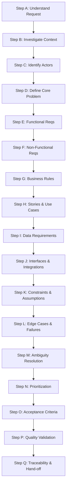

---
name: requirements-analysis
description: Analyzes software project ideas, user needs, stakeholder expectations, existing requirements, business rules, functional and non-functional requirements, use cases, acceptance criteria, constraints, ambiguities, and requirement gaps. Use when discovering, clarifying, validating, documenting, or revising software requirements before implementation or when evaluating substantial feature changes.
---

# Requirements Analysis Skill

This skill guides the AI coding agent to rigorously discover, analyze, clarify, structure, and validate software requirements before technical design or implementation begins. It ensures that development is grounded in genuine user needs, unambiguous business rules, verifiable quality attributes, and explicit constraints.

## 1. Purpose and Scope

Requirements analysis bridges the gap between high-level project vision and concrete technical execution. This skill equips the agent to answer critical discovery questions:

- **What problem is the user trying to solve?** The core friction, operational bottleneck, or unmet need.
- **Who will use the system, and what do they need?** Primary actors, user personas, operational roles, and their specific goals.
- **What should the system do?** The functional capabilities, behavioral workflows, and domain transformations.
- **What rules and constraints govern its behavior?** Business policies, calculations, state transitions, validation boundaries, and regulatory rules.
- **How should the system behave under exceptional conditions?** Edge cases, validation failures, concurrency conflicts, network outages, and recovery paths.
- **What quality attributes must the solution satisfy?** Non-functional requirements (NFRs) including security, performance, accessibility, availability, and scalability.
- **Which requirements are confirmed, assumed, ambiguous, conflicting, or missing?** Explicit status categorization of all requirement statements.
- **How can each requirement be verified?** Observable, testable acceptance criteria linked to business outcomes.
- **What information is needed before implementation can proceed safely?** Critical prerequisites, blocking questions, and architectural dependencies.

*Scope Boundary*: This skill focuses on requirements elicitation, analysis, scoping, ambiguity resolution, and acceptance criteria definition. It does not replace project roadmap planning, architectural diagramming, physical database schema design, or code implementation.

## 2. When to Use This Skill

### Trigger Scenarios

Activate this skill when:
- **Initiating a New Software Project**: Exploring problem space, user goals, and foundational capabilities.
- **Evaluating Feature Requests**: Translating vague user requests or high-level tickets into structured, testable specifications.
- **Reviewing Upstream Documents**: Analyzing existing PRDs, SRS documents, user stories, or design briefs for gaps and ambiguities.
- **Pre-Architecture Discovery**: Defining system boundaries, business rules, and non-functional constraints before architectural design.
- **Resolving Conflicts & Ambiguities**: Reconciling contradictory requirements, unmasking subjective adjectives, or untangling overlapping user workflows.
- **Substantial Feature Refactoring**: Assessing the behavioral and functional impact of altering existing business logic or data contracts.
- **Defining Acceptance Criteria**: Establishing verifiable quality gates and edge-case behaviors for complex requirements.

### When NOT to Use This Skill

Do not invoke this skill for:
- Routine, localized bug fixes with established repro steps and clear expected behavior.
- Minor refactorings that preserve identical functional behavior.
- Cosmetic styling adjustments or typographical corrections.
- Straightforward code tasks whose requirements are already exhaustively specified.

## 3. Requirements Analysis Workflow

Follow this seventeen-step procedure to analyze requirements systematically:

### Step A: Understand the Request

1. **Identify the Core Objective**: Extract what the user or stakeholder wants to accomplish and the underlying problem being addressed.
2. **Determine Scope Level**: Classify whether the request is a greenfield system, a major subsystem, an isolated feature, or an enhancement.
3. **Preserve Explicit Intent**: Record explicitly stated requirements verbatim in concept; do not distort user intent with agent preferences.
4. **Distinguish Needs from Solutions**: Separate what the system must achieve (the requirement) from how it might be built (the technical implementation).
5. **Resist Premature Architecture**: Avoid selecting specific databases, libraries, or design patterns until functional and quality needs are understood.

### Step B: Investigate Existing Context

- **For Existing Codebases**:
  - Inspect repository structure, data models, API endpoints, and configuration files.
  - Review existing user roles, authorization guards, business logic, and validation rules.
  - Identify reusable capabilities to avoid specifying duplicate functionality.
  - Audit existing documentation in `docs/` and compare documented intent against actual code implementation.
  - Flag discrepancies where current system behavior diverges from documentation.
- **For New Greenfield Projects**:
  - Review provided problem statements, target market descriptions, and customer briefs.
  - Identify explicitly mandated constraints (e.g., target deployment environment, regulatory compliance).
  - Note unstated details as open questions or provisional assumptions.

### Step C: Identify Stakeholders and Actors

Identify all entities that interact with or are impacted by the system:
- **Primary Human Actors**: End users, administrators, support staff, operators, and audit reviewers.
- **System Actors**: Automated background schedulers, event listeners, and worker processes.
- **External Actors**: Third-party APIs, payment gateways, identity providers, and webhook senders.
- **Role Differentiation**: Define boundaries where roles require distinct capabilities, data visibility, or permissions. Avoid inventing extraneous roles not justified by actual workflows.

### Step D: Identify the Core Problem and Desired Outcomes

1. **State the Underlying Friction**: Detail why current methods, manual processes, or legacy systems fail to satisfy user goals.
2. **Define Successful Resolution**: Describe what observable changes will occur once the system or feature is successfully deployed.
3. **Separate Core from Nice-to-Have**: Differentiate primary success outcomes from secondary conveniences.
4. **Evidence-Based Metrics**: Define quantifiable metrics (e.g., "reduces checkout steps from 5 to 2") only when grounded in explicit stakeholder goals; never invent fabricated conversion or revenue claims.

### Step E: Discover Functional Requirements

Enumerate what the system must do across its operational lifecycle:
- **Discovery Checklist**:
  - Authentication, onboarding, session management, and password recovery.
  - Role-based authorization, permissions, and tenant isolation.
  - Domain-specific workflows and business transaction processing.
  - CRUD operations, batch imports, search, filtering, and sorting.
  - Notifications, alerts, transactional emails, and messaging.
  - Reporting, dashboards, data aggregations, and exports (CSV/PDF).
  - Administrative management, configuration controls, and feature toggles.
  - Audit trails, event logging, and compliance history.
  - Error recovery, retry workflows, and cancellation mechanisms.

- **Requirement Specification Format**:
  - **ID**: Stable identifier (e.g., `FR-AUTH-01`).
  - **Title & Description**: Clear statement of system behavior.
  - **Actor**: The initiator or beneficiary of the action.
  - **Preconditions**: Required system state prior to execution.
  - **Trigger & Main Flow**: The initiating event and sequential system response.
  - **Postconditions**: Expected state change and persisted data upon completion.

### Step F: Discover Non-Functional Requirements (NFRs)

Define the operational qualities, architectural constraints, and system attributes:
- **Security & Privacy**: Authentication strength, encryption in transit/rest, RBAC, session lifecycles, and PII protection (reference [security.md](../../rules/security.md)).
- **Performance & Latency**: Acceptable response times (e.g., API p95 < 200ms), throughput, and payload limits (reference [performance-optimization.md](../../rules/performance-optimization.md)).
- **Reliability & Availability**: Uptime expectations, fault tolerance, transaction idempotency, and disaster recovery.
- **Accessibility**: Compliance targets (e.g., WCAG 2.2 AA), keyboard navigation, screen reader support, and minimum contrast (reference [accessibility.md](../../rules/accessibility.md)).
- **Scalability**: Projected concurrent users, data volume growth rates, and storage thresholds.
- **Maintainability & Observability**: Structured JSON logging, health check endpoints, telemetry, and error reporting.

### Step G: Identify Business Rules

Extract core business logic and institutional rules that govern operations:
- **Policy Enforcement**: Eligibility criteria, pricing algorithms, tax calculations, approval thresholds, and discount rules.
- **State Machine Transitions**: Valid transitions between entity states (e.g., `Draft` -> `PendingReview` -> `Published` -> `Archived`) and prohibited regressions.
- **Enforcement Locus**: Determine whether rules require strict database constraints, server-side validation, or synchronous approval.
- **Consistency Verification**: Ensure business rules do not contradict one another across different endpoints or user channels.

### Step H: Define User Stories and Use Cases

- **User Story Structure**:
  > As a `[role]`, I want to `[perform action]`, so that `[achieve value/outcome]`.
- **Use Case Elaboration**:
  For complex interactions, document:
  - **Main Success Scenario**: Numbered step-by-step happy path.
  - **Alternative Extensions**: Divergent paths (e.g., user selects guest checkout).
  - **Exception Flows**: Error handling (e.g., payment declined, item out of stock).

### Step I: Analyze Data and Information Requirements

- **Entities & Relationships**: Identify fundamental business objects, attributes, and associations (1:1, 1:N, N:M).
- **Data Lifecycle**: Map creation, retrieval, updates, archival policies, and deletion (soft vs. hard delete).
- **Integrity & Validation Constraints**: Required fields, uniqueness rules, data types, and cross-field dependencies.
- **Sensitive Data Categorization**: Identify credentials, financial records, and PII requiring masking or encryption.
- *Boundary Note*: Document business data needs, not physical SQL table schemas or index definitions (delegate to [database.md](../../rules/database.md)).

### Step J: Identify Interfaces and Integrations

- **External Services**: Third-party APIs, webhooks, payment processors, SSO providers, and email relays.
- **Contracts & Quotas**: Rate limits, webhook signatures, payload schemas, and timeout expectations.
- **Failure Resilience**: Fallback behaviors when external dependencies experience degradation or outages.

### Step K: Identify Constraints and Assumptions

Classify project factors into five unambiguous categories:
1. **Confirmed**: Explicitly validated facts or hard constraints (e.g., "Must run on Node 20+").
2. **Assumption**: Provisional working hypothesis adopted to maintain progress; requires validation.
3. **Unknown**: Critical information that is currently missing and cannot be assumed.
4. **Conflict**: Contradictory instructions or requirements requiring stakeholder resolution.
5. **Recommendation**: Optional engineering improvement proposed by the agent; awaiting client approval.

### Step L: Identify Edge Cases and Failure Scenarios

Anticipate reality beyond the happy path:
- **Input Boundaries**: Empty strings, maximum length strings, Unicode/emojis, negative numbers, malformed emails.
- **Concurrency & Races**: Simultaneous checkouts of the last inventory item, double-clicks on submit buttons.
- **Authorization Breaches**: Manipulated IDs in URLs/payloads, expired sessions, insufficient permissions.
- **Infrastructure Failures**: Network disconnect mid-upload, database lock timeouts, partial batch failures.

### Step M: Identify Ambiguities and Conflicts

- **Eliminate Subjective Adjectives**: Reject undefined terms like "fast", "intuitive", "secure", "user-friendly", or "modern". Replace with quantifiable parameters or specific interaction patterns.
- **Targeted Questioning**:
  - Ask only when missing information blocks core architecture, data integrity, or security.
  - Group related inquiries into concise, structured questions.
  - Never ask questions that can be answered by reading the codebase.
- **Safe Provisional Assumptions**: For non-critical ambiguities, document a sensible assumption, state it clearly, and proceed. Never guess silently on high-risk business logic.

### Step N: Prioritize Requirements

Structure requirements using the MoSCoW framework:
- **Must-Have (M)**: Non-negotiable core requirements. Without these, the release cannot function.
- **Should-Have (S)**: High-priority capabilities that add significant value but have acceptable temporary workarounds.
- **Could-Have (C)**: Desirable enhancements included only if time and resources permit.
- **Won't-Have (W)**: Explicitly deferred features out-of-scope for the current release.

*Rule*: Core security, accessibility, and data integrity requirements must never be relegated to optional or deferred status.

### Step O: Define Acceptance Criteria

Provide unambiguous, testable verification conditions for every requirement:
- **Given-When-Then Format**:
  > **Given** `[precondition / context]`,  
  > **When** `[action / event occurs]`,  
  > **Then** `[observable outcome / state change]`.
- **Negative Conditions**: Include explicit assertions for invalid inputs, unauthorized attempts, and boundary exceedances.

### Step P: Validate Requirement Quality

Audit all documented requirements against the standard quality criteria:
- **Clarity**: Unambiguous, plain language readable by both developers and stakeholders.
- **Consistency**: Free from contradictions with other requirements or existing code.
- **Completeness**: Preconditions, triggers, inputs, outputs, exceptions, and business rules are specified.
- **Feasibility**: Realistically implementable within technical and architectural constraints.
- **Testability**: Empirically verifiable via automated or manual testing.
- **Traceability**: Linked to business objectives, user roles, and implementation tasks.

### Step Q: Trace Requirements to Deliverables

Maintain a bidirectional traceability matrix connecting requirements to downstream tasks and tests:

| Requirement ID | Requirement Summary | Priority | Acceptance Criteria | Target Deliverable / Test | Status |
|---|---|---|---|---|---|
| FR-AUTH-01 | Secure password login | Must | AC-AUTH-01 | `src/auth/`, `tests/auth.test.ts` | Ready |
| FR-BOOK-02 | Book search by author | Should | AC-BOOK-02 | `src/books/`, `tests/search.test.ts` | Ready |

## 4. Requirements Analysis Output Format

When generating a formal requirements analysis document, structure the output using the following standard template:

---

### Requirements Specification: [Project / Feature Title]

#### 1. Executive Summary
Overview of the core problem, target audience, and business objective.

#### 2. Stakeholders & Actors
- **Primary Users**: [Roles and goals]
- **System Actors**: [Background services and external systems]

#### 3. Scope Boundaries
- **In-Scope**: [Explicitly included capabilities]
- **Out-of-Scope**: [Explicitly excluded features for this phase]

#### 4. Functional Requirements

| ID | Title & Description | Actor | Priority | Acceptance Criteria |
|---|---|---|---|---|
| FR-01 | [Clear behavioral statement] | [Role] | Must | [Given-When-Then criteria] |

#### 5. Non-Functional Requirements
- **Security**: [Auth, encryption, RBAC]
- **Performance**: [Latency, throughput targets]
- **Accessibility**: [WCAG 2.2 AA, keyboard navigation]
- **Reliability & Availability**: [Uptime, failure modes]

#### 6. Business Rules
- **BR-01**: [Specific calculation, constraint, or state machine rule]

#### 7. User Stories & Key Workflows
- **US-01**: As a `[role]`, I want to `[action]`, so that `[benefit]`.
  - *Main Flow*: 1. User does X... 2. System responds with Y...
  - *Exceptions*: If Z fails, system displays error E...

#### 8. Data & Integration Requirements
- **Core Entities**: [Entities, attributes, relationships]
- **External APIs**: [Third-party services, rate limits, webhooks]

#### 9. Constraints, Assumptions & Classifications
- **Confirmed Facts**: [Verified parameters]
- **Working Assumptions**: [Provisional decisions adopted]
- **Identified Conflicts**: [Contradictions highlighted for resolution]

#### 10. Traceability & Verification Matrix

| Req ID | Requirement | Priority | Verification Method | Status |
|---|---|---|---|---|
| FR-01 | User authentication | Must | Automated Integration Test | Ready |

#### 11. Open Questions & Blockers
- **Question 1**: [Specific high-impact question for user]

#### 12. Readiness Assessment
- **Status**: [Ready / Needs Clarification / Blocked]
- **Readiness Summary**: [Assessment of whether development can proceed safely]

---

## 5. Requirements Readiness Assessment

Classify the overall analysis or individual requirements using these standard states:
- **Ready**: Completely specified, consistent, feasible, and testable; implementation may safely begin.
- **Needs Clarification**: Minor ambiguities or secondary questions remain; low-risk implementation may proceed on non-blocked components.
- **Blocked**: Fundamental business rule, security boundary, or architecture constraint is missing or conflicting; implementation must halt on affected areas.
- **Proposed**: Suggested capability or optimization formulated by the agent; awaiting stakeholder confirmation.
- **Validated**: Formally reviewed and verified against stakeholder requirements or existing codebase evidence.

## 6. Documentation and Templates

- **Template Inspection**: Check `.agents/templates/` (e.g., `prd/`, `srs/`, `project-planning/`) before creating requirements documents.
- **Persistent Storage**: Save formal requirements artifacts in `docs/requirements/` (e.g., `docs/requirements/feature-x-analysis.md`) in accordance with [documentation.md](../../rules/documentation.md).
- **Never Store Requirements in Skills**: Do not save project-specific requirements documents inside `.agents/skills/requirements-analysis/`.
- **Preserve Historical Documentation**: When updating existing specifications, preserve verified requirements and historical context; never overwrite without inspection.
- **Mark Drafts Explicitly**: Clearly label unconfirmed requirement documents as `[Draft - Proposed]` until formally approved.

## 7. Interaction and Decision Principles

1. **Investigate First**: Exhaust repository code, commit history, and existing documentation before asking user questions.
2. **Actionable Inquiries**: Ask only questions that materially affect scope, security, data integrity, or core architecture.
3. **Structured Question Bundling**: Consolidate questions logically; avoid sending fragmented, piecemeal questions across multiple turns.
4. **State Assumptions Clearly**: If an ambiguity is low-risk, state the adopted assumption and proceed rather than blocking the user.
5. **Requirements Precede Coding**: Never write production code, alter database schemas, or implement features while in requirements analysis mode.

## 8. Rule Harmony and Skill Collaboration

This requirements analysis skill works in synergy with existing project rules and complementary skills:

- [core-workflow.md](../../rules/core-workflow.md): Governs overall analyze-plan-implement-verify lifecycle.
- [change-safety.md](../../rules/change-safety.md): Ensures requirements preserve existing functionality and prevent unintended scope expansion.
- [security.md](../../rules/security.md): Defines baseline authentication, authorization, and data protection requirements.
- [database.md](../../rules/database.md): Informs data integrity, entity constraints, and migration rules.
- [accessibility.md](../../rules/accessibility.md): Embeds WCAG 2.2 AA and keyboard navigation requirements into UI specifications.
- [performance-optimization.md](../../rules/performance-optimization.md): Establishes measurable latency, throughput, and resource NFRs.
- [api-design.md](../../rules/api-design.md): Informs interface and external contract specifications.
- [documentation.md](../../rules/documentation.md): Directs persistent requirements document organization in `docs/requirements/`.

*Complementary Skills*:
- `project-planning`: Transforms analyzed requirements into phased milestones, dependency maps, and task breakdowns.
- `prd-writing` & `srs-writing`: Formats analyzed requirements into formal product or system specifications when formal documents are requested.
- `architecture-design` & `database-design`: Converts analyzed functional and non-functional requirements into system architectures and data schemas.
