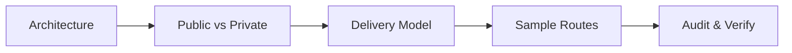

---
name: seo-audit
description: Audits websites for technical SEO, crawlability, indexability, page metadata, canonical URLs, robots directives, XML sitemaps, structured data, internal linking, JavaScript rendering, and relevant performance issues. Use when diagnosing search visibility problems, reviewing SEO implementation, inspecting public page discoverability, auditing metadata, investigating indexing barriers, or verifying SEO-related changes.
---

# Technical SEO Audit Skill

This skill teaches the agent to evaluate web applications, websites, and content platforms for technical SEO barriers, crawlability defects, indexing misconfigurations, metadata inconsistencies, structured data errors, and search-related implementation risks.

## 1. Purpose and Core Principles

Technical SEO ensures search engines can discover, crawl, render, understand, and index public content appropriately without resorting to manipulative tactics. Follow four principles:

- **Understand Purpose & Boundaries**: Establish which pages should be discoverable (marketing, articles, public catalogs) and which must remain private (dashboards, admin panels, staging, account areas). Never index private routes.
- **Prioritize Users & Quality Content**: Search engines reward genuine user utility. Reject keyword stuffing, doorway pages, deceptive metadata, and hidden text. Technical SEO assists discovery; it does not replace quality content.
- **Follow Authoritative Guidance**: Ground technical assessments in official documentation (Google Search Central, Search Essentials, W3C standards, schema.org). Distinguish specifications from unverified SEO folklore.
- **Separate Evidence from Predictions**: A technical audit identifies implementation defects and indexing barriers. It cannot guarantee specific rankings, indexing timelines, or rich result appearances.

*Scope Boundary*: Focuses strictly on technical and on-page SEO auditing, crawlability, indexability, metadata, structured data, and verification. For accessibility, use [accessibility-audit](../accessibility-audit/SKILL.md); for performance diagnostics, use [performance-profiling](../performance-profiling/SKILL.md); for frontend coding, use [frontend-development](../frontend-development/SKILL.md); for backend routing, use [backend-development](../backend-development/SKILL.md); for testing, use [testing-qa](../testing-qa/SKILL.md).

## 2. Defining the Audit Scope

Before inspecting code or URLs, establish clear evaluation boundaries:



- **Architecture & Domain**: Identify SSR, SSG, SPA, or CMS delivery. Enforce primary canonical hostnames (`https://example.com` vs `https://www.example.com`). Distinguish production from staging/dev.
- **Route Sampling**: For large catalogs, inspect representative templates: homepage, category index, item detail, editorial post, paginated list, and error pages.
- **In-Scope vs. Excluded**:
  - *In-Scope*: Public marketing pages, blog posts, documentation, public catalogs.
  - *Excluded*: `/admin/*`, `/dashboard/*`, `/auth/*`, `/api/*`, checkout/cart sessions, user settings.
- **Tooling Constraints**: Document whether live external endpoints, Search Console, or browser rendering tools are accessible in the execution environment.

## 3. SEO Audit Workflow

Execute technical SEO audits systematically through five sequential phases:

- **Phase A (Search Objective & Discovery)**: Identify site intent, audience, canonical domains, and existing SEO conventions or sitemaps.
- **Phase B (Site Structure & Route Mapping)**: Inspect route manifests, page templates, dynamic path parameters, query parameters, redirects, and error handling.
- **Phase C (Rendering & Delivery Inspection)**: Evaluate delivered HTML vs. client DOM. Verify search bots receive essential content and metadata without executing client scripts.
- **Phase D (Technical SEO Foundation Audit)**: Inspect status codes, robots.txt, robots meta tags, canonical tags, sitemaps, internal links, headings, structured data, and mobile signals.
- **Phase E (Validation & Prioritization)**: Verify suspected issues against source code and HTTP responses. Eliminate false positives and prioritize findings by indexability impact.

## 4. Crawlability and Indexability

Crawlability and indexability are distinct, interdependent mechanisms:

- **Crawlability (Can Bots Reach the Page?)**: Crawlers discover URLs via links. Blockers: `robots.txt` disallows, 404/500 errors, crawl traps (infinite query strings), timeouts, redirect loops.
- **Indexability (Can Bots Store & Display the Page?)**: Engines decide whether to index. Blockers: `noindex`, canonicals pointing elsewhere, soft 404s, auth walls, missing HTML.
- **Critical Caution (`robots.txt` vs. `noindex`)**: Never use `robots.txt` to enforce `noindex`. Crawlers cannot read `noindex` tags if blocked by `robots.txt`. To block indexing, allow crawling and return `noindex`.

## 5. Titles and Page Metadata

Page metadata communicates the topic and intent of each route to crawlers and searchers:

- **HTML `<title>` Tag**: Every public page must have a distinct, descriptive title. Avoid identical sitewide titles. Follow patterns like `Primary Topic - Category | Brand` (50–60 characters / ~600px). Avoid keyword stuffing.
- **Meta `<meta name="description">`**: Provide unique, compelling summaries (120–160 characters) accurately representing page content. Avoid duplicate descriptions across routes. Search engines generate snippets dynamically if unhelpful.
- **Social Tags**: Provide Open Graph (`og:title`, `og:description`, `og:image`, `og:url`) and Twitter Card tags. Ensure `og:url` matches the canonical URL.

## 6. Heading Structure and Content Organization

Content headings help crawlers parse thematic hierarchy and section relevance:

- **Primary Heading (`<h1>`)**: Every indexable page should have exactly one descriptive `<h1>` matching the page's primary subject and title intent.
- **Hierarchical Flow (`<h2>`-`<h6>`)**: Structure subtopics logically (`h1` $\rightarrow$ `h2` $\rightarrow$ `h3`). Do not skip heading levels for visual styling.
- **Avoid Boilerplate Headings**: Do not mark repeated sitewide UI elements ("Navigation", "Footer Links", "Sidebar") as `<h1>` or `<h2>`.
- **Content Prominence**: Ensure meaningful, unique content appears high in the DOM before repetitive boilerplate. Avoid hiding content behind interactions without crawlable text.

## 7. URL Structure and Canonicalization

Canonicalization consolidates link equity and tells search engines which URL version is authoritative:

- **Canonical Tag Syntax**: Provide `<link rel="canonical" href="...">` in `<head>`. Canonical URLs must always be absolute, using correct protocol (`https://`), domain, and trailing slashes.
- **URL Normalization**: Enforce single domain variant (`www` vs non-`www`), enforce HTTPS via 301 redirects, and normalize trailing slashes and lowercase paths.
- **Query & Filter Handling**: Catalog filters (`?sort=price_asc`) should canonicalize to primary category URLs unless representing distinct search intent. Tracking parameters must never self-canonicalize.
- **Signal vs. Directive**: Canonical tags are hints, not mandates. If canonicals point to 404s, unrelated content, or conflict with sitemaps, engines ignore them.

## 8. Robots.txt, Robots Directives, and Response Headers

Manage search crawler access safely without exposing private infrastructure:

- **`robots.txt` Rules**: Resides at root (`/robots.txt`) returning HTTP 200 `text/plain`. Never block CSS/JS/fonts (blocks rendering). Staging must block all crawlers (`Disallow: /`). Never list secret URLs.
- **Robots Meta Directives**: Use `<meta name="robots" content="index, follow">` for standard pages; use `noindex, follow` to exclude pages while following links; use `noindex, nofollow` for search results and checkout.
- **`X-Robots-Tag` Header**: Essential for non-HTML resources (PDFs, downloads): `X-Robots-Tag: noindex`.

## 9. XML Sitemaps

XML sitemaps provide an authoritative inventory of discoverable canonical URLs:

- **Protocol Hygiene**: Follow sitemaps.org schema. List only 200 OK, canonical, indexable URLs. Never list redirects, 404s, or `noindex`. URLs must be absolute.
- **`<lastmod>` Integrity**: Provide `<lastmod>` only when it reflects genuine content updates (`YYYY-MM-DD`). Never spoof `<lastmod>` to current timestamp on every request.
- **Sitemap Indexing & Size Limits**: Max 50,000 URLs or 50 MB per file. Use a sitemap index (`sitemap-index.xml`) referencing partitioned sitemaps for large catalogs. Reference sitemap in `robots.txt`.

## 10. Internal Links, Navigation, and Crawl Architecture

Internal links establish architecture, distribute authority, and guide crawlers:

- **Crawlable Links**: Use semantic `<a href="...">`. Crawlers do not execute button or div click handlers as links. Link directly to canonicals without redirect hops.
- **Meaningful Anchor Text**: Anchor text must clearly describe the destination. Avoid generic text ("click here", "read more").
- **Breadcrumbs & Orphans**: Provide visible breadcrumbs reflecting hierarchy (`Home > Books > Engineering`). Ensure important public pages are reachable within 3–4 clicks from homepage without orphan pages.
- **Pagination**: Paginated sequences (`/books?page=2`) must link via crawlable `<a href="...">` tags and self-canonicalize. Never canonicalize page 2+ to page 1.

## 11. HTTP Status Codes, Redirects, and Error Handling

Proper HTTP response codes communicate page lifecycle and content availability:

- **HTTP 200 OK**: Normal response for active, indexable content.
- **HTTP 301 vs. 302**: Use 301 for permanent migrations; use 302 only for temporary reroutes. Avoid redirect chains (`A -> B -> C`) and loops; flatten to `A -> C`.
- **HTTP 404 vs. 410**: Return true 404 or 410 for deleted content.
- **Soft 404s**: Never return HTTP 200 OK on "Item Not Found" or empty search results. Engines drop soft 404s. Avoid redirecting all missing URLs to homepage.

## 12. Structured Data and Schema Markup

Structured data (JSON-LD) provides machine-readable semantics, qualifying pages for rich results:

- **Format & Vocabulary**: Prefer JSON-LD in `<script type="application/ld+json">`. Use official schema.org vocabularies adhering to Google Search Central requirements.
- **Core Schema**: `Article` (headline, author), `Product` / `Offer` (name, price, stock), `Organization` (name, logo), `BreadcrumbList`, `Book`.
- **Content Parity**: Schema must reflect visible content. Never fabricate prices, ratings, or reviews in schema that do not appear to real users.
- **Validation**: Verify syntax via Schema.org Validator or Rich Results Test. Valid schema grants eligibility for rich results; it never guarantees display.

## 13. JavaScript Rendering and Single-Page Applications

Client-side rendering introduces latency and indexing risks:

- **Initial HTML vs. DOM**: Inspect raw HTML (`curl -sL`). If initial HTML is an empty `<div>`, crawlers queue two-stage rendering, risking delays or timeouts.
- **SSR & SSG Recommendation**: Server-Side Rendering (SSR) or Static Site Generation (SSG) is strongly recommended for public, search-critical routes.
- **Link Discoverability**: Ensure links render as real `<a href="/target">` tags in initial HTML, not client-side script events.
- **Hydration Errors**: Guard against hydration mismatches that wipe out server-rendered metadata upon client mounting.

## 14. Media and Content Discoverability

Ensure non-text media assets are accessible and discoverable:

- **Image Optimization**: Use descriptive file names (`clean-code-book.jpg`), informative `alt` text, explicit `width`/`height` (prevents CLS), and modern formats (`srcset` with WebP/AVIF).
- **Lazy Loading**: Use `loading="lazy"` below the fold. Never lazy-load the primary LCP hero image (delays render).
- **Video & Audio**: Provide captions, transcripts, and `VideoObject` structured data where applicable.

## 15. Mobile Usability and Page Performance Signals

Page performance and mobile ergonomics represent fundamental search quality signals:

- **Mobile Viewport & Parity**: Require `<meta name="viewport" ...>`. Mobile and desktop must serve identical content, schema, and metadata.
- **Core Web Vitals (CWV)**: Target LCP $\le 2.5\text{s}$, INP $\le 200\text{ms}$, CLS $\le 0.1$.
- **Avoid Score Obsession**: Focus on real technical bottlenecks (render-blocking assets, uncompressed media) rather than chasing 100/100 lab scores.

## 16. Duplicate and Low-Value Content Signals

Protect crawl budget and indexing authority from content dilution:

- **Faceted Navigation**: Filter combinations must canonicalize to primary category URLs or be blocked via `robots.txt`.
- **Thin or Empty Pages**: Category archives containing 0 items should return 404 or mark `noindex, follow` until populated.
- **Staging Leaks**: Prevent staging environments from being indexed by enforcing `noindex` or HTTP authentication.
- **No Arbitrary Word Counts**: Search engines do not enforce minimum word counts. A concise 150-word answer is preferable to 1,500 words of filler.

## 17. International and Local SEO

When websites target multiple languages, countries, or physical locations:

- **Hreflang Annotations**: Use `<link rel="alternate" hreflang="es" href="...">` for language variants. Hreflang requires reciprocal links. Include `x-default` fallback.
- **Local Business**: Maintain consistent Name, Address, and Phone (NAP) and implement `LocalBusiness` structured data for storefronts.

## 18. Private Routes and Application Boundaries

Maintain clear segregation between public web content and private application routes:

- **Enforce True Auth**: Never rely on `robots.txt` or `noindex` for security. Protect sensitive routes with server-side auth.
- **Private Route Directives**: Apply `<meta name="robots" content="noindex, nofollow">` to login forms, portals, and account screens.
- **Exclude from Sitemaps**: Verify zero inclusion of `/account`, `/reset-password`, `/admin`, or `/checkout` routes in XML sitemaps.

## 19. Search Console and Live Performance Telemetry

Differentiate verified technical code capabilities from external search engine indexing state:

| State | Definition & Evidence |
| :--- | :--- |
| **Technically Valid** | Code complies with standards (valid HTML, canonical tag, JSON-LD syntax). |
| **Crawlable** | Page is publicly reachable, returns HTTP 200, and is not blocked by `robots.txt`. |
| **Eligible for Indexing** | Page contains indexable directives, unique content, and valid canonical signals. |
| **Indexed by Engine** | Verified via Google Search Console URL Inspection or live `site:` query. |
| **Ranking & Traffic** | Verified via Search Console Performance reports or web analytics telemetry. |

*Honesty Standard*: Never claim a page is indexed, ranking, or gaining organic clicks without live Search Console or analytics data.

## 20. SEO Audit Tools and Technology Selection

Select low-overhead, tool-agnostic inspection methods tailored to the workspace:

- **CLI & Network**: `curl -ILs` (inspect HTTP status, redirects, headers), `curl -sL` (inspect raw server HTML vs client DOM).
- **Browser Tools**: Chrome DevTools (Elements tree, Network waterfall, Lighthouse SEO audit), Web Vitals extension.
- **Validators**: Schema.org Validator, Google Rich Results Test CLI/web API, W3C HTML Validator.
- **Automated Crawlers**: Low-overhead bounded crawlers for local route sampling. Enforce rate limits; never run unbounded crawls against production.

## 21. SEO Finding Quality and Severity

Prioritize issues by practical indexability and search visibility risk:

| Severity | Definition & Impact | Typical Examples |
| :--- | :--- | :--- |
| **Critical** | Complete blockage of crawling or indexing for essential public pages. | Production site marked `noindex`; `robots.txt` disallows `/`; sitewide 500 error. |
| **High** | Substantial barrier impacting major URL families or canonical signals. | Missing/broken canonicals across all items; empty initial HTML on SPA; sitemap 404. |
| **Medium** | Meaningful technical risk; workaround or partial indexing exists. | Duplicate title tags; slow LCP $>4.0\text{s}$; missing structured data on products. |
| **Low** | Minor optimization opportunity with negligible immediate disruption. | Missing image alt on decorative asset; meta description slightly long; minor XML flaw. |
| **Informational** | Best-practice observation or forward-looking architectural note. | Suggesting sitemap partitioning; advisory on upcoming schema updates. |

## 22. Required SEO Finding Format

Every substantive SEO finding must document:
- **Title & Severity**: Finding summary with level (Critical, High, Medium, Low, Informational).
- **Location & Scope**: Exact URL, route file, or config; scope (single page, route family, sitewide).
- **Confidence & Evidence**: Level (Confirmed, High, Medium) with code snippet, curl trace, or sitemap line.
- **Condition & SEO Impact**: Triggers and concrete risks to crawling, indexing, or canonical equity.
- **Recommendation, Verification & Standard**: Actionable code fix, test procedure, and official reference (Google Search Central / RFC).

## 23. Remediation and Verification

When authorized to remediate technical SEO defects:

1. **Root Cause Analysis**: Determine whether defect stems from a shared template, routing middleware, or build configuration.
2. **Minimal Targeted Intervention**: Modify only what is necessary (e.g., fix canonical tag generation without restructuring layout).
3. **Verify Generated HTML**: Test rendered HTML using curl or browser inspection to confirm metadata, canonical tags, and status codes.
4. **Inspect Robots & Sitemaps**: Re-generate and validate `robots.txt` and XML sitemaps.
5. **Acknowledge Time Lag**: Inform stakeholders that code corrections take effect immediately on the server, but search engine re-crawling and re-indexing occur asynchronously over days or weeks.

## 24. Risk Management and Change Safety

Follow strict safety boundaries during SEO audits:

- **Read-Only by Default**: Never alter application code, routing, or redirects during an audit task unless explicitly authorized.
- **No Global Indexing Shifts Without Review**: Never modify site-wide `robots.txt` or meta robots tags without verifying the exact scope of affected URLs.
- **Preserve Existing URLs**: Never rename routes or remove pages without establishing 301 redirects to preserve existing inbound links.
- **Protect Private Data**: Never place private user URLs or authentication tokens in sitemaps or public meta tags.
- **No Manipulative SEO**: Strictly avoid doorway pages, hidden content, deceptive redirects, or spam markup.

## 25. Expected SEO Audit Report Format

Every substantive SEO audit must produce a structured diagnostic report following this format:

```markdown
# Technical SEO Audit Report: [Website Name]

## 1. Audit Summary & Scope
- **Target**: `https://example.com` (SSR/SSG) | **Risks**: 1 Critical robots leak; 1 High canonical omission
- **Routes**: Sampled `/`, `/books/[id]`, `/sitemap.xml` | **Excluded**: `/admin/*`, `/auth/*`

## 2. Prioritized Findings
### [CRIT-01] Staging Noindex Meta Tag Leaked Into Production Build
- **Location**: `src/app/layout.tsx:18` | **Scope**: Sitewide | **Confidence**: Confirmed
- **Evidence**: `<meta name="robots" content="noindex, nofollow" />` hardcoded in root layout.
- **SEO Impact**: Instructs search engines to de-index entire public website.
- **Recommendation**: Dynamicize robots metadata based on `process.env.APP_ENV === 'production'`.
- **Verification**: `curl -sL https://example.com | grep robots`; verify content is `index, follow`.
- **Standard Reference**: Google Search Central: Robots Meta Tag Specifications.

## 3. Verification Results & Action Plan
- **Verified**: Initial SSR HTML contains text; sitemap valid; 301 HTTPS active; mobile viewport set.
- **Action Plan**: 1. Remove `noindex` (`layout.tsx`); 2. Add canonicals (`[id]/page.tsx`); 3. Add `BreadcrumbList`.
- **Assessment & Limitations**: Excellent SSR base; fixing metadata restores discovery. Live traffic requires GSC.
```

## 26. Alignment with Existing Rules and Skills

This skill integrates with repository governance rules and development skills:
- **Governance Rules**:
  - Conforms to [core-workflow.md](../../rules/core-workflow.md) and [change-safety.md](../../rules/change-safety.md) by auditing non-destructively before proposing fixes.
  - Aligns with [frontend.md](../../rules/frontend.md) for metadata generation and component rendering.
  - Aligns with [backend.md](../../rules/backend.md) and [api-design.md](../../rules/api-design.md) for routing, status codes, and redirects.
  - Adheres to [security.md](../../rules/security.md) by keeping private and authenticated routes strictly unexposed.
- **Related Skills**:
  - [accessibility-audit](../accessibility-audit/SKILL.md): Check heading semantics, image alt text, and landmark structures.
  - [performance-profiling](../performance-profiling/SKILL.md): Deep-dive into Core Web Vitals (LCP, INP, CLS) bottlenecks.
  - [frontend-development](../frontend-development/SKILL.md): Implement approved metadata and rendering updates.
  - [testing-qa](../testing-qa/SKILL.md): Write automated regression tests for sitemap and metadata generation.

## 27. Final Validation Checklist

Before finalizing any technical SEO audit, verify all 10 criteria:

- [ ] **1. Defined Target & Scope**: Audit scope clearly identifies public target URLs, architecture, and excluded private routes.
- [ ] **2. Crawlability & Robots Checked**: `robots.txt`, crawl traps, and asset accessibility were evaluated without using `robots.txt` for `noindex`.
- [ ] **3. Indexability & Meta Directives Verified**: Robots meta tags, `X-Robots-Tag`, and HTTP status codes were inspected.
- [ ] **4. Canonicalization Evaluated**: Canonical URLs are absolute, valid, normalized, and consistent with internal links.
- [ ] **5. Titles & Metadata Assessed**: Titles and descriptions are unique, descriptive, non-stuffed, and dynamically template-generated.
- [ ] **6. Sitemaps Verified**: XML sitemap exists, contains only 200 OK canonical indexable URLs, and provides valid `<lastmod>`.
- [ ] **7. Rendering & JS Delivery Audited**: Initial HTML contains essential content and links without requiring fragile client-side scripts.
- [ ] **8. Structured Data Validated**: JSON-LD schema matches visible page content and adheres to official schema.org vocabularies.
- [ ] **9. Honest Standards Reporting**: Findings distinguish confirmed technical defects from external search console telemetry and ranking speculation.
- [ ] **10. Actionable & Prioritized Findings**: Every finding includes exact location, evidence, SEO impact, minimal fix, and verification steps.
