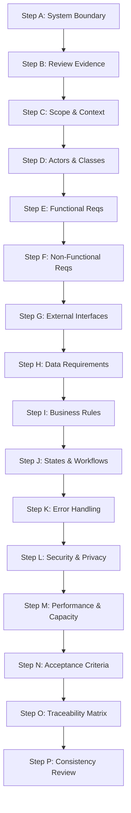

---
name: srs-writing
description: Creates, structures, reviews, and updates Software Requirements Specifications for software systems, applications, modules, and major features. Use when detailed functional requirements, non-functional requirements, system interfaces, external constraints, data requirements, system behavior, verifiable requirement statements, and requirements traceability need formal documentation.
---

# Software Requirements Specification (SRS) Writing Skill

This skill guides the AI coding agent to author, structure, review, and maintain production-quality Software Requirements Specifications (SRS). It ensures that software systems, modules, and major features are specified with unambiguous functional requirements, verifiable non-functional criteria, explicit interface contracts, rigorous business rules, and complete requirements traceability.

## 1. Purpose and Scope

A Software Requirements Specification (SRS) establishes the formal engineering contract describing *what* the software system must do and *how* it must behave externally, independent of internal implementation details. This skill answers key technical questions:

- **What software system or subsystem is being specified?** System boundaries, responsibilities, and external scope limits.
- **What functions must the software provide?** Exhaustive, testable functional capabilities across all user roles and system triggers.
- **How should the software behave under operational conditions?** State machines, workflows, concurrency expectations, and boundary responses.
- **Which users, external systems, and interfaces interact with it?** User interfaces, external APIs, hardware peripherals, and communication protocols.
- **What business rules and data constraints must it enforce?** Domain rules, calculations, validation logic, entity associations, and lifecycle rules.
- **What non-functional requirements govern the system?** Measurable criteria for security, performance, accessibility, availability, and reliability.
- **What exceptions and failure conditions must be handled?** Error taxonomy, recovery protocols, rollback expectations, and fallback behaviors.
- **What constraints limit the available solutions?** Operating runtimes, regulatory boundaries, architectural constraints, and legacy protocols.
- **How can each requirement be verified?** Observable verification methods (testing, demonstration, inspection, analysis) and acceptance criteria.
- **Which requirements remain unresolved?** Explicit tracking of assumptions, conflicts, and blocking dependencies.

*Scope Boundary*: Focuses strictly on formal software behavioral specifications, interface contracts, and requirements traceability. It does not replace high-level product vision (PRD), architecture diagrams, physical database schemas, or code implementation.

## 2. When to Use This Skill

### Trigger Scenarios

Activate this skill when:
- **Authoring a Formal System SRS**: Creating the technical specification for a new software application or platform.
- **Converting Approved PRDs into Technical Specifications**: Translating user-oriented product requirements into rigorous engineering specifications.
- **Specifying Major Subsystems or Modules**: Defining detailed requirements for complex subsystems (e.g., billing, auth, data pipelines).
- **Defining Interface Requirements**: Documenting integration contracts, data exchange formats, API schemas, and protocols.
- **Establishing Requirements Traceability**: Mapping product requirements to engineering specifications, acceptance criteria, and tests.
- **Revising Requirements Post-Change**: Updating the formal specification baseline following approved change requests.
- **Auditing Technical Requirements**: Reviewing existing specifications for ambiguities, untestable claims, contradictions, or missing edge cases.

### When NOT to Use This Skill

Do not invoke this skill for:
- Routine bug fixes or localized code patches.
- Internal refactorings that preserve identical externally observable behavior.
- High-level product vision exploration (use [prd-writing](../prd-writing/SKILL.md) instead).
- Raw requirements discovery and ambiguity resolution (use [requirements-analysis](../requirements-analysis/SKILL.md) instead).
- Physical database schema modeling or migration authoring (use [database.md](../../rules/database.md) instead).

## 3. SRS Writing Workflow

Follow this sixteen-step procedure to analyze, compose, and maintain an SRS:

### Step A: Understand the System Boundary

1. **Define the Scope Boundary**: Delineate what the software executes internally versus what is handled by external services, OS, hardware, or human processes.
2. **Identify Primary Responsibilities**: Specify the core services, data transformations, and behavioral obligations of the system.
3. **Establish External Entities**: Catalog all upstream clients, downstream APIs, background cron triggers, and identity providers that cross the boundary.
4. **Prevent Scope Creep**: Exclude external systems from internal specification; define the contract at the boundary.

### Step B: Review Existing Requirements and Evidence

- Inspect upstream documents: approved [PRD](../../../docs/product/), [requirements analysis](../../../docs/requirements/), and architecture records.
- Audit current codebase behavior, API routes, database schemas, and configuration files.
- Categorize statements: *Approved Requirement*, *Verified Implementation Fact*, *Provisional Assumption*, *Agent Recommendation*, *Unresolved Decision*, or *Known Conflict*.
- Flag discrepancies where legacy code contradicts documented requirements, recording conflicts explicitly.

### Step C: Establish Scope and Context

- Document system purpose, operating runtime environments (Node, JVM, Browser, OS versions), and deployment targets.
- Catalog included capabilities versus out-of-scope features to prevent ambiguity during engineering.
- Record critical technical assumptions and external dependencies (e.g., DNS, payment gateways, OAuth providers).

### Step D: Identify User Classes and Actors

- Catalog human user classes (e.g., Guest Shopper, Registered Member, Inventory Manager, Administrator).
- Identify system actors (e.g., Scheduled Task Daemon, Event Bus Consumer, External Webhook Relay).
- Detail access privileges, frequency of use, technical proficiency, and distinct security contexts for each actor.
- Base actors strictly on confirmed business workflows; avoid inventing speculative roles.

### Step E: Define Functional Requirements

Enumerate what the software *shall* do using precise, unambiguous, testable language:
- **Mandatory Phrasing**: Use "The system shall `[action]` when `[trigger]` given `[preconditions]`."
- **Specification Structure**:
  - **Requirement ID**: Stable identifier (e.g., `SRS-FR-AUTH-001`).
  - **Title**: Descriptive name of the functional capability.
  - **Preconditions**: Required system, user, or data state prior to execution.
  - **Primary Trigger & Action**: Initiating event and exact system behavioral response.
  - **Postconditions**: Resulting state, persisted data mutations, and emitted events.
  - **Alternative & Exception Flows**: Exact behavior on validation errors or boundary conditions.
- **Behavioral Focus**: Specify observable behavior, inputs, and outputs—never prescribe internal function names, class hierarchies, or design patterns.

### Step F: Define Non-Functional Requirements (NFRs)

Specify measurable quality attributes and system constraints:
- **Reliability & Availability**: Mean Time Between Failures (MTBF), target availability percentages, and graceful degradation modes.
- **Maintainability & Portability**: Modularity expectations, containerization standards, and multi-platform compatibility.
- **Usability & Accessibility**: Conformance criteria (e.g., WCAG 2.2 Level AA compliance, keyboard navigation; reference [accessibility.md](../../rules/accessibility.md)).
- **Measurable Standards**: Never use unquantified adjectives ("fast", "robust"). State exact metrics or mark them as `[Proposed Threshold]` awaiting approval.

### Step G: Define External Interface Requirements

Detail all boundary contracts across four explicit categories:
1. **User Interfaces (UI)**: Input constraints, navigation flows, error feedback mechanisms, and screen reader announcements.
2. **Software Interfaces**: External APIs, SDKs, database drivers, and OS services. Document request/response schemas, auth protocols, rate limits, and timeouts.
3. **Hardware Interfaces**: Direct hardware interactions (e.g., receipt printers, barcode scanners), including supported standards and driver constraints.
4. **Communication Interfaces**: Network protocols (HTTPS, WebSocket, gRPC), message formats (JSON, Protobuf), TLS standards, and retry policies.

### Step H: Define Data Requirements

- **Logical Entities & Attributes**: Catalog primary business entities, attribute data types, and logical relationships (1:1, 1:N, N:M).
- **Validation & Integrity Rules**: Mandatory fields, regex formats, numerical ranges, uniqueness constraints, and foreign key rules.
- **Data Lifecycle**: Retention policies, soft vs. hard deletion rules, archival schedules, and GDPR data purge obligations.
- **Sensitive Data Handling**: Field-level encryption requirements, tokenization, and masking rules for credentials, PII, and financial data.
- *Boundary Note*: Define logical data behavior, not physical SQL table layouts, column indexing, or partition strategies (delegate to [database.md](../../rules/database.md)).

### Step I: Define Business Rules and System Constraints

- Catalog domain calculations, approval hierarchies, status transition matrices, and transactional boundaries.
- Specify exact enforcement loci: trusted server-side enforcement versus client-side informational validation.
- Document regulatory, statutory, or organizational constraints (e.g., PCI-DSS, HIPAA, SOC 2 constraints).
- Highlight unresolved business rules that risk blocking implementation.

### Step J: Specify System States and Workflows

- Model stateful entities (e.g., `Order`, `BookLoan`, `AccountStatus`) using formal state transition tables or Mermaid state diagrams.
- Define valid states, triggering events, guard conditions, state transition outputs, and terminal states.
- Explicitly state system behavior when invalid state transitions are attempted.
- Define concurrency expectations and locking strategies for simultaneous state updates.

### Step K: Define Error Handling and Exceptional Behavior

- Categorize error modes: validation errors, authentication failures, authorization breaches, resource conflicts, timeouts, and dependency outages.
- Specify system response: transaction rejection, retry with exponential backoff, rollback, or dead-letter queue.
- Mandate zero partial-state corruptions: operations must be atomic.
- Define user-facing error messages: clear, actionable, and free from internal stack traces or database leaks.

### Step L: Define Security and Privacy Requirements

- **Authentication**: Credential hashing algorithms, multi-factor authentication (MFA) expectations, and session lifecycles.
- **Authorization & RBAC**: Role-based or attribute-based access control rules governing every endpoint and entity action.
- **Data Protection**: Encryption in transit (TLS 1.3) and at rest (AES-256), secure credential storage, and secret masking.
- **Audit Trails**: Security event logging requirements (failed logins, permission changes, sensitive data exports; reference [security.md](../../rules/security.md)).

### Step M: Define Performance and Capacity Requirements

- Quantify response time thresholds for critical user paths (e.g., "Search results rendered within 250ms under 500 concurrent users").
- Define system throughput expectations (e.g., requests per second, batch processing volume).
- Specify storage capacity limits, database connection pool limits, and memory utilization boundaries (reference [performance-optimization.md](../../rules/performance-optimization.md)).

### Step N: Define Acceptance and Verification Criteria

For every functional and non-functional requirement, assign an explicit verification method:
- **Testing (T)**: Automated unit, integration, or end-to-end test execution with verifiable assertions.
- **Demonstration (D)**: Observable operational walkthrough of system behavior without instrumentation.
- **Inspection (I)**: Visual audit of source code, configuration files, or database schemas.
- **Analysis (A)**: Theoretical calculation, simulation, or modeling of system performance or capacity.
- Structure verification criteria with observable, pass/fail conditions.

### Step O: Maintain Requirement Traceability

Construct a bidirectional Traceability Matrix linking requirements to upstream business goals and downstream verification assets:

| Req ID | Requirement Summary | Source (PRD / Issue) | Verification Method | Target Test / Deliverable | Status |
|---|---|---|---|---|---|
| SRS-FR-01 | Secure password authentication | PRD-FR-01 | Testing (T) | `tests/auth.test.ts` | Approved |
| SRS-FR-02 | Keyset pagination for books | PRD-FR-02 | Testing (T) | `tests/catalog.test.ts` | Approved |

### Step P: Review Requirement Consistency

Execute a comprehensive quality gate across the completed specification:
- Ensure no functional requirement contradicts an established non-functional constraint.
- Verify all error conditions have defined system outcomes and no partial-state corruptions.
- Check that all requirement IDs are unique, stable, and sequentially referenced.
- Ensure all unverified numbers or assumptions are explicitly tagged as `[Proposed]`.

## 4. Standard SRS Document Structure

When compiling a formal SRS, adhere to the following 12-section technical layout:

---

# Software Requirements Specification: [System or Module Name]

## 1. Introduction
- **1.1 Purpose**: Scope and objectives of this technical specification.
- **1.2 Document Conventions**: Typographic conventions, priority scales, and mandatory language ("shall").
- **1.3 Intended Audience**: Developers, QA engineers, security auditors, and architects.
- **1.4 Project Scope**: Core capabilities included and explicit boundaries.
- **1.5 References**: Links to PRDs, architecture decision records, and API standards.

## 2. Overall System Description
- **2.1 Product Perspective**: Relation to external platforms, legacy systems, and hosting tiers.
- **2.2 User Classes and Characteristics**: Roles, permissions, and access privileges.
- **2.3 Operating Environment**: Runtime engines, operating systems, and target client browsers.
- **2.4 Design and Implementation Constraints**: Mandated technologies, protocols, and regulatory limits.
- **2.5 Assumptions and Dependencies**: Technical assumptions and third-party dependencies.

## 3. System Context and External Interface Requirements
- **3.1 User Interfaces**: UI behavioral expectations, keyboard accessibility, and navigation constraints.
- **3.2 Software Interfaces**: Third-party APIs, auth providers, and database connectors.
- **3.3 Hardware Interfaces**: Supported physical peripherals, scanners, and sensors (if applicable).
- **3.4 Communication Interfaces**: HTTPS, WebSocket, message brokers, protocols, and encryption.

## 4. Functional System Requirements
- **4.1 Module / Domain A**:
  - **SRS-FR-001**: `[Requirement Title]`
    - *Statement*: The system shall...
    - *Preconditions*: ...
    - *Input / Trigger*: ...
    - *Output / Postcondition*: ...
    - *Exception Handling*: ...

## 5. Data Requirements
- **5.1 Logical Data Model**: Primary business entities, attributes, and relationships.
- **5.2 Data Validation & Integrity**: Field formats, uniqueness constraints, and foreign key rules.
- **5.3 Data Lifecycle & Retention**: Archival, deletion, and regulatory retention rules.

## 6. Business Rules & State Transition Models
- **6.1 Domain Business Rules**: Policies, calculations, and authorization limits.
- **6.2 State Transition Matrices**: State definitions, triggers, and invalid transition guards.

## 7. Non-Functional Quality Requirements
- **7.1 Performance Requirements**: Latency percentiles (p95, p99), throughput, and query limits.
- **7.2 Reliability & Availability**: Uptime targets, fault recovery, and data durability.
- **7.3 Security & Privacy Requirements**: Authentication, RBAC, encryption, and audit logging.
- **7.4 Usability & Accessibility Requirements**: WCAG 2.2 AA standards and keyboard operability.

## 8. Error Handling and System Recovery
- **8.1 Error Response Classification**: Standard error schemas, HTTP statuses, and recovery actions.
- **8.2 Transactional Atomicity**: Rollback requirements ensuring zero inconsistent state.

## 9. Verification & Acceptance Criteria
- **9.1 Verification Methods**: Classification by Test, Demonstration, Inspection, or Analysis.
- **9.2 Acceptance Quality Gates**: Criteria required before release approval.

## 10. Requirements Traceability Matrix
- Bidirectional mapping connecting PRD sources, SRS requirements, and automated tests.

## 11. Assumptions, Constraints & Open Decisions
- Documented technical assumptions, confirmed constraints, and open questions pending resolution.

## 12. Appendices
- Data flow diagrams, state charts, and technical glossary.

---

## 5. Requirement Writing Quality Standards

Every requirement statement in the SRS must satisfy standard engineering criteria:
- **Unambiguous**: Interpretable in exactly one way by developers, testers, and stakeholders.
- **Mandatory & Precise**: Formulated using "The system shall...", identifying actor, action, trigger, and result.
- **Verifiable**: Empirically provable through automated testing, demonstration, inspection, or analysis.
- **Implementation-Independent**: Describes externally observable behavior; never dictates internal variable names or class layouts.
- **Complete**: Covers preconditions, normal flow, validation rules, error handling, and expected postconditions.
- **Consistent**: Free from logical contradictions with other functional requirements or operational constraints.

## 6. PRD and SRS Boundary Definition

Maintain strict separation between product and technical requirement artifacts:

| Dimension | Product Requirements Document (PRD) | Software Requirements Specification (SRS) |
|---|---|---|
| **Focus** | Product vision, business value, *what* and *why* | System behavior, interfaces, technical contracts |
| **Primary Audience** | Product managers, executives, UI/UX designers | Software engineers, QA testers, system architects |
| **Language** | User-centric, strategic, outcome-oriented | Formal, technical, behavioral ("The system shall...") |
| **Key Content** | Personas, user journeys, market problem, KPIs | Functional specs, data models, state machines, NFRs |
| **Traceability Role** | Upstream business source of requirements | Downstream technical baseline for code and tests |

## 7. Storage, Versioning, and Template Usage

- **Template Sourcing**: Inspect `.agents/templates/srs/` before authoring to reuse approved project templates.
- **Persistent Storage Location**: Store permanent system specifications in `docs/requirements/` (e.g., `docs/requirements/SRS.md` or `docs/requirements/modules/<module>-srs.md`).
- **Never Store SRS in Skills Directory**: Never write project-specific SRS files into `.agents/skills/srs-writing/`.
- **Change Management**: When revising an SRS, perform targeted diffs, update the Document Control revision table, preserve existing stable requirement IDs, and mark unverified modifications as `[Proposed]`.

## 8. Interaction and Decision Principles

1. **Leverage Upstream Context**: Inspect existing PRDs, code, and architecture records before prompting the user.
2. **Technical Clarifications Only**: Prompt the user only when missing information blocks system integrity, security, or interface contracts.
3. **Safe Assumptions**: Adopt industry-standard technical conventions for non-critical ambiguities, label them clearly, and proceed.
4. **No Premature Implementation**: Generating an SRS does not authorize automatic application coding or infrastructure modification.
5. **Formal Approval Baseline**: An SRS remains a working draft until explicitly confirmed by the project stakeholder.

## 9. Rule Harmony and Skill Collaboration

This SRS writing skill operates in close synergy with existing project rules and skills:

- [requirements-analysis](../requirements-analysis/SKILL.md): Supplies foundational problem analysis and initial requirements discovery.
- [prd-writing](../prd-writing/SKILL.md): Supplies upstream product vision, user journeys, and business priorities.
- [project-planning](../project-planning/SKILL.md): Converts verified SRS requirements into phased implementation tasks and roadmaps.
- [documentation.md](../../rules/documentation.md): Governs document structure, versioning, and file placement in `docs/requirements/`.
- [security.md](../../rules/security.md): Sets formal security, authentication, and data protection requirements.
- [database.md](../../rules/database.md): Governs logical data constraints, relational integrity, and migration rules.
- [api-design.md](../../rules/api-design.md): Informs software interface specifications and contract formats.
- [accessibility.md](../../rules/accessibility.md): Defines UI accessibility expectations (WCAG 2.2 AA).
- [performance-optimization.md](../../rules/performance-optimization.md): Establishes verifiable latency and throughput NFRs.
- [testing.md](../../rules/testing.md): Guides acceptance verification methods and test coverage planning.
