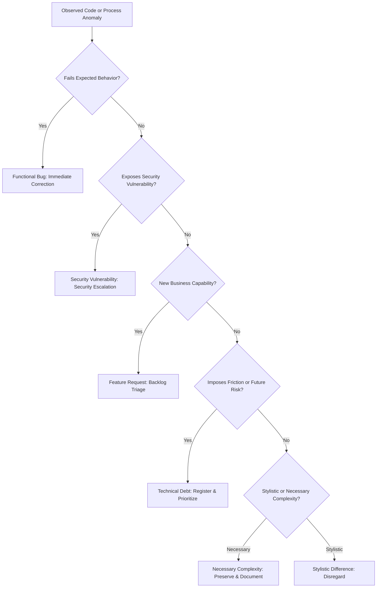
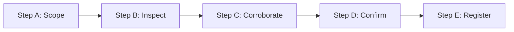
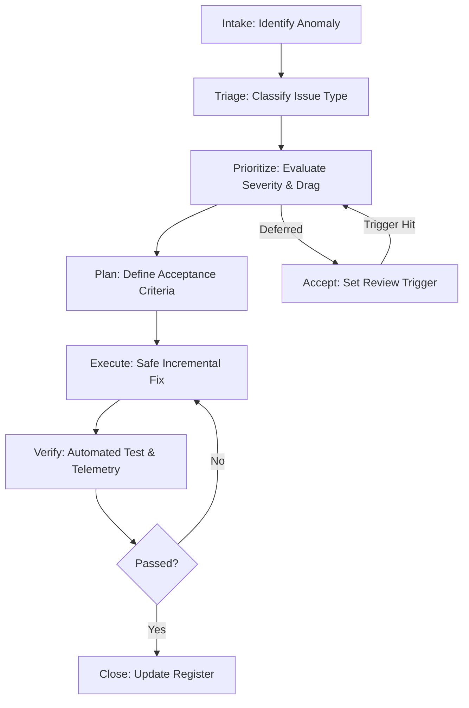

---
name: technical-debt-management
description: Identifies, documents, assesses, prioritizes, and tracks technical debt across code, architecture, databases, APIs, tests, dependencies, configuration, and infrastructure. Use when auditing maintainability risks, evaluating engineering trade-offs, building a technical debt register, planning incremental remediation, or assessing the cost and risk of leaving known technical weaknesses unresolved.
---

# Technical Debt Management Skill

This skill guides the AI coding agent to systematically discover, document, assess, prioritize, track, and plan the remediation of technical debt across code, architecture, databases, APIs, test suites, dependencies, configuration, and operations without executing unprompted rewrites.

## 1. Purpose, Core Principles, and Strategic Mindset

Technical debt represents structural shortcuts, deferred maintenance, suboptimal architectures, or obsolete dependencies that introduce ongoing maintenance friction, operational risks, or development bottlenecks. Adhere to five foundational principles:

- **Understand Debt in Context**: Code is not technical debt simply because it is old, verbose, or diverges from personal aesthetic preferences. Debt exists when an implementation imposes future maintenance costs, structural fragility, or engineering drag relative to real project requirements.
- **Debt Is Not Automatically Bad**: Some trade-offs are deliberate, economically sound decisions to ship critical value swiftly. The agent must distinguish intentional, well-bounded debt from unmanaged, compounding architectural decay.
- **Evidence Before Prioritization**: Every debt finding must be grounded in observable facts: recurring defect hotspots, high-churn files, broken abstractions, missing regression tests, or unpatched vulnerabilities. Never invent maintenance hours or speculative failure rates.
- **Prefer Proportionate Remediation**: Favor small, reversible, incremental improvements over massive, disruptive rewrites. Target remediations to high-churn modules where compounding interest is highest, leaving stable, low-churn code intact.
- **Management Is an Ongoing Governance Discipline**: Technical debt is not a one-time cleanup task; it requires structured tracking, cost-of-delay assessment, explicit acceptance criteria, and periodic reassessment alongside product delivery.

*Scope Boundary*: Focuses on identifying, registering, assessing, and roadmap-planning technical debt. For inspecting architectural boundaries, use [architecture-review](../architecture-review/SKILL.md); for executing authorized refactoring, use [refactoring](../refactoring/SKILL.md); for managing packages, use [dependency-management](../dependency-management/SKILL.md); for code-level reviews, use [code-review](../code-review/SKILL.md).

## 2. Technical Debt Categories Across Domains

Identify debt across eight concrete technical dimensions:

| Category | Typical Indicators & Manifestations | Practical Engineering Consequences |
| :--- | :--- | :--- |
| **Code Debt** | Duplicated business logic, god classes, deeply nested conditionals, hidden side-effects. | High defect rate during routine edits; cognitive overload. |
| **Architectural Debt** | Circular module dependencies, leaky layer boundaries, tight subsystem coupling. | Shotgun surgery; changes cascade across unrelated modules. |
| **Database Debt** | Unindexed foreign keys, N+1 query patterns, ambiguous table ownership, untracked DDL. | Performance degradation; data corruption; migration locks. |
| **Testing Debt** | Missing regression suites for critical paths, flaky tests, mocking implementation details. | Fear of refactoring; slow feedback loops; release delays. |
| **Dependency Debt** | Abandoned packages, ancient version pinning, transitive vulnerabilities, duplicate libs. | Security exposures; breaking upgrade paths; build failures. |
| **Config & Security Debt** | Scattered environment sources, missing validation, hardcoded credentials, ad-hoc RBAC. | Configuration drift; deployment crashes; privilege escalation. |
| **Operations Debt** | Manual deployment checklists, unverified backups, missing `/healthz` endpoints. | Prolonged MTTR; recurring outages; operational toil. |
| **Documentation Debt** | Outdated setup guides, missing invariant explanations, stale API schemas. | Onboarding friction; maintainers misinterpreting rules. |

## 3. Distinguishing Technical Debt from Related Concepts

Avoid misclassifying distinct engineering concepts as technical debt:



- **Technical Debt vs. Bug**: A bug is an active failure to meet existing specifications. Technical debt is a structural flaw that makes future bugs more likely or harder to fix, even while the system currently functions.
- **Technical Debt vs. Security Vulnerability**: Vulnerabilities requiring active containment must follow immediate incident or security review runbooks, not passive debt backlogs.
- **Technical Debt vs. Feature Request**: A feature request adds new user capabilities; technical debt remediation improves the internal maintainability of existing capabilities.
- **Technical Debt vs. Necessary Complexity**: Domain problems (tax calculations, cryptography, multi-tenant routing) require inherent complexity. Never strip necessary safeguards in pursuit of superficial simplicity.
- **Technical Debt vs. Stylistic Preference**: Code formatting, identifier naming nuances, or paradigm preferences (OOP vs. Functional) that do not increase change failure rate are harmless and must not inflate debt registers.

## 4. Systematic 5-Step Debt Discovery & Confirmation Workflow

Follow this evidence-backed sequence to discover and validate technical debt:



- **Step A: Establish Scope & Focus**: Define the target boundary (subsystem, module, service, operational workflow) and timeframe. Avoid shallow whole-repository scans when a focused assessment is required.
- **Step B: Inspect Implementation & Architecture**: Examine source code, imports, layer interactions, persistence queries, test setups, package manifests, and configuration schemas. Identify structural friction points.
- **Step C: Corroborate with Historical Telemetry**: Check git churn metrics, frequent bugfix commits in the same files, recurring incident reports, flaky test histories, and deployment rollback logs to verify real-world drag.
- **Step D: Confirm Candidates & Test Hypotheses**: Verify each finding against actual requirements and existing safeguards. Determine whether the flaw is actively harmful, dormant, or mitigated by compensating controls.
- **Step E: Document in Technical Debt Register**: Record confirmed items with structured evidence, severity, priority, effort estimates, and observable acceptance criteria.

## 5. Financial Metaphor: Principal, Interest, and Cost of Delay

Evaluate technical debt using financial mechanics to guide pragmatic remediation:

- **The Principal**: The estimated engineering effort, risk, and migration cost required to refactor or remediate the debt item today.
- **The Interest**: The ongoing recurring penalty paid in slowed velocity, increased defect rates, manual workarounds, compute waste, and debugging hours while the debt remains unresolved.
- **Cost of Delay (CoD)**: The compounding escalation of remediation difficulty and business risk when deferred into future sprints.

### Compounding vs. Zero-Interest Debt
- **High-Interest (Compounding) Debt**: Located in high-churn core business modules; touched by multiple engineers weekly; blocks upcoming strategic features; causes recurring production bugs. *Action: Prioritize remediation promptly.*
- **Zero-Interest (Dormant) Debt**: Located in stable, rarely modified utility code; fully tested; exhibits zero defect regression; operates reliably in production. Even if written using outdated idioms, its ongoing maintenance cost is near zero. *Action: Defer indefinitely; do NOT rewrite.*

## 6. Debt Assessment, Severity, and Priority Framework

Separate technical severity (inherent risk) from scheduling priority (operational urgency):

### Severity Model
- **Critical**: Active risk of data corruption, severe security vulnerability, or complete system breakdown under normal load.
- **High**: Substantial architectural defect, circular coupling, or unmonitored failure mode causing frequent regressions.
- **Medium**: Meaningful structural friction, leaky layers, duplicate domain rules, or testability barriers slowing delivery.
- **Low**: Localized code smell, minor inconsistency, or deprecated utility with an easy workaround.
- **Informational**: Documented intentional trade-off or optional structural refinement without current negative impact.

### Remediation Priority Tiers
- **P0 — Immediate**: Address in current sprint under emergency/incident protocol (reserved for Critical/High security/integrity risks).
- **P1 — High**: Schedule in the next work cycle; blocks near-term milestones or incurs heavy recurring interest.
- **P2 — Normal**: Bundle with planned feature work touching the same module; refactor opportunistically.
- **P3 — Low**: Log in register and defer until triggered by significant domain changes or dedicated capacity.

*Rule*: Never assign high priority to low-severity debt simply because the fix is easy. Never postpone critical security or data-integrity debt simply because the fix is complex.

## 7. Prioritization Strategies

Select the prioritization strategy best suited to organizational context:

| Strategy | Decision Rule & Focus | Best Used When |
| :--- | :--- | :--- |
| **Risk-Based** | Prioritize debt threatening security, data integrity, or availability. | Preparing for production release, compliance audit, or post-incident. |
| **Change-Driven** | Remediate debt in modules scheduled for upcoming major feature work. | Active product development; maximizes return on refactoring effort. |
| **Dependency-Driven** | Address foundational blockers that prevent other improvements or upgrades. | Unblocking framework migrations or architectural modularization. |
| **Recurrence-Driven** | Target the top 5% of files responsible for 80% of bug reports and regressions. | High defect rates, maintenance fatigue, and regression hotspots. |
| **Opportunity-Driven** | Clean up localized low-risk friction while already working in the file (Boy Scout). | Daily feature development and routine bug fixing. |
| **Cost-Benefit** | Quantify (Interest Saved $\div$ Principal Effort); prioritize high-ratio items. | Engineering capacity allocation and executive stakeholder roadmapping. |

## 8. Remediation Planning: Opportunistic vs. Dedicated

### The Boy Scout Principle (Opportunistic Micro-Remediation)
When modifying a file for approved feature work or bug fixing, make small, safe improvements within the same scope:
- Remove verified unused helper functions or dead imports.
- Rename misleading variables or extract a complex boolean conditional into an explanatory predicate.
- Add missing unit test cases for the specific edge case being touched.
- *Strict Rule*: Boy Scout cleanups must touch only files directly involved in the task. Never trigger sprawling refactorings across unrelated directories under the guise of casual cleanup.

### Dedicated Remediation Projects
For systemic, high-principal architectural debt:
- **Phase 1: Encapsulation**: Introduce a clean interface or facade around the legacy subsystem; freeze direct calls to internals.
- **Phase 2: Test Baseline**: Establish automated end-to-end characterization tests verifying current behavior under all edge cases.
- **Phase 3: Incremental Replacement**: Implement the new component using the expand-and-contract pattern; route a small percentage of traffic.
- **Phase 4: Cutover & Cleanup**: Shift 100% traffic; verify telemetry; delete legacy implementation and obsolete migration shims.

## 9. Accepting and Deferring Technical Debt Safely

Not all debt should be resolved. Explicitly document accepted trade-offs:

- **Documented Acceptance Criteria**: Every deferred debt record must state:
  1. *Rationale*: Why the shortcut was taken (e.g., meeting critical market deadline).
  2. *Residual Risk*: What could fail and how it will be monitored.
  3. *Compensating Safeguards*: Existing checks (rate limits, alerts, manual reviews) mitigating risk.
  4. *Review Trigger*: Specific condition that mandates reassessment (e.g., traffic exceeds $1,000\text{ req/s}$, or table exceeds $1\text{M}$ rows).
  5. *Authorized Approver*: Engineering lead or product owner who approved the trade-off.
- **Non-Negotiable Boundaries**: Never accept technical debt that compromises credential security, violates regulatory compliance (GDPR/HIPAA), risks unrecoverable data loss, or bypasses core authorization guards.

## 10. Technical Debt Metrics, Governance, and Lifecycle

Track genuine maintainability health rather than vanity metrics:



### Actionable Metrics vs. Vanity Metrics
- **Actionable Metrics**: Churn-to-defect correlation in top modules; MTTR for debt-related incidents; percentage of sprint capacity spent on unplanned maintenance; number of open P0/P1 items over 60 days.
- **Vanity Metrics**: Total raw lines of code deleted; superficial static analysis warning counts; aggregate ticket counts without severity weighting.

## 11. Technical Debt Register Schema & Practical Decision Guide

Maintain a structured register in project documentation (`docs/technical-debt.md` or issue tracker):

```markdown
### [DEBT-014] Direct Database Queries in Order Controller
- **Category**: Architectural & Database Debt | **Severity**: High | **Priority**: P1
- **Location**: `src/controllers/orderController.ts#L42-L88`
- **Evidence**: Controller directly executes raw SQL joins across `orders`, `users`, and `inventory`.
- **Impact**: Bypasses domain validation, blocks unit testing, creates N+1 database connection spikes.
- **Confidence**: Confirmed (Code inspected) | **Principal Effort**: 2 days | **Interest**: High
- **Remediation Plan**: Extract query to `OrderRepository`; invoke via `OrderService`; add isolation unit tests.
- **Acceptance Criteria**: Zero raw SQL in controllers; order creation covered by 100% unit tests.
- **Review Trigger**: Prior to commencing Q3 Subscription Orders feature.
- **Status**: Planned (Sprint 24) | **Owner**: Backend Team
```

### Practical Decision Guide
| Scenario | Recommended Evaluative Decision & Action |
| :--- | :--- |
| **Old module has no tests but has zero bugs for 2 years** | Classify as Low Priority / Dormant Debt. Do not write tests unless new features require modifying it. |
| **Developer wants to rewrite module in new framework** | Reject rewrite. Demand evidence that incremental refactoring is impossible and business value justifies total rebuild cost. |
| **Database migration has missing down-migration** | Classify as High Severity Operations Debt. Author backward-compatible down script or document forward-recovery runbook. |
| **Dependency is 2 major versions behind but supported** | Classify as Medium/Low Priority. Schedule upgrade during scheduled maintenance window; do not treat as emergency. |
| **Code duplication across 3 controller endpoints** | If business logic is identical, consolidate into shared domain service. If logic diverges, keep separated. |
| **Test suite takes 45 minutes to run in CI** | Classify as High Priority Testing Debt. Parallelize tests, isolate database dependencies, and separate unit from E2E. |
| **Unindexed foreign key on table with 5M rows** | Classify as High Severity Database Debt. Add index concurrently using [database-migration](../database-migration/SKILL.md). |
| **Configuration values loaded from 4 different files** | Classify as Medium Severity Config Debt. Consolidate into single validated schema using [environment-configuration](../environment-configuration/SKILL.md). |
| **Team disagrees on functional vs OOP coding style** | Disregard as stylistic preference. Enforce existing linter rules; do not add to technical debt register. |
| **Temporary hack added to pass Friday deployment** | Log immediately in debt register as P1 with 14-day expiry trigger; assign original author as owner. |
| **Third-party package abandoned by maintainer** | Classify as High Priority Dependency Debt. Evaluate active vulnerabilities; identify maintained drop-in replacement. |
| **Microservices communicate via shared database** | Classify as Critical Architectural Debt. Delineate data ownership; expose REST/gRPC interfaces before database split. |

## 12. Technical Debt Review Deliverable Template

Deliver debt audits using this standardized markdown report structure:

```markdown
# Technical Debt Audit Report: [System / Subsystem Name]

## Executive Summary
- **Overall Health**: [HEALTHY / ACCUMULATING / CRITICAL DRAG]
- **Key Risk Areas**: [Summary of highest-drag modules or architectural bottlenecks]
- **Debt Inventory**: [X Critical, Y High, Z Medium, W Low, V Accepted]
- **Core Recommendation**: [Concise statement on the highest-ROI debt remediation focus]

## Review Scope & Methodology
- **Scope**: [Modules, repositories, pipelines, and databases inspected]
- **Evidence Sources**: Code inspection, git churn analysis, issue tracker history, CI/CD telemetry.
- **Limitations**: [e.g., Production APM unavailable; assessment based on static analysis].

## Top Technical Debt Items (Prioritized)
### [DEBT-ID] Title: [Concise Problem Statement]
- **Category**: [Code / Architecture / Database / Testing / Dependency / Security / Ops]
- **Location**: [`path/to/file.ts#L10-L40`] | **Severity**: High | **Priority**: P1
- **Evidence & Impact**: [Observable symptoms, compounding interest, and engineering drag]
- **Confidence**: Confirmed | High | Medium
- **Recommended Remediation**: [Incremental remediation path, acceptance criteria, and effort estimate]

## Risk Concentrations & Hotspots
- **Hotspot 1**: [`src/billing/`] - High change churn combined with zero unit tests and circular imports.

## Quick Wins (High ROI / Low Effort)
1. **[Quick Win 1]**: Consolidate redundant date-parsing helpers into standard utility ($<2\text{h}$).

## Accepted & Deferred Trade-offs
- **[DEBT-ID]**: [Description] - Deferred because [rationale]; review triggered when [condition].

## Phased Remediation Roadmap
1. **Immediate (Sprint N)**: Remediate critical unindexed queries and security config gaps.
2. **Near-Term (Next 2 Sprints)**: Modularize high-churn billing module and introduce unit tests.
3. **Long-Term (Strategic)**: Deprecate legacy SOAP integration in favor of event-driven webhook worker.
```

## 13. Remediation Safety, Change Boundaries, and Repository Alignment

Maintain strict operational safety during debt evaluations:

- **Read-Only Inspection**: Technical debt assessments must never modify application code, alter schemas, or delete files.
- **Preserve User Changes**: Respect uncommitted changes and ongoing feature branches.
- **No Unapproved Rewrites**: Never rewrite modules, upgrade dependencies, or alter architecture without explicit human authorization.
- **Never Weaken Tests**: Never disable, skip, or weaken existing test assertions to make a refactoring pass.

### Repository Alignment
- **Rules**: [architecture.md](../../rules/architecture.md) (modularity), [change-safety.md](../../rules/change-safety.md) (authorization), [coding-standards.md](../../rules/coding-standards.md) (structure), [database.md](../../rules/database.md) (integrity), [security.md](../../rules/security.md) (least privilege), [testing.md](../../rules/testing.md) (test quality).
- **Companion Skills**: [architecture-review](../architecture-review/SKILL.md) (structural audit), [refactoring](../refactoring/SKILL.md) (behavior-preserving edits), [dependency-management](../dependency-management/SKILL.md) (package updates), [database-migration](../database-migration/SKILL.md) (schema evolution), [testing-qa](../testing-qa/SKILL.md) (test suite remediation), [code-review](../code-review/SKILL.md) (diff review).

## 14. Final Validation Checklist

Before concluding any technical debt assessment, verify these 10 criteria:

- [ ] **1. Grounded in Evidence**: Every debt item is backed by observable code paths, churn data, or test logs.
- [ ] **2. Conceptual Boundaries Respected**: Debt is cleanly distinguished from bugs, features, and style preferences.
- [ ] **3. Severity vs. Priority Separated**: Technical severity is distinguished from business scheduling priority.
- [ ] **4. Contextual Evaluation**: Code assessed against real project scale and requirements, not textbook dogma.
- [ ] **5. High-Interest Debt Prioritized**: Remediation focuses on high-churn hotspots rather than dormant code.
- [ ] **6. Proportionate Remediation**: Incremental refactoring recommended over high-risk wholesale rewrites.
- [ ] **7. Explicit Deferrals Documented**: Accepted debt records include rationale, risks, safeguards, and review triggers.
- [ ] **8. Boy Scout Boundaries Enforced**: Opportunistic cleanups constrained to files actively modified by feature work.
- [ ] **9. Strict Read-Only Audit**: Review completed without unauthorized modifications to application code or configs.
- [ ] **10. Actionable Deliverable Produced**: Report includes prioritized register, risk concentrations, and phased roadmap.
