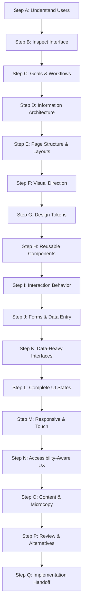

---
name: ui-ux-design
description: Designs and evaluates user experiences, information architecture, user flows, wireframes, page layouts, visual hierarchy, design systems, component patterns, responsive behavior, and interaction specifications. Use when planning a new application interface, designing a feature or user journey, creating a UI/UX specification, reviewing an existing interface, or planning a redesign.
---

# UI/UX Design Skill

This skill guides the AI coding agent to translate product requirements into intuitive user experiences, coherent visual systems, clear information architectures, structured page layouts, accessible interaction patterns, and actionable interface specifications.

## 1. Purpose and Scope

UI/UX design establishes how users perceive, navigate, and interact with software interfaces. This skill ensures the agent answers essential product design questions:

- **Who will use the interface?** User personas, roles, context of use, and accessibility needs.
- **What are users trying to accomplish?** Primary jobs-to-be-done, core workflows, and operational goals.
- **What is the simplest, most intuitive path to completion?** Streamlined task flows that eliminate unnecessary friction and cognitive load.
- **How should information and navigation be organized?** Sitemaps, navigation hierarchies, and content taxonomy.
- **Which content and actions deserve visual emphasis?** Clear typographic scale, visual weights, and layout hierarchy.
- **How should UI components behave?** Layout rules, form patterns, dialog lifecycles, and data table interactions.
- **What visual direction fits the brand and users?** Cohesive color schemes, typography, spacing scales, and density.
- **Which reusable design patterns should the UI follow?** Design system primitives and proven interaction paradigms.
- **How does the design adapt across screens and input modes?** Fluid responsive reflow, mobile touch targets, and keyboard navigation.
- **What do users experience across all UI states?** Initial, loading, empty, validation error, server error, and success states.
- **How is the design evaluated prior to implementation?** Design-level acceptance criteria and usability validation.

*Scope Boundary*: Focuses on UX reasoning, interaction specifications, visual systems, wireframing, and design documentation. It does not replace code implementation (handled by [frontend.md](../../rules/frontend.md)), product requirements gathering, or software architecture design.

## 2. When to Use This Skill

### Trigger Scenarios

Activate this skill when:
- **Designing New Applications & Portals**: Establishing the UX framework, visual direction, and key screens for a new product.
- **Architecting Dashboards & Admin Interfaces**: Organizing complex, data-heavy views, metric summaries, and action panels.
- **Translating PRDs into UI Specifications**: Converting user stories into wireframe specifications, component inventories, and user flows.
- **Designing Multi-Step Workflows**: Structuring checkouts, onboarding funnels, multi-field wizards, and configuration flows.
- **Establishing or Extending Design Systems**: Defining semantic design tokens, color palettes, spacing scales, and shared components.
- **Reviewing & Redesigning Interfaces**: Auditing existing screens for visual inconsistency, cognitive friction, or navigation bottlenecks.
- **Pre-Frontend Implementation Handoff**: Producing UI specifications for frontend engineering teams.

### When NOT to Use This Skill

Do not invoke this skill for:
- Backend-only business logic, API route changes, or database migrations.
- Minor bug fixes or isolated styling corrections that do not alter the user experience.
- Writing raw frontend CSS/JS code (delegate to frontend development).
- Pure accessibility auditing without design restructuring (use [accessibility.md](../../rules/accessibility.md)).

## 3. UI/UX Design Workflow

Follow this seventeen-step procedure to analyze, conceptualize, and document user interfaces:



### Step A: Understand the Product and Users

1. **Review Upstream Specs**: Inspect approved [PRDs](../../../docs/product/), [SRS documents](../../../docs/requirements/), and user personas.
2. **Identify Primary Goals**: Determine the specific jobs-to-be-done and high-frequency user tasks.
3. **Analyze Operational Context**: Consider user environment, device constraints, ambient lighting, and technical proficiency.
4. **Resist Premature Styling**: Never select decorative colors, gradients, or micro-animations before core user workflows are defined.

### Step B: Inspect the Existing Interface

- **For Existing Applications**:
  - Audit current pages, navigation menus, component libraries, typography, and color tokens.
  - Identify established visual conventions and maintain consistency across new additions.
  - Diagnose verified usability issues (e.g., hidden primary actions, confusing labels) rather than executing arbitrary aesthetic redesigns.
- **For Greenfield Projects**:
  - Establish the minimum viable interface structure necessary to accomplish core user workflows.

### Step C: Identify User Goals and Core Workflows

- Map the critical user path from trigger to successful completion.
- Minimize friction: eliminate superfluous steps, unnecessary clicks, and redundant form inputs.
- Provide clear cancellation, back-navigation, and draft-preservation mechanisms for multi-step tasks.
- Prioritize high-frequency and high-value workflows over secondary settings screens.

### Step D: Define Information Architecture

- Structure content into intuitive categories reflecting user mental models rather than database schemas.
- Establish navigation hierarchies: global top/side navigation, contextual sub-navigation, breadcrumbs, and search.
- Use explicit, descriptive labels; avoid technical jargon or vague category names.
- Ensure critical features are discoverable within 2–3 clicks or taps.

### Step E: Define Page Structure and Layouts

- Establish a dominant visual hierarchy: Page Title -> Primary Action -> Summary Metrics -> Main Content Area -> Secondary Tools.
- Structure layouts using consistent grid systems (e.g., 4px/8px baseline grids, 12-column responsive layouts).
- Position primary actions Above-The-Fold or in predictable, persistent action bars.
- Avoid cluttered interfaces: use whitespace purposefully to group related information and provide breathing room.

### Step F: Establish Visual Direction

- Align visual aesthetics with the product domain and user expectations (e.g., clean, high-density editorial/dashboard style for content platforms, or streamlined transactional layouts for utilities).
- Define functional color roles:
  - *Primary / Brand*: Core interactive actions and brand recognition.
  - *Neutral / Surface*: Backgrounds, cards, text, borders, and dividers.
  - *Semantic / Status*: Green (Success), Red (Destructive/Error), Amber (Warning), Blue (Info).
- Balance density: compact data density for administrative management; comfortable padding for reading views.
- Reject decorative trends (e.g., neomorphism, heavy blur) that impair readability or accessibility.

### Step G: Define Design Tokens and Visual Foundations

- Establish reusable design tokens matching the project's styling approach (Tailwind, CSS variables, tokens):
  - **Colors**: Semantic tokens (`--color-bg-primary`, `--color-text-main`, `--color-action-default`).
  - **Typography**: Clear scale (`text-xs`, `text-sm`, `text-base`, `text-lg`, `text-xl`, `text-2xl`) with line heights >= 1.5 for body text.
  - **Spacing**: 8-point spatial grid (`space-1`: 4px, `space-2`: 8px, `space-4`: 16px, `space-6`: 24px, `space-8`: 32px).
  - **Borders & Radii**: Consistent corner rounding (`rounded-sm`: 2px, `rounded-md`: 6px, `rounded-lg`: 12px) and high-contrast borders.

### Step H: Design Reusable Components

Specify shared UI primitives to ensure visual and operational consistency:
- Buttons (Primary, Secondary, Outline, Destructive, Ghost).
- Form inputs (Text, Select, Checkbox, Radio, Date picker, File upload).
- Feedback components (Banners, Badges, Modals, Popovers, Tooltips).
- Data containers (Cards, Tables, List items, Accordions, Tabs).
- Define exact states for every component: default, hover, focus-visible, active, disabled, loading.

### Step I: Specify Interaction Behavior

- Ensure control affordances match behavior: buttons trigger actions; styled text links navigate URLs.
- Provide instant feedback upon activation: button loading spinners, optimistic UI updates, or immediate state changes.
- Eliminate dead ends: every empty state, error message, or modal must offer a clear next action.
- Prevent destructive errors: require explicit confirmation modals for irreversible actions (e.g., deleting a book).

### Step J: Design Forms and Data-Entry Workflows

- Group fields into logical sections with clear section headers.
- Always provide visible, persistent labels above inputs (never rely on disappearing placeholder text).
- Indicate required fields clearly (e.g., asterisk with legend or "(required)" tag).
- Provide inline, real-time validation feedback after field blur; explain how to correct errors.
- Preserve user input across submission failures; never wipe a form upon validation error.

### Step K: Design Data-Heavy Interfaces

For catalogs, dashboards, inventory tables, and reports:
- Prioritize high-frequency columns; support column sorting and customizable views where useful.
- Provide accessible, persistent search, filtering, and keyset/page pagination controls.
- Align numerical values to the right and text values to the left for effortless scanning.
- Replace raw data clutter with visual aids (status badges, formatted currency, sparklines) only where they accelerate comprehension.

### Step L: Design Complete UI States

Every screen and component must specify its full state lifecycle:
1. **Initial / Default**: Standard populated state with typical user data.
2. **Loading**: Skeleton screens or localized spinners (preserving layout geometry to prevent CLS).
3. **Empty**: Informative graphic, explanation of why data is absent, and a primary call-to-action to create data.
4. **Validation Error**: Inline field warnings with actionable correction text.
5. **Server / Network Error**: Clear banner explaining the outage with a "Retry" button.
6. **Success**: Subtle confirmation toasts or dedicated success screens for major transactions.
7. **Disabled / Restricted**: Dimmed controls with explanatory tooltips indicating prerequisite requirements.

### Step M: Responsive and Cross-Device UX

- Design for standard responsive viewports: Mobile (320px–480px), Tablet (768px–1024px), Desktop (1280px+).
- Reflow gracefully: collapse multi-column tables into cards or horizontally scrollable containers on mobile.
- Touch Targets: Ensure all mobile interactive elements meet the minimum 24x24 CSS pixel target size (WCAG 2.2 AA).
- Mobile Navigation: Provide accessible bottom bars or slide-out drawer menus that preserve keyboard focus.

### Step N: Accessibility-Aware UX Design

- Integrate accessibility into design decisions from day one (reference [accessibility.md](../../rules/accessibility.md)).
- Enforce strict contrast: minimum 4.5:1 for body text; 3:1 for large text and interactive boundaries.
- Ensure color is never the sole indicator of state; always pair color with text, icons, or patterns.
- Design prominent, high-contrast keyboard focus indicators (`outline` / `ring`) for all interactive elements.

### Step O: Consider Content and Microcopy

- Write concise, active-voice UI microcopy ("Save Changes", "Delete Book", "Add to Wishlist").
- Provide contextual helper text for complex inputs or financial calculations.
- Avoid condescending, overly casual, or ambiguous system messages ("Oops! Something went wrong").
- Ensure error messages state: (1) what happened, (2) why it happened, and (3) what the user should do next.

### Step P: Review Existing Designs and Alternatives

- Compare design alternatives using objective usability criteria: task completion time, error rates, and cognitive load.
- Present trade-offs clearly: evaluate compact data density against visual breathing room.
- Avoid introducing novel, idiosyncratic UI interactions when standard patterns solve the problem better.

### Step Q: Prepare the Handoff for Implementation

Assemble a complete UI/UX specification for frontend engineering:
- Screen layouts and section wireframes.
- Component mapping to existing design tokens and UI library elements.
- Interaction specifications, error handling behavior, and responsive rules.
- Design-level acceptance criteria for QA verification.

## 4. Standard UI/UX Design Specification Format

When authoring a formal UI/UX specification, structure the document using the following layout:

---

# UI/UX Design Specification: [Feature or Screen Name]

## 1. Executive Summary & Design Goals
- **Objective**: The user problem being solved and the desired experience outcome.
- **Target Audience**: Primary user roles and context of use.

## 2. Core User Workflows
- **Flow 1: [Workflow Title]**:
  ```mermaid
  flowchart LR
      Start["Browse Catalog"] --> Filter["Apply Genre Filter"]
      Filter --> Select["Select Book"]
      Select --> Detail["View Detail Modal"]
      Detail --> Borrow["Confirm Loan"]
  ```

## 3. Information Architecture & Navigation
- Placement within global navigation, breadcrumb structure, and contextual sub-menus.

## 4. Page Layout & Wireframe Specification
- **Header**: Search bar, notification bell, user profile avatar.
- **Sidebar**: Genre filter accordions, price slider, availability toggle.
- **Main Content**: 4-column responsive book grid with cover, title, author, rating, and "Borrow" CTA.
- **Footer**: Pagination controls and results summary counter.

## 5. Visual Direction & Design Tokens
- **Theme**: Clean editorial palette with deep indigo primary actions and warm slate backgrounds.
- **Tokens Used**: `bg-surface`, `text-primary`, `border-subtle`, `radius-md`.

## 6. Reusable Component Inventory

| Component Name | Variant | Responsibility | Key States |
|---|---|---|---|
| `BookCard` | Standard | Display book preview & trigger detail view | Default, Hover, Focus |
| `LoanButton` | Primary Action | Initiate loan transaction | Default, Loading, Disabled |
| `FilterSidebar` | Collapsible | Multi-facet filtering | Expanded, Collapsed (Mobile) |

## 7. Interactive Behaviors & UI States
- **Loading**: 8 skeleton cards shimmer while catalog query executes.
- **Empty State**: Illustrated open book with text "No books match your filters" and "Reset Filters" button.
- **Error State**: Inline alert with retry button when catalog API fails.
- **Success State**: Animated checkmark with modal confirmation: "Book loaned! Due in 14 days."

## 8. Responsive & Cross-Device Adaptation
- **Desktop (1280px+)**: 4-column grid with persistent sidebar.
- **Tablet (768px–1024px)**: 3-column grid with collapsible filter drawer.
- **Mobile (320px–480px)**: 1-column grid with bottom sticky filter button and 48px touch targets.

## 9. Accessibility Specifications
- High-contrast focus rings (2px solid indigo) on all interactive elements.
- Text contrast exceeds 4.5:1; status badges use distinct icons alongside color.

## 10. Design-Level Acceptance Criteria
- [ ] Users can filter catalog by genre and view updated results within 300ms.
- [ ] All interactive buttons and filters are navigable via keyboard Tab/Enter/Space.
- [ ] Form submission preserves entered text if validation fails.
- [ ] Mobile view displays touch targets of at least 24x24px.

---

## 5. Prototypes and Mockup Standards

- **Visual Clarity**: Use low-fidelity ASCII or Mermaid diagrams when illustrating structural wireframes.
- **Fidelity Transparency**: Clearly label conceptual mockups as `[Conceptual Mockup]` to prevent confusion with production code.
- **Evidence-Based Assets**: Reuse existing design tokens, fonts, and assets established in `docs/design/` or `src/`.

## 6. Existing vs. New UI Design

- **For Existing Apps**: Extend existing components, preserve established navigation conventions, and perform targeted visual refinements.
- **For New Apps**: Establish the foundational design system, typography scales, and core interaction patterns before expanding into secondary screens.

## 7. Interaction and Decision Principles

1. **Context-Driven Inquiry**: Review existing requirements, mockups, and components before prompting the user.
2. **Targeted UX Questions**: Inquire only when core user workflows, permission models, or business logic are genuinely ambiguous.
3. **Safe Assumptions**: Adopt established UX conventions (e.g., standard form validation, accessible contrast) and state them clearly.
4. **No Code Implementation**: Creating a UI/UX specification does not authorize writing frontend production code.
5. **Stakeholder Alignment**: Mark new designs as `[Proposed UI Specification]` until explicitly approved.

## 8. Rule Harmony and Skill Collaboration

This UI/UX design skill operates in close synergy with existing project rules and skills:

- [frontend.md](../../rules/frontend.md): Informs component implementation, state management, and framework conventions.
- [accessibility.md](../../rules/accessibility.md): Dictates WCAG 2.2 AA compliance, keyboard navigation, and contrast minimums.
- [prd-writing](../prd-writing/SKILL.md) & [requirements-analysis](../requirements-analysis/SKILL.md): Supply upstream user stories, personas, and business rules.
- [architecture-design](../architecture-design/SKILL.md): Defines frontend-backend integration boundaries and client-side data flows.
- [performance-optimization.md](../../rules/performance-optimization.md): Establishes Core Web Vitals, bundle size limits, and rendering latency constraints.
- [documentation.md](../../rules/documentation.md): Directs persistent design documentation placement in `docs/design/`.
