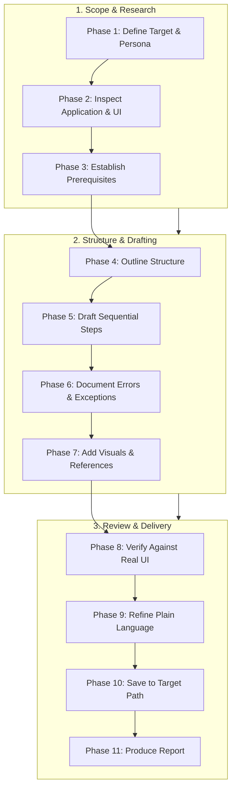

# User Documentation Writing Skill

This skill guides the AI coding agent to author accurate, clear, practical, and task-oriented user documentation for software applications. It ensures guides, manuals, installation procedures, and troubleshooting articles help end users, administrators, and operators complete real tasks successfully based on verified application behavior.

## 1. Purpose, Core Principles, and User Documentation Mindset

The central mandate of user documentation writing is:
**Write documentation that helps the intended reader accomplish a real task successfully. Base every instruction on verified application behavior, explain necessary prerequisites, and never invent features, interface elements, commands, or configuration options.**

Adhere to six foundational principles:

- **Grounded in Verified Reality**: Every step, button name, command, and setting must reflect the actual application code, UI, or approved requirements. Never fabricate controls or invent workflows.
- **Task-Oriented Clarity**: Structure content around what the user wants to achieve (e.g., "How to enroll a student") rather than an abstract tour of code modules or database schemas.
- **Audience Empathy**: Write for the reader's technical level and business domain. A classroom teacher needs workflow-focused prose; a systems administrator needs precise configuration keys and environment requirements.
- **Complete Prerequisite Transparency**: Always state what permissions, credentials, accounts, or settings are required before beginning a procedure.
- **Safe and Responsible Guidance**: Highlight irreversible operations, backup prerequisites, and confirmation prompts. Never recommend disabling security controls or leaking credentials.
- **Proportionate Ceremony**: Scale documentation depth to the task. A simple feature tweak needs a focused walkthrough; a multi-role enterprise workflow requires a structured guide.

*Scope Boundary*: Focuses on user-facing documentation. For release notes, use [release-notes-writing](../release-notes-writing/SKILL.md); for API references, use [api-documentation](../api-documentation/SKILL.md); for general project standards, use [documentation.md](../../rules/documentation.md); for feature delivery, use [feature-implementation](../feature-implementation/SKILL.md).

## 2. Document Typology and Scope Classification

Select the appropriate document format based on user objectives:

| Document Type | Primary Objective | Typical Content |
| :--- | :--- | :--- |
| **Getting Started Guide** | First-time user onboarding. | Overview, account access, initial login, first essential workflow. |
| **Feature Walkthrough** | Task-specific guidance. | Prerequisites, sequential steps, field rules, expected results. |
| **Administrator Guide** | System configuration & ops. | Role management, global settings, migrations, backups, maintenance. |
| **Installation Guide** | Environment setup. | Prerequisites, dependencies, commands, environment variables, health checks. |
| **Troubleshooting Guide** | Problem diagnosis & recovery. | Symptoms, verified causes, step-by-step remedies, support escalation. |
| **FAQ** | Direct answers to questions. | Anticipated questions, concise answers, links to detailed guides. |
| **Role-Specific Manual** | Persona-oriented workflows. | Curated workflows tailored to teachers, accountants, or librarians. |

*Discipline Rule*: Keep user guides distinct from developer architecture notes, internal design documents, and marketing materials.

## 3. Audience Analysis and Persona Calibration

Identify the primary reader before drafting content:

- **Technical Literacy**: Determine whether the reader understands command-line shells, database concepts, or only browser user interfaces.
- **Role and Permissions**: Clarify what user roles can perform the documented task (e.g., Administrator, Staff, Student).
- **Domain Terminology**: Use familiar business and product vocabulary (e.g., "Tuition Fee", "Course Roster") rather than internal engineering labels (`fee_ledger_tbl`, `student_course_rel`).
- **Contextual Goals**: Focus on the user's primary goal, such as generating an invoice or approving an absence.

## 4. Establishing the Source of Truth and Reality Grounding

Base all documentation on verified application assets:

- **Inspecting Live Code & UI**: Check route definitions, page layouts, component labels, form validation schemas, and database constraints.
- **Executing Workflows**: When a safe local environment is available, run through the workflow to confirm exact button text, dialog prompts, and success toasts.
- **Handling Incomplete Features**: If a workflow cannot be verified or remains unmerged, mark the documentation as a draft or explicitly state the limitation. Never guess button names or API URLs.

## 5. Task-Oriented Procedural Writing Standards

Structure procedural instructions for maximum clarity and actionability:

1. **State the Objective**: Explain what the user will accomplish in 1–2 sentences.
2. **List Prerequisites**: Detail required permissions, existing records, or preparatory steps.
3. **Numbered Sequential Steps**: Provide chronological, actionable steps starting with imperative verbs (`Navigate`, `Select`, `Enter`, `Confirm`).
4. **Exact Interface Labels**: Use bold formatting for literal UI elements (`Select **Add Student**`, `Click **Save Changes**`).
5. **Describe Observable Results**: Explain what the user should see upon completion (`A green confirmation banner displays with the new Student ID`).
6. **Address Common Errors**: Explain inline validation failures or permission blocks directly adjacent to relevant steps.

*Writing Contrast*:
- *Weak*: "The system can be configured to manage fees in the admin panel."
- *Strong*: "Navigate to **Settings > Billing**, enter the **Annual Tuition Fee**, and select **Apply Changes**."

## 6. Document Architectures and Structural Templates

Standardize structural formats across documentation types:

### Feature Walkthrough Template
```markdown
# [Feature Name] Walkthrough

## Overview
Brief description of the feature's purpose and business value.

## Prerequisites
- Required role: `School Administrator` or `Registrar`
- Completed prior setup: Active academic year configured

## Step-by-Step Instructions
1. Navigate to **[Menu] > [Submenu]**.
2. Select **[Primary Action]**.
3. Complete the required fields in the dialog.
4. Select **[Submit Button]**.

## Field Reference
| Field | Required | Description |
| :--- | :---: | :--- |
| **[Field Name]** | Yes | Format requirements, allowed values. |

## Expected Outcome
Description of the visible confirmation and updated application state.
```

## 7. Clear, Accessible, and Inclusive Language

Ensure documentation is easily comprehended by diverse readers:

- **Plain English**: Use direct, familiar words. Replace "utilize" with "use", "terminate" with "stop", and "facilitate" with "help".
- **Short Sentences**: Aim for sentences under 25 words. Break complex compound instructions into separate numbered steps.
- **Active Voice**: Write "Select the file" instead of "The file should be selected by the user".
- **Consistent Terminology**: Never use interchangeable terms for the same concept (e.g., do not alternate between "account", "profile", and "user record").
- **Inclusive & Accessible**: Provide descriptive link text (never "click here"); use semantic Markdown headings; ensure reading order is logical.

## 8. Documenting User Interfaces and Screen Interactions

Provide clear visual context without cluttering the page:

- **Precise Element Identification**: Distinguish buttons, links, tabs, dropdowns, and checkboxes clearly (`From the **Status** dropdown, select **Active**`).
- **Modal and Dialog Flows**: Explicitly document confirmation dialogs for destructive actions.
- **Screenshot Standards**:
  - Capture real application screens; never fabricate mockups.
  - Sanitize screenshots: redact passwords, tokens, real credit cards, or personal PII.
  - Pair every screenshot with comprehensive text instructions so readers who cannot view images can still complete the task.
  - Include descriptive `alt` text and informative captions.

## 9. Forms, Data Entry, and Validation Guidance

Help users populate forms correctly on the first attempt:

- **Field Catalog**: Document label, purpose, mandatory vs. optional status, expected format, and default values.
- **Input Constraints**: Specify string length limits, accepted regex patterns (e.g., phone or tax ID formats), and date formats (`YYYY-MM-DD`).
- **Validation Feedback**: Explain common inline errors (e.g., "Email already registered") and state the exact corrective action required.
- **Preserving Inputs**: Note if form errors preserve entered data or require re-entry of sensitive fields (like passwords).

## 10. Installation, Setup, and Environment Instructions

Guide operators and developers through foolproof environment provisioning:

- **System Requirements**: State supported OS versions, runtimes (Node.js 20+, Python 3.11+), and hardware recommendations.
- **Dependency Installation**: Provide exact, copy-pasteable commands (`npm install`, `pnpm install`, `pip install -r requirements.txt`).
- **Database Provisioning**: Document migration and seeding commands (`npm run migrate`, `npm run seed`).
- **Safe Placeholders**: Always use safe, standard placeholders in code blocks (`YOUR_API_KEY`, `db_user`, `localhost:5432`). Never expose production credentials.
- **Startup & Verification**: Detail startup commands (`npm start`) and the exact health check URL or output that confirms successful launch.

## 11. Configuration and Environment Variables

Document configuration cleanly without leaking secrets:

- **Variable Table**: Document variable name, default value, required/optional status, and purpose:
  ```markdown
  | Variable | Default | Required | Purpose |
  | :--- | :--- | :---: | :--- |
  | `PORT` | `3000` | No | HTTP server port |
  | `DATABASE_URL` | None | Yes | PostgreSQL connection string |
  ```
- **Configuration Files**: Explain where configuration is loaded from (`.env`, `config/production.json`) and how to reload settings.
- **Security Safeguards**: Explicitly remind operators to add `.env` to `.gitignore` and restrict file read permissions on servers.

## 12. Diagnostic and Troubleshooting Design

Empower users and operators to solve problems independently:

- **Structured Diagnostic Pattern**:
  - *Symptom*: Observable failure (e.g., "Login button spins indefinitely").
  - *Verified Cause*: Expired authentication token or database connection drop.
  - *Verification Step*: How to confirm the cause (e.g., "Check browser console for 401 error").
  - *Corrective Action*: Actionable, safe remedy (e.g., "Refresh the page and log in again").
  - *Escalation Path*: What sanitized diagnostic logs to provide to system support if unresolved.
- **Zero Dangerous Shortcuts**: Never recommend turning off firewalls, running `chmod 777`, or disabling authentication to bypass errors.

## 13. Roles, Permissions, and Access Boundaries

Document multi-role systems with precision:

- **Role Capabilities**: Detail what actions each role (e.g., Admin, Manager, Member) can perform.
- **Access Restrictions**: Explain when a menu item is hidden or disabled due to role permissions.
- **Multi-Tenant Boundaries**: Explain data isolation boundaries (e.g., "Users can only view students enrolled in their assigned campus").
- **Neutral Language**: State permission restrictions neutrally (e.g., "This action requires Administrator privileges. Contact your organization administrator for access").

## 14. Data Import, Export, and File Handling

Ensure bulk data operations run safely:

- **File Specifications**: Document supported formats (CSV, XLSX, JSON), maximum file sizes, and encoding (UTF-8).
- **Template Schemas**: Detail required header column names and date formats.
- **Handling Duplicates**: Explain whether duplicates are skipped, overwritten, or cause the entire import to fail.
- **Export Handling**: Document where exported files download and remind users to handle exported personal data in compliance with privacy regulations.

## 15. Destructive Operations, Backups, and Recovery

Treat destructive actions with utmost caution:

- **Prominent Warnings**: Use standard warning blocks before explaining deletions or bulk resets.
- **Reversibility Disclosure**: Clearly state whether an action is permanently destructive or recoverable from an archive/recycle bin.
- **Backup Prerequisites**: Remind users to create a verified backup before initiating major data deletions or schema updates.

## 16. Error Guidance and User Recovery

Help users recover gracefully from common failure modes:

- **Form Errors**: Guide users on correcting format violations or missing required fields.
- **Session Expirations**: Explain that session timeouts protect account security and prompt users to re-authenticate.
- **Resource Not Found**: Explain why a record might be missing (e.g., deleted by another user, incorrect filter).
- **Sanitized Guidance**: Never expose internal database error messages, stack traces, or server file paths in user-facing manuals.

## 17. FAQs and Tutorial Construction

Design intuitive learning resources:

- **Targeted FAQs**: Group questions by functional domain (e.g., "Billing & Invoices", "User Accounts"). Provide direct 1–2 sentence answers followed by procedural links.
- **Step-by-Step Tutorials**: Guide users through complete, practical milestones (e.g., "Setting up your school's first grading period").
- **Realistic Data**: Use credible, representative example names and figures rather than nonsensical placeholders (`foo`, `bar`).

## 18. Information Architecture, Navigation, and Visual Aids

Organize documentation for effortless discoverability:

- **Logical Hierarchies**: Group documents by persona or user task. Use clear, descriptive directory and file names (`docs/guides/user-enrollment.md`).
- **Table of Contents**: Provide structured tables of contents for documents exceeding three sections.
- **Relative Linking**: Use valid relative markdown links (e.g., `\[Enrollment Guide\](./enrollment.md)`) to connect related topics.
- **Diagrams**: Use Mermaid diagrams to explain workflows, approval hierarchies, and system lifecycles.

## 19. Documentation Maintenance During Software Evolution

Keep documentation synchronized with code updates:

- **Targeted Diff Updates**: When a feature updates, edit only the affected sections and field descriptions.
- **Deprecating Outdated Material**: When features are retired, remove obsolete instructions or label them clearly with version expiration notices.
- **Preserve Writing Style**: Match the established heading structure, voice, and formatting conventions of existing documentation.

## 20. Recommended 11-Phase User Documentation Workflow

Follow this systematic sequence to author or update user documentation:



- **Phase 1: Define Target & Persona**: Confirm document type, target audience, and primary task outcome.
- **Phase 2: Inspect Application & UI**: Verify actual route names, button labels, fields, and permissions.
- **Phase 3: Establish Prerequisites**: Document required roles, accounts, and preliminary setups.
- **Phase 4: Outline Structure**: Establish logical headings matching standard templates.
- **Phase 5: Draft Sequential Steps**: Write numbered, action-oriented instructions using exact labels.
- **Phase 6: Document Errors & Exceptions**: Add validation rules, boundary limits, and troubleshooting remedies.
- **Phase 7: Add Visuals & References**: Embed sanitized screenshots or Mermaid workflow diagrams.
- **Phase 8: Verify Against Real UI**: Walk through the drafted instructions against the running app or verified code.
- **Phase 9: Refine Plain Language**: Eliminate jargon, simplify sentences, and verify accessible link text.
- **Phase 10: Save to Target Path**: Commit the document to the approved repository directory.
- **Phase 11: Produce Report**: Provide a concise completion summary detailing verified workflows and coverage.

## 21. Overengineering Traps & Anti-Patterns to Avoid

Avoid common technical writing pitfalls:

- **Inventing Features & Labels**: Writing instructions for buttons, menus, or options that do not exist.
- **Premature Information Architecture**: Building a complex multi-tier documentation site for a basic user guide.
- **Implementation Leakage**: Describing database schemas or internal backend classes to general end users.
- **Marketing Fluff**: Injecting promotional exaggeration into procedural guides.
- **Unverified Command Sequences**: Providing copy-paste terminal commands that have never been tested.
- **Secret Exposure**: Pasting real passwords, API tokens, or server IPs into code snippets.
- **Dangerous Workarounds**: Suggesting insecure configuration changes to resolve permission errors.

## 22. Definition of Done & Standardized Completion Report

A user documentation task is complete only when all applicable criteria are met:

- [ ] 1. **Verified Against Reality**: All documented steps, buttons, fields, and options exist in the application.
- [ ] 2. **Task-Oriented**: Focuses on helping a defined user persona achieve a concrete outcome.
- [ ] 3. **Prerequisites Clear**: Permissions, required setup, and initial conditions are stated upfront.
- [ ] 4. **Sequential & Numbered**: Procedures use numbered steps starting with imperative action verbs.
- [ ] 5. **Exceptions Handled**: Common validation errors, permission blocks, and failure recovery are explained.
- [ ] 6. **Zero Leaked Secrets**: All examples use safe placeholders; no real credentials or PII are exposed.
- [ ] 7. **Accessible Formatting**: Uses clean Markdown headings, tables, descriptive link text, and alt text.

### Standardized Completion Report Template

Synthesize your documentation work using this structured format:

```markdown
# User Documentation Report: [Document Title]

## 1. Document Summary
- **Destination File**: [e.g., `docs/user-guides/attendance-management.md`]
- **Document Type**: [User Guide / Getting Started / Admin Manual / FAQ]
- **Target Audience**: [e.g., Teachers, School Administrators, End Users]

## 2. Coverage & Workflows Documented
- **Primary Task**: [Core user workflow explained]
- **Prerequisites Documented**: [Roles, permissions, prior configurations]
- **Exceptions Covered**: [Validation rules, common errors, troubleshooting steps]

## 3. Verification & Source Grounding
- **Sources Inspected**: [UI components, route files, schemas, or live application testing]
- **Verification Method**: [Walked through live UI / Verified via component code]

## 4. Remaining Limitations & Outstanding Questions
- [Any unverified behavior, pending features, or missing external configurations]
```

## 23. Alignment with Project Rules, Skills, and Validation Checklist

Ensure all user documentation conforms to established repository governance:

- Rules: [documentation.md](../../rules/documentation.md) (documentation standards), [core-workflow.md](../../rules/core-workflow.md) (workflow discipline), [change-safety.md](../../rules/change-safety.md) (safety invariants), [coding-standards.md](../../rules/coding-standards.md) (clean standards), [security.md](../../rules/security.md) (privacy & credentials), [accessibility.md](../../rules/accessibility.md) (a11y conventions).
- Skills: [api-documentation](../api-documentation/SKILL.md), [release-notes-writing](../release-notes-writing/SKILL.md), [feature-implementation](../feature-implementation/SKILL.md), [project-context-analysis](../project-context-analysis/SKILL.md), [testing-qa](../testing-qa/SKILL.md), [accessibility-audit](../accessibility-audit/SKILL.md), [deployment-readiness](../deployment-readiness/SKILL.md).

### 10-Point User Documentation Validation Checklist

Before finalizing any documentation task, verify that:

- [ ] 1. **Grounded in Verified Code**: Every step matches actual application routes, components, and behavior.
- [ ] 2. **Clear Target Audience**: Content tone, technical depth, and vocabulary are tailored to the intended reader.
- [ ] 3. **Numbered Action Steps**: Procedures use sequential, numbered steps starting with active verbs.
- [ ] 4. **Prerequisites Documented**: Required roles, permissions, and preliminary configurations are stated upfront.
- [ ] 5. **Exact UI Labels**: Buttons, tabs, and menu options match the exact visible interface text.
- [ ] 6. **Error Recovery Covered**: Validation feedback and corrective actions are explained for common errors.
- [ ] 7. **Zero Secret Leaks**: Configuration samples use safe placeholders (`YOUR_API_KEY`); no secrets exposed.
- [ ] 8. **No Dangerous Advice**: Never suggests disabling security controls, firewalls, or auth checks.
- [ ] 9. **Markdown Compliant**: Clean heading hierarchy, valid relative links, and working code blocks.
- [ ] 10. **Application Files Intact**: No application code or unrelated configuration was altered during authoring.
