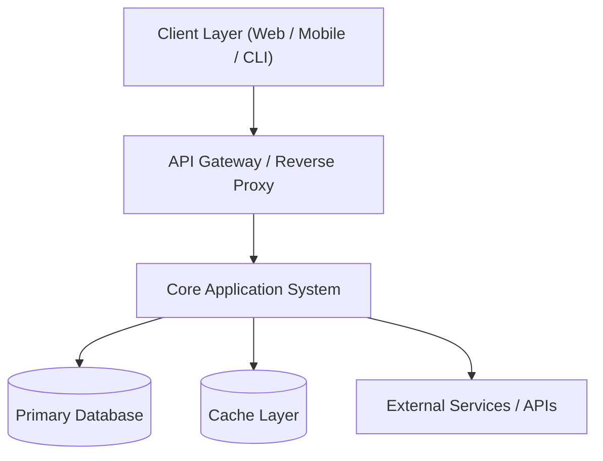

# Architecture Design Document: [System or Project Name]

## 1. Architecture Overview
Executive summary of the system, primary architectural style (e.g., Modular Monolith, Clean Architecture, Event-Driven), core runtime environment, and primary business and technical drivers.

## 2. Requirements & Architectural Drivers
- **Key Functional Drivers**: Core workflows and functional requirements dictating system design.
- **Quality Attributes (Non-Functional Requirements)**:
  - *Performance & Latency*: Expected response times (p95/p99) and throughput.
  - *Scalability*: Concurrent user expectations and data volume scaling.
  - *Availability & Reliability*: Target uptime, failure isolation, and recovery targets (RTO/RPO).
  - *Security & Compliance*: Authentication, access control, and regulatory boundaries.
- **Technical & Business Constraints**: Mandated technologies, platform constraints, timeline, and resource limits.

## 3. Architecture Style & Rationale
- **Selected Style**: `[e.g., Modular Monolith / Clean Architecture / Event-Driven Microservices]`
- **Rationale**: Detailed justification of why this pattern satisfies the architectural drivers.
- **Alternatives Considered**: Other architectural patterns evaluated and reasons for rejection.

## 4. System Context & External Boundaries
High-level system topology and external system boundaries.

## 5. Component & Module Decomposition

| Module Name | Primary Responsibility | Owned Entities | Dependencies |
|---|---|---|---|
| `[Module A]` | [Primary function and boundaries] | `[Entity 1]`, `[Entity 2]` | Database, [Module B] |
| `[Module B]` | [Primary function and boundaries] | `[Entity 3]` | Database, External Service |

## 6. Data Flows & Execution Lifecycles
Narrative walkthrough and sequence diagrams illustrating primary request and event flows:
1. Ingress and authentication.
2. Domain validation and business rule execution.
3. Persistence transaction boundaries.
4. Outbound event dispatch and client response formatting.

## 7. Technology Stack Selection & Evidence

| Layer | Selected Technology | Version | Rationale & Trade-offs |
|---|---|---|---|
| Runtime / Platform | [e.g., Node.js / Python / Go] | [Version] | [Rationale] |
| Framework | [e.g., Fastify / FastAPI] | [Version] | [Rationale] |
| Primary Database | [e.g., PostgreSQL] | [Version] | [Rationale] |
| Caching | [e.g., Redis] | [Version] | [Rationale] |
| Observability | [e.g., OpenTelemetry] | [Version] | [Rationale] |

## 8. Data & Persistence Architecture
- **Data Segregation & Ownership**: Boundary definitions for module data ownership.
- **Transaction Strategy**: Transaction boundaries, isolation levels, and atomicity guarantees.
- **Migration Strategy**: Schema evolution approach (e.g., expand-and-contract, backwards compatibility).

## 9. Security & Trust Architecture
- **Authentication**: Token format, validation, and session lifecycle.
- **Authorization**: Role-Based / Attribute-Based Access Control (RBAC/ABAC) policy.
- **Data Protection**: Encryption standards at rest and in transit, secret management (`.env` injection, zero committed secrets).

## 10. Reliability & Performance Engineering
- **Fault Tolerance**: Circuit breakers, rate limiters, retries with exponential backoff and jitter.
- **Concurrency & Resource Management**: Connection pool sizing, memory limits, and stateless horizontal scaling.

## 11. Deployment & Infrastructure View
- **Containerization & Hosting**: Container specs, orchestrator/hosting platform.
- **Configuration Management**: Runtime environment variable schema and validation.
- **CI/CD Integration**: Automated build, test, and deployment gating.

## 12. Architectural Decision Summary
List and link individual Architecture Decision Records:
- `\[ADR-001: Architecture Style Selection\](architecture-decisions/ADR-001.md)`
- `\[ADR-002: Primary Database Selection\](architecture-decisions/ADR-002.md)`

## 13. Risks, Trade-offs & Open Decisions
- **Technical Risks**: Identified architectural vulnerabilities and planned mitigations.
- **Accepted Trade-offs**: Intentional compromises made to achieve delivery goals.
- **Open Questions**: Unresolved technical or business decisions under active evaluation.
