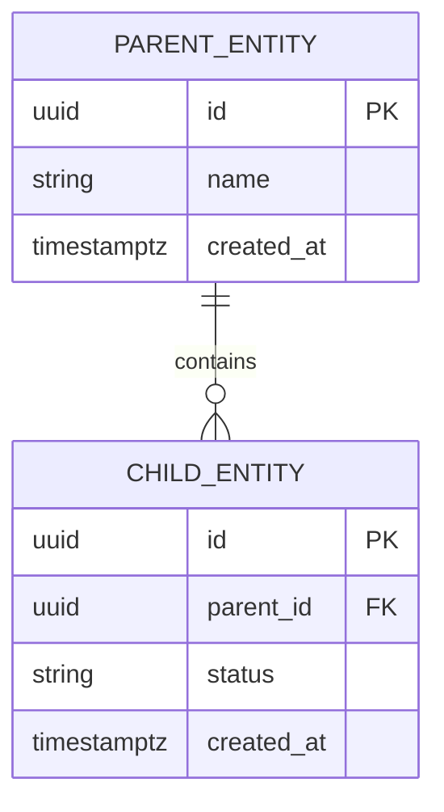

# Database Design Specification: [System or Module Name]

## 1. Design Overview
Summary of persistence requirements, selected database engine, architectural drivers, and core rationale.

## 2. Requirements, Constraints & Assumptions
- **Key Data Requirements**: Core domain entities, storage lifespan, and query expectations.
- **Engine & Version**: `[e.g., PostgreSQL 16+ / MySQL 8.0+ / SQLite 3.45+]`
- **Volume & Scaling Assumptions**: Initial storage volume, yearly growth estimates, and peak write/read throughput.
- **Isolation & Tenancy Model**: `[Single-tenant / Multi-tenant with row-level security / Schema-per-tenant]`.

## 3. Storage Paradigm Choice & Trade-offs
- **Selected Storage Engine**: `[Relational / Document / Key-Value / Time-Series]`
- **Rationale**: Detailed justification based on relational integrity, ACID guarantees, or schema flexibility.
- **Alternatives Considered**: Other storage paradigms evaluated and reasons for rejection.

## 4. Entity Definitions Table

| Entity Name | Primary Responsibility | Authoritative System of Record | Estimated Volume (Year 1) |
|---|---|---|---|
| `[table_a]` | [Core entity responsibility] | [System of Record] | [Estimated Row Count] |
| `[table_b]` | [Core entity responsibility] | [System of Record] | [Estimated Row Count] |

## 5. Relationships & Cardinality Table

| Parent Entity | Relationship | Child Entity | Cardinality | Deletion Action | Integrity Rules |
|---|---|---|---|---|---|
| `[parent_table]` | [has / owns / references] | `[child_table]` | 1:N / 1:1 / N:M | CASCADE / RESTRICT / SET NULL | [Referential integrity enforcement] |

## 6. Entity Relationship Diagram

## 7. Detailed Schema & Field Definitions

### Table: `[table_name]`
- **Purpose**: [Brief description of what this table stores]
- **Primary Key**: `id`

| Column Name | Data Type | Nullable | Default | Constraints | Description |
|---|---|---|---|---|---|
| `id` | `UUID` | No | `gen_random_uuid()` | PRIMARY KEY | Unique surrogate identifier |
| `[field_name]` | `VARCHAR(255)` | No | None | None | [Field business description] |
| `created_at` | `TIMESTAMPTZ` | No | `CURRENT_TIMESTAMP` | None | Row creation audit timestamp |
| `updated_at` | `TIMESTAMPTZ` | No | `CURRENT_TIMESTAMP` | None | Row modification audit timestamp |

## 8. Normalization, Constraints & Business Invariants
- **Normalization Level**: Target normal form (e.g., 3NF) and explicit justification for any intentional denormalization.
- **Check Constraints & Business Invariants**: Enforced checks (e.g., `CHECK (price >= 0)`, status enum validations).
- **Unique Constraints**: Business uniqueness rules spanning single or composite columns.

## 9. Query Patterns & Indexing Strategy

| Index Name | Target Table | Indexed Columns | Index Type | Target Query Pattern |
|---|---|---|---|---|
| `idx_[table]_[col]` | `[table]` | `([col])` | B-Tree / GIN / Hash | [Exact lookup / Range query / Filter] |

## 10. Transactions, Concurrency & Atomicity
- **Transaction Boundaries**: Workflows requiring atomic multi-table mutations.
- **Concurrency Control**: Optimistic locking (`version` column) or pessimistic locking (`SELECT FOR UPDATE`).
- **Isolation Level**: Required transaction isolation level (e.g., `READ COMMITTED`, `SERIALIZABLE`).

## 11. Migration & Evolution Strategy
- **Migration Methodology**: Migration framework and tooling `[e.g., Flyway, Prisma, Alembic]`.
- **Zero-Downtime Approach**: Expand-and-contract phase pattern for destructive schema changes.
- **Rollback Readiness**: Backward compatibility guidelines for deployed code during migration runs.
