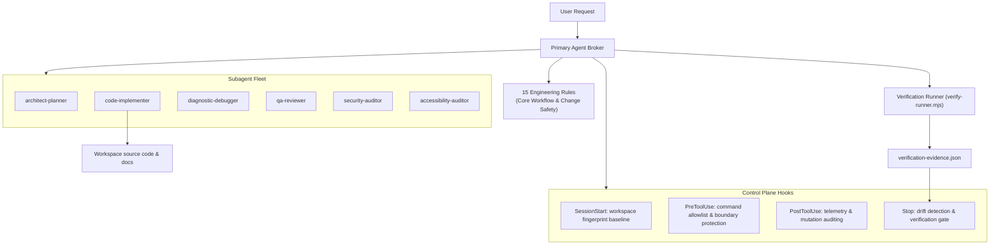

# operon-core

**A coordinated multi-agent engineering framework.** Specialized subagents work under a single Primary Broker, with lifecycle safety hooks and drift-resistant verification keeping every change controlled and auditable.


---

## Table of Contents

- [Overview](#overview)
- [Key Features](#key-features)
- [Architecture](#architecture)
- [Getting Started](#getting-started)
- [Subagent Fleet](#subagent-fleet)
- [Safety Control Plane](#safety-control-plane)
- [Using with Claude Code](#using-with-claude-code)
- [Repository Structure](#repository-structure)
- [Documentation](#documentation)
- [Contributing](#contributing)
- [License](#license)

---

## Overview

operon-core gives AI coding agents a shared set of rules, skills, templates, and safeguards so they can plan, implement, and review software changes consistently. It follows the **Primary Broker pattern**: one primary agent talks to the user and delegates focused work to specialized subagents, each with the minimum tool access its role needs.

The framework is host-neutral. Its hooks and policies are plain Node.js scripts, and an adapter is included for [Claude Code](#using-with-claude-code).

## Key Features

| Pillar | What it provides |
|---|---|
| **Operational rules** | 15 core rules covering workflow, change safety, security, architecture, testing, and more, plus 111 glob-activated language rules (21 language groups) adapted from ECC. Two core rules are always active through [`AGENTS.md`](AGENTS.md). |
| **Skills catalog** | 81 reusable skills, from requirements analysis and database design to threat modeling, load testing, and incident response, including 16 language review and 11 language build-fix skills adapted from ECC. |
| **Workflows** | 9 slash-command workflows (`/plan`, `/plan-prd`, `/feature-dev`, `/code-review`, `/pr`, `/build-fix`, `/test-coverage`, `/refactor-clean`, `/update-docs`) adapted from ECC and gated by the framework's safety rules. |
| **Specification templates** | 11 templates for PRDs, SRS documents, ADRs, database schemas, API contracts, test plans, and deployment runbooks. |
| **Subagent fleet** | 6 subagents with least-privilege tool access. Only one can modify files or run commands. |
| **Safety hooks** | Lifecycle hooks that fingerprint the workspace, gate shell commands against an allowlist, block path traversal, and require verification before a session ends. |
| **Documentation store** | A structured [`docs/`](docs/README.md) hierarchy for product, requirements, architecture, database, API, testing, and deployment documents. |

## Architecture



## Getting Started

### Prerequisites

- [Node.js](https://nodejs.org/) 21 or later (the test command relies on Node expanding a quoted glob)
- Git

### Installation

```bash
git clone https://github.com/Tayyabthecoder/operon-core.git
cd operon-core
```

There are no dependencies to install.

### Verify the framework

Check that all rules, skills, templates, documentation guides, subagent definitions, hooks, and Markdown links are consistent:

```bash
node .agents/scripts/verify-runner.mjs --profile framework-validator
```

Run the safety lifecycle test suite, which covers the hooks, boundary protection, the Claude Code adapter, and workspace fingerprinting:

```bash
node .agents/scripts/verify-runner.mjs --profile node-test -- ".agents/scripts/tests/*.mjs"
```

Each run records its results in a `verification-evidence.json` file in a per-workspace folder under your OS temp directory.

## Subagent Fleet

Definitions live in [`.agents/agents/`](.agents/agents/README.md).

| Subagent | Role | Access |
|---|---|---|
| `architect-planner` | Analyzes requirements, designs architectures, writes specifications, and breaks work into packages | Read-only |
| `code-implementer` | Makes source changes, fixes bugs, and runs migrations from approved specifications | Read, write, and sandboxed command execution |
| `diagnostic-debugger` | Investigates defects and regressions from evidence supplied by the Primary Agent | Read-only |
| `qa-reviewer` | Reviews test, lint, and typecheck evidence and audits diffs to give a quality-gate decision | Read-only |
| `security-auditor` | Threat modeling, vulnerability assessment, dependency and credential-exposure review | Read-only |
| `accessibility-auditor` | Accessibility audits, screen-reader and keyboard-navigation compliance review | Read-only |

All subagents run without inherited MCP tools, so their capabilities are exactly what their definition declares. They still inherit the project's rules and skills.

## Safety Control Plane

Hooks are registered in [`.agents/hooks.json`](.agents/hooks.json) and implemented in [`.agents/scripts/hooks/`](.agents/scripts/hooks/).

| Hook | Script | Purpose |
|---|---|---|
| `SessionStart` | `session-start.mjs` | Records a workspace fingerprint as the baseline for the session |
| `PreToolUse` (commands) | `pre-tool-safety.mjs` | Allows only exact-match commands, asks for confirmation on alternates, and denies command chaining and destructive operations such as forced `git clean`, `git reset --hard`, and force pushes |
| `PreToolUse` (files) | `pre-file-safety.mjs` | Blocks path traversal, UNC and device paths, and escaping junctions, and asks before touching sensitive files or control-plane assets |
| `PostToolUse` | `post-tool-safety.mjs` | Writes redacted audit entries that never include argument values |
| `Stop` | `stop-gate.mjs` | Compares the workspace against the baseline and blocks completion until verification evidence exists |

Behavior is configured in [`.agents/framework.config.json`](.agents/framework.config.json), including expected asset counts, stop-gate scope, and fingerprint exclusions.

## Using with Claude Code

The core hooks are host-neutral. [`claude-code.mjs`](.agents/scripts/adapters/claude-code.mjs) maps Claude Code's tool payloads onto them: `allow` defers to Claude Code's own permissions, `force_ask` becomes `ask`, and `deny` becomes `deny`.

Claude Code does not read `.agents/` on its own. Run the setup script once from the repository root (and again after changing subagents):

```bash
node .agents/scripts/adapters/setup-claude-code.mjs
```

It links `.claude/skills`, `.claude/commands`, and `.claude/rules` to the framework's skills, workflows, and rules (junctions on Windows, symlinks elsewhere), generates `.claude/agents/` from `.agents/agents/` with Claude Code tool names (`Read`, `Grep`, `Glob`; `Write`, `Edit`, `Bash` only for `code-implementer`), creates `.claude/settings.json` with the adapter hooks, and creates a `CLAUDE.md` containing `@AGENTS.md`. Existing user files are never overwritten; the script reports what to merge by hand. Check the wiring at any time with `--check`.

Enabling the hooks applies the framework's command policy to every Claude Code session in the repository, including chained shell commands being denied.

## Repository Structure

```plaintext
operon-core/
├── AGENTS.md                  # Master instructions and always-on core rules
├── CHANGELOG.md               # Release history
├── LICENSE                    # MIT License
├── README.md
├── docs/                      # Project documentation store
│   ├── api/                   # API specifications and contracts
│   ├── architecture/          # Architecture specs and ADRs
│   ├── database/              # Schemas and data dictionaries
│   ├── deployment/            # Runbooks and release checklists
│   ├── product/               # PRDs and user journeys
│   ├── requirements/          # Software requirements specifications
│   └── testing/               # Test plans and verification matrices
└── .agents/
    ├── framework.config.json  # Configuration and expected-counts manifest
    ├── hooks.json             # Lifecycle hook registrations
    ├── agents/                # 6 subagent definitions
    ├── plugins/               # Prototype plugins (experimental)
    ├── rules/                 # 15 core rules + 111 language rules
    ├── scratch/               # Temporary agent workspace (excluded from fingerprinting)
    ├── scripts/               # Hooks, adapters, tests, validator, and verification runner
    ├── skills/                # 81 reusable engineering skills
    ├── workflows/             # 9 slash-command workflows (adapted from ECC)
    └── templates/             # 11 specification and planning templates
```

## Documentation

- [`docs/README.md`](docs/README.md): index of the project documentation hierarchy
- [`.agents/agents/README.md`](.agents/agents/README.md): subagent architecture and the Primary Broker pattern
- [`.agents/plugins/README.md`](.agents/plugins/README.md): plugin structure (prototypes only)
- [`CHANGELOG.md`](CHANGELOG.md): release history, following [Keep a Changelog](https://keepachangelog.com/en/1.1.0/) and [Semantic Versioning](https://semver.org/spec/v2.0.0.html)
- [`THIRD_PARTY_NOTICES.md`](THIRD_PARTY_NOTICES.md): material adapted from ECC (`ecc-universal`, MIT) and its license

## Contributing

1. Read [`AGENTS.md`](AGENTS.md) and the rules in [`.agents/rules/`](.agents/rules/) before making changes.
2. Keep changes scoped. Avoid unrelated refactoring and unnecessary new files or dependencies.
3. Run both verification commands from [Getting Started](#getting-started) and make sure they pass.
4. Record notable changes in [`CHANGELOG.md`](CHANGELOG.md).

## License

Released under the [MIT License](LICENSE). Copyright © 2026 Muhammad Tayyab.
