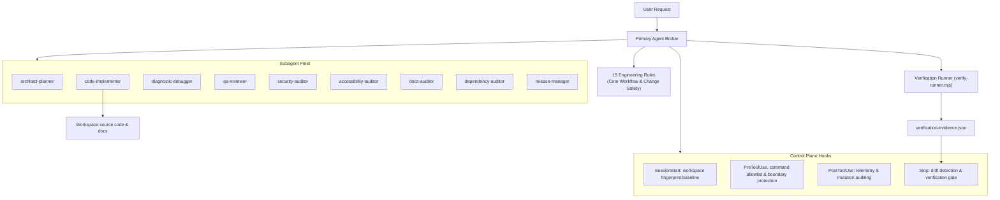

# operon-core

**A coordinated multi-agent engineering framework.** Specialized subagents work under a single Primary Broker, with lifecycle safety hooks and drift-resistant verification keeping every change controlled and auditable.


---

## Table of Contents

- [Overview](#overview)
- [Key Features](#key-features)
- [Architecture](#architecture)
- [Getting Started](#getting-started)
- [Subagent Fleet](#subagent-fleet)
- [Safety Control Plane](#safety-control-plane)
- [Using with Claude Code](#using-with-claude-code)
- [Repository Structure](#repository-structure)
- [Documentation](#documentation)
- [Contributing](#contributing)
- [License](#license)

---

## Overview

operon-core gives AI coding agents a shared set of rules, skills, templates, and safeguards so they can plan, implement, and review software changes consistently. It follows the **Primary Broker pattern**: one primary agent talks to the user and delegates focused work to specialized subagents, each with the minimum tool access its role needs.

The framework is host-neutral. Its hooks and policies are plain Node.js scripts, and an adapter is included for [Claude Code](#using-with-claude-code).

## Key Features

| Pillar | What it provides |
|---|---|
| **Operational rules** | 15 core rules covering workflow, change safety, security, architecture, testing, and more, plus 111 glob-activated language rules (21 language groups) adapted from ECC. Two core rules are always active through [`AGENTS.md`](AGENTS.md). |
| **Skills catalog** | 81 reusable skills, from requirements analysis and database design to threat modeling, load testing, and incident response, including 16 language review and 11 language build-fix skills adapted from ECC. |
| **Workflows** | 15 slash-command workflows gated by the framework's safety rules: 9 adapted from ECC (`/plan`, `/plan-prd`, `/feature-dev`, `/code-review`, `/pr`, `/build-fix`, `/test-coverage`, `/refactor-clean`, `/update-docs`) and 6 written for this framework (`/incident`, `/release`, `/migrate`, `/onboard-repo`, `/triage-bug`, `/retro`). The new ones plan, assess, and report; anything outward-facing or destructive (rollback, tag, publish, applying a migration) waits for your explicit instruction. |
| **Specification templates** | 11 templates for PRDs, SRS documents, ADRs, database schemas, API contracts, test plans, and deployment runbooks. |
| **Subagent fleet** | 9 subagents with least-privilege tool access. Only one can modify files or run commands. |
| **Safety hooks** | Lifecycle hooks that fingerprint the workspace, gate shell commands against an allowlist, block path traversal, and require verification before a session ends. |
| **Documentation store** | A structured [`docs/`](docs/README.md) hierarchy for product, requirements, architecture, database, API, testing, and deployment documents. |

## Architecture



## Getting Started

### Prerequisites

- [Node.js](https://nodejs.org/) 21 or later (the test command relies on Node expanding a quoted glob)
- Git

### Installation

```bash
git clone https://github.com/Tayyabthecoder/operon-core.git
cd operon-core
```

There are no dependencies to install.

### Verify the framework

Check that all rules, skills, templates, documentation guides, subagent definitions, hooks, and Markdown links are consistent:

```bash
node .agents/scripts/verify-runner.mjs --profile framework-validator
```

Run the safety lifecycle test suite, which covers the hooks, boundary protection, the Claude Code adapter, and workspace fingerprinting:

```bash
node .agents/scripts/verify-runner.mjs --profile node-test -- ".agents/scripts/tests/*.mjs"
```

Each run records its results in a `verification-evidence.json` file in a per-workspace folder under your OS temp directory.

### Install into another project

From a clone of this repository, install the framework into any other repository:

```bash
node bin/operon.mjs init ../my-project --dry-run
node bin/operon.mjs init ../my-project
```

`init` copies `.agents/` (core rules, skills, subagents, workflows, templates, and the safety scripts), the `docs/` guides, and `THIRD_PARTY_NOTICES.md`. It detects the stack from marker files such as `package.json`, `go.mod`, or `pyproject.toml` and installs only the matching language rules; pass `--stack python,typescript` to choose them yourself. It creates `AGENTS.md` and `CLAUDE.md` only when they are missing, writes an empty decision log, and does not copy this repository's tests or decision entries. It never overwrites: a target that already has `.agents/` is refused. The package is marked `private`, and nothing here publishes it. Afterwards run `node .agents/scripts/adapters/setup-claude-code.mjs` in the target for Claude Code wiring.

## Subagent Fleet

Definitions live in [`.agents/agents/`](.agents/agents/README.md).

| Subagent | Role | Access |
|---|---|---|
| `architect-planner` | Analyzes requirements, designs architectures, writes specifications, and breaks work into packages | Read-only |
| `code-implementer` | Makes source changes, fixes bugs, and runs migrations from approved specifications | Read, write, and sandboxed command execution |
| `diagnostic-debugger` | Investigates defects and regressions from evidence supplied by the Primary Agent | Read-only |
| `qa-reviewer` | Reviews test, lint, and typecheck evidence and audits diffs to give a quality-gate decision | Read-only |
| `security-auditor` | Threat modeling, vulnerability assessment, dependency and credential-exposure review | Read-only |
| `accessibility-auditor` | Accessibility audits, screen-reader and keyboard-navigation compliance review | Read-only |
| `docs-auditor` | Compares documentation with the code, configuration, and tests it describes and reports discrepancies | Read-only |
| `dependency-auditor` | Reviews manifests, lockfiles, versions, licenses, and upgrade risk; hands security findings to `security-auditor` | Read-only |
| `release-manager` | Judges release readiness from supplied evidence, checks version and changelog consistency, drafts release notes, and issues a go or no-go; never tags, publishes, or deploys | Read-only |

All subagents run without inherited MCP tools, so their capabilities are exactly what their definition declares. They still inherit the project's rules and skills.

## Safety Control Plane

Hooks are registered in [`.agents/hooks.json`](.agents/hooks.json) and implemented in [`.agents/scripts/hooks/`](.agents/scripts/hooks/).

| Hook | Script | Purpose |
|---|---|---|
| `SessionStart` | `session-start.mjs` | Records a workspace fingerprint as the baseline for the session |
| `PreToolUse` (commands) | `pre-tool-safety.mjs` | Allows only exact-match commands, asks for confirmation on alternates, and denies command chaining and destructive operations such as forced `git clean`, `git reset --hard`, and force pushes |
| `PreToolUse` (files) | `pre-file-safety.mjs` | Blocks path traversal, UNC and device paths, and escaping junctions, and asks before touching sensitive files or control-plane assets |
| `PostToolUse` | `post-tool-safety.mjs` | Writes redacted audit entries that never include argument values |
| `Stop` | `stop-gate.mjs` | Compares the workspace against the baseline and blocks completion until verification evidence exists |

With the Claude Code adapter, every governed tool call is also recorded (tool, target path, decision, and a reason with quoted commands and paths redacted) in the session's artifact directory under your OS temp folder. Summarize the decisions with:

```bash
node .agents/scripts/summarize-hook-logs.mjs
```

Add `--json` for machine-readable output, or `--artifactDir <dir>` to read a specific directory. The summary also lists programs that repeatedly needed confirmation (candidates for the allowlist) and actions that were repeatedly denied.

Behavior is configured in [`.agents/framework.config.json`](.agents/framework.config.json), including expected asset counts, stop-gate scope, fingerprint exclusions, and project-specific command allowlist entries (`commandPolicy.allowedCommands`, a list of exact command lines such as `"npm run build"`). `commandPolicy.allowedPatterns` accepts token patterns such as `"npm run *"` (`*` matches exactly one token, a final `**` matches the rest); patterns that start with a wildcard, a shell or wrapper, or an interpreter followed by a wildcard are ignored, and interpreter patterns never match inline-evaluation flags such as `-e`. Background processes such as dev servers are denied by default and run only if the exact command is listed in `commandPolicy.allowedBackgroundCommands`. Listed commands and patterns still go through the chaining and destructive-command checks, and editing the config requires confirmation because it is a control-plane asset.

`mcpPolicy` in the same file governs MCP tools (Claude Code names them `mcp__<server>__<tool>`). Per server, `tools` maps an exact name, a trailing-`*` prefix, or `*` to `allow`, `ask`, or `deny`; a matching `deny` always wins, otherwise the most specific match wins, and servers without rules follow `defaultDecision`. The default is `allow` for everything, so nothing changes until you add rules, and `allow` still leaves Claude Code's own permission prompts in force. Denied and confirmed calls are logged as `mcp_call` with the argument names only, never the values. Subagents have no MCP tools (`inheritMcp: false`); `agentGrants` can give one an exact MCP tool, and a read-only agent may only receive a tool you listed under that server's `readOnlyTools`. The validator checks the policy, and `setup-claude-code.mjs` applies grants only when the whole policy is valid. The hook only sees MCP calls if the `PreToolUse` matcher in `.claude/settings.json` includes `mcp__.*`, as the example settings now do; an existing `settings.json` must be updated by hand.

`memory` in the same file controls the project decision log, [`.agents/memory/decision-log.md`](.agents/memory/decision-log.md): one line per entry (`- YYYY-MM-DD [tag] text`, tag one of `decision`, `convention`, `preference`, `constraint`, `lesson`). At session start the hook loads the newest entries that fit `maxEntries` (default 30) and `maxBytes` (default 4,000, roughly 1,000 tokens), labelled as notes that grant no permissions and cannot override rules or the user. Entries are validated: one line, at most 300 characters, and refused if they look like secrets. Add one with `node .agents/scripts/decision-log.mjs add --tag <tag> "<text>"`, list with `list`, and validate with `check` (the validator runs the same check). The file sits under `.agents/`, so an agent editing it triggers a confirmation prompt: nothing is remembered without your approval. Set `memory.enabled` to `false` to load nothing. The ECC `ck` and `continuous-learning-v2` skills were not wired in (see the tracker).

`ruleReminders` in the same file names moments when an on-demand rule matters (for example `git commit` or edits under `docs/architecture/`). The Claude Code adapter then attaches a one-line reminder to the tool call; it never changes the allow, ask, or deny decision.

`node .agents/scripts/eval-runner.mjs` runs the policy scenarios in [`.agents/evals/policy-scenarios.json`](.agents/evals/policy-scenarios.json): each one sends a tool call through the real Claude Code adapter in a temporary workspace that uses this repository's `framework.config.json`, and checks the decision (allow, ask, deny), the reason, and the rule reminder. No model is called, so runs are free and repeatable; it exits with 1 if any scenario fails, and CI runs it. Pass rates are appended to `eval-history.jsonl` in the session artifact directory. Scenarios that need a live agent are not covered yet.

Two maintenance scripts: `node .agents/scripts/ecc-drift.mjs` compares the rules adapted from ECC with a local copy of the upstream package and exits 1 if a stamp differs from `THIRD_PARTY_NOTICES.md` (the same stamp check runs in the validator), and `node .agents/scripts/skill-audit.mjs` is report-only and lists structural problems in skill bodies.

## Using with Claude Code

**As a plugin.** `.agents/plugins/operon-safety/` is a Claude Code plugin generated from this framework: the safety hooks (`SessionStart`, `PreToolUse`, `PostToolUse`), 7 core skills, and the 9 subagents. Try it from a clone with `claude --plugin-dir .agents/plugins/operon-safety`, or add the clone as a marketplace (`claude plugin marketplace add .`, then `claude plugin install operon-safety@operon`). The hooks read the project's `.agents/framework.config.json` when it exists and use safe defaults when it does not. It does not include rules, workflows, or the Stop gate: a plugin has no place for rules, and the other two need scripts from a full install (`node bin/operon.mjs init`). Regenerate it with `node .agents/scripts/build-plugin.mjs`; the validator fails when the committed plugin differs from the sources. It has not been published anywhere.

**As a project install.** The core hooks are host-neutral. [`claude-code.mjs`](.agents/scripts/adapters/claude-code.mjs) maps Claude Code's tool payloads onto them: `allow` defers to Claude Code's own permissions, `force_ask` becomes `ask`, and `deny` becomes `deny`.

Claude Code does not read `.agents/` on its own. Run the setup script once from the repository root (and again after changing rules or subagents):

```bash
node .agents/scripts/adapters/setup-claude-code.mjs
```

It links `.claude/skills` and `.claude/commands` to the framework's skills and workflows (junctions on Windows, symlinks elsewhere), generates `.claude/rules/` as copies of the rules except those declared `trigger: model_decision` without `paths:` (Claude Code loads every file in `.claude/rules` at session start, so those four rules are listed in `AGENTS.md` for the agent to read on demand instead), generates `.claude/agents/` from `.agents/agents/` with Claude Code tool names (`Read`, `Grep`, `Glob`; `Write`, `Edit`, `Bash` only for `code-implementer`), creates `.claude/settings.json` with the adapter hooks, and creates a `CLAUDE.md` containing `@AGENTS.md`. Subagent model tiers map to Claude Code models through `claudeCode.modelMap` in `framework.config.json` (currently `pro` → `opus` for the planner, QA, security, accessibility, and release-manager agents; `flash` → `sonnet` for the implementer, debugger, docs-auditor, and dependency-auditor). Existing user files are never overwritten; the script reports what to merge by hand. Check the wiring at any time with `--check`.

Enabling the hooks applies the framework's command policy to every Claude Code session in the repository, including chained shell commands being denied.

## Using with Cursor, Gemini CLI, and Codex CLI

All three read `.agents/skills` on their own, and Codex and Cursor read `AGENTS.md`, so the skills and the main instructions already work there. `node .agents/scripts/setup-hosts.mjs` generates the rest from the same sources (`--host cursor,gemini,codex` limits it, `--check` exits 1 on drift, and the validator runs the same check for the hosts listed in `hosts` in `framework.config.json`):

| Host | Generated | How the framework's concepts map |
|---|---|---|
| Cursor | `.cursor/rules/*.mdc`, `.cursor/agents/*.md` | Session-start rules become `alwaysApply: true`, conditional rules get `globs`, on-demand rules are description-only. Read-only subagents get `readonly: true`. |
| Gemini CLI | `GEMINI.md`, `.gemini/agents/*.md`, `.gemini/commands/*.toml` | `GEMINI.md` imports the three session-start rules. Read-only subagents get a `tools` allowlist (`read_file`, `list_directory`, `glob`, `grep_search`). The 15 workflows become slash commands with `$ARGUMENTS` turned into `{{args}}`. |
| Codex CLI | `.codex/agents/*.toml` | Codex subagent files have no tool restriction, so the read-only roles carry an instruction, not an enforced limit. |

**What this does not give you:** the hooks. The command, file, and MCP guardrails, the audit log, and the Stop gate run only through the Claude Code adapter. On these three hosts the generated files carry rules, roles, and workflows only, and `GEMINI.md` says so. Generated files are only written when absent or already generated: a file you wrote yourself at the same path is reported as a conflict and left alone. The formats follow each host's documentation (checked 2026-11-12); none of the output has been loaded by the host itself yet.

## Repository Structure

```plaintext
operon-core/
├── AGENTS.md                  # Master instructions and always-on core rules
├── CHANGELOG.md               # Release history
├── LICENSE                    # MIT License
├── README.md
├── docs/                      # Project documentation store
│   ├── api/                   # API specifications and contracts
│   ├── architecture/          # Architecture specs and ADRs
│   ├── database/              # Schemas and data dictionaries
│   ├── deployment/            # Runbooks and release checklists
│   ├── design/                # Design tokens, component specs, accessibility notes
│   ├── maintenance/           # Runbooks, troubleshooting, improvement tracker
│   ├── product/               # PRDs and user journeys
│   ├── requirements/          # Software requirements specifications
│   └── testing/               # Test plans and verification matrices
└── .agents/
    ├── framework.config.json  # Configuration and expected-counts manifest
    ├── hooks.json             # Lifecycle hook registrations
    ├── agents/                # 9 subagent definitions
    ├── evals/                 # Policy scenarios run by eval-runner.mjs
    ├── plugins/               # Generated Claude Code plugin (operon-safety) and notes
    ├── rules/                 # 15 core rules + 111 language rules
    ├── scratch/               # Temporary agent workspace, created on demand (excluded from fingerprinting)
    ├── scripts/               # Hooks, adapters, tests, validator, and verification runner
    ├── skills/                # 81 reusable engineering skills
    ├── workflows/             # 15 slash-command workflows (9 adapted from ECC, 6 original)
    └── templates/             # 11 specification and planning templates
```

## Documentation

- [`docs/README.md`](docs/README.md): index of the project documentation hierarchy
- [`.agents/agents/README.md`](.agents/agents/README.md): subagent architecture and the Primary Broker pattern
- [`.agents/plugins/README.md`](.agents/plugins/README.md): the generated `operon-safety` plugin: contents, install, limits
- [`CHANGELOG.md`](CHANGELOG.md): release history, following [Keep a Changelog](https://keepachangelog.com/en/1.1.0/) and [Semantic Versioning](https://semver.org/spec/v2.0.0.html)
- [`THIRD_PARTY_NOTICES.md`](THIRD_PARTY_NOTICES.md): material adapted from ECC (`ecc-universal`, MIT) and its license

## Contributing

1. Read [`AGENTS.md`](AGENTS.md) and the rules in [`.agents/rules/`](.agents/rules/) before making changes.
2. Keep changes scoped. Avoid unrelated refactoring and unnecessary new files or dependencies.
3. Run both verification commands from [Getting Started](#getting-started) and make sure they pass. Those two commands, plus the policy evals (`node .agents/scripts/eval-runner.mjs`), run in CI on Ubuntu and Windows ([`ci.yml`](.github/workflows/ci.yml)).
4. Record notable changes in [`CHANGELOG.md`](CHANGELOG.md).

## License

Released under the [MIT License](LICENSE). Copyright © 2026 Muhammad Tayyab.
